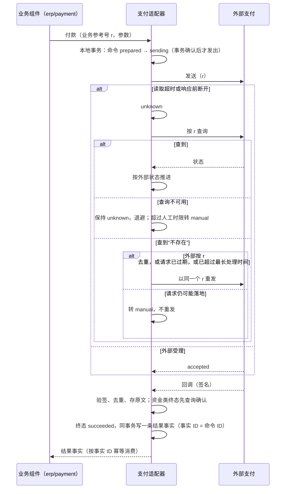

# 外部集成、回调与对外副作用

系统要对外做事（付款、提交电子发票、发起电子签、发消息、交给物流），也要接收外部的通知（支付结果、银行回单、签署完成）与外部系统的调用（客户自己的系统读写数据）。外部世界不参加我们的事务。本页回答：

1. 一次对外操作的应答丢了，怎样既不重复执行、也不漏掉结果？
2. 外部回调可能伪造、重复、乱序、丢失，怎样把它变成可靠的业务事实？
3. 通知与打印这两类对外输出，内容由谁授权，结果怎样表示？
4. 客户的系统怎样调用我们、订阅我们的变化，凭据、幂等、版本与配额怎样约定？

依据的决定：D29（已确认业务的后续处理以受限服务身份执行）、D47（收付款独立于核销与总账，回调不等于到账）、D49（税计算与电子开票分别选配，提交成功不等于完成）、D68（基础组件不同步调用业务组件）、D73（物流承运与电商平台是远期的集成族）。

## 方案比较

| 路线 | 判断 |
| --- | --- |
| **采用**：每个外部系统一个适配器；对外操作是持久的“对外命令”记录，结果未知是一等状态，先查询再决定是否重发；回调只是线索，资金类事实经查询、或声明为权威的签名终态确认后才发出；每日对账兜底 | 应答丢失、重复与乱序回调、伪造回调、适配器替换都有确定的处理；外部系统的模型不进入业务组件 |
| 在用户请求中同步调用外部系统，并直接更新业务状态 | 简单，但外部超时让用户请求失败或挂起，结果未知时只能猜 |
| 超时后直接重试 | 外部不按我们的参考号去重时，会重复付款（参考模型的“不查询就重试”坏变体） |
| 收到回调就当作事实 | 伪造或未验证的回调会产生虚假的到账（参考模型的“信任未签名回调”坏变体）；回调丢失则事实永远不出现 |

## 适配器与业务权威

| 角色 | 拥有 | 不做 |
| --- | --- | --- |
| 业务组件（收付款、出账、销售、物流等） | 业务单据与业务状态；决定何时对外操作 | 不直接调用外部系统；外部系统的类型与状态码不出现在业务组件中 |
| 适配器（`integration/*`） | 对外命令记录、外部协议、回调接收、查询、对账材料 | 不决定业务结论（D47：支付适配器不是收付款业务的权威） |
| 财务 | 应收应付、核销、总账 | 只接受业务组件发出的可靠事实（[协议 05](05-billing-settlement-and-costing.md)） |

适配器是独立组件，按 BrickKit 的组件规则单独运行；业务组件经契约调用它。同一类外部能力的多个适配器（多家支付、多种 IM、多家承运商）按能力声明选择或并存。

## 对外命令

### 记录

业务组件请求适配器执行一次对外操作时，适配器在本地事务中写一条对外命令，然后由工作项（[协议 01](01-background-work.md)）发送。业务组件的请求以“业务组件 + 业务参考号”幂等，重复请求返回同一条命令。

| 字段 | 说明 |
| --- | --- |
| 命令 ID | 适配器生成 |
| 业务参考号 | 业务组件给出，同时作为发给外部的外部单号或幂等键；重发时不变。取不复用的身份（业务记录的身份或命令身份，UUIDv7），不用单号或库内序列：数据库恢复后单号与序列会被再次分配，外部会把新付款当作旧付款的重试（[协议 14 的库内计数与纪元](14-data-foundations.md#库内计数与纪元)）。外部要求人可读的单号时，另作显示字段。切换或恢复后的外部对账同时比较参数摘要 |
| 操作与参数摘要 | 按[安全 09a 的规范编码](security/09a-encoding-and-records.md#规范编码与摘要)计算；同一参考号、不同参数的请求被拒绝 |
| 外部身份 | 外部系统返回的单号 |
| 状态 | 见下表 |
| 尝试记录 | 每次发送的时间、分类结果、耗时、外部响应的摘要 |
| 请求时限 | 外部支持时，请求携带的过期时刻 |

### 状态

| 当前状态 | 事件 | 结果状态 | 说明 |
| --- | --- | --- | --- |
| （无） | 业务组件请求 | `prepared` | 已记录，未发送 |
| `prepared`、`retry_wait` | 整套恢复的第 7 步：没有匹配上外部记录，且外部不去重或已超过去重保留期（[协议 15 的第 7 步：外部对账](15-backup-and-recovery.md#第-7-步外部对账)） | `unknown` | 它可能在恢复点之后已经发出；恢复期间适配器只查询，不发送 |
| `prepared`、`retry_wait` | 工作项认领 | `sending` | 转入 `sending` 的事务在发出之前提交（高可用部署中全部写入同步提交，D66：外部不按幂等键去重时，这个事务确认后才发出） |
| `sending` | 请求肯定没有被外部处理（连接失败、明确的限流） | `retry_wait` | 退避后再发 |
| `sending` | 请求可能已被处理（读取超时、网关错误、响应前断开） | `unknown` | 按“结果未知时”处理 |
| `sending` | 认领者失效（租约到期、进程崩溃），无法判断请求是否已发出 | `unknown` | 接管者不重发，按“结果未知时”处理（[协议 01](01-background-work.md) 的认领后检查） |
| `sending`、`unknown` | 外部受理，结果未终结 | `accepted` | 等回调或查询得到终态 |
| `accepted` | 超过适配器声明的终结时限仍没有终态（回调丢失） | `accepted` | 主动查询；没有查询能力或查询持续不可用，超过人工时限转 `manual` |
| `sending`、`unknown`、`accepted` | 外部终态（经查询或权威的签名回调确认） | `succeeded` 或 `failed` | 终态，不再改变 |
| `sending`、`unknown` | 外部明确拒绝（参数错误、账户无效），重试也一样 | `rejected` | 终态；转为业务错误 |
| `unknown` | 查询确认“不存在”，且之前的请求再也不可能落地 | `sending` | 沿用同一个业务参考号重发 |
| `unknown` | 查询确认“不存在”，但之前的请求仍可能落地 | `manual` | 不自动重发 |
| `unknown`、`accepted` | 超过人工时限，或外部不提供可靠的确认手段 | `manual` | 等待人工确认 |
| `manual` | 有权限的人登记核实结果（附依据） | `succeeded`、`failed`、`rejected`，或核实为“未发生”后 `sending`（沿用同一个业务参考号） | 写审计；资金类终态同样写一条结果事实 |
| 终态 | 任何回调或查询结果 | 不变 | 终态吸收后续一切结果，不倒退 |

`unknown` 是一等状态，不是失败。终态不倒退（参考模型的“回调后到先写”坏变体会让已成功的命令退回处理中）。更正（退款、作废发票）是一条新的对外命令，引用原命令，不改写原命令。

### 结果未知时

1. 用业务参考号向外部查询。
2. 查到记录：按外部的状态推进。
3. 查询不可用：保持 `unknown`，退避后再查；超过告警阈值告警，超过人工时限转 `manual`。
4. 查询确认“不存在”：只有在**之前的请求再也不可能落地**时才可以重发，并沿用同一个业务参考号。成立的条件是以下之一：
   - 外部按业务参考号或幂等键去重（重复请求返回原结果），且距**最早一次发送**未超过适配器声明的去重保留期，在实际重发的时刻也未超过——这时重发是安全的。外部按最后一次使用续期的，适配器在能力声明中写明，按最后一次发送计；没有写明的一律按首次使用计（常见的幂等键按创建时刻过期，中间的重发不续期）；
   - 请求携带了外部会执行的过期时刻，且已过期；
   - 外部声明了最长处理时间，且距最后一次发送已超过它。

   都不满足时，不自动重发，转 `manual`。在请求仍可能落地时把“查不到”当作“没有执行”，是重复付款的来源（参考模型的“查不到即视为未执行”坏变体）。

结论：外部可能不去重时，对外命令绝不在“请求仍可能落地”时重发；资金类终态只在查询或权威的签名回调确认后形成事实，每条命令只有一条事实（EI01–EI04、EI10、EI29）。

### 适配器的能力声明

每个适配器声明外部系统实际提供的能力，业务组件与本协议据此选择行为：

| 能力 | 缺少时的后果 |
| --- | --- |
| 按业务参考号或幂等键去重，带去重保留期（`dedupe_window`）与计期起点（首次使用或最后使用；一致性套件按外部的实际语义验证） | 结果未知时只能依靠查询与时限；更多命令进入 `manual`；超过去重保留期的重发按“不去重”对待 |
| 按业务参考号查询 | 结果未知只能等回调或对账，或转人工 |
| 请求的过期时刻 | 依靠声明的最长处理时间 |
| 签名回调；回调中的终态是否权威 | 回调只能触发查询 |
| 部分退款、部分收款 | 业务组件不提供该操作 |
| 对账文件或对账接口 | 只能逐笔查询；发现差异变慢 |

声明与实际不符（例如声明去重、外部实际不去重）是适配器的缺陷；一致性套件对每个适配器用模拟的外部服务验证它的声明。

## 入站回调

回调由适配器接收，按以下顺序处理：

1. **验证来源**：按外部的签名方案验证（HMAC 或非对称签名），对原始字节验签，先检查时间戳窗口；验证失败直接丢弃并计数，不进入后续步骤。
2. **去重**：按外部的事件 ID（没有时按“外部单号 + 状态 + 外部时间”）去重；去重记录的保留时间长于外部的重试窗口。
3. **持久化原始报文**：写入适配器的回调表，敏感字段加密；保留期按纠纷周期。
4. **立即返回成功**：处理异步进行；处理不了的报文（关联不到命令）进入隔离区并告警，不返回错误让对方无限重试。
5. **关联与推进**：按外部单号或业务参考号关联对外命令；状态只沿“受理 → 终态”前进。
6. **确认资金类终态**：对资金、税务等事实，回调只是线索。适配器用查询确认终态，或者外部明确声明它的签名回调中的终态是权威的（能力声明），才把命令推进为终态。

回调的入口经边缘路由暴露到外部可达的地址，与用户接口分开路由，不需要用户身份，但有签名、限速与大小限制。客户的部署无法从外部到达时，适配器以“只查询”模式运行：按受理后的预期时间主动查询。

## 业务事实

命令进入终态时，适配器在同一事务中写出一条结果事实（发件表），以命令 ID 为事实 ID，每条命令只写一次（参考模型的“每个回调一条事实”坏变体会重复记账）。业务组件按事实 ID 幂等消费，再按自己的规则形成业务事实，例如收付款组件确认“已到账”后，再向财务发出收款事实（协议 05）。

| 外部结果 | 业务含义 |
| --- | --- |
| 受理 | 不是到账、不是开票完成；只表示外部接受了请求 |
| 成功 | 可以形成业务事实（到账、发票被税务系统接受、签署完成） |
| 失败或拒绝 | 业务组件决定重新发起（新的业务参考号）、换通道或通知人工 |
| `manual` | 业务状态显示“结果待确认”，不进入下游 |

已经完成的外部事实不会因为本地恢复、撤销请求而自动回退；恢复与对账不能盲目再执行（D47）。

## 对账

- 适配器每日取得外部的对账材料（对账文件或接口），按业务参考号与外部单号逐条比对数量、金额与状态。
- 取数窗口前后多取一段时间；只比对截止时刻之前足够久的记录，在途的留到下一轮。
- 差异分三类：我方有外部无、外部有我方无（漏收回调）、双方都有但不一致。状态类的差异经查询自动修正（同样只沿终态方向）；涉及金额的差异生成差异单，人工处理，不自动改账。
- 对账结果与差异数有指标与告警。

## 凭据与出站网络

- 每个外部账户的凭据（API 密钥、证书、回调签名密钥）是密钥引用（`${NAME}` 或文件），由适配器的配置持有，不写日志，不进入事件或审计的正文。
- 回调签名密钥轮换时，新旧两个同时有效一段时间；出站凭据的轮换按外部支持的方式先加后删。
- 出站请求经受控的出口：目标地址在允许列表中；银行等要求双向 TLS 时，客户端证书同样是密钥引用。
- 凭据的轮换步骤与客户版本清单在[协议 19](19-config-secrets-registries-release.md)统一。

## 通知

通知是对外输出的一种：`infra/notification` 负责协调，IM、邮件、短信等渠道成员负责投递。

### 意图

业务组件（或流程管理方）发出通知意图，不直接调用渠道：

| 字段 | 说明 |
| --- | --- |
| 意图 ID | 发送方生成；以它去重 |
| 类别 | 例如审批待办、到期提醒、安全提醒、对外通信（催款、对账单、单据外发）、营销；类别决定能否退订与默认渠道 |
| 收件人 | 人或岗位的身份，或伙伴联系人的引用；不是渠道账号 |
| 内容 | 模板 ID 与参数；默认是“门铃式”：标题与指向系统内页面的链接 |
| 敏感内容 | 只有发送方声明“已按该收件人的字段资格计算”时，才可以带业务字段 |
| 优先级与时效 | 过期未投递的意图不再投递 |
| 动作令牌 | 可选；所属组件为收件人签发的一次性动作令牌（见下文的交互按钮） |

通知不授予权限：链接打开时，系统按收件人当前的权限再检查；通知里能看到的内容，不超过收件人在系统中能看到的内容。

### 路由与投递

- 通知组件在投递时解析收件人：岗位展开为当前的持有人；人对应的渠道账号由渠道成员维护（从身份与员工信息同步）；没有渠道账号时退回站内消息。伙伴联系人的引用，投递时按 `mdm/partner` 的正式联系人解析（只解析发起方在数据范围内可见的伙伴），经邮件、短信等外部渠道投递。
- 外部地址的投递抑制（退信、退订）归通知组件，是唯一的一份；营销同意是联系人的属性，归 `mdm/partner`，营销组件只读它，不另存。
- 用户的偏好按类别与渠道设置；必须送达的类别（安全提醒、法律通知）不能退订。免打扰时段与摘要合并按偏好执行。
- 每次投递是渠道成员的一条对外命令，状态同上；渠道不能确认送达时，状态停在“已发送”，不写成“已送达”。
- **交互按钮**（例如在 IM 里点“同意”）只是一次动作入口（D68）：
  - **签发**：所属组件（例如审批的流程管理方）在建任务或分配给新处理人时，为该处理人签发一次性的动作令牌：随机的不透明值，所属组件只保存摘要；绑定所属组件（受众）、任务、处理人、任务版本与允许的动作；不绑定某一个渠道（投递时选哪个渠道由通知组件按偏好决定，所属组件事先不知道），只要求回调来自部署中登记的渠道适配器。重分配、升级或任务新版本使旧令牌失效；代理人与升级对象不是令牌绑定的处理人，用自己的令牌或在待办中处理。
  - **传递**：令牌经通知意图放进消息卡片，按秘密处理（[协议 19](19-config-secrets-registries-release.md#密钥)）：不进日志；通知组件与渠道适配器只在投递完成前保留它，之后只留摘要。提醒由所属组件签发新令牌并发新的通知意图（之前的令牌继续有效到截止，任一令牌被使用后其余随任务完成而失效）；截止后的提醒与升级通知不带按钮。
  - **回调**：渠道适配器验证渠道的回调签名，把渠道用户映射到平台主体，在**自己的事件主题**上发布“某主体对某令牌执行了某动作”。所属组件只订阅部署中登记的渠道适配器的主题，并按安全 02 核对发布者的服务身份与主题相符。
  - **执行**：所属组件核对令牌（摘要存在、未过期、受众是自己、处理人等于事件中的主体、动作允许），再按自己的检查执行（审批按[协议 09 的决定的提交](09-approval-and-workflow.md#决定的提交)）。同一个令牌、同一个动作再次到达，返回第一次的结果（幂等，与协议 09 的重试一致）；同一个令牌的不同动作被拒绝。
  - **回显**：所属组件把结果写成通知意图，由通知组件更新原卡片（已处理、处理结果，或被拒绝的原因）。
  - 渠道成员与通知组件都不记录决定，也不需要知道所属组件的地址。

### 失败与积压

- 渠道不可用时，意图留在队列中按时效等待；超过时效丢弃并计数，必须送达的类别转站内消息并告警。
- 每个收件人的发送有速率上限，超出时合并为摘要。

## 打印与渲染

`infra/print` 是纯渲染服务：模板 + 数据 → PDF 或 ZPL 字节流，不读业务数据，不判断业务规则。

- **数据由调用方提供，并已按调用者的权限与字段资格处理**。渲染服务没有数据访问权。
- 模板有 ID、版本与摘要；正式单据的渲染记录模板版本。客户修改模板产生新版本，不改旧版本。
- 渲染是确定性的：字体随模板版本固定；模板不能访问网络或文件系统；时间、语言、数字格式由调用方传入；每次渲染有时间、内存与输出大小上限。
- 正式单据（发票、对账单）的输出由调用方保存为附件（[协议 12](12-attachments-and-object-storage.md)），记录模板版本与数据摘要；重打标为副本，并由调用方计数。
- 打印到客户现场的打印机（标签机等）是一种投递渠道，由现场打印代理接收，按对外命令处理；渲染服务本身不连接打印机。

## 开放接口

客户自己的系统与第三方通过开放接口调用我们。

| 方面 | 约定 |
| --- | --- |
| 调用方身份 | 每个集成是一个服务主体（[安全 02](security/02-trusted-identity-and-attributes.md)），有自己的凭据（OAuth 2.0 客户端凭据或双向 TLS）；授权与人一样用完整授予，管理员按最小范围授予 |
| 写入幂等 | 写接口要求幂等键；服务端保存“幂等键 + 请求指纹（安全 09a 的规范摘要）+ 结果”；同键同指纹返回原结果，同键不同指纹返回冲突 |
| 版本 | 主版本在路径中；同一主版本内只追加字段与操作；弃用有公告与期限 |
| 配额与限速 | 按集成设置；超出返回限流并给出重试时间；配额与使用量可以查询 |
| 长操作 | 返回操作资源，调用方查询进度与结果；结果按调用方当前的权限交付（D29） |
| 列表 | 游标分页（[协议 14](14-data-foundations.md#列表游标排序与筛选)） |
| 变化订阅 | 默认提供事件流：按游标顺序读取，只含调用方授权范围内的事件，保留期见参数表；只能接收推送的调用方可以订阅 Webhook |
| Webhook | 门铃式（事件 ID、类型、资源与版本、游标），不带业务字段；签名含时间戳；至少一次、不保证顺序；投递由发件表驱动，每个订阅独立排队与限并发；连续失败后停用并通知；订阅绑定集成的凭据，凭据吊销或权限收窄后随之停止或收窄 |
| 回调地址安全 | 只允许 HTTPS；云上部署只允许公网地址，私有化部署用客户给出的允许列表；每次投递前解析并检查地址；不跟随重定向；经出站代理 |

## 适配器的替换与在途命令

- 新的对外命令交给新适配器；在途命令留在原适配器中完成：原适配器以“只查询与接收回调”的方式继续运行，直到它的命令全部进入终态或转人工。
- 对账在过渡期覆盖两个适配器。
- 渠道成员替换时，收件人的渠道账号映射由新成员重新建立；没有映射的人退回站内消息。

## 参数起始值

| 参数 | 起始值 |
| --- | --- |
| 连接超时 | 3 秒 |
| 读取超时 | 10 秒（按外部的处理时间调整） |
| 可重试失败的退避 | 1 分钟起，每次翻倍，单次上限 1 小时 |
| `unknown` 告警 | 1 小时 |
| `unknown` 转人工 | 24 小时 |
| 回调验签的时间窗口 | 5 分钟 |
| 回调去重保留 | 30 天 |
| 回调原始报文保留 | 180 天 |
| 对账 | 每日；取数窗口前后各多 1 小时；在途截止 1 小时 |
| 开放接口幂等记录保留 | 24 小时 |
| 事件流保留 | 30 天 |
| Webhook 投递 | 超时 10 秒；24 小时内最多重试 8 次；连续失败 3 天停用 |
| 通知意图的默认时效 | 24 小时；审批类随任务截止 |
| 一次性动作令牌的有效期 | 随任务截止，最长 7 天；使用一次即失效 |

## 参考模型

[对外命令模型](../../work/checks/22-external-commands.py)（种子 20261013，3,000 次运行）：外部服务**不**按参考号去重（最坏的情况）；请求与应答随机丢失，请求可以在发送后最多 D 个时刻内才落地执行；回调随机重复、延迟、乱序；攻击者注入未签名的回调；外部的查询接口随机不可用。

| 检查 | 结果 |
| --- | --- |
| 外部对每条命令至多执行一次 | 成立 |
| “成功”事实只为外部确实执行并成功的命令发出 | 成立 |
| 每条命令至多一条事实 | 成立 |
| 终态不倒退 | 成立 |
| 外部可达、在途请求落定之后，每条命令都进入终态并与外部一致 | 成立 |

5 个坏变体全部被发现：不查询就重试、信任未签名的回调、回调后到先写、每个回调一条事实、查不到即视为未执行。“每个回调一条事实”只有同时绕过终态检查时才会被发现（终态吸收本身挡住了重复回调）；模型按这样构造。模型不是 SDK、适配器或真实外部服务的运行结果；通知、打印、开放接口与一次性动作令牌不在模型中。

## 独立预期

| 编号 | 场景 | 固定预期 |
| --- | --- | --- |
| EI01 | 付款请求读取超时 | 命令为 `unknown`；先查询，不直接重发 |
| EI02 | 查询不可用 | 保持 `unknown`，退避再查；超过时限转人工 |
| EI03 | 查询“不存在”，外部不去重、没有过期时刻、没有声明最长处理时间 | 不自动重发，转人工 |
| EI04 | 查询“不存在”，外部按参考号去重 | 以同一个参考号重发 |
| EI05 | 同一业务参考号、不同金额的请求 | 拒绝 |
| EI06 | 未签名或签名错误的回调声称已支付 | 丢弃并计数；不产生事实 |
| EI07 | 同一回调重复到达 | 只处理一次 |
| EI08 | “处理中”回调晚于“成功”回调到达 | 状态保持成功 |
| EI09 | 回调关联不到任何命令 | 进入隔离区并告警；仍返回成功 |
| EI10 | 签名有效的成功回调，外部未声明回调终态为权威 | 查询确认后才产生事实 |
| EI11 | 回调丢失 | 主动查询或对账发现终态 |
| EI12 | 外部已受理 | 不是到账；不向财务发事实 |
| EI13 | 成功后需要退款 | 新的对外命令引用原命令；原命令不变 |
| EI14 | 对账发现金额不一致 | 生成差异单人工处理，不自动改账 |
| EI15 | 对账时有刚发出的请求 | 留到下一轮，不算差异 |
| EI16 | 回调签名密钥轮换 | 过渡期新旧密钥都有效 |
| EI17 | 客户部署无法从外部到达 | 适配器以只查询模式运行 |
| EI18 | 审批通知的收件人已不在岗位 | 投递时按当前的持有人解析 |
| EI19 | 通知链接被转发给无权限的人 | 打开时按当前权限检查，拒绝 |
| EI20 | 在 IM 里点“同意” | 渠道适配器在自己的主题上发布；所属组件核对发布者、令牌的受众、处理人与动作后，按协议 09 检查并执行；同一令牌同一动作再次到达返回原结果，不同动作被拒绝；结果回显到原卡片 |
| EI21 | 用户退订安全提醒 | 不允许 |
| EI22 | 渠道无法确认送达 | 状态为“已发送”，不写成“已送达” |
| EI23 | 打印的数据含调用者无权查看的字段 | 调用方在交给渲染服务前已掩码；渲染服务不取数据 |
| EI24 | 客户修改发票模板后重打旧发票 | 按原模板版本渲染，标为副本 |
| EI25 | 开放接口同一幂等键、不同的请求体 | 返回冲突 |
| EI26 | 集成凭据被吊销 | 接口拒绝；它的 Webhook 订阅停止 |
| EI27 | Webhook 回调地址解析到内网地址 | 拒绝投递（私有化部署按允许列表） |
| EI28 | 更换支付适配器时有在途付款 | 在途命令在原适配器完成；新命令走新适配器；对账覆盖两者 |
| EI29 | 高可用部署中，不按幂等键去重的付款转入 `sending` 后主库立刻坏掉 | 该事务已同步到备库才发出；切换后看到 `sending`，按“结果未知时”先查询，不重发 |
| EI30 | 付款处于 `sending` 时适配器进程崩溃，租约到期 | 接管者转 `unknown` 并查询，不重发 |
| EI31 | 外部受理后回调丢失，一直停在 `accepted` | 超过终结时限后主动查询；没有查询能力时超过人工时限转 `manual` |
| EI32 | 另一个组件在自己的主题上伪造“某人对某令牌同意”的事件，或通知组件转存的令牌被拿去兑现 | 所属组件只认登记渠道适配器的主题与发布者，令牌绑定任务、处理人与版本（不绑定渠道）；伪造的被拒绝；通知组件投递后只留摘要 |
| EI33 | 任务被重分配后，原处理人点旧卡片上的按钮 | 旧令牌已失效，拒绝；卡片回显“任务已转给他人” |
| EI34 | 用户把审批通知的偏好从钉钉改为企业微信 | 令牌不绑定渠道；企业微信卡片上的按钮照常可用，回调来自登记的渠道适配器 |
| EI35 | 截止前发出提醒 | 所属组件签发新令牌；原卡片与提醒卡片的按钮都可用，任一个使用后任务完成，其余失效 |
| EI36 | 外部的幂等键保留 24 小时，结果未知的付款 3 天后才查询，查询确认“不存在” | 已超过去重保留期，不按“去重”重发；按过期时刻或最长处理时间判断，不能判断的转 `manual` |
| EI37 | 财务对客户发送对账单，收件人是伙伴联系人的引用 | 通知组件按伙伴的正式联系人解析，经邮件投递；退信记入通知组件的投递抑制 |
| EI38 | 营销活动向一位已退订的联系人发送 | 通知组件按投递抑制不投递；营销同意按伙伴联系人的属性判断 |
| EI39 | 幂等键保留 24 小时、按首次使用计期；付款首次发送 23 小时后按去重重发一次，30 小时后查询仍“不存在” | 距最早一次发送已超过 24 小时，不按去重重发；按过期时刻或最长处理时间判断，不能判断的转 `manual` |

## 已知风险与待定

- 各外部系统（银行、支付、税务、电子签、IM、物流承运、电商平台）的能力声明，随具体适配器的设计逐个填写；接入前查对方的官方文档。
- 收付款组件、税计算与电子开票组件的业务状态机，随各组件的设计确定；本页只规定它们与外部之间的共同协议。
- 通知类别目录与偏好的默认值、站内消息的属主，随前端与支撑能力的组件设计确定。
- 现场打印代理的形态（客户网络中的轻量进程）与它的凭据，随部署的设计确定。
- 开放接口的门户、文档与集成的自助申请流程不在标准版首批的范围；接口与授权按本页设计。
- 共享任务契约与一次性动作令牌的字段，随统一待办与通知的契约一起写出。
- 以上预期尚未在 SDK、适配器或外部服务上运行。
