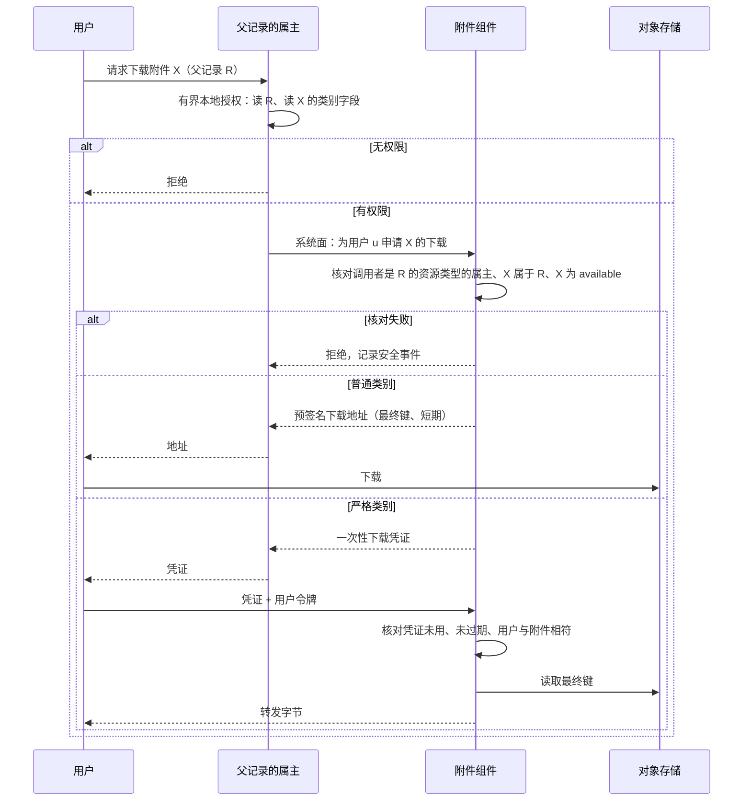

# 附件与对象存储

本页回答：

1. 哪些组件拥有对象存储里的哪些对象？桶、前缀与凭据怎样划分？
2. 上传、扫描、下载怎样保证“扫描通过的”就是“被下载的”那份内容？
3. 附件的读写权限从哪里来？附件组件不调用业务组件（D68），怎样知道谁能访问？已签出的下载链接在撤权后多久失效？
4. 解除引用、删除、保全，以及对象与记录的不一致，怎样处理？

依据的决定：D53（标准物理访问走 SDK 的存储适配器，不增加纯转发组件）、D68（基础组件不同步调用业务组件）。选择背景见[附件、物理对象与存储访问](../00-overview/guides/files-and-attachments.md)。

## 方案比较

| 路线 | 判断 |
| --- | --- |
| **采用**：用户经父记录的属主请求上传或下载，属主判断权限后经系统面向附件组件申请访问凭证；客户端经预签名地址上传到暂存键；确认时附件组件把内容复制到不可覆盖的最终键并记录摘要；扫描与下载只针对最终键 | 扫描结果与内容绑定；预签名地址在确认后仍可用，也改不了最终内容；附件组件不需要知道任何业务组件，新业务组件上线不改它；撤权的暴露窗口有上界 |
| 附件组件在下载时调用父记录的属主取授权 | 附件组件要知道所有业务组件的地址，新业务组件上线就要改它、发新版本，单独启动它也要带上全部业务组件（D68 否决） |
| 属主自己签名凭证，附件组件验签 | 附件组件要持有每个属主的验签密钥，同样要知道全部业务组件 |
| 直接把客户端上传的键当作最终对象 | 预签名地址在有效期内可以再次写入，同一个键在扫描后被替换（参考模型的“扫描并提供暂存键”坏变体） |
| 所有字节经附件组件转发 | 每次访问都可检查凭证，但大文件占用组件的连接与内存；只用于严格的敏感类别 |
| 统一存储门面组件 | D53 未采用；集中凭据，但多一层网络与故障点 |

## 对象的属主与凭据

| 对象 | 属主组件 | 说明 |
| --- | --- | --- |
| 业务附件 | 附件组件（`infra/attachment`） | 记录、处理状态与对象；读写资格由父记录的属主决定 |
| 正式单据的渲染结果 | 附件组件（作为该单据的附件） | 由业务组件请求保存，记录模板版本与数据摘要（[协议 10 的打印与渲染](10-external-integration.md#打印与渲染)） |
| 导出文件 | 发起导出的组件 | 短期保留；只有发起人按当前授权可领取（D29） |
| 事件的大载荷 | 发布事件的组件 | 事件中只带引用；保留不短于事件流的保留期 |
| 冷数据 | 数据的属主组件 | 按[协议 11](11-tiering.md) |

- 每个属主组件有自己的桶或前缀，以及只能访问它的存储凭据；存储凭据是密钥引用，由装配时的初始化（与数据库初始化同一类工作）创建。共用一个存储服务不等于共用访问权。
- 组件经 SDK 的存储端口访问对象存储（D53）；三种语言的适配器提供同样的语义：对象身份、条件写入、摘要校验、预签名、错误分类。
- 所用的对象存储接口子集由一致性套件验证（认证与签名、预签名、长度限制、元数据、服务端复制、条件写入、列举、错误、版本）；标称“兼容 S3”不直接等于本项目的用法兼容。

## 附件类别

类别（例如合同、发票原件、产品图片）由父记录的属主在自己的版本中声明，与资源定义（[安全 09a](security/09a-encoding-and-records.md#定义资源维度操作与字段)）一起进入授权组件的定义目录。附件组件从授权组件取得类别目录（基础组件之间的依赖），不从业务组件读取；新业务组件上线只增加目录内容，不改动、不重新发布附件组件。

| 类别属性 | 说明 |
| --- | --- |
| 父资源类型 | 类别属于哪个资源类型；只有该资源类型的属主可以为它申请凭证 |
| 大小上限、允许的类型 | 附件组件在确认时检查；不能超过附件组件自己的全局上限 |
| 敏感级别 | 普通或严格；决定下载方式 |
| 保留类别 | 与协议 11 相同的保留类别 |
| 字段名 | 类别在父资源上作为一个字段出现，属主按[安全 07 的逐行字段](security/07-finite-expressions-containment-and-queries.md#命中位图与逐行字段)判断用户能否读写这类附件 |

附件记录保存创建时的类别版本；类别以后修改，只对新附件生效。

## 附件记录

| 字段 | 说明 |
| --- | --- |
| 附件 ID | 附件组件生成 |
| 父记录 | 属主组件、资源类型、记录 ID；附件归属一个父记录，不跨父记录共享 |
| 类别与类别版本 | 见上节 |
| 内容版本 | 每次替换内容加一 |
| 最终键与摘要 | 最终对象的键与 SHA-256；键包含附件 ID 与内容版本，写入后不覆盖 |
| 大小与类型 | 由服务端检测，不信任客户端声明 |
| 状态 | 见下表 |
| 扫描结果 | 结果、引擎与签名版本、被扫描内容的摘要；关闭扫描的部署标为“未扫描” |
| 上传者与时间 | 上传者不因上传而永久可见；读权限仍由父记录的属主决定 |
| 保全与保留 | 与协议 11 相同的保全记录与保留类别 |

| 当前状态 | 事件 | 守卫条件 | 结果状态 |
| --- | --- | --- | --- |
| （无） | 属主申请上传会话 | 调用的服务是父资源类型的属主 | `uploading` |
| `uploading` | 用户确认 | 确认凭证有效；暂存对象存在 | `finalizing` |
| `finalizing` | 复制并检查完成 | 最终对象符合类别限制 | 开启扫描：`pending_scan`；关闭扫描：`available`（标为未扫描） |
| `finalizing` | 检查失败 | — | `rejected` |
| `finalizing` | 超过时限 | — | 重做确认，或 `rejected` |
| `pending_scan` | 扫描干净 | 最终对象的摘要等于记录的摘要 | `available` |
| `pending_scan` | 发现威胁，或摘要不符 | — | `quarantined` |
| `pending_scan` | 扫描出错、类型不支持 | — | `pending_scan`（重试；超过时限告警，由有权限的人决定） |
| `available` | 替换内容 | 属主为替换申请了上传会话 | 新内容版本经 `finalizing` 走同样的流程；旧版本按保留规则保留 |
| `available`、`quarantined` | 属主命令解除引用 | — | `detached` |
| `detached` | 属主命令恢复 | 在宽限期内 | 原状态 |
| `detached` | 清除 | 宽限期已过、保留已到期、没有生效的保全（在同一个决定事务中检查） | `purged` |
| `rejected` | 清理 | 会话已到期 | `purged` |

## 访问凭证

附件组件不判断“这个用户能不能访问这个父记录”，这个判断只有父记录的属主能做。流程是：

1. 用户向父记录的属主请求上传或下载（属主的用户面接口）。属主按[安全 03 的有界本地授权](security/03-authorization-acceptance-and-revocation.md#默认路径有界本地授权)判断：用户能否对父记录执行“添加附件”或读取，能否读写这个类别对应的字段；还可以加上业务条件，例如已关闭的单据不能再添加附件。
2. 属主经系统面（[安全 02 的调用面](security/02-trusted-identity-and-attributes.md)）向附件组件申请凭证。附件组件按已验证的服务身份核对：调用的组件是父资源类型的属主（资源定义的 `owner_component`）；附件确实属于该父记录。不符合时拒绝并记录安全事件。
3. 附件组件生成**访问凭证**：随机的不透明值，只保存它的摘要；绑定用户、附件（上传时是上传会话）、操作（上传确认、下载）、内容版本与到期时间。属主把凭证或由它换来的地址交给用户。
4. 用户凭访问凭证与自己的用户令牌访问附件组件；附件组件核对凭证存在、未过期、绑定的用户就是当前用户、操作与附件相符。不存在（包括被篡改）、过期、用于另一个附件或另一种操作，都拒绝。

| 用途 | 属主得到的结果 | 有效期 |
| --- | --- | --- |
| 上传 | 上传会话 ID、预签名上传地址、确认凭证 | 上传会话的时限 |
| 普通类别的下载 | 预签名下载地址（附件组件直接签发，只针对最终键与当前内容版本） | 预签名下载地址的有效期 |
| 严格类别的下载 | 一次性的下载凭证；用户凭它向附件组件请求，附件组件转发字节 | 一次请求，且不超过它的有效期 |
| 列出父记录的附件 | 属主经系统面查询附件清单，按用户的字段资格过滤类别后返回 | 不签发凭证 |

结论：附件组件只依赖授权组件的定义目录与服务身份，从不调用业务组件；每一次被服务的访问都由父记录真正的属主为这个用户、这个附件、这种操作做过判断，并且在凭证到期之前（GRANT_SCOPE）。

## 上传

1. **创建上传会话**：属主按上一节申请；附件组件写入 `uploading` 记录，生成暂存键与预签名上传地址（限定长度、类型，支持时附带摘要校验头），以及确认凭证。大文件用分段上传。
2. **客户端直传**到暂存键。
3. **确认**：用户凭确认凭证请求附件组件。附件组件在本地事务中把记录转为 `finalizing` 并预留最终键；然后**先**把暂存对象以服务端复制写到最终键（条件写入，键已存在则失败），**再**读取最终对象计算摘要与大小、检测类型、检查类别限制——检查的对象就是今后提供下载的对象，客户端在确认期间覆盖暂存对象也改变不了它；再在本地事务中记录摘要，按部署是否开启扫描转为 `pending_scan` 或 `available`。任何检查失败转为 `rejected`。
4. 附件组件发布附件状态事件；属主需要在自己的单据上显示附件数量等信息时，订阅这个事件。
5. 暂存对象在会话到期后由清理工作删除。预签名上传地址在确认之后仍然有效到期满，但它只能写暂存键，不能改变最终对象。

## 扫描与派生物

- 扫描工作读取最终键，先核对内容摘要等于记录的摘要，再扫描；结果与该摘要一起记录。扫描出错或类型不支持不算干净，按状态表处理。
- 生产环境默认开启扫描，开发环境默认关闭；关闭时附件直接可用，并在记录中标明“未扫描”。
- 替换附件的内容是新的内容版本：新的最终键、新的摘要、重新扫描。原地覆盖同一个键并沿用旧的扫描结果，会让未扫描的内容被下载（参考模型的坏变体）。
- 预览、缩略图等派生物以源内容的摘要为键，源内容变化时重新生成。

## 下载

- 只有 `available` 的附件可以下载。
- 普通类别：撤权后，已签出的预签名地址最多在一个有效期内仍可使用，这是声明的暴露窗口。没有有效期的链接会让撤权失去意义（参考模型的坏变体）。
- 严格类别：不签发预签名地址；每次请求（包括续传的每个片段）都要属主新签发的一次性凭证，附件组件转发字节。属主也可以经系统面读取内容后自己转发，适合需要在转发时做额外处理（水印、脱敏）的类别。
- 下载记录按[协议 03](03-audit-durability.md)：属主记录授权判断，附件组件记录凭证的签发与使用；敏感类别的下载进入审计。

## 解除引用、删除与保全

父记录的变化由属主**命令**附件组件处理（D68），不由附件组件订阅业务事件推断。属主把命令放进自己的工作项（[协议 01](01-background-work.md)），保证父记录的变化提交后命令最终送达。

| 动作 | 结果 |
| --- | --- |
| 从父记录移除附件 | 属主命令解除引用，`detached`；在宽限期内可以恢复 |
| 父记录被删除或作废 | 属主命令解除该父记录的全部附件 |
| 宽限期后清除 | 在一个事务中检查没有生效的保全、保留已到期，转为 `purged`，再删除对象 |
| 父记录被销毁或擦除（[协议 07 的销毁与擦除](07-references.md#销毁与擦除)） | 属主命令清除擦除涉及的类别；保全中的推迟并告警 |
| 保全 | 期间不能清除；保全检查在清除的决定事务中进行 |

附件记录与对象存储不能共同提交，所以每一步都先写记录、再动对象，并由对账补齐：

| 对账发现 | 处理 |
| --- | --- |
| 对象存在，没有任何记录指向它 | 孤儿；超过验证窗口且没有未结束的上传会话时删除 |
| 记录为 `available`，对象缺失 | 故障；转为不可用并告警，不报告为“不存在” |
| 记录为 `purged`，对象仍在 | 继续删除 |
| 记录为 `finalizing` 超过时限 | 重做确认或转为 `rejected` |

清理按记录判断，不按对象的年龄判断：只看年龄会删掉仍被引用的对象（参考模型的坏变体）。

## 备份与恢复

对象存储的备份或版本保留与数据库备份对齐：恢复后，附件记录指向的最终键都必须存在；清除记录晚于恢复点的，重新执行清除。清除的意图写入审计组件兼任的证据存储，缺时走外部告警通道。具体流程见[协议 15](../../protocols/15-backup-and-recovery.md)。

## 存储后端的更换

更换对象存储后端时：新后端先通过接口子集的一致性套件；按属主逐个复制对象并核对摘要；切换路由后，旧后端在宽限期内只读；对账覆盖新旧两边。预签名链接因后端变化失效，客户端重新请求即可。

## 参数起始值

| 参数 | 起始值 |
| --- | --- |
| 上传会话、预签名上传地址与确认凭证 | 15 分钟 |
| 预签名下载地址 | 5 分钟 |
| 严格类别的一次性下载凭证 | 1 分钟，用一次 |
| 单个附件大小上限 | 100 MiB（按类别声明，不超过全局上限） |
| 分段上传的阈值 | 16 MiB |
| 解除引用后的宽限期 | 30 天 |
| 孤儿对象的验证窗口 | 7 天 |
| 扫描出错的告警时限 | 1 小时 |

## 参考模型

[附件模型](../../work/checks/24-attachments.py)（种子 20261013，3,000 次运行）分两部分。

**内容与生命周期**：一个附件的上传、确认、扫描、替换、签发链接、下载、撤权、清理、保全、解除引用与清除随机交错；预签名上传地址在确认后仍可写暂存键；约三成运行是关闭扫描的部署。

| 检查 | 结果 |
| --- | --- |
| 下载得到的内容总是扫描为干净的那份（开启扫描时） | 成立 |
| 下载得到的内容等于确认时记录的摘要、大小与类型 | 成立 |
| 可用的附件总有对象 | 成立 |
| 保全中的附件从不被清除 | 成立 |
| 撤权后的下载不晚于撤权时刻加链接有效期 | 成立 |

6 个坏变体全部被发现：扫描并提供暂存键、原地替换内容并沿用旧扫描结果、先读暂存对象检查再复制到最终键、按年龄清理对象、清除时忽略保全、链接没有有效期。原地替换的变体需要足够多的下载才会暴露，模型因此调低了撤权频率、提高了下载频率。

**访问凭证**：两个属主组件各有父记录与附件；用户向属主请求访问，属主按自己的权限决定是否申请凭证；同时有凭证重放、用在另一个附件、伪造，以及非属主组件为别人的父记录申请凭证。检查“每一次被服务的访问都由真正的属主为该用户、该附件、该操作判断过，并在到期之前”成立；3 个坏变体全部被发现：凭证不绑定附件、不检查到期、不核对申请者是父资源类型的属主。

模型不是 SDK、对象存储或附件组件的运行结果。

## 独立预期

| 编号 | 场景 | 固定预期 |
| --- | --- | --- |
| FA01 | 组件甲用自己的存储凭据读组件乙的桶 | 拒绝 |
| FA02 | 确认后，客户端用仍有效的预签名地址再次上传 | 只改变暂存对象；最终对象与扫描结果不变 |
| FA03 | 客户端声明的类型与实际内容不符 | 按检测到的类型检查类别限制 |
| FA04 | 扫描出错 | 不可下载；重试并告警 |
| FA05 | 开发环境关闭扫描 | 附件可用，并标明未扫描 |
| FA06 | 替换附件内容 | 新的内容版本，重新扫描；旧版本按保留规则保留 |
| FA07 | 上传者失去父记录的读权限 | 属主不再为他申请凭证，不能再下载自己上传的附件 |
| FA08 | 撤权后，已签出的下载链接 | 最多在一个有效期内仍可用 |
| FA09 | 严格类别附件 | 每次请求需要属主新签发的一次性凭证，附件组件转发字节 |
| FA10 | 父记录被作废 | 属主命令解除引用，宽限期后清除 |
| FA11 | 清除时有保全 | 不清除 |
| FA12 | 对象存在但没有记录 | 验证窗口后且无未结束会话时删除 |
| FA13 | 记录可用但对象缺失 | 不可用并告警，不报告“不存在” |
| FA14 | 确认中途崩溃 | 超时后重做确认或拒绝 |
| FA15 | 正式发票的渲染结果 | 作为发票的附件保存，记录模板版本与数据摘要 |
| FA16 | 导出文件由他人领取 | 拒绝；只有发起人按当前授权领取 |
| FA17 | 事件引用的大载荷 | 保留不短于事件流的保留期 |
| FA18 | 从备份恢复后 | 记录指向的对象都存在；晚于恢复点的清除重新执行 |
| FA19 | 更换对象存储后端 | 一致性套件通过后复制、核对、切换，旧后端宽限期只读 |
| FA20 | 父记录因个人信息擦除被销毁 | 属主命令清除相应类别的附件；保全中推迟并告警 |
| FA21 | 确认期间客户端覆盖暂存对象 | 最终对象是复制时的内容，摘要、大小与类型按最终对象计算，一致；关闭扫描的部署也不受影响 |
| FA22 | 用户把附件甲的下载凭证用于附件乙 | 拒绝 |
| FA23 | 凭证过期后使用，或凭证被篡改 | 拒绝；篡改的凭证按不存在处理 |
| FA24 | 组件甲为组件乙拥有的资源类型的父记录申请凭证 | 拒绝并记录安全事件 |
| FA25 | 用户甲使用发给用户乙的凭证 | 拒绝 |
| FA26 | 新业务组件上线，声明自己的附件类别 | 类别经授权组件的定义目录进入附件组件；附件组件不改动、不重新发布，也不把新组件声明为依赖 |
| FA27 | 已关闭的单据，用户请求添加附件 | 属主按业务条件拒绝，不申请上传会话 |
| FA28 | 列出父记录的附件，用户不能读某个类别 | 该类别的附件不出现在属主返回的清单中 |

## 已知风险与待定

- 附件类别目录（大小、类型、敏感级别、保留类别）随组件设计逐个声明。
- 扫描引擎的选择、签名更新后是否回溯重扫，随代表部署实验与客户要求确定。
- RustFS 等候选后端对接口子集（尤其条件写入与服务端复制）的支持，在一致性套件中实测。
- 现场离线客户端（断网草稿中的附件）随前端协议确定（[协议 20](../../protocols/20-frontend.md)）。
- 以上预期尚未在 SDK、对象存储或附件组件上运行。
