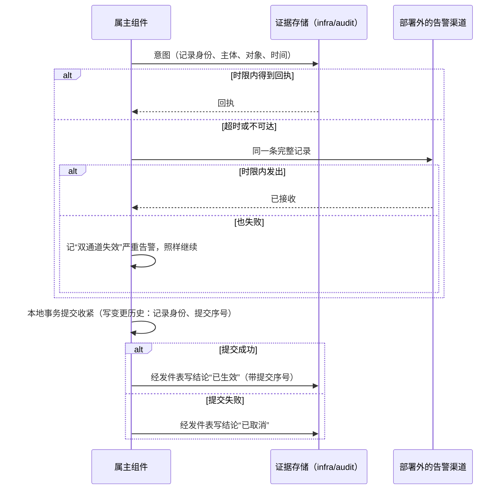
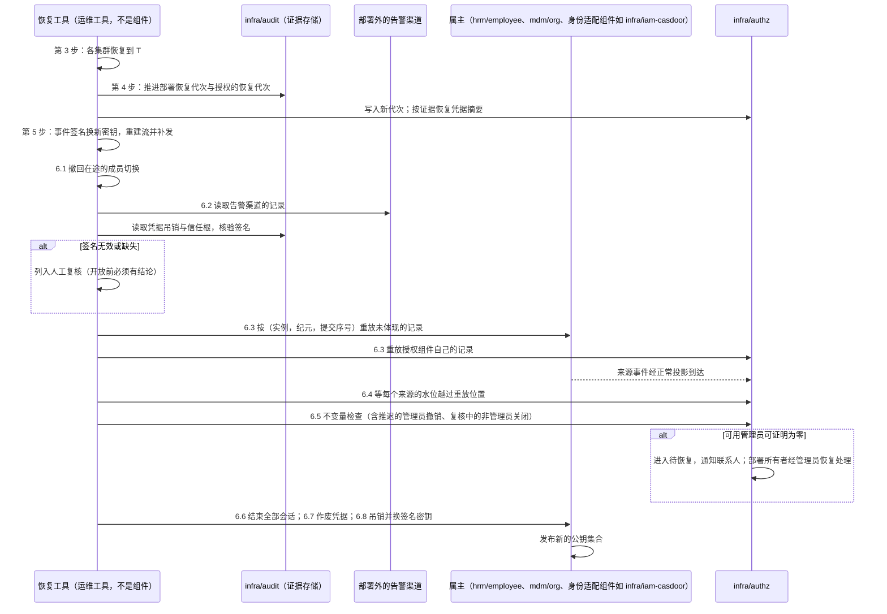
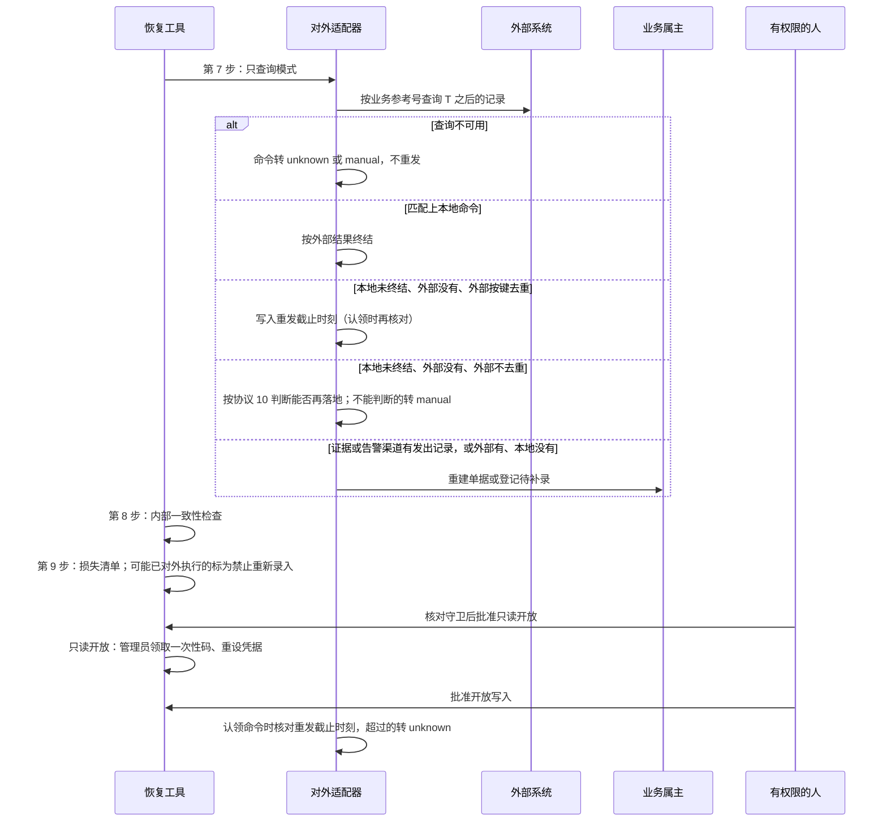

# 备份、恢复与一致性恢复

数据库恢复成功，不等于业务恢复成功。整套部署恢复到较早的时刻 T 之后：

1. T 之后已经发出的事件、已经执行的外部操作、已经做出的撤权与销毁，怎样不丢失、不重复、不复活？
2. 恢复的步骤、顺序与检查是什么？谁来确认可以重新开放？
3. 损失的范围怎样确定并告诉用户？
4. 高可用切换与恢复有什么不同？

依据的决定：D26（优先保证整套部署的一致性恢复）、D66（高可用部署整体同步提交，底层预留、后期启用）、D62（来源事实照常生效，可用管理员为零时进入待恢复）。背景见[数据与生命周期的灾难恢复](../04-foundations/02-data-and-lifecycle.md#灾难恢复)。

本页的“整套恢复”指把整套部署恢复到某一时刻；[安全 08](security/08-state-and-change-protocol.md#安装认领管理员恢复与紧急访问) 的“管理员恢复”是部署所有者重建授权管理员，是另一件事。

## 方案比较

| 路线 | 判断 |
| --- | --- |
| **采用**：整套部署恢复到同一时刻 T；消息流重建并按各消费者在 T 的进度补发；外部事实与安全记录从独立的证据存储补回；恢复期冻结一切对外动作；以对账与检查清单决定重新开放 | 不出现幽灵事件与丢失事件；不重复付款；撤权与销毁不复活；损失范围可列出 |
| 只恢复数据库，其余照常启动 | 消息流中留有 T 之后的事件（幽灵事件），消费者却回到 T 之前；在途的外部操作被盲目重发；撤权失效 |
| 按组件分别恢复为标准能力 | 不受影响的组件可以继续服务，但跨组件事实的对齐要逐组件设计；D26 未作为标准，按专项场景设计 |

## 恢复组与备份清单

标准的恢复组是客户的整套部署：

| 状态 | 备份方式 | 恢复后的地位 |
| --- | --- | --- |
| 全部组件的数据库（含部署内身份产品的数据库） | 物理备份 + 预写日志归档，支持恢复到任意时刻 | 权威；恢复到 T |
| 对象存储 | 对象版本保留与异地副本；对象在备份窗口内不物理删除（[协议 11](11-tiering.md)、[协议 12](12-attachments-and-object-storage.md)） | 按恢复后的目录与附件记录核对 |
| 消息流 | 不作为权威备份；恢复时重建 | 由各组件的发件表补发 |
| 配置与密钥引用 | 随客户基线版本管理（[协议 19](19-config-secrets-registries-release.md)） | 恢复到与 T 一致的基线；密钥本身按密钥管理恢复 |
| 独立证据存储（由审计组件兼任） | 只追加、单独保存与复制，不随部署备份回退 | 恢复后用于补回 T 之后的外部事实与安全记录 |
| 审计存储 | 按[协议 03](03-audit-durability.md) 单独保存 | 不回退；T 之后的审计保留，用于确定损失范围 |

客户自有的外部身份源不随本部署回退。

**独立证据存储**保存恢复时不能丢的记录。它由审计组件兼任（[`infra/audit` 卡](../07-components/infra.md#infraaudit)）：审计组件已经有回执、备份水位与“不回退”的保存，不再另设一个基础资源；证据与审计记录分开存放与查询。证据存储保存什么，只在下表定义：

| 记录类别 | 记录者 | 怎样写入 | 依据 |
| --- | --- | --- | --- |
| 安全记录的收紧：撤销、管理资格回收、安全处置、终止尚未生效的记录（取消、撤回、确认人拒绝） | 授权组件 | 两段写（意图、结论） | [安全 08](security/08-state-and-change-protocol.md) |
| 安全记录的放宽：授予等 | 授权组件 | 提交后经发件表 | 安全 08 |
| 离职、任职结束、账号与员工关联的结束 | 员工组件 | 两段写 | 安全 08 |
| 收紧性的组织调整：撤销组织、移出上级、缩小范围 | 组织组件 | 两段写 | 安全 03 |
| 账号停用，包括补取或按 `P_pull` 拉取时从身份产品得到的控制台直接停用；拉取到的启用同样记录（使“停用后又启用”在重放时按提交序号得到启用） | 身份适配组件 | 两段写 | [安全 03 的身份成员由外部产品承载时](security/03-authorization-acceptance-and-revocation.md#身份成员由外部产品承载时) |
| 身份适配组件签名密钥的吊销（服务凭据的吊销见下面的信任材料一行） | 身份适配组件 | 两段写 | 协议 19 |
| 凭据收紧经适配组件办理：改密码、重置或移除 MFA 因素、解除外部身份链接（只记事实与主体，不记秘密） | 身份适配组件 | 两段写 | 安全 02、协议 20 |
| 强制登出与会话撤销（只记事实与主体）；恢复时由 6.6 结束全部会话覆盖，不作废凭据 | 身份适配组件 | 两段写 | 协议 20 |
| 凭据收紧在身份产品侧自助办理（用户在产品的账户页面改密码、删除 MFA 设备） | 身份适配组件，按 `P_pull` 拉取产品的凭据变更事件 | 拉取后经发件表写入 | [安全 11 的预检](security/11-identity-member-switching.md)与身份成员的共同验收要求能拉取这类事件；不能提供的产品，说明中写明“恢复后凭据收紧可能丢失” |
| 经适配组件办理的账号重新启用与解冻 | 身份适配组件 | 提交后经发件表 | 安全 08 |
| 恢复凭据与部署所有者确认凭据的轮换（记事实与新凭据的摘要，与库中保存的形式相同；不记凭据） | 授权组件、恢复工具 | 两段写；结论在部署所有者用新凭据确认一次之后才写 | 安全 08 |
| 对外可见的连续单号的签发（序列、单号、单据身份） | 单号的属主 | 提交后经发件表 | [协议 14 的单号](14-data-foundations.md#单号) |
| 成员切换的移交（角色、旧实例截至的移交位置、新实例、切换尝试的身份），写入结果不明后的“放弃这次移交”，以及回退时的反向移交 | 授权组件、身份适配组件 | 同步提交：在接管的同一时刻写入，写不进时不接管 | [安全 10](security/10-providers-and-member-switching.md) 的 7.4 与回退、[安全 11](security/11-identity-member-switching.md) 的 6.4.2 与回退 |
| 销毁与擦除（包括附件的清除） | 数据的属主 | 两段写 | 协议 11、12 |
| 能力声明标为不可撤回的对外命令（资金、开票、电子签、承运下单）的发出记录：命令身份、业务参考号、参数摘要、属主的业务记录身份 | 发出命令的适配组件 | 每次发出之前写入并等回执（时限同收紧意图）；超时签名后发到告警渠道；两者都失败时不发出，退避 | [协议 10 的状态](10-external-integration.md#状态) |
| 对外命令的终态与外部单号 | 发出命令的适配组件 | 提交后经发件表 | [协议 10](10-external-integration.md) |
| 信任材料：部署信任域 CA 证书链的轮换与吊销、服务凭据的签发登记（含 CA 签入的组件 ID 与角色）与吊销 | 部署信任域的签发者 | 按方向分开，都以部署之外的运行档案为准（它不依赖审计组件与它的凭据；只追加，每条签发与轮换由上一级链签名，吊销由签发者签名，6.2 照样核对签名）：签发与轮换在运行档案同步提交后才发布，证据存储事后补写；吊销按收紧两段写（写证据，写不进时经告警渠道），同时写运行档案，不能为了证据或运行档案推迟吊销。紧急吊销先轮换出新的签发链（[安全 02 的凭据生命周期](security/02-trusted-identity-and-attributes.md)），再吊销旧的；运行档案不可达、无法轮换时，吊销照常执行，依赖被吊销链的组件按凭据失效处理（证据写入改走告警渠道），等运行档案可达后再轮换，不会因此推迟吊销 | [安全 02](security/02-trusted-identity-and-attributes.md)；6.2 的核验读三处的并集 |
| 部署恢复代次的权威计数 | 恢复工具与升级工具 | 同步提交，同时写入部署之外的运行档案；推进时取证据、各库与运行档案中见过的最大值加一 | [协议 14](14-data-foundations.md#库内计数与纪元) |
| 授权的恢复代次的权威计数 | 授权组件、恢复工具 | 同步提交，同时写入运行档案；推进时取证据存储、各授权成员库与运行档案中见过的最大值加一 | [安全 03 的代次、纪元与修订](security/03-authorization-acceptance-and-revocation.md#代次纪元与修订) |

外部告警渠道的记录保留不短于完整备份的保留（参数表），否则恢复到较早的 T 时 6.2 读不到它们。证据存储自身从备份恢复（审计库损坏）时，它备份点之后的证据只能从外部告警渠道与运行档案补回，其余列入损失范围；两种代次因为同时写在运行档案中，不会因此重用。

授权组件应用来源事件时不等待证据；由来源事实派生的撤销（例如任职结束后自动收回的授予，D30）不另记证据，恢复后来源在属主处重新办理，授权组件经投影重新派生。

## 发件表的保留与消费者进度

整套恢复依赖两件事，平时就要做到：

- **消费者记录进度**：每个消费者在自己的数据库中按来源记录已处理的事件（收件表，或按来源的连续位置）。
- **发件表的保留**分成两个量，互不牵连：
  - **未发布积压**：尚未发布到运输的行。D14 的保护只看它（超过阈值时按[协议 17](17-runtime-and-resources.md) 限制受影响业务），因为这才是运输故障。
  - **补发保留**：已发布的行按固定上限保留（时间与容量，见参数表），只为整套恢复与[协议 02](02-projections.md) 的补取。它不看有哪些消费者、消费者是否确认，所以后加的消费者不需要生产者变更，下游故障也不会反向限流上游。消费者落后超过保留上限时只告警。

恢复时，每个生产者补发的范围必须覆盖各消费者在 T 的进度：可以按各消费者的进度补发，也可以把补发保留内的全部行补发、由消费者按收件表去重；但不能只补发一段比消费者落后距离更短的固定时间窗，那会漏掉落后的消费者（参考模型的“只补发固定时间窗”坏变体）。需要的行已经超出补发保留时，该消费者按协议 02 的完整快照修复，或按[协议 05](05-billing-settlement-and-payment.md) 的增量事实按序号向产生方补取与对账，并记入恢复报告；恢复流程从各消费者的数据库读取进度，生产者不需要事先知道有哪些消费者。

## 证据的写入

- **一般记录**（包括授予等放宽、对外命令的终态）在本地事务提交后经发件表写入，有回执，回执之前的记录在本地保留。
- **每条安全记录的变更都在本地留下记录身份与提交序号**：本地事务把证据记录身份、变更后的对象版本与属主本地的全局提交序号写进变更历史（同一事务）。提交序号在取得守卫或对象锁之后分配，或按[协议 02 的锁内提交后编号](02-projections.md#来源一侧编号纪元与补取)分配，使序号的先后等于提交的先后，并按协议 14 带纪元；结论与经发件表写入的记录都携带这个提交序号。记录写的是变更本身（“从范围中移除 X”“解除与 P1 的上级关系”），不是变更后的绝对状态。证据的追加顺序不等于生效顺序（收紧在提交之前追加意图，放宽在提交之后才经发件表追加），重放只按提交序号排序。
- **收紧分两段写**（先记意图，后生效）：
  1. **意图**：在本地守卫事务**之外**、事务开始之前，把收紧记录（记录身份、主体、对象、提交前的对象版本、时间）写入证据并等待回执（时限见参数表）；超时或不可达时，把同一条完整记录由属主以自己的服务凭据签名，发到部署之外、不随恢复回退的告警渠道（同一时限）；两者都失败时本地记“双通道失效”的严重告警，照样继续（不能为了证据推迟撤权）。批量计划的意图批量写入。
  2. **提交**本地事务；事务内不做网络调用。
  3. **结论**：提交成功后经发件表写“已生效”；提交失败（冲突、检查不通过）写“已取消”。
- 代价：每次收紧最多多出两段写入时限。

结论：收紧不因证据不可达而推迟；证据要么在证据存储，要么在部署外的告警渠道，两者都失败的时间段单独列入损失范围（RC17、RC21、RC22）。

## 恢复流程

| 步骤 | 内容 | 完成的依据 |
| --- | --- | --- |
| 1. 宣布与选择 T | 有权限的人宣布恢复，选择恢复时刻 T（数据损坏之前、日志可达的最晚时刻） | 恢复记录：原因、T、批准人 |
| 2. 冻结 | 边缘入口返回维护中；停止定时任务、后台工作、发件转发、消费者与对外适配器的发送；外部回调入口返回暂不可用，外部按其重试 | 所有执行者停止，确认没有在途发送 |
| 3. 恢复数据库 | 各集群恢复到 T | 恢复日志与校验 |
| 4. 推进代次 | 部署恢复代次加一（权威计数在证据存储，只增不减），在解冻前写入每个组件库的一行，纪元由它参与组成：所有工作项的认领纪元、转层与对外命令的代次随之失效，旧执行者即使残留也被拒绝。同时推进授权的恢复代次，写入基线中当前权威的授权成员库（T 时授权成员切换在途的，两个成员库都写），使组件不把恢复后的授权组件判为回退，恢复前的视图与许可全部作废。同一步按证据把恢复凭据与部署所有者确认凭据的摘要恢复到最近一次有结论的轮换（[第 6 步：会话、凭据与签名密钥](#第-6-步会话凭据与签名密钥)），使之后任何时刻的管理员恢复都按最新的凭据认证 | 代次记录；凭据摘要的恢复记录 |
| 5. 重建消息流 | 删除并重建流与持久消费者；生产者按各消费者在 T 的进度补发，事件 ID 不变，消费者按收件表去重。补发之前，事件签名密钥按[协议 19](19-config-secrets-registries-release.md) 的“整套恢复之后”生成新密钥、发布公钥集合并重新签名用已吊销密钥签过的事件 | 每个消费者的补发清单 |
| 6. 补回收紧与销毁 | 按[第 6 步的子步骤](#第-6-步的子步骤)依次办理 | 重放清单、待复核清单、告警渠道记录的核验结果、凭据作废清单、损失范围与复核结论 |
| 7. 外部对账 | 对外适配器以只查询模式运行，按[第 7 步：外部对账](#第-7-步外部对账)把外部在 T 之后的记录、证据或告警渠道中签名有效的发出记录（只有不可撤回的命令才有）与本地全部未终结的命令匹配 | 每个适配器的对账结果 |
| 8. 内部一致性检查 | 跨组件的对账：预占与订单（协议 04）、出账与来源、子账与总账（协议 05）、期间状态（协议 06）、引用（协议 07）、目录与对象（协议 11、12）、投影完整性（协议 02）、严格路径的接受与消费记录与业务事实（[安全 03](security/03-authorization-acceptance-and-revocation.md)） | 检查清单，全部通过或差异有处置 |
| 9. 损失范围 | 按[第 9 步：损失范围](#第-9-步损失范围)列出丢失的业务操作与审计损失 | 损失清单，按用户与单据；审计损失清单 |
| 10. 重新开放 | 按[第 10 步：重新开放](#第-10-步重新开放)先只读、再开放写入与对外动作 | 开放记录 |

部署在恢复中的状态，按行序第一条命中：

| 当前状态 | 事件 | 守卫条件 | 结果状态 |
| --- | --- | --- | --- |
| 运行（`running`） | 有权限的人宣布恢复（第 1 步） | 记录原因、T、批准人 | 冻结（`frozen`） |
| 冻结 | 有权限的人放弃恢复 | 第 3 步尚未开始 | 运行 |
| 冻结 | 全部执行者停止、确认没有在途发送（第 2 步完成） | — | 恢复中（`restoring`，第 3–6 步） |
| 恢复中 | 第 3–6 步完成 | 重放清单与待复核清单已生成；不变量检查已在授权组件应用完重放之后完成 | 核对中（`verifying`，第 7–9 步） |
| 核对中 | 检查清单全部通过或差异有处置，损失清单已生成 | 有权限的人批准；全部验证方已刷新公钥集合；告警渠道中签名无效或缺失的记录全部有复核结论；至少一名可用的授权管理员能登录（凭据没有被作废，或已取得一次性码） | 只读开放（`read_only`） |
| 只读开放 | 有权限的人批准开放写入 | 连续单号已取得已用的最大值 | 运行 |
| 只读开放 | 有权限的人决定重新冻结（只读期间发现问题） | — | 冻结（之后按需要重做某些步骤，或重新选择 T） |
| 恢复中 | 某一步失败 | — | 恢复中，修复后重做该步；各步可重复执行 |
| 核对中 | 某一步失败 | — | 核对中，修复后重做该步 |
| 其余组合 | — | — | 不变，拒绝并告警 |

恢复期间各执行者以**恢复模式**启动（[协议 17 的启动与停止](17-runtime-and-resources.md#启动与停止)），只做当前步骤需要的事；当前阶段由恢复工具经动态部署变量下发（协议 19），执行者按它切换模式。对外适配器指付款、银行、开票、IM 等与外部系统交换业务的适配组件；身份适配组件在第 6 步作为属主执行重放与密钥吊销，不按对外适配器处理。

| 阶段 | 入口 | 发件转发与消费者 | 工作项的领取 | 对外适配器 | 身份适配组件 |
| --- | --- | --- | --- | --- | --- |
| 冻结、第 3–4 步 | 维护中 | 停止 | 停止 | 停止 | 停止 |
| 第 5 步 | 维护中 | 运行（补发与投影） | 停止 | 停止 | 运行，但不发布公钥集合、不签发 |
| 第 6 步 | 维护中 | 运行 | 只领取恢复工具发起的重放工作；不领取对外发送的工作 | 停止 | 执行属主的重放命令与密钥吊销；完成后才发布新的公钥集合 |
| 第 7–9 步 | 维护中 | 运行 | 同上 | 只查询模式：只按业务参考号查询外部，不发送 | 运行，不签发；受理部署所有者为管理员发放的一次性码；恢复工具在这一阶段受理管理员恢复 |
| 只读开放 | 只读；唯一允许的写入是一次性码的发放与核销、重设密码与登记 MFA | 运行 | 同上 | 只查询 | 签发 |
| 运行 | 开放 | 运行 | 全部恢复 | 全部恢复 | 全部恢复 |

为什么要这样做：

- **幽灵事件**：T 之后发布到旧消息流中的事件，其源数据在恢复后不存在。保留旧消息流会让消费者处理它们（参考模型的“保留旧消息流”坏变体），所以消息流必须重建（第 5 步）。
- **外部操作**：恢复后的数据库中处于“发送中”或仍是“待发送”的命令，在 T 之后可能已经执行；直接重发会重复执行（参考模型的坏变体）。T 之后才创建并发出的命令在恢复后的库中不存在，只有证据或告警渠道中的发出记录能找到它（只有能力声明标为不可撤回的命令才写发出记录；其余命令恢复后可能重复发出，后果只是重复通知）。工作项中 `outcome_unknown` 为真的，按[协议 01](01-background-work.md) 转为暂停，由第 7 步的对账核实。
- **安全记录**：只从备份恢复安全状态，T 之后的撤权就失效了（参考模型的坏变体）；重放证据存储中的记录使其继续有效（第 6 步）。T 之后新增的授予同样重放，它们有自己的批准记录；被引用的对象在恢复后不存在时，授予成为悬空引用，按[协议 07](07-references.md) 处理。

第 3–6 步的时序（失败的子步骤修复后重做，已完成的按“已体现”跳过）：

第 7–10 步的时序：

### 第 6 步的子步骤

部署处于恢复中（入口维护中、对外动作停止），没有业务的并发写入；高可用切换不做重放（[高可用与故障切换](#高可用与故障切换)）。第 6 步按下表依次办理；中断后重来时，已完成的子步骤按“已体现”跳过：

| 子步骤 | 内容 | 规则所在 |
| --- | --- | --- |
| 6.1 成员切换 | T 时切换在途的，先撤回；新成员接管之后才恢复的，以新成员为基线 | [恢复与成员切换](#恢复与成员切换) |
| 6.2 告警渠道记录的核验 | 按不随恢复回退的信任根核验签名：有效的进入 6.3；无效或缺失的列入人工复核 | [第 6 步：证据的重放](#第-6-步证据的重放) |
| 6.3 重放 | 未体现的记录按属主的（实现实例，纪元，提交序号）重放 | 同上 |
| 6.4 等授权组件应用 | 授权组件对每个来源的水位越过该来源重放的最后提交位置 | 同上 |
| 6.5 不变量检查 | 对最终状态检查可用管理员、职责分离、管理上限与包含证明；推迟的“只有意图”管理员撤销在此判断；6.2 复核中的记录所涉主体，按重放后的状态，不是授权管理员的在此关闭 | 同上 |
| 6.6 会话 | 结束恢复前的全部会话 | [第 6 步：会话、凭据与签名密钥](#第-6-步会话凭据与签名密钥) |
| 6.7 凭据 | 身份产品在恢复组内时，作废 T 之后改过密码或 MFA 的主体的现有密码与 MFA 因素，生成作废清单；一次性码在第 7–9 步与只读开放时发放 | 同上 |
| 6.8 签名密钥 | 重新吊销并切到新密钥，之后才发布公钥集合 | 同上 |

### 恢复与成员切换

本节是 6.1 的规则。“在途”指新成员**开始独自作答之前**：授权在[安全 10](security/10-providers-and-member-switching.md) 的 7.4 之前（7.4 时新成员即开始作答）；身份在[安全 11](security/11-identity-member-switching.md) 的 6.6.2 之前（6.4.2 之后新成员已接管身份来源，但授权组件在 6.5 才对齐、6.6.2 才开始签发，恢复中不把这段切换向前做完）。按切换在恢复点与冻结时的状态，第一条命中：

| 切换在恢复点 T 与冻结时的状态 | 处理 |
| --- | --- |
| T 时在途 | 6.1 先把切换撤回（授权按安全 10 的回退，身份按安全 11 的回退 B；6.2.2 之前的身份切换按回退 A）；撤回在恢复中只做到切换状态回到正常、代理记录重放完毕，登录与签发按恢复模式表在只读开放时恢复。重放在撤回之后进行，按正常的收紧路径办理；恢复后再重新发起切换 |
| T 时新成员已独自作答（授权 7.4、身份 6.6.2 之后）、旧成员尚未退役 | 以新成员为基线，不做反向切换；旧实例的记录按移交排序后由新成员按平台主体执行 |
| 切换在 T 之后才开始，冻结时新成员尚未独自作答 | 恢复后的基线是旧成员，库中没有这次切换的状态；新成员上经代理生效过的收紧，按证据由旧成员按平台主体重新执行；之后重新发起切换 |
| 切换在 T 之后开始，冻结时新成员已独自作答（或已完成、旧成员已退役） | 恢复后的基线回到切换之前的成员（安全 10 第 9 步与安全 11 第 8 步要求旧成员退役后仍保留可重新部署的产物与配置，直到早于退役时刻的备份全部过期）；新成员上生效过的收紧，按证据中登记的移交排序后，由基线中的成员按平台主体重新执行 |
| 其余（无法判断切换状态） | 停在 6.1，告警，由有权限的人按证据中的移交记录判断后选择上面的一行 |

第 4 步把授权的恢复代次写入基线中权威的成员库；切换在途时两个成员库都写。

### 第 6 步：证据的重放

本节是 6.2 至 6.5 的规则。

#### 6.2 告警渠道记录的核验

告警渠道中的记录（日常收紧、对外命令的发出记录、高可用与降级期间由 SDK 发出的记录）都由记录者用自己服务凭据的私钥签名。核验只用**不随恢复回退**的材料，每次恢复都读这三处的并集：证据存储中记录的信任材料历史、告警渠道中签名有效的信任材料记录（CA 证书链的轮换与吊销、服务凭据的登记与吊销）、部署之外的运行档案中的信任材料（[安全 02](security/02-trusted-identity-and-attributes.md)）；任一处有的吊销都算，不只在证据存储从备份恢复时才读运行档案；不用恢复后的库，也不用恢复到 T 的配置基线。第 4 步之后各组件同样按这份历史更新信任材料。每条记录按下表，第一条命中：

| 情形 | 结果 |
| --- | --- |
| 签名缺失，或签名者的证书链按信任材料历史不成立 | 无效 |
| 签名者的服务身份不是这类记录的记录者（证据表“记录者”一列；签名者的角色取自部署 CA 签入服务凭据的组件 ID 与角色，按信任材料历史核对，不取配置基线，所以成员切换后新成员签的真实记录照常有效；例如集成适配器签的授权撤销） | 无效 |
| 签名凭据已被吊销，告警渠道接收这条记录的时刻晚于吊销意图的时刻减去声明的时钟偏差（吊销记录取证据存储、告警渠道与运行档案三处中签名有效的全部；接收时刻以渠道为准，吊销时刻取最早写入的那一处） | 无效 |
| 对外命令的发出记录 | 有效，不重放，交第 7 步 |
| 其余 | 有效，进入 6.3 |

所以一份 T 之后泄露并被吊销的凭据，或另一个组件泄露的凭据，都不能用来伪造恢复中会执行的记录；T 之后轮换出的新凭据与新 CA 由信任材料历史证明，签的真记录照常有效。签名无效的记录列入人工复核，开放前必须有结论；复核结论之前，所涉主体中按 6.3 重放之后的状态不是授权管理员的，在 6.5 关闭（多执行一次收紧是安全的），授权管理员不关闭。

#### 6.3 重放

- 逐条比较证据与告警渠道中的记录和恢复后的数据库。**“已体现”按记录身份判定**：恢复后变更历史中有这条记录身份，就已体现；不按时间与 T 比较（意图早于 T、提交晚于 T 的收紧也不会漏掉）。
- 未体现的记录**按属主的（实现实例，纪元，提交序号）**重放：同一角色（授权、身份）的记录跨成员实例时，按证据中**最后一条未被放弃**的移交排序（写入结果不明后写了“放弃这次移交”的那条不算）：旧实例截至移交位置的记录全部先于新实例的记录；同一实例的记录始终按（纪元，提交序号）字典序，与移交位置无关，所以放弃之后旧实例继续受理的收紧也不会被丢弃。这样跨对象的先后与原来一致，例如管理员交接“先授予 B、后撤销 A”。属主的实例不在恢复后的基线中时，由基线中同一角色的成员按平台主体执行（身份停用按平台主体级记录）。纪元只按恢复后**当前纪元历史上的祖先**比较（纪元历史随库恢复，是一棵树，[协议 14 的分叉点](14-data-foundations.md#库内计数与纪元)）。
- 属主采用过新纪元时，旧纪元分叉点之后的证据记录标为“随切换丢失”：它们已列入那次切换的损失范围，重放跳过它们并列入复核，不让一项已决定不再授予的权限在日后的整套恢复中回来。
- 只有意图、序号未知的收紧排在该属主的最后。
- 恢复凭据与确认凭据的轮换记录只在第 4 步处理，6.3 跳过。

未体现的记录按下表处理，按行序第一条命中：

| 记录在哪里 | 证据状态 | 处理 |
| --- | --- | --- |
| 任一 | 对外命令的发出记录、凭据轮换记录、凭据收紧（改密码、重置或移除 MFA 因素） | 不重放（分别交第 7 步、第 4 步与 6.7；一次改密码无从重新执行，由 6.7 作废凭据代替） |
| 任一 | 身份侧建立的安全处置 | 不重放：重放后的账号状态按转变派生（[安全 08 的身份侧处置的派生](security/08-state-and-change-protocol.md#身份侧处置的派生)），已有生效中的不新建；对它的解除照常重放，只从处置的 `signal_ref` 集合中移除它自己的证据记录身份，集合空了才解除；所带的每个记录身份分别判断：在本次重放清单中的，等身份来源水位越过它的重放位置；早于 T（已在恢复后的库中）的不等；全部满足后一起移除；映射不到的列入复核 |
| 只在告警渠道中（证据当时不可达），签名按 6.2 无效 | — | 不执行，列入人工复核；复核确认后按下面各行处理 |
| 只在告警渠道中，签名按 6.2 有效 | — | 按下面“只有意图”的各行处理（记录带提交前的对象版本，供判断是否已体现） |
| 证据存储 | 已取消 | 忽略 |
| 证据存储 | 随切换丢失 | 跳过，列入复核 |
| 证据存储 | 已生效（含经发件表写入的放宽） | 按提交序号在属主处重新执行（员工组件重新办理离职，组织组件重新调整，身份适配组件向产品重新停用，授权组件重放自己的记录）；授权组件经正常投影得到来源事实，不在自己的投影上重放 |
| 证据存储 | 只有意图，销毁或擦除 | **不自动执行**（不可逆），列入人工复核 |
| 证据存储 | 只有意图，授权组件内的普通撤销，且依赖索引显示它会影响授权管理员的可用性 | 推迟到 6.5，按最终状态判断：执行后可用管理员可证明为零的，不执行，转复核，复核期间关闭该主体的管理资格；否则执行并标记 |
| 证据存储 | 只有意图，其余收紧（撤销、停用、离职、任职结束、组织收紧、安全处置、终止尚未生效的记录） | 在该属主的已生效记录之后执行，并标为“意图未确认”供复核：多执行一次收紧是安全的，也不能让一个可能被盗的唯一管理员账号在恢复后保留管理权 |
| 其余 | — | 不执行，列入人工复核 |

**重新执行的规则**：

- 记录按原变更重新施加，不重做业务前置校验（例如“撤销组织要求部门内没有在职任职”“授予人必须是管理员”）：它们在原时刻已经校验过，而重放中途的状态不是任何真实时刻的状态；只检查被引用的对象仍然存在（不存在时按协议 07 的悬空引用处理）。
- 重新执行写入原记录身份，所以第 6 步中断后重来时，已执行的记录按“已体现”跳过，不重复执行。任何重新执行失败时，关闭相关主体（按无法证明处理）并列入人工复核，不静默跳过。

例：恢复点 T 之后，管理员误把付款权授予 Bob（提交序号 107），一秒后撤销（序号 108）。证据中撤销的意图先于授予追加；按提交序号重放得到“授予、撤销”，恢复后 Bob 没有付款权。按追加顺序重放会得到相反的结果；按对象分组、对象之间任意先后重放，会让管理员交接中途出现零个管理员（参考模型的两个坏变体）。

#### 6.4–6.5 等授权组件应用，再检查不变量

- 授权组件对每个来源的水位越过该来源重放的最后提交位置之后，才运行不变量检查。
- D62 的“可用的授权管理员为零”在重放全部结束后才判定，重放中途不判定；判定按[安全 08 的系统角色与最后管理员](security/08-state-and-change-protocol.md#系统角色与最后管理员)的“可证明”。对最终状态运行一次不变量检查（可用管理员、职责分离、管理上限与包含证明）：违反的主体关闭并列入复核，由第 10 步的人裁定。任何原因造成的可用管理员为零，都按 D62 进入待恢复，由部署所有者经管理员恢复处理。

**收紧类记录的恢复点目标为零**，只有这几段除外：“双通道失效”的时间段；身份产品侧的变更（含用户自助的凭据变更）到适配组件拉取之间的间隔（不超过 `P_pull`）；单号签发提交之后、经发件表写入证据之前的窗口（恢复后可能重号或出现空号，第 10 步从证据与外部对账取最大值，空号作废登记）。业务数据的恢复点目标另见参数表。

多个数据库集群时，各集群按同一时刻恢复；跨集群的恢复不是原子的。恢复或切换使来源的纪元变化，投影与增量事实（协议 05、06 的序号）的消费者按[协议 02 的纪元变化](02-projections.md#纪元变化)对齐。

### 第 6 步：会话、凭据与签名密钥

本节是 6.6 至 6.8 的规则（恢复凭据与确认凭据的摘要在第 4 步处理，规则也在本节）。T 之后的登出、会话撤销与吊销可能已随数据库回退。身份产品是否在恢复组内（[恢复组与备份清单](#恢复组与备份清单)），决定哪些需要重做：

| 项 | 身份产品在恢复组内（随恢复回退） | 身份产品不在恢复组内（客户自有的身份源、部署之外托管的产品） |
| --- | --- | --- |
| 6.6 会话 | 身份适配组件把恢复前创建的全部会话转为已结束（按会话创建时的部署恢复代次判断），撤销全部刷新令牌，让身份产品结束全部用户会话与离线令牌、把产品的“不早于”时间推到恢复时刻；边缘丢弃全部缓存的令牌（[协议 20 的登录与会话](20-frontend.md#登录与会话)） | 只结束本平台的会话、刷新令牌与本平台在产品中的客户端会话；不结束用户在其他应用中的会话 |
| 6.7 凭据收紧（证据或告警渠道中签名有效的记录显示 T 之后改过密码、重置或移除过 MFA 因素的主体；强制登出与会话撤销已由 6.6 覆盖，不在此列） | 作废这些主体的现有密码、移除全部 MFA 因素；产品自带的找回流程（例如邮件找回）对他们关闭，只能凭一次性码或带外确认重设 | 不作废：产品中的凭据没有回退；只核对证据或告警渠道中的凭据收紧在产品中仍然有效，不一致的列入复核 |
| 外部身份链接 | T 之后解除过的按证据重新解除 | 同左 |
| 签名密钥（6.8） | 按证据重新吊销 T 之后吊销过的密钥，一律把签名切到一把新生成的密钥、发布新的备用（恢复后的公钥集合可能含已泄露的旧密钥）；完成之前不发布公钥集合 | 同左（签名密钥属于身份适配组件） |
| 服务凭据 | 由各自的属主轮换 | 同左 |

**凭据被作废的主体怎样重设**（身份产品在恢复组内时）：

| 主体 | 怎样取得重设的证明 | 时点 |
| --- | --- | --- |
| 可用管理员为零（6.5 进入待恢复，不论原因） | 部署所有者在第 7–9 步经恢复工具做管理员恢复（[安全 08 的管理员恢复](security/08-state-and-change-protocol.md#安装认领管理员恢复与紧急访问)）；恢复出的管理员凭部署所有者发放的一次性码登记 | 第 7–9 步；只读开放的守卫要求至少一名授权管理员能登录 |
| 全部可用的授权管理员都被作废 | 部署所有者在恢复工具中用恢复凭据为至少一名发放一次性码（与[安全 08 的管理员恢复](security/08-state-and-change-protocol.md#安装认领管理员恢复与紧急访问)在身份切换中发放的登记码同一机制，有效期与核销同安全 11 第 1 步的（a）） | 第 7–9 步；只读开放的守卫要求至少一名授权管理员能登录 |
| 部分授权管理员被作废 | 已能登录的管理员经受保护操作按（b）发码，或部署所有者发码 | 只读开放起；不在场的开放后再办 |
| 其余主体 | 管理员经受保护操作发放、经带外渠道交付的一次性码，或客户规定的带外确认，与[安全 11 第 1 步](security/11-identity-member-switching.md)的（b）（c）同一强度 | 只读开放起；办完之前不能登录 |
| 身份产品不能提供凭据变更事件、客户选择对全部主体作废 | 同上各行；客户同时规定带外确认，或由管理员发码 | 同上 |

**恢复凭据与确认凭据**（第 4 步，早于任何可能触发管理员恢复的子步骤）：按证据把凭据摘要恢复到最近一次**有结论**的轮换（结论在部署所有者用新凭据确认之后才写，所以所有者一定持有它）；只有意图的轮换列入复核并告警，恢复工具这时同时接受上一凭据与意图中新凭据的任一认证，认证后立即再轮换一次。第 6 步完成后，部署所有者再轮换一次。

身份适配组件在 6.6–6.8 完成之前不发布公钥集合（恢复模式表），组件因此不会缓存含旧密钥的集合；第 10 步开放之前，核对全部验证方已刷新公钥集合。

### 第 7 步：外部对账

对外适配器以只查询模式运行。

1. 查询外部在 T 之后的记录。查询窗口从 T 往前留出声明的时钟偏差与外部的入账延迟（参数表），使时间戳略早于 T 的外部记录也不漏掉。
2. 按业务参考号与本地**全部未终结**的命令匹配，包括 T 时仍是 `prepared` 或 `retry_wait` 的命令：它们可能在 T 之后才发出并执行。匹配上的按外部结果终结，不重发（[协议 10 的结果未知时](10-external-integration.md#结果未知时)）。
3. 没有匹配上的未终结命令：
   - 外部按业务参考号或幂等键去重、且距**最早一次可能的发送**未超过适配器声明的去重保留期（按它声明的计期起点，[协议 10 的适配器的能力声明](10-external-integration.md#适配器的能力声明)）的：把重发截止时刻（最早发送 + 保留期 − 重发截止的安全余量）写入命令（[协议 10 的记录](10-external-integration.md#记录)），开放后由工作项认领时与发出前按主库时间核对，超过的转 `unknown`（[协议 10 的状态](10-external-integration.md#状态)）；判断时已超过的，按下一条“外部不去重”处理。最早一次可能的发送：有尝试记录的取第一次发送；`sending` 而没有尝试记录的取转入 `sending` 的时刻；`retry_wait` 取第一次发送；`prepared` 取 T；
   - 外部不去重的：无论本地是 `prepared`、`retry_wait`、发送中还是结果未知，都按 `unknown` 处理，按协议 10 第 4 步判断“之前的请求是否再也不可能落地”（过期时刻、最长处理时间）；不能判断的转 `manual`。适配器没有查询能力时同样如此。
4. 外部有、本地没有的：按业务参考号找到属主的业务记录（参考号即业务记录的身份，协议 10）；属主按证据与外部记录重建单据，或登记为“已对外执行、待补录”；第 9 步据此把对应的操作标为禁止重新录入。
5. 证据或告警渠道中有签名有效的发出记录（6.2）、本地没有、外部也查不到的（T 之后创建并发出、外部尚未入账）：按协议 10 第 4 步判断之前的请求是否再也不可能落地；不能判断的，属主登记为“可能已对外执行、待核实”，第 9 步标为禁止重新录入，直到外部确认不存在且请求再也不可能落地。
6. 暂停的非幂等工作项按对方记录核实后再处置。

### 第 9 步：损失范围

- 用审计存储与访问日志列出 T 之后用户提交、但恢复后不存在的业务操作（T 之后新入职、新建立关联的管理员，恢复后只剩悬空的持有资格的，同样列出）。
- 逐条对照第 7 步的结果：已对外执行的标为“已对外执行，按补录处理，禁止重新录入”；可能已对外执行、待核实的标为“禁止重新录入，待核实”。
- 证据存储自身从备份恢复时，证据备份点之后的发出记录可能丢失：这段时间录入的不可撤回操作（资金、开票、电子签、承运下单）一律标为“禁止重新录入，待核实”，直到外部确认不存在且请求再也不可能落地。
- 另列出各组件的**审计损失**：组件产生而未转运的审计记录（包括已经释放了数据的敏感读取与导出）在两处都不存在，按产生序号的空位与最大产生序号之后的时间窗口得出（协议 03 的积压与故障）。审计存储在整套恢复中不回退，所以已转运的记录与严格档的记录都在；只有审计存储自身也从备份恢复（审计库损坏）时，它备份点之后的记录可能丢失，严格档也不例外，这段同样列入。

### 第 10 步：重新开放

- 开放写入之前，对外可见的连续单号从证据、审计存储中的签发操作与外部对账取得已用的最大值，从其后继续，中间的空号作废登记（[协议 14 的单号](14-data-foundations.md#单号)）。
- 全部验证方已刷新身份族的公钥集合。
- 有权限的人依据检查清单与损失清单决定开放，按状态表的守卫：先只读开放（凭据被作废的主体在此期间领取一次性码、重设凭据），再开放写入与对外动作。
- 通知受影响的用户重新录入；标为禁止重新录入的除外，由属主补录或核实。
- 带重发截止时刻的命令不在开放时一次性判断：每次认领与发出前按协议 10 核对。

## 部分恢复与局部修复

- 可重建的副本（投影、数据集、搜索索引）出错时，按协议 02、[13](13-search-reports-and-datasets.md) 重建，不需要整套恢复。
- 普通的业务错误按业务更正流程处理（冲销、更正单据），不使用恢复。
- 只恢复一个组件不是标准能力（D26）；需要时作为专项场景设计：列出它与其他组件的全部事实关联，按本页的对账步骤逐项对齐。任何使一个库内容回退的操作（包括单库恢复）都推进部署恢复代次（协议 14），其他组件对它的计数因此按纪元重新对齐；它的审计损失窗口同样列出（协议 03）。

## 高可用与故障切换

声明为高可用的部署，每个组件库的**全部写入同步提交**（D66）：两个备库，任一确认即完成。本节是底层预留、后期启用：正式开发起步是单实例、单数据库，本节的机制在真正上高可用时实现与实测；但库内计数带纪元、恢复流程现在就按本节的需要设计。

| 方式 | 数据损失 | 做法 |
| --- | --- | --- |
| 高可用切换（整体同步） | 已确认的提交不丢失；只可能丢失“对外已可见、备库尚未确认”的极短窗口（PostgreSQL 在等待备库确认时提交已对其他会话可见） | 满足下面的提升前提时，不冻结，不执行第 4–6 步 |
| 降级切换 | 可能丢失最后一段已提交事务 | 按整套恢复的流程处理：冻结、第 4 步推进两种代次、第 5–9 步、人工开放；声明的残余风险 |
| 消息系统的集群副本 | 按其复制设置 | 消息流不是权威；丢失时按第 5 步补发 |
| 单节点部署 | 依靠备份 | 小客户的标准组合；恢复目标按备份频率声明 |

规则：

- **提升的前提**：新主库受理写入之前旧主库已被隔离；只提升包含全部已确认提交的备库（`ANY 1` 时取日志位置最高的那个，两个备库都要可达才能判断）；不能判断时不自动提升，按降级切换处理。两个备库都不可用而降级为异步期间的切换，同样按降级切换处理。
- **高可用切换之后**：切换使该集群的时间线变大，纪元随之变大；库内计数带纪元，窗口内被重用的计数按纪元与分叉点识别（[协议 14](14-data-foundations.md#库内计数与纪元)）；消费者按协议 02 的纪元变化对齐。消费者自己的库切换后，按自己库中记录的进度请生产者补发（第 5 步的补发机制），不重建消息流。切换后自动启动第 8 步的对账工作项（时限见参数表），并执行第 9 步；第 7 步只对切换前未终结的命令核对，与正常发送并行，不冻结。
- **本地提交持久**：全部组件库 `fsync` 开启，`synchronous_commit` 为 `on`（等备库落盘），不允许 `off` 或 `local`；SDK 在启动时检查并纳入一致性套件。
- **确认之前不报成功**：`COMMIT` 前 `SET LOCAL statement_timeout = 0`，同步等待不设客户端取消；服务端取消或连接中断使等待中断时（`COMMIT` 带警告返回或连接断开），按“结果未知”处理，不报成功。对收紧与不可幂等外部调用的发出前标记（协议 01、10），SDK 立即把完整记录发到部署之外的告警渠道（与证据的外部告警渠道相同），并在进程内继续尝试确认（在同一对象上写一条确认行，使之前的日志一并确认）；任何重试——包括按幂等键发现“已生效”的重放——都在完成一次同步确认之后才返回成功。SDK 提供这一原语并有测试。
- **降级**：两个备库都不可用时，高可用工具降级为异步并告警，同时在部署之外的运行档案中写入“降级开始”；组件从这里得知降级，此后的收紧与发出前标记也发到外部告警渠道，使清单不依赖可能一起丢失的库。
- 证据存储（审计组件）同样整体同步，降级切换时按整套恢复处理。

服务端取消、降级时等待者被放行、高可用工具的同步模式与提升选择、切换钩子写运行档案的行为，都列入代表部署实验。高可用是可选的部署组合，按客户基线声明；故障切换的演练与恢复演练分别进行。

## 恢复目标与演练

- 每个客户基线声明恢复点目标与恢复时间目标；标准组合的起始值见参数表，实际值由代表部署实验与客户的数据量测得后承诺。收紧类记录的恢复点目标为零，范围见[第 6 步：证据的重放](#第-6-步证据的重放)。
- 演练在隔离环境中进行：用真实的备份，按[协议 14 的从备份另建环境](14-data-foundations.md#库内计数与纪元)另建环境（自己的证据存储与运行档案，证据存储从生产证据存储的最近备份恢复（含信任材料历史，备份点之后的部分从生产运行档案的副本补回），生产告警渠道的记录以只读副本导入，对外适配器只连外部的测试环境或只查询），执行完整流程，记录每一步的时间与检查结果；演练场景只在这里列出，运维手册链接本条：T 之后有外部付款；T 之后有撤权；某消费者在 T 时落后两天；一次只有意图的停用；只在告警渠道中的停用；T 之后改过密码与 MFA 的账号（含一名授权管理员）；T 之后已在外部执行而本地不存在的付款（按补录处理，禁止重新录入）；幂等键已过去重保留期的待发送付款。
- 演练记录进入客户的运行档案；没有演练记录，不宣称恢复目标已满足。

## 参数起始值

| 参数 | 起始值 |
| --- | --- |
| 预写日志归档间隔 | 不超过 1 分钟 |
| 完整物理备份 | 每日一次，保留 30 天 |
| 恢复点目标（标准组合，业务数据） | 5 分钟 |
| 恢复时间目标（标准组合） | 4 小时（实测后承诺） |
| 已发布行的补发保留 | 7 天，且不短于最长的对齐时长与消费者正常的离线时长（协议 02）；容量上限使它达不到这个下限时，告警并在恢复说明中声明 |
| 未发布积压告警 | 最老一行超过 5 分钟（D14 的保护阈值随业务声明） |
| 收紧意图写证据的时限 | 2 秒；超时则发外部告警（时限 2 秒），再失败记“双通道失效”；不可撤回命令的发出记录同样 |
| 告警渠道与证据存储之间声明的时钟偏差 | 2 秒（6.2 判断“吊销之后签名”时扣除） |
| 第 7 步查询窗口的余量 | 每个适配器声明的时钟偏差加外部的入账延迟；没有声明的起始 1 天 |
| 重发截止的安全余量 | 去重保留期的 10%，不少于 1 小时 |
| 外部告警渠道的记录保留 | 不短于完整物理备份的保留（30 天） |
| 高可用切换后的对账工作项 | 1 小时内完成 |
| 消费者落后告警 | 1 小时 |
| 恢复演练 | 每季度一次 |

## 参考模型

[一致性恢复模型](../../work/checks/27-consistent-recovery.py)（种子 20261013，3,000 次运行）：生产者写事实与发件表，转发发布，消费者经收件表处理；适配器执行外部命令（外部保留自己的记录）；收紧（撤销、销毁）按“意图—本地提交—结论”两段写入证据，结论带属主的提交序号；授予在提交后经发件表写入证据；多个收紧可同时等待提交、按任意顺序提交，证据的追加顺序因而不等于生效顺序；进程可在提交前后崩溃，结论与授予记录可能未送达，意图可早于 T、提交晚于 T；两个主体都是管理员；随机选择较早的时刻 T 恢复整套部署，按记录身份判定是否已体现，按属主的原提交序号重放，不重做业务校验。补发按覆盖各消费者在 T 的进度进行；已发布行按固定上限保留，超出保留的事件由消费者修复补齐，修复规则对所有变体一致、只补超出保留的部分。

| 检查 | 结果 |
| --- | --- |
| 消费者没有处理恢复后不存在的事实 | 成立 |
| 恢复后存在的每个事实都已被消费者处理 | 成立 |
| 外部不重复执行 | 成立 |
| 外部执行过的命令在本地都可知 | 成立 |
| 失效前最后一次生效的变更是撤销的主体，恢复后仍被撤销（声明损失除外） | 成立 |
| 恢复后没有销毁从未真正销毁的对象 | 成立 |
| 真正生效的销毁在恢复后重新执行或列入复核 | 成立 |
| 恢复后比实际更受限的主体都被标记、列入复核或落在声明损失内（过量收紧只在可见时允许） | 成立 |
| 重放已确认记录的过程中与重放结束后，不出现真实历史里没有过的“零个管理员”；最终状态没有管理员而现实中有时，部署处于 D62 的待恢复 | 成立 |

16 个坏变体全部被发现（另有管理员交接的定向场景，50 个种子）：

- 消息与补发：保留旧消息流（幽灵事件）、重建消息流但不补发、只补发一段短于消费者落后距离的固定时间窗、不做消费者修复；
- 外部命令：不查询就重发发送中的命令；
- 安全记录：只从备份恢复安全状态、告警不带完整记录、先提交后写意图（中间崩溃即丢失）、按记录时间与 T 比较选择重放（意图早于 T、提交晚于 T 的撤销与销毁被漏掉）、只有意图的销毁自动执行（提交失败或崩溃的销毁被误执行）、只有意图的撤销执行但不标记（过量收紧不可见）、按证据的追加顺序重放（“授予后立即撤销”在恢复后复活）、按对象分组而对象之间任意先后（管理员交接中途出现零个管理员）、重放授予时重做“授予人必须是管理员”的校验（授予被拒绝而丢失）、没有管理员却不进入 D62 的待恢复、复核期间保留只有意图被撤销的主体的管理资格。

模型对“只有意图的授权组件内普通撤销会使可用管理员为零”这一行采用“执行并标记”，与正文“不执行而转复核、复核期间关闭管理资格”效果相同：复核期间这个主体都没有管理资格，部署进入待恢复。

**模型没有覆盖的条款**：属主各自记证据与在属主处重新执行（员工组件、组织组件、身份适配组件，身份产品数据库进入恢复组）、派生撤销经投影重新派生、`P_pull`、批量计划的意图批量写入、写证据的等待时限、高可用中的整体同步与降级（D66）、纪元历史的树形比较、审计损失窗口、T 时仍是待发送的对外命令与查询窗口（RC46、RC48、RC51）、签名密钥的吊销与公钥集合的发布（RC45、RC49）、授权恢复代次的推进（RC50）、执行者的恢复模式，告警渠道的签名核验、凭据作废与一次性码、凭据摘要的恢复、重发截止时刻与发出记录、成员切换的各种状态、签名者与信任材料历史、客户自有的身份源、信任材料的补回、身份侧处置解除的映射、信任材料的三处来源（RC52–RC88），靠 RC14、RC21–RC88 的实现测试与恢复演练；按原提交序号重放时，跨对象的前置条件在真实历史中已经成立，所以“不重做业务校验”只在记录缺失（声明损失、只有意图）时起作用，模型没有单独检验。模型不是数据库、消息系统或备份工具的运行结果。

## 独立预期

| 编号 | 场景 | 固定预期 |
| --- | --- | --- |
| RC01 | 恢复到 T 后启动服务 | 先冻结、推进代次、重建消息流，再开放 |
| RC02 | T 之后发布的事件 | 不被处理（消息流已重建） |
| RC03 | 某消费者在 T 时落后两天 | 按它的进度补发，不丢事件 |
| RC04 | 需要补发的发件表行已被清理 | 该消费者做完整快照修复或增量事实对账，并记入损失范围 |
| RC05 | 本地处于发送中的付款 | 先查询外部，不重发 |
| RC06 | T 之后外部已收款，本地无记录 | 第 7 步按参考号匹配到外部记录，属主重建单据或登记待补录；禁止重新录入 |
| RC07 | T 之后撤销的权限 | 恢复后仍然撤销 |
| RC08 | T 之后执行的销毁 | 重新执行 |
| RC09 | 残留的旧执行者在恢复后提交 | 因代次不符被拒绝 |
| RC10 | 用户在 T 之后录入的订单 | 列入损失清单并通知用户 |
| RC11 | 目录指向的冷对象缺失 | 检查不通过，按协议 11 处理后才开放 |
| RC12 | 投影出错 | 重建投影，不做整套恢复 |
| RC13 | 只恢复库存组件的请求 | 不是标准能力，按专项场景设计 |
| RC14 | 高可用部署的主库故障切换（整体同步） | 旧主库已隔离；不冻结、不执行第 4–6 步；纪元变大，消费者对齐；执行外部对账、一致性检查与损失范围 |
| RC15 | 没有演练记录 | 不宣称恢复目标已满足 |
| RC16 | 恢复期间外部回调到达 | 入口暂不可用，外部按其重试；开放后处理 |
| RC17 | 撤销付款权时证据组件不可达，随后恢复到撤销之前 | 撤销照样生效，签名的完整记录进入外部告警渠道；恢复时签名有效，按“只有意图”重新执行撤销，不等人工复核 |
| RC18 | 某消费者落后超过补发保留 | 只告警，不限流上游；恢复时该消费者走快照修复或按序号补取，记入恢复报告 |
| RC19 | 新增一个消费者组件 | 生产者不需要变更 |
| RC20 | 报表组件故障一周 | 上游的订单确认不受影响 |
| RC21 | 写意图之后、本地提交之前进程崩溃，随后恢复 | 只有意图的撤销在恢复后执行并标“意图未确认”；不出现撤权复活 |
| RC22 | 证据组件与外部告警渠道同时不可达时撤权，随后恢复到撤权之前 | 声明的残余风险：恢复报告列为损失范围，要求复核该时间段的权限 |
| RC23 | 意图写于 T 之前、本地提交晚于 T，随后恢复到 T | 按“是否已体现”比较，不漏掉 |
| RC24 | 销毁只有意图，本地提交失败 | 恢复后不自动执行，列入人工复核 |
| RC25 | T 之后员工离职，随后恢复到 T | 员工组件依据证据重新办理离职，授权经投影得到 |
| RC26 | T 之后管理员在身份产品控制台直接停用账号，随后恢复 | 适配组件拉取到停用时已记证据，恢复后向产品重新停用 |
| RC27 | T 之后授予某人付款权、随即撤销，随后恢复到两者之前 | 按属主的原提交序号重放，恢复后没有付款权；不按证据的追加顺序 |
| RC28 | T 之后撤销组织（组织收紧），随后恢复 | 组织组件依据证据重新撤销，授权经投影得到 |
| RC29 | T 之后任职结束，授权组件随之自动收回授予，随后恢复 | 员工组件重新办理任职结束，授权组件经投影重新派生收回；派生的收回不另有证据 |
| RC30 | 高可用部署中授权组件的库切换，切换前刚撤销付款权 | 撤销已同步提交（D66），切换后仍在；授权组件照常服务，不等待证据重放 |
| RC31 | 两个备库都不可用、已降级为异步期间，员工库切换丢失离职 | 降级切换按整套恢复处理：冻结、推进部署恢复代次；依据外部告警渠道中的清单与证据重新办理离职后才开放 |
| RC32 | 重放“撤销组织”时，部门内的任职调出属于员工对象 | 按原变更重新施加，不重做“部门内没有在职任职”的前置校验；撤销生效 |
| RC33 | 第 6 步执行到一半中断后重来 | 已执行的记录写有原记录身份，按已体现跳过，不重复执行 |
| RC34 | T 之后管理员交接：先授予 B 管理资格，再撤销 A，随后恢复 | 按原提交序号重放，重放中途不出现零个管理员；B 的授予不重做“授予人必须是管理员”的校验 |
| RC35 | 第 6 步重放时证据组件可读、授权组件尚未开放 | 证据读取是系统方法，服务准入由部署声明的服务到方法许可决定，不依赖授权视图 |
| RC36 | 收紧的同步等待被服务端取消（`COMMIT` 带警告返回），调用方没有重试，随后切换 | 按结果未知处理，不报成功；SDK 已把完整记录发到外部告警渠道并继续尝试确认；切换后依据清单复核 |
| RC37 | 身份产品的库切换，丢失控制台里的一次停用 | 适配组件拉取到产品坐标中晚于本地记录的“启用类”变更才认作重新启用；没有这类变更时判为产品回退，重新停用并告警 |
| RC38 | 两个备库都不可用（降级）期间主库坏掉并切换 | 降级切换按整套恢复处理；运行档案中的“降级开始”让组件此前已把收紧送到外部告警渠道 |
| RC39 | 整套恢复中一条离职记录缺失（双通道失效），按原序重放后出现职责分离冲突 | 重放结束后的不变量检查发现冲突，相关主体关闭并列入复核，不进入待恢复 |
| RC40 | T 之后唯一管理员的账号被盗并被停用，停用只有意图（提交时崩溃），随后恢复 | 只有意图的停用照常执行并标记；可用管理员为零，按 D62 进入待恢复，由部署所有者恢复 |
| RC41 | T 之后用户登出，随后恢复到 T | 第 6 步结束恢复前创建的全部会话（身份产品在恢复组内时，含产品的会话），登出前的会话不复活，被撤销的会话 Cookie 被拒绝、需要重新输入凭据 |
| RC42 | 高可用切换丢失了一次授予（分叉点之后），日后整套恢复到切换之前 | 该授予的证据已标“随切换丢失”，重放跳过并列入复核 |
| RC43 | 审计组件故障两小时期间用户导出客户名单，随后整套恢复到故障之前 | 第 9 步列出该组件的审计损失窗口；选了严格档的导出在得到回执前没有释放，不在窗口中 |
| RC44 | 证据记录所在的纪元分支随某个库从更早的备份恢复而整体丢弃 | 只按当前纪元历史上的祖先比较；该记录不按分叉点视为已包含，按未体现处理或列入复核 |
| RC45 | T 之后签名密钥 K1 泄露并被吊销，随后整套恢复到 T | 第 6 步按证据重新吊销 K1，签名切到新生成的密钥；K1 签发的令牌被拒绝 |
| RC46 | 一笔付款在 T 时已提交、仍是 `prepared`，T 之后才发出并被外部执行，随后整套恢复到 T | 恢复期间对外适配器只查询；第 7 步按业务参考号匹配到外部记录，按外部结果终结，不再发送 |
| RC47 | 恢复期间为补发启动发件转发 | 执行者以恢复模式启动：工作项不领取对外发送的工作，适配器只查询 |
| RC48 | 银行代付以批量文件提交、外部不按参考号去重；付款 C 在 T 时是 `prepared`，T 之后发出，恢复时文件尚未入账，查询查不到 | 按 `unknown` 处理：按协议 10 第 4 步判断是否再也不可能落地，不能判断的转 `manual`；开放后不由工作者照发 |
| RC49 | 恢复后组件在第 5 步启动，第 6 步才重新吊销 T 之后泄露的 K1 | 身份适配组件在第 6 步完成前不发布公钥集合，组件不会缓存含 K1 的集合；开放前核对全部验证方已刷新 |
| RC50 | T 之后做过一次授权成员切换（授权恢复代次推进到 g），整套恢复把授权库恢复到 T（库中是 g − 1） | 第 4 步从证据存储推进到 g + 1 并写入授权库；组件不把恢复后的授权组件判为回退，恢复前的视图全部作废 |
| RC51 | 外部的入账时间戳比本系统的时钟早 2 分钟，一笔 T 之后发出的付款在外部记为 T − 1 分钟 | 查询窗口从 T 往前留出余量，匹配到这笔记录，按外部结果终结 |
| RC52 | T 之后完成授权成员切换，并在新成员上撤销 Bob 的付款权；之前在旧成员上授予过；新成员的库损坏，恢复到切换之前 | 按证据中的移交排序，旧成员的授予先于新成员的撤销重放；恢复后 Bob 没有付款权 |
| RC53 | T 落在身份切换的 6.2.2 之后、6.4.2 之前 | 6.1 先按回退 B 撤回；重放在撤回之后按正常收紧路径办理；恢复后重新发起切换（6.2.2 之前按回退 A，6.4.2–6.6.2 见 RC74） |
| RC54 | T 之后被撤销的被盗会话 Cookie，在恢复后被拿来请求 | 恢复前创建的会话全部已结束，身份产品在恢复组内时，产品的会话也已结束；需要重新输入凭据登录，会话不复活 |
| RC55 | T 之前攻击者给财务经理加了自己的 MFA 设备，T 之后经理改密码、删掉设备，随后恢复到 T | 证据中有凭据收紧；第 6 步作废旧密码、移除全部 MFA 因素，旧密码与旧设备都不能登录；重设需要带外交付的一次性码 |
| RC56 | 支付适配器的幂等键保留 24 小时，付款在 T 时待发送、T 之后发出成功，恢复时已过 3 天且查不到 | 超过去重保留期，按外部不去重处理：按协议 10 判断能否落地，不能判断的转人工，不重发 |
| RC57 | T 之后录入并已在银行付出的付款，恢复后单据不存在 | 第 7 步按参考号匹配到外部记录，属主重建单据或登记待补录；第 9 步标为禁止重新录入，不通知用户重新录入 |
| RC58 | 证据存储与各库同时从备份恢复 | 证据备份点之后的收紧从外部告警渠道与运行档案补回，其余列入损失；两种代次取证据、各库与运行档案的最大值推进，不重用 |
| RC59 | 告警渠道中有一条“撤销全部管理员”的意图记录，签名无效 | 不执行，列入人工复核，开放前必须有结论；不关闭管理员 |
| RC60 | 付款在 T 时是 `retry_wait`、首次发送在 T 之前；第 7 步在首次发送后 21 小时判断，开放在 25 小时；幂等键保留 24 小时，按首次使用计期 | 第 7 步记为“截至首次发送后 24 小时（减余量）可以重发”；开放后认领时已超过，按 `unknown` 处理，不重发 |
| RC61 | 审计组件故障期间停用被盗账号 X，记录只在告警渠道且签名有效，随后整套恢复 | 6.2 核验通过，按“只有意图”重新停用 X；不等人工复核，X 在开放时不可用 |
| RC62 | 告警渠道中一条停用普通用户 Y 的记录签名缺失 | 复核结论之前关闭 Y；开放前必须有复核结论 |
| RC63 | T 之后部署所有者轮换了恢复凭据，整套恢复后可用管理员为零 | 第 4 步已按证据恢复最近一次有结论的轮换的摘要，6.5 进入待恢复后，管理员恢复用新凭据认证；第 6 步完成后再轮换一次 |
| RC64 | 用户 T 之后在身份产品的账户页面自助改了密码，随后恢复到 T | 适配组件按 `P_pull` 拉取到凭据变更并写入证据；恢复时按凭据收紧办理 |
| RC65 | T 落在身份切换 6.6.2 之后、旧成员退役之前 | 已接管，以新成员为基线，不做反向切换 |
| RC66 | T 在切换开始之前，切换完成并已退役旧成员，数天后恢复到 T | 旧成员的产物与配置仍保留（备份未全部过期），基线回到旧成员；新成员上的收紧按移交排序重放 |
| RC67 | T 之后某管理员执行过一次全部用户登出，随后整套恢复 | 强制登出不作废凭据，由 6.6 结束全部会话覆盖；管理员照常用原密码与 MFA 重新登录 |
| RC68 | 身份产品在恢复组内、不能提供凭据变更事件，客户选择恢复时对全部主体作废凭据 | 管理员同样作废；至少一名由部署所有者在第 7–9 步发码，其余由已能登录的管理员按（b）发码；部署不会没有能登录的管理员 |
| RC69 | 第 7 步记下付款 C 的重发截止时刻，开放写入在截止之前，C 因退避在截止之后才被认领 | 认领时按主库时间核对，已超过，C 转 `unknown`，不作为新请求发出 |
| RC70 | T 之后录入并以批量文件发出的付款，恢复时银行尚未入账 | 证据中有发出记录；第 7 步查不到，按协议 10 第 4 步判断，不能判断的登记待核实；第 9 步标为禁止重新录入 |
| RC71 | T 之后授权组件的服务凭据泄露并被吊销，攻击者在吊销后向告警渠道发一条“撤销全部管理员” | 渠道接收时刻晚于证据中的吊销，6.2 判为无效，不执行，列入复核 |
| RC72 | T 之后授权组件按例行轮换取得新凭据，用它签名的真实撤销进入告警渠道 | 新凭据由部署信任域的证书链证明，6.2 判为有效，按意图重新执行 |
| RC73 | 部署所有者轮换恢复凭据时只写了意图，随后整套恢复 | 摘要恢复到上一次有结论的轮换；这次轮换列入复核并告警；恢复工具接受上一凭据或意图中新凭据的认证，认证后立即再轮换 |
| RC74 | T 落在身份切换的 6.4.2 之后、6.6.2 之前 | 新成员尚未独自作答，按在途处理：6.1 按回退 B 撤回，恢复后重新发起切换 |
| RC75 | 只读开放期间发现内部一致性的差异漏处理 | 有权限的人重新冻结，修复后重做相应步骤再开放 |
| RC76 | 付款的发出记录写证据超时、只进了告警渠道，银行次日才入账，随后整套恢复 | 6.2 核验有效，交第 7 步；第 7 步查不到外部、本地没有，登记待核实；第 9 步标为禁止重新录入 |
| RC77 | 十名管理员中一人的凭据被作废，他不在场，其他管理员可用 | 只读开放的守卫满足；开放后由已能登录的管理员按（b）为他发码 |
| RC78 | 身份源是客户自有的目录，T 之后有人改过密码，随后整套恢复 | 不作废凭据，只结束本平台的会话；核对证据中的凭据收紧在目录中仍然有效 |
| RC79 | 告警渠道中一条“授权组件撤销全部管理员”，用集成适配器泄露的凭据签名 | 签名者不是这类记录的记录者，判为无效，列入复核 |
| RC80 | 凭据 C1 的吊销记录因证据不可达只进了告警渠道，之后又有一条用 C1 签名的记录 | 吊销记录取证据与告警渠道两处，接收时刻晚于吊销，判为无效 |
| RC81 | T 之后部署信任域的 CA 轮换，新 CA 签发的凭据签了一条真实撤销 | 信任材料历史在证据存储中，按它核验有效；恢复到 T 的配置基线不用于核验 |
| RC82 | 证据存储不可达期间有人改了密码，记录只进了告警渠道，随后整套恢复 | 6.2 核验有效；6.7 按证据与告警渠道两处选主体，作废这名主体的凭据 |
| RC83 | 证据存储自身从备份恢复，备份点之后 CA 轮换过 | 信任材料从运行档案补回，6.2 仍按轮换后的 CA 核验 |
| RC84 | 重放后可用管理员为零（全部管理员 T 之后离职） | 6.5 进入待恢复；部署所有者在第 7–9 步做管理员恢复，恢复出的管理员持一次性码登录，只读开放的守卫满足 |
| RC85 | T 之后 a1 冻结 f1、解除、再冻结 f2，随后整套恢复 | f2 的记录身份并入重新派生的处置；重放的解除只移除 f1，处置保持生效，第二次冻结不丢失 |
| RC86 | 证据存储不可达时 CA 因泄露被紧急吊销，之后整套恢复（证据存储本身没有回退） | 先轮换出新链、再吊销；吊销经告警渠道并写运行档案；6.2 读三处的并集，旧 CA 不再受信，用它伪造的记录判为无效 |
| RC87 | 审计组件的凭据在被吊销的链下，证据存储不可达 | 签发与轮换以运行档案同步提交为准，新链先发布，审计组件换到新凭据后证据存储再补写；不锁死 |
| RC88 | 运行档案与证据存储都不可达时 CA 因泄露被吊销 | 吊销经告警渠道照常执行，依赖旧链的组件凭据失效；运行档案可达后再轮换出新链 |

## 已知风险与待定

- 备份工具（例如 pgBackRest）、对象存储的复制方式、消息系统的重建步骤，在代表部署实验中选定并实测。
- 证据在审计组件中的存放形态（独立表或只追加日志）与保护方式，随审计组件设计确定。
- 恢复时间目标在实测后按客户数据量承诺。
- 恢复流程的操作步骤见运维手册的[备份与恢复](../05-operations/01-backup-and-recovery.md)。
- 以上预期尚未在数据库、消息系统或备份工具上运行。
