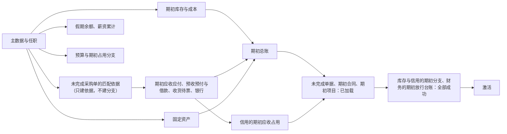

# 客户上线：导入、期初与切点

客户第一次上线时，要把旧系统的主数据、期初库存与成本、应收应付、总账余额与未完成单据带进来；上线之后，日常也有批量导入（价格表、客户名单）。演示数据与测试数据不能代替这些。本页回答：

1. 导入走什么入口？校验、确认、幂等、部分失败、续跑怎样处理？
2. 期初事实怎样表达，才能既有可解释的来源，又不伪造历史交易？
3. 上线切点怎样防止库存、应收、成本或凭证被重复形成？
4. 怎样试迁移、对账、签字确认，出了问题怎样退回？

实施排期：平台级导入工具不提前开发，规范在此写全。

## 方案比较

| 路线 | 判断 |
| --- | --- |
| **采用**：导入是后台工作，先全量校验出报告，确认后分块写入；写入走与界面相同的业务入口；期初以专门的“期初”业务类型形成流水与未清项；批次在激活前对业务不可见；以来源身份登记保证幂等；试迁移与对账签字后切换 | 业务规则只有一套；重跑不会翻倍；对账不通过的批次不生效；切点前后的事实不会重复 |
| 直接写结存与余额表 | 快，但没有流水与来源，成本、账龄、对账都无法解释 |
| 把旧系统的全部历史交易作为新交易重放 | 历史可查，但会按新规则重新计价、重新编号、重新发事件，产生与旧系统不同的结果；量大且无必要 |
| 每个组件各写一套导入 | 校验与幂等各不相同；跨组件顺序与对账无人负责 |

## 导入的共同机制

导入由各业务组件的导入入口实现，SDK 提供共同的批次与工作项机制（[协议 01](01-background-work.md)），前端提供统一的导入页面。

| 环节 | 规则 |
| --- | --- |
| 模板 | 由组件按资源定义生成：列、必填、格式、可选值、示例；模板有版本，包含扩展字段（[协议 08](08-extension-fields.md)） |
| 批次 | 上传即创建导入批次（发起人、模板版本、文件摘要、状态）；文件作为批次的受限附件保存：批次的属主组件为发起人申请上传凭证（[协议 12](12-attachments-and-object-storage.md#访问凭证)） |
| 校验 | 全量校验、不写入：格式 → 引用（[协议 07](07-references.md) 的资格检查）→ 业务规则 → 权限与数据范围；复用业务入口的校验，不另写一份 |
| 报告 | 原文件加一列错误原因，可以修改后重新上传；报告同样是受限附件 |
| 确认 | 发起人确认后才写入；确认时按当前授权再检查（D29） |
| 写入 | 分块，每块一个本地事务，走业务入口（状态机、编号、库存、记账、审计）；中断后从下一块继续 |
| 幂等 | **来源身份登记**：每行有来源系统与来源 ID，登记“来源身份 → 新记录身份”，与写入同事务；重跑时已登记的行跳过或按声明更新 |
| 部分成功 | 缺省“有错全不写”；行彼此独立的大批量（例如客户名单）可以声明“跳过错误行” |
| 结果 | 新增、更新、跳过、失败的数量与明细，可下载 |
| 保留 | 批次记录与来源身份登记长期保留（用于对账与追溯）；导入文件与报告按短保留期清理 |

导出与导入同样按发起人当前授权执行与交付（[协议 13 的导出与订阅](13-search-reports-and-datasets.md#导出与订阅)）。

### 批次的状态

| 当前状态 | 事件 | 守卫条件 | 结果状态 |
| --- | --- | --- | --- |
| （无） | 上传 | 发起人有导入权限 | 已上传 |
| 已上传 | 校验完成 | 有错误 | 校验失败（报告可下载；修改后重新上传是新批次） |
| 已上传 | 校验完成 | 没有错误，或声明了“跳过错误行” | 待确认 |
| 待确认 | 发起人确认 | 当前授权仍允许 | 写入中 |
| 写入中 | 一块提交 | 还有未写的块 | 写入中 |
| 写入中 | 中断 | — | 写入中（从下一块继续） |
| 写入中 | 最后一块提交 | 日常导入 | 已完成 |
| 写入中 | 最后一块提交 | 期初批次 | 已加载（对业务不可见） |
| 已加载 | 激活 | 对账门槛通过；依赖的前序批次已激活 | 已激活 |
| 已加载 | 激活 | 对账不通过 | 已加载（报告差异） |
| 已上传、待确认、写入中、已加载 | 丢弃 | 激活之前 | 已丢弃（先取消已建的期初分支；已写入的行与来源身份登记一并删除；已占用的单号作废并登记为空号；审计记录保留并标明批次已丢弃） |
| 校验失败 | — | — | 终态（修改后重新上传是新批次） |

## 期初事实

期初是上线时点之前的结果，以专门的业务类型进入，不伪造成真实发生的新交易：

| 期初内容 | 表达 | 属主 |
| --- | --- | --- |
| 主数据 | 伙伴、产品、组织、员工与币种按普通业务入口导入，带来源身份登记 | `mdm/*` |
| 员工的任职 | 以切点为生效时间建立任职实例；切点之前的任职历史只作只读资料 | `mdm/employee` |
| 期初库存 | 库存的“期初”流水：按仓库、产品、批次或序列号、数量 | `erp/inventory` |
| 期初成本 | 成本子账的期初成本层：数量与金额，按计价方法；成本组件把期初流水与期初成本层按（仓库、产品、批次）对应，不为期初流水产生成本事实（[协议 05b 的期初](05b-inventory-costing.md#期初)） | `erp/costing` |
| 应收与应付 | 逐张未清的发票或单据作为期初未清项：原单号、原日期、到期日、币种与汇率、未清金额；款到发货订单的发票可选带订单参考（待解析参考，订单批次激活时绑定，之后付到它的收款计入该订单的放行台账） | `erp/finance`（应收应付）；`erp/billing` 登记原账单的单号与明细，只作为红字与更正单上的引用文字：不在任何来源登记认领，不发布“已出账”（应收由期初未清项承接，信用的期初占用由期初应收事实建立）。旧系统已开票部分的退货与贷记，一律经可退货参考或经授权的无原单退货 |
| 可退货参考 | 切点前一段退货期内**已开票且已发货**的销售与已入库已开票的采购：按伙伴与产品的数量、单价与出库或入库成本；上线后的退货与红字以它作为原订单行（[协议 05 的退货单](05-billing-settlement-and-payment.md#退货单)）。一般可选，不导入时上线前的货按无原单退货办理；导入未完成订单时，该订单在旧系统已开票且已发货的部分必须同时生成可退货参考 | `erp/sales`、`erp/purchase` |
| 预收、预付与员工借款 | 尚未分配的客户预收、尚未抵扣的供应商预付、尚未结清的员工借款，作为期初未清项；之后按协议 05 的预收、预付与借款规则核销或抵扣。预收的销售订单参考在这一步是**待解析参考**（销售订单在之后的订单批次才加载），不做引用校验：订单批次激活时绑定，并计入该订单的期初放行台账 | `erp/finance` |
| 收货待票 | 上线时已收货未开票的采购，按采购订单行建立期初的“收货待票”子账，承接期初凭证中的暂估应付；这些货没有收货流水（期初库存已含它们）。新系统收到票据时匹配并冲回它，不发布“票据单价确认”，单价差异由财务计入差异科目，不进成本调整。协议 05 与 05b 只引用这一行 | `erp/finance`；`erp/purchase` 的期初匹配依据 |
| 银行账户 | 各账户在切点的**账面余额**（旧系统的余额，不是对账单余额）；未达账项只作为切点后对账的依据：本方已记、银行未记的，等银行入账后对上；银行已记、本方未记的，切点后在新系统按对账补记（不作为期初事实，避免重复） | `erp/payment`；账面余额同时进入期初凭证 |
| 总账余额 | 期初凭证：以切点所在期间的期初日期，按科目、法人、币种；控制科目（应收、应付、预收、预付、员工借款、收货待票、存货、银行、固定资产）等于对应子账的期初合计 | `erp/finance` |
| 固定资产 | 期初资产卡片：原值、累计折旧、剩余使用期、折旧方法；新系统从切点所在期间起计提，不重算切点之前的折旧 | `erp/asset`；原值与累计折旧等于总账的对应科目 |
| 未完成销售订单 | 订单行分别导入三个量：**剩余待发货量**（订购 − 已发货）；**剩余可出账额度**（按出账政策扣除已开票，其中已发货未开票的部分作为期初可出账额度，新系统据此开票）；**期初已开票未发货量**（这部分在新系统发货时不增加 `billable`，与换货补发同理）。已开票的部分不在订单行登记认领，已开票且已发货的由可退货参考承接退货。激活时建立期初分支（[未完成订单与期初分支](#未完成订单与期初分支)） | `erp/sales`；`erp/inventory` 与 `erp/credit` 接受期初命令 |
| 款到发货订单的期初收款覆盖额 | 旧系统已收款、已核销到本订单发票、对应的货尚未发出的金额（尚未分配的预收不在此列，它是期初预收；部分已付的发票余额是期初应收）；激活订单批次时由销售以期初命令交给财务，建立订单的期初放行台账（[协议 05 的放行台账](05-billing-settlement-and-payment.md#放行台账的字段与变化)） | `erp/sales`；`erp/finance` 接受期初命令 |
| 未完成采购订单 | 以剩余数量与金额建立；**已收货未开票**的部分作为采购的期初匹配依据，由收货待票一行承接 | `erp/purchase` |
| 有效合同与订阅 | 期初合同：当前版本、价格与额度承诺、下一个周期的起点；旧系统**已生成订单或已出账**的周期都不再生成（已生成订单、尚未开票的周期由导入的未完成订单承接，订单引用合同周期），框架额度只导入剩余部分 | `erp/contract` |
| 进行中的项目 | 期初项目：估算、已归集成本与已出账金额作为期初值；切点之后的工时、报销与采购照常归集 | `prj/project` |
| 预算 | 已批准的预算版本，以及在途请购、采购订单、未批报销对预算的期初占用分支（与库存、信用的期初分支同一做法，未激活批次的分支期限同样适用） | `erp/budget` |
| 假期余额 | 每名员工、每种假期在切点的余额（旧系统批准时已扣减的口径），作为期初调整；已批准、尚未休的请假作为期初请假单导入，标为“已扣余额”，休假时不再扣减，供排班与考勤显示；上线后这样的请假单被取消时，按尚未休的天数恢复余额 | `hrm/leave` |
| 薪资的年度累计 | 每个法人与薪资组声明**新系统的第一个计薪期间**；年度累计（应发、个税、社保等）截至它之前，供累计计税；它之前的期间不在新系统计算，切点之前的工资单不重算 | `hrm/payroll-core` 与各国薪资 |
| 历史已完成单据 | 默认不作为业务事实导入；需要查阅时作为只读的历史资料（数据集或附件） | 各业务组件 |
| 用户与授权 | 经授权管理的批量计划与确认（[安全 08 的批量计划](security/08-state-and-change-protocol.md#批量计划)），不直接写入；外部身份到平台主体的映射按安全 02 预先登记 | `infra/authz`、身份成员 |

- **期初业务类型不产生总账分录**：期初库存、期初成本层、期初未清项（含预收、预付、员工借款与收货待票）、期初资产卡片、银行账面余额只建立子账；总账只由期初凭证承接，激活时核对控制科目等于子账合计。否则控制科目会被记两次。
- 期初应收激活后，财务向信用**逐张**发布期初应收事实（带未清项身份），信用据此按账单身份建立期初的应收占用，之后的“应收结清”按同一身份处理（[协议 05 的应收形成与信用占用的转换](05-billing-settlement-and-payment.md#应收形成与信用占用的转换)）；没有信用组件时不发布。
- 待解析的订单参考（期初预收、期初应收）在全部订单批次激活后仍没有绑定的（订单没有导入，或批次被丢弃），告警列出；预收留作客户的贷方余额，应收照常，只是不计入任何放行台账。
- 期初业务类型只在上线窗口内开放，需要业务确认（安全 08 的业务确认 profile）；上线完成后关闭，之后的调整走正常更正流程。
- 导入的单号登记在编号序列中，新单号从声明的起点之后开始（[协议 14 的单号](14-data-foundations.md#单号)）。
- 未完成订单的剩余金额必须扣除旧系统已开票的部分，否则出账会再开一次（参考模型的“按全额导入”坏变体）；已开票部分由期初应收未清项承接。同样，期初合同不重复生成已出账的周期，期初项目不重复归集已归集的成本。

## 批次激活

一个期初批次的行分块写入，激活之前对业务不可见（业务查询按批次状态过滤）；激活在属主组件的一个本地事务中进行：

1. 本批次的全部行已写入，没有失败行（或失败行按声明处理完毕）。
2. 需要其他组件配合的期初命令已全部成功（例如[未完成订单与期初分支](#未完成订单与期初分支)）。
3. 对账门槛通过：总账余额一行列出的每个控制科目等于对应子账的期初合计，例如应收控制科目等于期初应收未清项的合计，存货科目等于期初成本层的合计，固定资产科目等于资产卡片的合计。不通过时批次保持“已加载”，报告差异，不激活（参考模型的坏变体）。
4. 激活后发布事件；下游按正常协议投影。批次激活之前不向发件表写事件，所以丢弃批次时没有已发布的事件要撤回。

### 未完成订单与期初分支

- 订单批次加载后、激活前，销售以期初命令逐张建立：向库存与信用的**期初分支**（分支身份由期初订单行确定，幂等），按剩余数量与金额直接进入确认占用（[协议 04](04-order-reservation.md) 的不变量“已确认订单的全部分支都是确认占用”从上线当天成立）；款到发货订单向财务的期初放行台账（期初收款覆盖额）。全部成功才激活订单批次，财务同时绑定带这些订单参考的期初预收。
- 库存可用量不足时报告差异，批次不激活，已建的分支保持（修正后重试按身份幂等）。
- 信用额度不足时期初分支照常建立并标为“超限”（旧系统中已超额的客户常见），按信用政策处理此后的新订单，不逼客户在上线前临时改额度。
- 批次被丢弃时，销售对已建的分支逐个发取消（协议 04 的取消，期初分支同样适用）并撤销期初放行台账，然后才删除行。

跨组件的激活按依赖顺序，每一步的对账以前一步已激活的数据为依据：

分块写入时就让行生效，会让业务在中途看到半个期初（参考模型的坏变体）。

## 上线切点

切点按法人声明，是一个业务日期与时刻：

| 事实 | 处理 |
| --- | --- |
| 切点之前发生 | 只能以期初事实进入 |
| 切点之后发生 | 只在新系统中录入 |
| 旧系统在切点之后仍有补录 | 切点前冻结旧系统；冻结后的补录列入差额迁移，以期初调整进入，并在对账中单独列出 |
| 切点所在期间之前的期间 | 在新系统中标为“上线前”，不可过账（[协议 06](06-period-close.md)） |

## 试迁移、对账与签字

1. **试迁移**：在独立环境中用真实数据完整走一遍，次数按需要；每次记录耗时、失败与差异。
2. **对账**：数量与金额两侧核对——客户、供应商、产品数量；库存数量与金额（按仓库）；应收应付账龄；银行余额；固定资产原值与累计折旧；试算平衡；未完成单据与合同的剩余量。差异逐项解释或修正源数据。
3. **签字**：客户的负责人按对账清单签字确认，签字记录进入上线档案。
4. **正式切换**：冻结旧系统 → 差额迁移 → 激活 → 抽样核对 → 开放。
5. **退回**：激活前发现问题，丢弃新部署中的批次（或整库重建）；激活并开放后不退回，问题按更正流程处理。

## 日常批量导入

上线之后的批量导入（价格表、客户名单、预算）使用同一机制，但没有期初类型：每行按普通业务入口新增或更新，权限与数据范围逐行检查，结果写入审计。

## 参数起始值

| 参数 | 起始值 |
| --- | --- |
| 每块行数 | 500 |
| 单个批次的最大行数 | 20 万行；更大的分批 |
| 导入文件与报告保留 | 30 天 |
| 来源身份登记保留 | 永久（随记录） |
| 试迁移次数 | 至少 2 次，最后一次与正式切换使用同一流程 |
| 未激活批次的期初分支期限 | 7 天；超过告警，有权限的人经业务确认决定激活或丢弃（丢弃时取消分支） |

## 独立预期

| 编号 | 场景 | 固定预期 |
| --- | --- | --- |
| GL01 | 导入 1 万行，第 5,000 行有错 | 校验阶段报告错误，确认前不写入 |
| GL02 | 写入中途中断 | 从下一块继续，不重复 |
| GL03 | 同一文件导入两次 | 来源身份已登记的行跳过或更新，不翻倍 |
| GL04 | 导入者无权操作某门店的商品 | 该行报告无权 |
| GL05 | 引用的客户编码不存在 | 报告引用错误 |
| GL06 | 直接写入库存结存 | 不允许；以期初流水进入 |
| GL07 | 期初应收只给余额 | 不允许；逐张未清项 |
| GL08 | 应收控制科目与未清项合计不等 | 批次不激活，报告差异 |
| GL09 | 期初批次部分写入时查询库存 | 看不到该批次 |
| GL10 | 旧系统部分开票的未完成订单 | 只导入剩余可开票金额 |
| GL11 | 上线后再使用期初类型 | 不允许；走更正流程 |
| GL12 | 切点后旧系统还有补录 | 列入差额迁移，对账中单独列出 |
| GL13 | 上线前期间的过账 | 拒绝 |
| GL14 | 导入的历史发票号与新编号冲突 | 新编号从声明起点之后开始，不冲突 |
| GL15 | 用户与角色的批量导入 | 走授权管理的批量计划与确认 |
| GL16 | 激活前发现问题 | 丢弃批次或重建，不影响旧系统 |
| GL17 | 激活并开放后发现问题 | 不退回，按更正流程 |
| GL18 | 导入文件含个人信息 | 作为受限附件保存，30 天后清理 |
| GL19 | 上线后批量更新价格表 | 普通业务入口，逐行权限检查，写审计 |
| GL20 | 外币期初应收 | 记录原币、汇率与本位币金额 |
| GL21 | 激活已确认的期初销售订单 | 向库存与信用建立期初分支，直接为确认占用；发货时消耗这些分支 |
| GL22 | 期初订单的剩余数量超过期初库存可用量 | 报告差异，该批次不激活 |
| GL23 | 激活期初应收 | 信用建立期初应收占用，客户的总占用包含期初敞口 |
| GL24 | 期初订单使某客户的信用占用超过额度 | 期初分支照常建立并标为超限；此后的新订单按信用政策处理 |
| GL25 | 银行账户的期初余额与总账银行科目不等 | 期初总账批次不激活，报告差异 |
| GL26 | 期初资产卡片的累计折旧 | 新系统从切点所在期间起计提，不重算切点之前的折旧；原值与累计折旧等于总账科目 |
| GL27 | 按月订阅的合同，旧系统已出账到 3 月，切点在 4 月 1 日 | 期初合同的下一个周期从 4 月开始，不重复生成 1–3 月 |
| GL28 | 进行中的项目已归集成本 50 万 | 作为期初值；切点之后只归集新的来源事实 |
| GL29 | 年中上线，员工的年度累计应发与个税 | 作为期初累计导入，供累计计税；不重算切点之前的工资单 |
| GL30 | 期初批次在激活前被丢弃 | 已写入的行与来源身份登记一并删除；重新导入不被当作重复 |
| GL31 | 订阅在旧系统已生成 4 月的订单、尚未开票，切点在 4 月 15 日 | 该订单作为未完成单据导入；期初合同的下一个周期从 5 月开始，不再生成 4 月 |
| GL32 | 旧系统 4 月 25 日已发 4 月工资，切点在 4 月 28 日 | 新系统的第一个计薪期间声明为 5 月；4 月不在新系统计算 |
| GL33 | 员工已批准、尚未休的 3 天年假 | 余额按已扣口径导入；请假单标为已扣余额，休假时不再扣减 |
| GL34 | 期初库存与期初未清项激活时 | 不产生总账分录；总账只由期初凭证承接，控制科目不重复 |
| GL35 | 已发货未开票 10 件、已收货未开票 5 件 | 前者作为订单行的期初可出账额度；后者作为采购的期初匹配依据，由财务的期初收货待票子账承接暂估应付，不再建收货流水 |
| GL36 | 订单批次中第 301 张订单库存不足 | 批次不激活；已建的分支保持，修正后按身份幂等重试；丢弃批次时先取消已建的分支 |
| GL37 | 银行已记、本方未记的手续费 | 不作为期初事实；切点后在新系统按对账补记 |
| GL38 | 期初库存激活后，成本组件收到期初流水 | 与期初成本层按（仓库、产品、批次）对应，不产生成本事实；存货科目只由期初凭证进入，与成本子账一致 |
| GL39 | 期初收货待票的 5 件在新系统收到票据，单价与暂估不同 | 匹配冲回期初收货待票子账，差异由财务计入差异科目；不发布“票据单价确认”，不进成本调整 |
| GL40 | 旧系统有未抵扣的供应商预付 3 000、未分配的客户预收 2 000、员工借款 500 | 作为期初未清项导入；之后按协议 05 在票据匹配、交货核销与报销批准时抵扣 |
| GL41 | 标为已扣余额的 3 天期初请假单，已休 1 天后取消剩余 | 按尚未休的 2 天恢复余额 |
| GL42 | 按法人分批上线：甲法人已上线，乙法人的未完成订单批次已建期初分支、迟迟未激活，两法人共用一个仓库 | 期初分支带期限；超过期限告警，有权限的人经业务确认激活或丢弃（丢弃时取消分支）；期间分支照常占用可用量，告警列出受影响的产品 |
| GL43 | 期初账单批次激活 | 不发布“已出账”，财务不再形成一次应收，信用不再加一次占用 |
| GL44 | 期初预收带一张尚未加载的销售订单参考 | 作为待解析参考导入，不报引用错误；订单批次激活时绑定并计入该订单的放行台账 |
| GL45 | 期初预付的子账合计与总账的预付科目不等 | 对账门槛不通过，批次不激活 |
| GL46 | 导入了可退货参考，客户退回上线前买的 3 件 | 以可退货参考作为原订单行开退货单与红字，贷记以它为上限 |
| GL47 | 上线时有一张在途的采购订单按预算占用 | 预算组件建立期初占用分支；之后票据过账时消耗它，不重复计入实际 |
| GL48 | 款到发货订单在旧系统已开票并收款 1,000，货尚未发出 | 期初收款覆盖额 1,000 建立期初放行台账；上线后放行成功 |
| GL49 | 未完成订单在旧系统已开票 6 件，上线后客户退回其中 2 件 | 订单行不登记期初认领；按导入时生成的可退货参考开退货单与红字 |
| GL50 | 旧系统订单 10 件，已开票 1,000 并收款，已发货 4 件 | 剩余待发货 6 件、剩余可出账 0、期初已开票未发货 6 件；期初覆盖额 600，上线后放行 6 件成功，发货不再增加可出账额度；可退货参考只含已发货的 4 件 |
| GL51 | 旧系统款到发货订单 1,000 已开票，客户付了 600，货未发；期初应收 400 带订单参考 | 订单批次激活时绑定；上线后客户付清 400 计入放行台账，剩余的货可以放行 |
| GL52 | 期初应收激活后，客户付清其中一张旧发票 | 期初应收事实已按这张未清项的身份建立占用，“应收结清”照常减少，不被永久暂存 |

## 参考模型

[上线导入模型](../../work/checks/28-go-live-import.py)（种子 20261013，3,000 次运行）：期初应收、未完成订单（部分已在旧系统开票）分块写入，作业随机中断后续跑或重跑，旧系统的总账控制科目有时与明细不符。

| 检查 | 结果 |
| --- | --- |
| 每个来源行恰好写入一次，无论重跑几次 | 成立 |
| 批次激活前，业务看不到其中任何一行 | 成立（检查的是可见性规则是否执行） |
| 只有控制科目等于未清项合计时才激活 | 成立 |
| 未完成订单不会让旧系统已开票的金额再次可开票 | 成立 |

4 个坏变体全部被发现：没有来源身份登记、分块提交即生效、激活不做对账、未完成订单按全额导入。模型不是导入工具或业务组件的运行结果。

**模型没有覆盖的条款**：期初分支与期初应收占用（GL21–GL24），银行、固定资产、合同、项目、假期与薪资的期初、批次与分支的衔接（GL25–GL37），以及期初放行台账、待解析的订单参考、可退货参考与未完成订单的三个量（GL44、GL46、GL48–GL52），没有建模，靠实现测试。

## 已知风险与待定

- 各组件的导入模板与期初类型，随组件设计逐个声明。
- 统一导入页面的交互（进度、报告下载、确认），随前端页面模块的设计确定（[协议 20](20-frontend.md) 的已知风险）。
- 大量历史交易的只读迁移（作为数据集或附件）的格式，按客户需要专项设计。
- 各国薪资的年度累计口径，随各国薪资组件确定。
- 以上预期尚未在导入工具或业务组件上运行。
