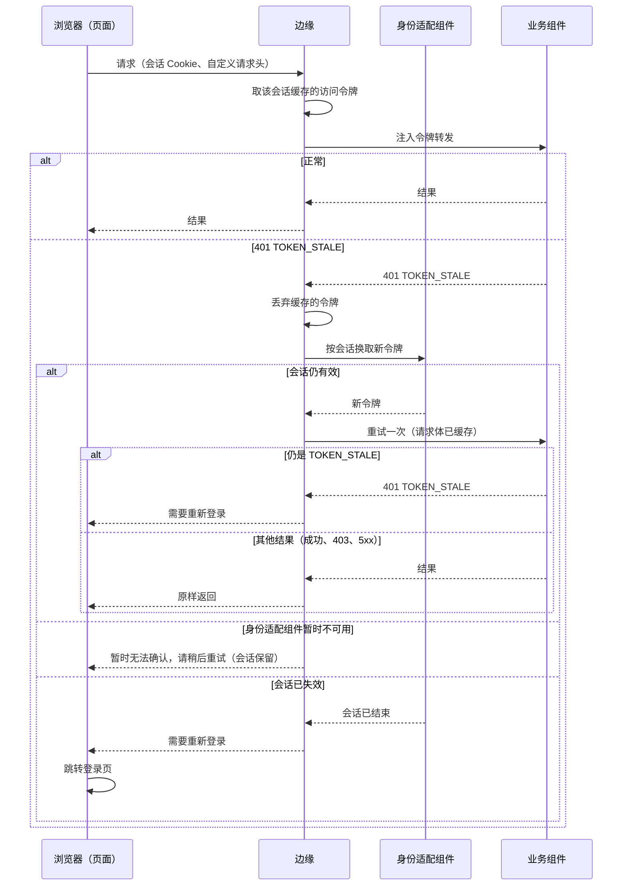

# 前端

本页回答：

1. 前端按什么单位选择、构建与发布？页面模块怎样与后端能力对应？菜单从哪里来？
2. 登录会话放在哪里？令牌、刷新、登出、多标签页怎样处理？
3. 权限与缺件在界面上怎样表现？错误、部分结果、结果未知怎样显示？
4. 断网草稿、旧客户端、多语言与浏览器安全怎样约定？

依据的决定：D17（入口分别选择与替换）、D24（断网保护草稿、联网确认提交）、D34（同一入口构建时组合）、D61（浏览器会话在身份适配组件的服务端，边缘按会话缓存短期令牌）、D68（待办的动作由前端直接发给所属组件）。技术栈（Vue 3、Ant Design Vue 与 vxe-table、Uni-app 与 wot-design-uni、CSS 变量令牌、两层导航）见[前端技术栈](../04-foundations/04-frontend-stack.md)；客户视角见[前端的选型说明](../00-overview/guides/frontend.md)。

## 方案比较

| 路线 | 判断 |
| --- | --- |
| **采用**：入口（PC、移动、仓库终端）各自构建与发布；页面模块声明所需的后端能力与菜单，构建时按客户基线组合；浏览器入口的会话由身份适配组件在服务端持有，边缘按会话缓存其签发的短期访问令牌并注入请求，页面不接触令牌 | 入口可分别替换；缺件在构建时就确定；令牌不暴露给页面脚本，刷新与多标签页的协调在服务端一处完成 |
| 单页应用在浏览器中持有访问与刷新令牌 | 不需要服务端会话；但令牌可被页面脚本读取，多标签页刷新、刷新应答丢失需要前端各自处理 |
| 运行时加载独立发布的页面模块（微前端） | 页面可单独发布；运行组合多、兼容与回退复杂；D34 未作为标准 |

## 入口与页面模块

- **入口**是选择、构建、发布与替换的单位（D17）：PC 办公、移动外勤、仓库终端等。客户只选需要的入口；一个入口可以是标准实现、客户 Fork 或行业实现。
- **页面模块**是入口内的一组页面，声明：

| 声明项 | 说明 |
| --- | --- |
| 所需后端能力 | 组件 ID 与契约主版本、需要的能力（[安全 09b 的能力目录](security/09b-capabilities-and-profiles.md#能力目录)） |
| 菜单与路由 | 菜单项、路由、所需的权限键；所属的组件与领域（服务选择器按它分组） |
| 可选依赖 | 某能力缺失时页面的降级（例如隐藏某个标签页） |
| 文本资源 | 各语言的界面文本 |

- **构建**：入口的构建工具从客户基线（[协议 19 的客户基线与升级](19-config-secrets-registries-release.md#客户基线与升级)）读出选中的组件与版本，只组合所需能力全部存在的页面模块，生成确定版本（D34）。未选组件的页面不被注册，不会出现“菜单可点、打开 404”。
- **菜单的唯一来源**是页面模块的声明：入口构建时随页面模块一起确定。后端组件不声明菜单；装配工具按组件汇总菜单的功能退役（[前端技术栈的菜单与导航的来源](../04-foundations/04-frontend-stack.md#菜单与导航的来源)）。
- **运行时**：已构建的页面再按两类信息决定显示：`features`（这个部署实际启用了什么）与 `permissions`（这个用户能做什么）。只检查 `features` 不检查 `permissions`，会出现菜单可见、打开即被拒的整页错误。
- **`features` 的来源**：装配工具在每次部署时生成（启用的组件、能力与版本），随入口的静态资源由边缘提供；不经身份或授权组件，也不按用户变化。一套部署就是一个客户，不存在“租户能力”。
- 有限业务设置与菜单权限的变化在运行时生效，不需要重建入口。

## 登录与会话

| 入口类型 | 方式 |
| --- | --- |
| 浏览器入口（PC、仓库终端浏览器、移动 H5，包括企业微信与钉钉的内置浏览器） | 授权码 + PKCE；身份适配组件（IAM 成员）作为客户端完成登录，在服务端保存会话与令牌，向浏览器发 `HttpOnly`、`Secure`、`SameSite` 的会话 Cookie；边缘按会话缓存身份适配组件签发的短期访问令牌，到其有效期前直接注入请求头，过期或被推送失效后再向身份适配组件换取（D61） |
| 原生移动应用（Uni-app 出的 App） | 系统浏览器中的授权码 + PKCE；令牌存于系统安全存储；刷新令牌每次更换，旧刷新令牌被再次使用时撤销整串；同一设备上的并发刷新有很短的宽限 |
| 小程序 | 平台登录凭证经身份适配组件换取应用会话，按原生应用的刷新规则；需要时专项设计 |
| 共用终端 | 每人登录；空闲超时短；登出时清除本人会话与本地数据（草稿按下文的隔离规则保留或清除） |

- **为什么用服务端会话**：页面脚本拿不到令牌，跨站脚本无法窃取；刷新、多标签页并发刷新、刷新应答丢失都在身份适配组件中按会话加锁处理一次；这与知识库认证篇“浏览器由同站后端作为客户端”的建议一致。
- **边缘缓存的实现**：常见边缘（Traefik、Nginx、Envoy）的转发认证不带按会话缓存与推送失效，由身份适配组件随附的边缘插件或旁挂进程实现，归身份适配组件维护，列入代表部署实验验证。
- **为什么边缘缓存令牌**（D61）：身份适配组件不进入每个请求的同步路径，它短暂重启不影响已登录用户，与 D57 对授权组件的可用性取舍一致。登出、停用与会话撤销时，身份适配组件向边缘推送失效，边缘立即丢弃缓存；推送丢失时，最坏由令牌有效期（5 分钟）界定，产品说明写明这一上界，不称为即时登出。
- **令牌陈旧**：令牌只携带身份，不携带角色或部门（[安全 02](security/02-trusted-identity-and-attributes.md)），所以角色变更不需要新令牌，经授权视图生效。`TOKEN_STALE` 只用于**身份侧**的事实：令牌在有效期内，但它所属会话的会话代次已推进，或账号的安全状态版本已变（改密码、重置 MFA、强制登出）。规则：
  - 只有入口组件在**准入阶段**、任何副作用之前返回 `401 TOKEN_STALE`（[安全 09a 的错误](security/09a-encoding-and-records.md#求值结果与错误)）；组件调用下游时收到的 401 不原样向上返回，按“暂时无法确认”（可重试的 503）处理。前端只对带幂等键的请求自动重试可重试的错误；不带幂等键的写请求显示“暂时无法确认”，由用户查询后决定，不自动重放。
  - 边缘丢弃该会话缓存的令牌，向身份适配组件按会话换取新令牌，**只重试一次**，并且只重试边缘缓存了请求体的请求（超过缓存上限的不重试，直接返回可重试的错误）。
  - 重试的结果原样返回（成功、403、409、5xx 都是）；只有重试仍是 `TOKEN_STALE`，或身份适配组件回答会话已结束，才返回“需要重新登录”。身份适配组件暂时不可用时，返回“暂时无法确认，请稍后重试”，会话不结束。
  - 前端只在收到“需要重新登录”时跳转登录页。
- **跨站请求伪造**：会话 Cookie 为 `SameSite=Lax`，从邮件或 IM 的通知链接打开系统时仍保持登录；改变状态的请求一律要求自定义请求头，边缘拒绝缺少它的请求，所以 `Lax` 允许的跨站顶层导航不能改变状态。
- **超时**：空闲超时与绝对超时可配置；轮询请求不续期空闲超时；应用会话的超时不晚于身份提供方的会话。
- **登出**：服务端撤销会话与令牌，然后清除浏览器状态。

浏览器会话的状态（身份适配组件中）：

| 当前状态 | 事件 | 守卫条件 | 结果状态 | 动作 |
| --- | --- | --- | --- | --- |
| （无） | 授权码回调 | PKCE 与状态参数核对通过 | 有效 | 保存会话与令牌，发会话 Cookie |
| 有效 | 用户请求 | 未超过空闲与绝对超时 | 有效 | 边缘注入缓存的令牌或换取新令牌；非轮询请求续期空闲超时 |
| 有效 | 空闲超时或绝对超时 | — | 已结束 | 推送失效到边缘 |
| 有效 | 登出、账号停用、会话撤销 | — | 已结束 | 撤销令牌，推送失效到边缘 |
| 有效 | 换取新令牌失败（身份提供方的会话已结束） | — | 已结束 | 边缘返回“需要重新登录” |
| 有效 | 换取新令牌时身份适配组件暂时不可用 | — | 有效 | 边缘返回可重试的错误；不结束会话 |
| 已结束 | 任何请求 | — | 已结束 | 拒绝；前端跳转登录 |

结论：令牌只在边缘与组件之间流动，页面从不处理刷新；陈旧令牌由边缘重换并重试一次，前端只对明确的“需要重新登录”跳转（UI22、UI23）。

## 权限、缺件与错误的显示

| 情况 | 显示 |
| --- | --- |
| 无权的菜单与按钮 | 不显示；后端仍然拒绝（隐藏不是安全边界） |
| 受限字段 | 按后端返回的掩码显示，不在前端推断 |
| 能力未安装 | 页面不注册；可选依赖缺失时按声明降级 |
| 后端拒绝（无权、不存在） | 按错误类别显示，不泄露对象是否存在（[安全 09a 的求值结果与错误](security/09a-encoding-and-records.md#求值结果与错误)） |
| 暂时无法证明（授权视图过期、来源水位超期、数据集的授权列不够新） | 显示“暂时无法确认，请稍后重试”，可重试；不显示为无权，也不显示为空列表（[安全 03](security/03-authorization-acceptance-and-revocation.md)、[协议 13](13-search-reports-and-datasets.md#授权列落后于来源时)） |
| 校验失败 | 定位到字段 |
| 批量操作 | 逐项结果：成功、失败（原因）、跳过；不以总的“成功”掩盖部分失败 |
| 结果未确认（超时、对外命令结果未知、从待办直发所属组件的动作没有得到回答） | 明确显示“处理中，结果未确认”，提供查询（按幂等键或变更键）；不显示为成功或失败 |
| 服务繁忙 | 按重试时间提示，可重试 |
| 数据可能不完整（投影或数据集不完整） | 显示提示与截至时间（[协议 13 的完整水位](13-search-reports-and-datasets.md#完整水位)） |

**统一待办中的动作**（D68）：待办列表只汇总与显示共享任务契约的投影；用户在待办中点击“同意”等动作时，前端把请求直接发给任务所属的组件（边缘按组件路由），带幂等键；结果与错误由所属组件回答，按上表显示。待办不转发动作（[协议 09 的统一待办](09-approval-and-workflow.md#统一待办)）。

## 断网草稿（D24）

- 客户端连不上后端时，表单内容保存为本地草稿；草稿以“入口 + 用户 + 法人 + 表单类型”隔离，同一终端上的其他用户看不到（参考模型的“只按终端保存”坏变体）。
- 草稿记录表单的结构版本与所基于的记录修订（带纪元，或内容摘要，[协议 14 的库内计数与纪元](14-data-foundations.md#库内计数与纪元)）；受限字段默认不进入本地草稿，除非资源定义声明允许。
- 草稿有容量与期限；过期清除。登出时按声明清除或保留本人草稿（共用终端缺省清除；正在提交、结果未确认的草稿与它的幂等键例外，按本人隔离保留到结果确认或过期，本人下次登录时查询结果）。
- 联网后由用户**确认**提交，不自动提交（参考模型的坏变体）；提交时后端按当前授权与记录的当前修订检查，不信任草稿中记录的版本或权限（参考模型的坏变体）；修订已变化时显示差异，由用户决定。
- 本地草稿从不显示为“已提交”“已扣库存”“已审批”。
- 离线采集与自动同步是可选的终端能力，按场景另行设计。

| 当前状态 | 事件 | 守卫条件 | 结果状态 |
| --- | --- | --- | --- |
| （无） | 断网时保存表单 | 本人、本法人、容量未满 | 本地草稿 |
| 本地草稿 | 联网后用户确认提交 | — | 提交中 |
| 本地草稿 | 过期，或共用终端上本人登出 | — | 已清除 |
| 提交中 | 后端接受 | 当前授权允许、所基于的修订仍是当前修订 | 已提交（草稿删除） |
| 提交中 | 后端返回修订已变 | — | 本地草稿（显示差异，由用户决定） |
| 提交中 | 后端拒绝（无权、校验失败） | — | 本地草稿（显示原因） |
| 提交中 | 结果未确认 | — | 提交中（按幂等键查询） |

## 版本与旧客户端

- 入口产物带构建版本；静态资源按内容摘要命名，可长期缓存。
- 后端契约在主版本内只追加，旧客户端继续可用；后端可以为某入口声明最低客户端版本，低于它的客户端提示刷新。
- 入口的回退是发布上一个构建产物；回退前核对它需要的后端契约仍可用。

## 多语言与格式

- 界面文本按语言资源组织；数据中的多语言内容（产品名称等）由后端按用户语言返回。
- 数字与金额按用户的语言格式显示，金额的小数位按币种（[协议 14 的金额与单位](14-data-foundations.md#金额数量汇率与单位)）；业务日期原样显示；时刻按法人时区显示并标明时区，用户偏好只改变显示。

## 浏览器安全

- 内容安全策略：只允许本站脚本，不允许内联脚本；第三方资源经评审。
- 富文本：后端存储时与前端显示时都按白名单清洗；用户上传的文件经附件协议下载（[协议 12](12-attachments-and-object-storage.md)），不内联执行。
- 导出到电子表格的单元格防公式注入（以 `=`、`+`、`-`、`@` 开头的值加前缀）。
- 外部链接与回调地址不由前端拼接。

## 测试

前端测试分层沿用测试规范（FE-1 至 FE-4，[测试与验证](../01-conventions/02-testing-and-validation.md)）；入口的验收至少覆盖：登录与登出、令牌陈旧时的重试、菜单与权限、受限字段、缺件、暂时无法证明、批量部分结果、结果未确认、待办直发动作、断网草稿与确认提交、权限撤销后的提交、多用户共用终端、旧客户端提示、多语言。

## 参数起始值

| 参数 | 起始值 |
| --- | --- |
| 浏览器会话空闲超时 | 30 分钟（共用终端 10 分钟） |
| 浏览器会话绝对超时 | 12 小时 |
| 注入的访问令牌有效期 | 5 分钟 |
| 令牌陈旧时边缘的重试 | 1 次 |
| 移动端刷新令牌 | 空闲 7 天，绝对 30 天 |
| 草稿保留 | 7 天 |
| 每用户草稿容量 | 5 MiB |

## 参考模型

[断网草稿模型](../../work/checks/32-offline-drafts.py)（种子 20261013，3,000 次运行）：两名用户共用终端，断网时编辑草稿，服务端记录不断变化，权限随机撤销与恢复；联网后提交。

| 检查 | 结果 |
| --- | --- |
| 用户看不到也提交不了他人的草稿 | 成立 |
| 草稿只在本人确认后提交 | 成立 |
| 服务端只在用户当前有权、草稿基于当前修订时应用 | 成立 |

3 个坏变体全部被发现：只按终端保存草稿、联网后自动提交、服务端信任草稿中的版本与权限。模型不是前端或后端的运行结果。

**模型没有覆盖的条款**：边缘令牌缓存与失效推送、令牌陈旧时的重试、身份适配组件重启与 `D_src_high` 的关系（UI19–UI23）、`features` 的生成与提供、菜单的构建组合，靠代表部署实验与端到端测试。

## 独立预期

| 编号 | 场景 | 固定预期 |
| --- | --- | --- |
| UI01 | 客户未选库存组件 | 库存页面不注册，没有菜单 |
| UI02 | 已安装但用户无权 | 菜单不显示；直接访问时后端拒绝 |
| UI03 | 只替换移动入口 | PC 入口不受影响 |
| UI04 | 页面脚本读取访问令牌 | 拿不到；令牌在服务端 |
| UI05 | 两个标签页同时需要刷新 | 身份适配组件按会话处理一次 |
| UI06 | 缺少自定义请求头的状态变更请求 | 边缘拒绝 |
| UI07 | 登出后使用旧 Cookie | 会话已撤销，拒绝 |
| UI08 | 批量审批 20 张，3 张失败 | 逐项显示结果 |
| UI09 | 提交后超时 | 显示结果未确认，可查询 |
| UI10 | 共用终端上用户乙登录 | 看不到用户甲的草稿 |
| UI11 | 联网恢复 | 草稿等待用户确认，不自动提交 |
| UI12 | 草稿提交时权限已撤销 | 后端拒绝 |
| UI13 | 草稿所基于的修订已变化 | 显示差异，由用户决定 |
| UI14 | 受限字段进入本地草稿 | 缺省不允许 |
| UI15 | 旧客户端低于最低版本 | 提示刷新 |
| UI16 | 三位小数币种的金额显示 | 按币种的小数位 |
| UI17 | 富文本中的脚本 | 被清洗 |
| UI18 | 导出值以 `=` 开头 | 加前缀防公式注入 |
| UI19 | 身份适配组件重启 1 分钟以内 | 已登录用户的请求照常（边缘缓存的令牌有效期内，授权侧的来源水位在 `D_src_high` 内）；新登录暂时不可用；超过 `D_src_high` 后高风险操作暂停（D64） |
| UI20 | 登出时失效推送丢失 | 最迟在令牌有效期到时失效 |
| UI21 | 从邮件中的通知链接打开系统 | 保持登录；改变状态的请求仍要求自定义请求头 |
| UI22 | 用户改了密码，会话代次推进，入口组件在准入时以 `401 TOKEN_STALE` 拒绝缓存的令牌 | 边缘丢弃缓存、换取新令牌、重试一次；页面不参与，用户无感；角色变更不产生 `TOKEN_STALE`，经授权视图生效 |
| UI23 | 重试后仍是 `TOKEN_STALE`，或会话已结束 | 边缘返回需要重新登录；前端只在这时跳转登录页；重试得到 403、409、5xx 时原样返回，不要求重新登录 |
| UI24 | 客户 Fork 了 PC 入口，新增一个页面模块 | 菜单随该页面模块的声明在入口构建时确定；后端组件不需要改动 |
| UI25 | 部署新增一个组件 | 装配工具重新生成 `features`，边缘随入口静态资源提供；不经身份或授权组件 |
| UI26 | 在待办中点击“同意” | 前端把请求直接发给任务所属的组件，带幂等键；待办不转发；没有回答时显示结果未确认 |
| UI27 | 报表的授权列不够新，受限用户查询 | 显示暂时无法确认、可重试；不显示为无权或空列表 |
| UI28 | 组件 A 已提交本地事务，再调用下游 B 时 B 返回 401 | A 不把 401 原样向上返回，按暂时无法确认处理；边缘不会因此重放 A 的请求 |
| UI29 | 换取新令牌时身份适配组件正在重启 | 返回暂时无法确认、可重试；会话不结束 |
| UI30 | 共用终端上，提交中的草稿结果未确认时本人登出 | 草稿与幂等键保留到结果确认或过期，再按共用终端规则清除 |
| UI31 | 一个已在组件提交了本地事务的写请求，因下游的令牌陈旧被返回可重试的 503 | 请求带幂等键时前端自动重试，按幂等键返回原结果；不带幂等键的不自动重放，显示暂时无法确认 |

## 已知风险与待定

- 入口与页面模块的仓库划分（原 `frontend/standard` 拆成按入口的实现）、共享代码包与构建工具，随重建计划确定。
- 身份适配组件的会话存储、边缘的令牌缓存与失效推送的具体配置，随身份成员的设计与代表部署实验验证。
- 小程序、企业微信与钉钉内 H5 的登录流程，随身份成员的设计专项确定；小程序的凭证只能存平台提供的存储，安全性弱于原生应用的系统安全存储，在专项设计中给出补偿（更短的有效期）。
- 统一导入页面（协议 16）的交互：进度、报告下载与确认，随页面模块的设计确定。
- 仓库终端的具体技术按客户场景确定；可选的离线采集能力按场景另行设计。
- 浏览器会话的服务端方案（D61）在代表部署实验中验证延迟与可用性。
- 以上预期尚未在前端或端到端验收上运行。
