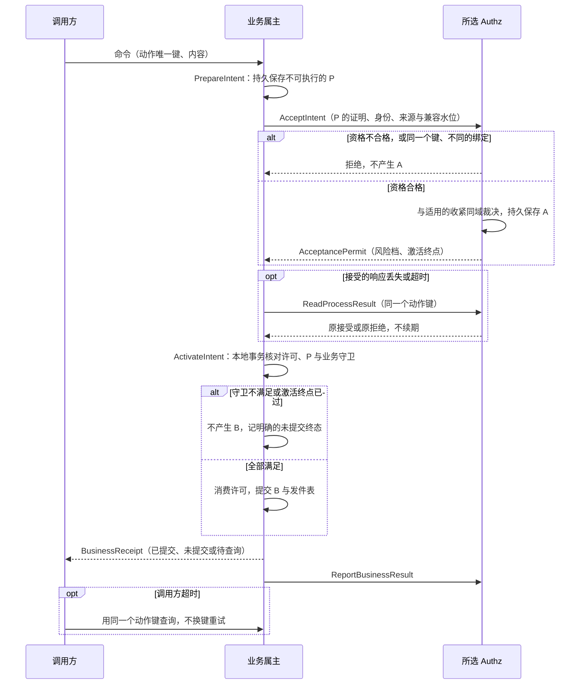
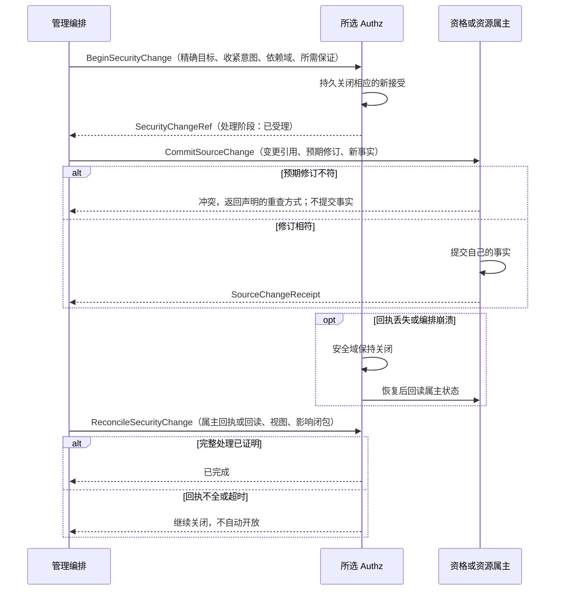

# 共同安全结构、接口与能力兼容

本页回答：各组件在安全上具体交换什么记录、调用什么接口、谁负责证明什么，以及怎样识别一个成员缺少某项能力、新旧版本怎样兼容与切换。行为规则的唯一来源是[安全 01](01-authorization-evaluation.md)到[安全 05](05-sharing-delegation-and-impersonation.md)；本页只收敛它们的输入与输出，不复制公式与生命周期。逐字段的编码、摘要规则、能力目录与 profile 见[安全 09](09a-encoding-and-records.md)；本页的接口表是语义规格，不代表正式契约已经发布，也不代表所有客户组合已经合格。

## 目标与方案

默认按小公司开发，按客户的需要选择配置、专项组件与部署。共同结构从一开始就保留有限扩展与替换的边界，不要求基础成员实现全部扩展，也不承诺无限的规模。本页解决“组件具体交换什么、谁能证明、怎样识别能力不足”，不重新选择权限产品。

| 路线 | 取舍 |
| --- | --- |
| **采用**：类型明确的共同记录与接口，能力按语义、限制与责任声明 | 同一业务要求可以在不同提供方上核对，SDK 与属主各自承担执行义务；代价是增加显式验证与版本维护的成本 |
| 各成员只返回 allow 或 deny，调用方自行补来源、字段与时间 | 无法表达未知、完整集合、限定接受与撤销完成，业务组件容易各写一套 |
| 全部成员暴露相同的数据库结构与策略语言 | 表面统一，实际绑死实现，精简成员被迫承担用不到的图与策略能力；不采用 |

共同记录是有限的语义边界，可以由不同的内部实现提供等价的证明。请求不把任意策略代码送进业务组件，业务也不按提供方的名称写分支。一个部署选择一个对外的安全裁决权威；内部多种模型的组合由这个权威声明并验证，不在业务调用方拼接几个提供方的布尔结果。

## 权威与执行责任

| 层或属主 | 负责提供或执行 | 不能因此接管 |
| --- | --- | --- |
| 部署管理与受控签发 | 信任域、组件与实例的映射、凭据与实际的运行准入 | 用户的业务授予、员工任职与资源事实 |
| IAM | 平台主体、精确的外部身份链接、会话与认证、账号状态的证据 | 用登录时的角色或部门代替当前的授权与组织事实 |
| 组织与员工属主 | 组织、员工、任职实例、责任绑定所需的事实与变更依据 | 因为岗位名直接创建业务角色或审批许可 |
| 所选的 Authz | 客户的授予、角色、管理与个人委托记录；受控的安全视图、完整求值、接受与收紧的裁决 | 写别的组件的数据库；为未完成的事实签发新鲜的证明 |
| 业务与关系属主 | 资源的声明与事实、关系权威、意图 P、提交 B 与发件表、本地守卫、输出与业务结果 | 接受客户端自报的负责人；用内部系统读取扩大用户的响应 |
| 三种语言的 SDK 与 runtime | 构造受信上下文、验证证据、适配有限表示、查询、字段与守卫的入口、错误映射 | 自行签发任意的身份或许可；代替属主的持久事实 |
| 装配工具与验收工具 | 校验声明的闭包、精确的版本、制品与配置；验证声明实际成立 | 只凭安装成功宣称安全合格；静默改变风险档 |
| 前端与 BFF | 声明页面的需求，传播明确的请求模式，显示资格与处理状态 | 把按钮状态或客户端缓存当作提交许可 |

外壳只改变部署。合并到一个进程不消除各属主、真实的网络、独立的凭据与契约；runtime 可以复用验证代码，但不共享“当前用户”，也不共享全权签发的私钥。高性能成员可以优化内部的索引、缓存与裁决域，不能改变本表的责任。

## 共同标识与封装

以下英文名称是模型标签，不是登记的权限键、错误键、组件 ID 或线字段名。正式编码在安全 09 中逐项映射与评审，不从本页的表名直接生成产品 API。

| 结构 | 最少的语义与校验 |
| --- | --- |
| `PrincipalRef` | 部署或信任域、主体类别、稳定的主体 ID；组件的逻辑身份与运行实例分开；不能用版本号、邮箱或显示名作身份 |
| `ObjectRef` | 部署、权威属主、资源或记录类型、稳定 ID；按声明的命名空间定位，类型不同而 ID 相同的不是同一个对象 |
| `RevisionRef` | 权威、修订域、对象或集合的身份、不透明的修订值及其比较与兼容规则；不是全局可比的裸整数 |
| `DefinitionRef` | 声明的属主；契约、模型、资源、动作或字段定义的版本与内容摘要；按精确语义匹配，不能只看组件的主版本相同 |
| `TimeWindow` | UTC 的起止、精度与时钟 profile，左闭右开；“无固定终点”只用于明确允许它的类型，缺字段不表示无限期 |
| `RecordEnvelope` | 记录类别、schema 与语义版本、部署与权威、稳定的实例 ID 与修订、必要的能力与 profile 引用；有用途的证据另附发行、终点与证明材料 |
| `EvidenceRef` | 证据类别、可信的发行者、用途与目标受众、绑定的记录与修订、核验时刻与终点、可验证的载体或认证回读的引用 |

- **三种“类别”分开**：`source_kind` 表示业务授权的来源，凭据类别表示验证用途，请求模式表示实际的执行路径；三者不能塞进同一个 `kind`。对象 ID、修订值与任职 ID 都不携带访问许可。
- **显式存在性**：安全输入区分“已知空”“已知 null”“未取得”“不支持”；未知的枚举值与零值不代表全集，也不代表允许。
- **全集与空集**：列表型的“全部”必须用显式的受限全集表达；空列表只表示空集合。
- **数值与比较**：十进制条件带币种或单位、精度与比较语义，不通过浮点数或无单位的字符串比较。集合的顺序有无业务含义、去重的身份、时间精度与文本比较规则，在编码表中登记，不由 Go、Python、TypeScript 各自猜测。
- **内容摘要**：绑定 schema、语义与编码的版本，以及全部有授权意义的字段，使用无歧义的表示。默认的 protobuf 序列化结果或其 deterministic 选项不能作为跨版本的规范摘要，[Protobuf 官方说明](https://protobuf.dev/programming-guides/serialization-not-canonical/)明确它的序列化不是规范形式。摘要编码与正反向量见[安全 09 的规范编码与摘要](09a-encoding-and-records.md#规范编码与摘要)；本项目不自创密码算法。

## 身份、资格与事实证据

| 结构 | 必须保留的字段组 | 验证者与边界 |
| --- | --- | --- |
| `VerifiedContext` | 部署、明确的请求模式、实际操作者、被代表主体、直接服务与实例、选定的任职、委托或扮演的引用、认证与会话证据、请求目的与截止时间 | 由 runtime 的受信入口构造；客户端只能提交选择意图；下游重新验证跨网络的证据，不信 `verified=true` |
| `QualificationEvidence` | 资格属主、主体与任职实例、责任绑定、组织与法人关联、当前状态与时间窗、修订与安全下界 | 来源属主负责事实，安全裁决权威证明它已被完整纳入；历史任职 ID 不证明当前资格 |
| `FactEvidence` | 对象与资源定义、事实修订、所需已声明属性的类型与值（或“不可取得”的状态）、来源与完整性、水位与兼容范围 | 属主提供真实的旧事实或校验后的候选事实；其他组件不能把任意请求体包装成权威证据 |
| `SecurityViewEvidence` | 裁决权威与恢复代次、模型与能力版本、完整的适用域、安全修订与依赖水位、核验请求的发出时刻（组件的单调时钟）、有效期与关闭状态 | 发行者具备完整处理的证明；只有 Authz 本次重新计算的回答（包括“修订未变”）能续期；失联的旧投影、缓存或代理返回的 304、组件重放的旧回答都不续期（[安全 03 的授权视图与核验](03-authorization-acceptance-and-revocation.md#授权视图与核验)） |

- 上下文中的原始发起人另作历史责任的引用。系统续办凭已建立的 B 的过程依据进行，不把历史用户当作当前用户。
- 普通读取可以使用合格的有界证据；关键接受与敏感输出使用它们声明的更强 profile。
- 事实返回带签名，不自动证明全部变化已纳入。完整性是对适用域与变化进度的证明，不是一个可以随意填写的布尔值。
- **跨组件证明的方式**：起始推荐是“可以认证回读的属主引用”或“限定用途的属主证明”，两者的选择要核对网络与恢复的预算以及签发信任（[已知风险与待定](#已知风险与待定)）。业务组件不持有其他属主的签发私钥。凭据验证、事实证明、读取证据与接受许可的用途互斥，不能因为由同一个 issuer 签名就互换。JWT 载体的验证 profile 必须明确区分各类令牌（[RFC 8725 §3.12](https://www.rfc-editor.org/rfc/rfc8725.html#section-3.12)）。

## 完整段、来源与治理记录

| 结构 | 内容与不变量 |
| --- | --- |
| `GrantSegment` | 段 ID、授予或来源的引用、主体与资格绑定、一个资源类型与一个操作、完整的合取范围与条件、读写字段集、有效窗；不拆出可以跨来源拼接的最宽维度 |
| `GrantSource` | 明确的来源类型、权威记录与修订、治理单元或个人根、适用的资源契约、当前必要的资格与依赖引用；历史授出人单独保存 |
| `ManagementUnit`、`ManagementHolding` | 前者是机构职责与治理父来源、目标管理域、管理动作与完整的授出上限；后者另存实际持有的主体、资格实例与时间窗；个人卸任不等于机构单元关闭 |
| `RoleRevision`、`RoleBinding` | 不可变的角色内容修订、候选或退役状态；客户每一份实际绑定及其资格与范围；新模板不自动替换已确认的绑定 |
| `ChangePlan`、`ContainmentWitness` | 请求者与确认者、目标与新旧修订、影响集合、候选完整段及每段的完整上限见证、有限证明规则的版本、预算与有效期、幂等键与结果引用 |
| `InstitutionalShare` | 资源与治理资格、接收主体或受控的组、读取段与字段、期限、共享规则的修订；来源默认不是授出操作人的永久个人许可 |
| `DelegationEdge` | 根与父边、实际的授出主体与受托主体、合法的确认、创建上限、当前的来源资格与修订、目的或任务、范围、字段与期限、再委托许可与深度、状态 |
| `ImpersonationSession` | 真实的支持人员、目标主体、专门的资格与确认依据、只读的目标与字段上限、起止与撤销、通知引用与隔离的会话标识 |

- 共享与委托来源允许的类型集合属于版本化的能力。普通共享、个人委托、机构管理父链与技术调用历史不能互相改名；每类记录的失效规则按[安全 05](05-sharing-delegation-and-impersonation.md)与[安全 04](04-authorization-administration-and-appointments.md)。业务关系由关系属主提供，Authz 保存的受控视图不能反过来成为修改团队或层级的入口。
- 求值段只是执行视图，管理、资格与资源记录各有自己唯一的权威。临时的求值结果不能直接持久化成普通授予。
- 包含见证绑定当前的管理者、目标、上限与候选内容，不是可以带到以后的批次永久复用的许可；每个生效点重新验证。有限包含算法与分支展开的预算见[安全 07](07-finite-expressions-containment-and-queries.md)；状态与生效点见[安全 08](08-state-and-change-protocol.md)。

## 资源、动作与副作用声明

业务组件的每个版本必须提交完整的 `ResourceDefinition`、`OperationDefinition` 与 `FieldDefinition`：稳定的引用、权威属性及其来源、`view_key`、动作与输出所用的读取键、字段到列或派生依赖的映射、共享与代理规则、所需的资格与职责分离、查询与出口能力、风险与副作用 profile。

| 声明组 | 必须明确 |
| --- | --- |
| 调用模式 | 直接用户、服务代理、系统、固定任务或事件、渠道回调、显式公开，各自的证据与方法准入；不凭某个请求头是否存在来猜模式 |
| 读取与动作 | 通常列表、特殊读取或导出、可执行动作的集合分别声明；授权资格、业务可执行、A 与 B 不合并 |
| 字段 | 普通、受限、不可输出的秘密；读取键与写入键；查询用途与派生依赖；新增而未分类的字段使声明不合格 |
| 副作用 | 业务写入、外部指令或投递、作业、订阅或文件能力的创建、管理变更、必要的审计、会话与通知，分别登记；不能只看 HTTP 动词 |
| 风险与出口 | 有界读取、权威的敏感读取、A 或严格的 B、严格的输出屏障，分别指定；分页、批量、后台、缓存、下载与冷查询都映射到相同的保证 |

- 一个动作可能产生多个副作用，按全部声明检查，不能只取其中最低的风险。
- 组件的声明设定最低保证；部署只能选择满足它的 profile，或明确改变所启用的业务，不能用配置把付款改为陈旧读取。
- 新增的路由、resolver 或任务未登记、采用未知的 profile、或存在未覆盖的出口时，构建、启动或装配检查失败；运行时发现变化，则保护受影响的能力。
- **profile 的形状**：profile 是不可变的内容版本加受控的实际配置；来源健康、认证与资格、最大窗口、期限、时钟、激活、批次与字节、证明与查询预算、确认与通知、失败与停止行为，都绑定版本。限制的方向逐项定义：时效上界越小越严，能力覆盖必须包含所需的集合，保证级别按适用的操作比较；不能把全部数字机械地取最小值，也不能从版本号更大推出更强。
- [安全 03 的起始参数](03-authorization-acceptance-and-revocation.md#起始参数与可配置边界)与安全 05 只读扮演的 15 分钟上限，仍是待评审的起始值。本页只确定参数的责任与验证形状，不产生默认的配置键或对客户的性能承诺；profile 的字段见[安全 09 的 profile](09b-capabilities-and-profiles.md#profile)。

## 求值与查询接口

| 接口 | 输入 | 返回与执行义务 |
| --- | --- | --- |
| `VerifyRequest` | 入口定义、原凭据或直接服务的证明、明确的选择意图 | 受信的上下文，或验证失败；没有系统兜底的主体 |
| `ResolveFacts` | 已认证的调用方、所需的对象、属性与资格声明、用途、水位与期限 | 完整合格的证据，或逐项的未知与不可得；不能泄漏未获准的属性 |
| `EvaluateObject` | 已验证的上下文 C、操作与资源定义、权威的旧事实或候选事实、必要的安全视图 | 允许、明确拒绝或无法证明，以及逐记录的字段、依据与终点；这是资格决定，不是 A 许可 |
| `PlanAuthorizedQuery` | 明确的列表用途、筛选、排序、字段与聚合、C、定义、数据视图与必要水位、预算 | 有完整集合证明的有限计划，或“不可完成”；不返回可以拼接的原始 SQL |
| `ExecuteAuthorizedQuery` | 合格的计划、属主的数据访问适配、当前必要的证据 | 全部分支授权并去重后，统一分页与聚合；逐记录的字段映射、内容兼容与出口截止检查 |
| `EvaluateBusinessAction` | 授权资格的结果、任务、单据与业务规则及其修订 | 可执行、明确的业务拒绝或未知；属主实际提交时仍重新验证必需的控制 |

- 接口可以是本地的 runtime 入口，也可以是认证的 RPC，位置不改变语义。`ResolveFacts` 是每个来源各自的受限适配操作，不新增一个可以任意读取全组件数据库的中央属性查询服务。普通的服务内部计算与用户输出所用的权限，分别校验。
- **查询计划的绑定**：至少绑定类型、列表用途与操作、完整段或等价的候选证明、字段可用性、筛选、排序与聚合、数据视图、C 的安全身份与请求模式、模型与定义、必要的水位、期限与预算。SQL 由受信的数据适配编译，参数化，并执行安全 01 的完整集合契约；图结果的截断或缺页、未知的分支、冷热层缺覆盖，不能冒充完整的计划。编译规则见[安全 07 的完整查询](07-finite-expressions-containment-and-queries.md#完整查询)。
- **计划与游标是受保护的执行状态**，不是客户端可以编辑的策略。可以用服务端引用或有完整性保护的载体，但不因此免除当前资格、内容与截止的重新验证。来源或模型改变后，无法证明安全集合兼容，就重新查询，返回新的安全上下文，不伪称是原快照的下一页。响应可以包含逐行的动作“未知”，但不能把只证明了一部分的动作集合标成完整。
- **字段输出**由唯一的受控映射执行。合法的业务 null 与授权掩码，分别通过值与声明的掩码元数据表达；字段未登记、无法求值或出口漏映射，不是可以随手置 null 的“已通过”。批量按业务定义的整批或逐项边界返回每项的结果，不用总体成功掩盖未知的项。

## 接受、提交、变更与输出接口

| 接口或记录 | 权威与输入 | 返回与限制 |
| --- | --- | --- |
| `PrepareIntent`、`IntentRef` | 业务属主；真实的身份与请求模式、动作的唯一键、内容与资源修订、关键摘要与业务定义 | 持久、不可执行的 P 及其受控证明；准备不产生可执行的事件 |
| `AcceptIntent`、`AcceptancePermit` | Authz；已认证的属主、P 的证明、当前的身份与来源、兼容水位 | 持久的 A 的限定许可、风险档与激活终点；与适用的收紧在同一裁决域内裁决；同一个键、不同的绑定拒绝 |
| `ActivateIntent`、`BusinessReceipt` | 业务属主；许可、P、当前的业务事实与守卫 | 本地原子地消费许可并提交 B 与发件表，或给出明确的未提交终态或“待查询”；不在事务内等待远程裁决 |
| `ReadProcessResult`、`ReportBusinessResult` | 分别向 A 与 B 的属主认证查询与关联 | 接受与业务的终态各自证明；请求超时不证明未执行，不换键，也不续期 |
| `BeginSecurityChange`、`SecurityChangeRef` | 合格的管理路径与安全权威；精确的目标、收紧或放宽的意图、事实与依赖域、所需的保证 | 收紧先持久关闭新接受，放宽先验证已提交的事实；返回处理阶段，不把“已受理”当作完成 |
| `CommitSourceChange`、`SourceChangeReceipt` | 对应的资格或资源属主；变更引用、预期修订与经校验的新事实 | 属主自己的事实提交与状态证明；不自动重新打开安全域 |
| `ReconcileSecurityChange` | 安全权威；完整的属主回执或回读、视图、影响闭包 | 确认变化已完整处理，或继续关闭；不能因超时自动开放 |
| `RegisterParticipants`、`InstallCommitBarrier` | Authz 管理参与者登记，写入属主安装本地守卫 | 绑定撤销代次、范围与完整参与集合的版本；只有全部合格的持久回执才报告 `R_commit` |
| `RegisterContentPublication` | 业务属主准备修订与内容的意图，安全权威核对因果顺序 | 必要的安全下界与限定的发布证明；对物理提交点要求更严的，另用资源发布屏障 |
| `AdmitOutput`、`OutputEvidence` | 声明的出口；合格的读取或敏感准入证据、具体的内容与字段 | 最小的 `cutoff`、批次与字节预算、当前的输出依据；严格停止另外需要输出屏障与完整回执 |

- 这些是逻辑接口，不要求每个接口成为一个服务或一次独立的 RPC。安全与业务确实由同一属主拥有时，按安全 03、04 的同事务 A 与 B 路线处理，意图的绑定与接受、业务记录仍可核对，不强制另建跨库的 P 与 A 流程。分属不同权威时，执行表中的准备、接受与激活协议；不能因为在同一外壳或共用数据库就取消边界。节点的含义与协议见[安全 03 的严格路径](03-authorization-acceptance-and-revocation.md#严格路径可选持久接受与提交屏障)。
- **许可携带的内容**：部署、目标属主与接口、动作键、真实与被代表的主体、履职或委托的依据、P、内容与资源的绑定、模型与 profile、安全依赖、恢复代次、A 的引用与时刻、激活终点；严格的 B 再绑定适用的本地提交守卫代次。普通撤权推进安全修订，不自动改变恢复代次，也不取消合法在先的 A。
- **四类值保持独立**：权威与恢复代次、安全修订与依赖水位、属主提交守卫的代次、内容修订。普通重启、撤销、恢复、内容更新各自按[安全 03 的代次与修订的区分](03-authorization-acceptance-and-revocation.md#代次与修订的区分)变化，不用一个 `version` 代替。跨提供方的水位只按声明过的转换或兼容关系比较，不按整数大小判断新旧。
- **幂等域**：准备、接受、业务结果、收紧、参与者与通知各有持久的身份与幂等域；每个域明确目标与内容绑定，不能把 HTTP 的 request_id 当作所有业务的唯一键。结果查询、清理的墓碑、在途对账与外部事实继续受时间与业务协议约束；本页不新增“过期即失败”的状态。

严格路径中，安全与业务分属不同权威时，上表的接口这样配合：

图说明：A 只在 Authz 的裁决域中产生，B 只在业务属主的本地事务中产生，两者之间没有跨库事务；任何一处响应丢失，都用同一个动作键查询原结果，不换键制造第二次接受，也不把超时当作未执行。

安全处置的收紧（例如紧急停用）由管理编排驱动，接口这样配合：

图说明：收紧先在权威处关闭新接受，再由属主提交事实，最后经对账才宣告完成；中途的任何失败都让安全域保持关闭。放宽按相反的顺序：先取得完整的已提交事实，再开放（[安全 03 的两种来路](03-authorization-acceptance-and-revocation.md#两种来路)）。

## 能力声明与准入

`CapabilityDescriptor` 至少列出：精确的提供方、制品与契约；共同的语义与 schema；每项能力的版本；支持的资源、操作、来源、入口与出口；表达原语；完整性与时间保证；所需的属主、SDK 与平台适配；profile 与预算的上限；对应证据的状态。字段表与能力目录见[安全 09 的能力声明](09b-capabilities-and-profiles.md#能力声明)。

| 类别 | 所需的能力与依赖 | 缺少时的行为 |
| --- | --- | --- |
| 共同核心 | 类型化的身份与事实、完整段与字段绑定、三态决定、定义与版本校验、时间与内容兼容、保护错误 | 不能作为本项目安全契约的合格成员；只返回布尔值不算精简实现 |
| 受保护的用户读取 | 共同核心，加上声明范围内的有界证据、唯一的字段映射、出口 `cutoff` | 不开放该读取；没有可信的期限时，不降为无限期的静态授权 |
| 完整列表与统计 | 共同核心，加上对应列表用途的完整查询与字段用途证明、全部数据层的适配 | 单对象可以独立合格，但不把列表能力伪装成已支持；不能静默删掉未知的分支 |
| 关键业务写入 | 默认路径：完整的当前资格、`W_high` 有效期内的视图、事务内提交前的截止检查、幂等与业务守卫；严格路径另加持久的 A、P 的证明与属主限定的 B（D57） | 阻止启用该写入业务；不改成无期限缓存，也不改成普通 Check 后直接写库 |
| 授权管理与授出共享 | 当前的管理资格与完整包含证明、同属主的 A 与 B 或等价的严格管理屏障、变更闭包 | 没有编辑界面，不免除部署配置或导入变更必须走合格的生效路径 |
| 任职与人员级的职责分离 | 当前的任职与受控的责任绑定、任务与单据规则、提交检查 | 没有真实的关联时，不能把未知的账号当作不同的人 |
| 团队、层级与关系图 | 明确的来源、完整的路径或候选集合、修订与收紧、有限的深度与预算 | 不启用该继承路径；只支持直接授予时也必须符合共同语义 |
| 个人委托与有限再委托 | 当前个人来源与创建上限的交、真实的执行资格、委托链与声明的 profile | 基础委托可以只声明单层；再委托另需逐边的完整证明，不从令牌的 `act` 推出支持 |
| 只读扮演 | 真实与目标身份的隔离、只读的副作用清单、当前目标的读取、短会话与通知落点 | 缺任何一项必要能力就不启用生产扮演，不借超级用户补齐 |
| 敏感读取与导出 | 权威准入、内容与字段绑定、后台与领取时的重新验证、有限的输出 | 页面读取不自动赋予导出；旧文件与 URL 不自动兼容 |
| 严格的 B 与严格的输出停止 | 持久守卫、完整的写者与出口登记、隔离、回执与恢复 | 只能声明已具备的 A 或有界出口保证，不能满足要求更严的业务 |
| agent 与匿名外链 | 独立的受信身份、有限的授予、目的、确认与出口契约 | 预留，不在基础能力集中默认可用 |

- **准入按组合匹配**：准入匹配具体的业务、资源、动作、来源与出口，不是几项布尔值的交集。例如提供方支持图 Check、SDK 支持 SQL 列表，不证明“图授权的库存完整列表”有合格的实现；必须存在覆盖这个组合的计划与数据适配路径。深度、集合规模、租约、时钟与查询预算都校验；超出预算可以拒绝，或改为明确的有界异步流程，不自动减弱安全语义。
- **三种状态分开记录**：声明已支持、实现已存在、某版本在某环境验收通过，分别记录。运行时的能力信息来自已认证的目标与受控的配置、制品对照，不信任任意返回的“全支持”；能力描述也不是当前用户的许可。
- **检验的时点**：安装、配置变更、功能启用、成员或模型切换时，检验全部闭包；实例启动时校验自身的版本与适配；运行时仍验证证据的健康。滚动升级期间只路由到已证明合格的实例，不能随机打到旧能力的实例后再兜底。

## 实现路线的适配矩阵

下表是必须设计与验收的适配义务，不是现有成员的能力测评或产品推荐；外部产品的已核实能力与成员切换见[安全 10](10-providers-and-member-switching.md)。

| 路线 | 怎样承接共同语义 | 不能假定自带的能力 |
| --- | --- | --- |
| 标准的角色与范围成员 | 完整段与字段、当前资格、有限查询；接入共同的管理、接受与收紧，以及属主适配 | 按维度并集的接口与字段接口，不证明完整段已经满足 |
| 静态或精简成员 | 受控、不可变的规则快照，加上当前的身份与资格、有界视图；配置变更走合格的确认与收紧 | 静态文件不等于身份不会撤销；需要写入或管理时仍要合格的接受与管理能力，不能用热重载绕过 |
| 关系图成员 | 有权威的关系源、完整的候选或路径证明；金额、字段与责任通过受控的共同适配 | 单对象 Check 不证明完整列表、字段、管理包含或跨库提交的保证 |
| 策略引擎成员 | 只接入声明过的有限子集，或等价的完整查询证明；控制模型版本与事实来源 | 任意策略不能自动下推为 SQL 或证明包含，也不自带 P、A、B 与输出停止 |
| 平台身份与更大的部署 | 工作负载证实、分域裁决、隔离、预算与监控，按能力接入 | 服务网格、Kubernetes、多副本与更快的轮询，不自动证明当前的业务资格与严格撤销 |

精简部署可以只用一个持久裁决域、有限的基础查询与单层委托；复杂关系、分域、高并发或更强的停止，按实际的业务、尾延迟、锁等待与来源滞后触发。默认的安全核心一致；增加组件与调整配置，只适用于已经实现并验证过的适配路径。新需求超出能力或预算时，先补规范、适配与验收，再推荐客户启用。

## 结果、错误与信息边界

| 结果类别 | 内部语义与对外义务 |
| --- | --- |
| 已证明允许 | 精确的对象、操作、字段、请求模式与终点；仍不代表业务可执行，也不代表 A 或 B 已完成 |
| 已证明拒绝 | 当前完整的事实不匹配、必要的资格不存在、或必需控制明确禁止；对外遵守存在性保护 |
| 无法证明 | 来源不可得、超期或不完整、预算耗尽、修订不相容、闭包未知；不能返回假的空列表或说“无数据” |
| 契约或能力不相容 | 构建、启动或启用时阻止；运行时保护受影响的路径；没有自动退回旧版的兜底 |
| 请求、幂等或修订冲突 | 不产生新的接受或业务事实；返回声明的重查或纠正方式，不自动换键 |
| 处理结果未知、处理中 | A、B 与撤销都有可以查询的持久引用，查询本身也要认证；未知不当作失败，也不当作完整成功 |

- 这些是内部分类。正式的错误目录把它们映射到 HTTP、gRPC 与 GraphQL，写明重试资格、状态查询、可显示的信息与审计（[安全 09 的求值结果与错误](09a-encoding-and-records.md#求值结果与错误)）；不在正文中临时创造生产错误原因。未知的错误按保护映射，不能默认允许。
- 不可见的对象按存在性保护处理；内部诊断不把金额、负责人、角色内容或完整的证明暴露给无权的调用者。
- 追踪与日志只记录必要的稳定引用、版本、类别与结果，不记录可以重放的令牌、许可载体、私钥与未授权的属性。
- 可靠的通知意图、站内可见的落点、外部投递、必需审计的应用保存回执，分别关联；普通请求成功或消息系统的 ACK，不证明后两项已经完成。审计的可靠保存由[协议 03](../03-audit-durability.md)承担，本页的字段列表不代替它。

## 版本演进与切换准入

本节针对新版本发布之后的演进与切换。按 D59，不设计从现有实现与已发布契约的过渡。

schema 可以解析、模型语义等价、能力满足、当前事实与历史及在途状态可以承接，是四道不同的检查。安全字段的“新增可选”，只有旧读者忽略它之后仍保持原有承诺，才算兼容；新的限制、来源类型或操作符必须在语义或 required 能力中可以识别，旧读者不支持时，拒绝该对象或对应的功能，不能忽略限制继续放行。

| 面或对象 | 已知变化 | 准入与退出条件 |
| --- | --- | --- |
| 客户角色、任职、共享、委托 | 来源类型、资格实例、创建上限与字段、治理与旧历史 | 来源不明的列为待复核的受保护对象，不擅自全部扩权，也不永久删除；经客户确认后迁移 |
| 接受记录、水位、守卫 | 在途的 A 与 B、关闭的域、参与集合、恢复代次 | 兼容的限定消费，或可靠地终止与对账；隔离旧写者；不能重新签发为新的宽许可 |
| 查询、游标、缓存、文件 | 不同的集合语义、字段、身份模式与内容关联 | 明确地失效、受限读取或重建；旧游标不延长资格；已提交或已交付的事实不伪造回滚 |
| 滚动发布、客户 Fork、外壳 | 新旧代码可能真实地同时执行 | 逐个核对入口、证据、语义、数据与适配的精确版本；不能只用“在同一进程编译通过”证明网络与持久记录兼容 |

- protobuf 二进制可以解析，不能直接推出 JSON 或业务兼容；ProtoJSON 没有相同的未知字段处理保证，必须分别测试。缺失、null、未知枚举、网关转换、日志与重新序列化，还要核对是否丢失限制或证据。安全关键的扩展要求语义识别后才能使用；只有声明为不影响安全含义的元数据，可以按相应的版本规则忽略（[Protobuf 线兼容说明](https://protobuf.dev/programming-guides/proto3/#updating)、[ProtoJSON 演进说明](https://protobuf.dev/programming-guides/json/#protojson-wire-safety)）。
- **切换顺序**：清点真实的消费者、客户定制与持久对象；形成可以验证的新契约与转换；隔离验证；准备兼容部署，关闭旧的不合格入口；处理在途的许可、事实与当前的安全状态；准入新路径；核对退出与回退的边界。能否同时运行、谁承担写权、截止期限与故障回退，按组合逐一制定；不默认“复制旧快照回滚”就是安全的。成员切换的具体步骤见[安全 10 的成员切换协议](10-providers-and-member-switching.md#成员切换协议)。

## 独立预期

以下 SC 场景只检查共同契约边界的预期，尚未运行 schema、SDK 或实际路径；实例化时与 AE、TI、AT、AM、SD、PA 合并映射，避免生成重复的、镜像实现的测试。

| 编号 | 场景 | 固定预期 |
| --- | --- | --- |
| SC01 | 客户端提交 verified、系统模式或另一个负责人 | 不构造可信的上下文或属主证据；合法验证入口的正例保留 |
| SC02 | 空列表、缺省、未知枚举、null、数字零 | 明确的空与未知分开，不默认为全集或允许；必要的输入缺失时保护 |
| SC03 | 相同的 ID 属于不同的部署或类型；组件升级，或个人改邮箱 | 不串对象或主体，稳定的身份与类型、域保持 |
| SC04 | 修订 100 来自图提供方，99 来自 IAM；普通撤权 | 不跨域比较大小；不用普通的安全修订改变恢复代次，从而取消合法在先的 A |
| SC05 | 两份段的法人、仓库、额度、字段分别取最宽 | 不能产生第三份错配的段；原完整配对的正例成立 |
| SC06 | 授予的机构来源被写成个人，或技术上的 `act` 被写成委托链 | 不猜测失效或委托语义，来源与有效的链都要验证 |
| SC07 | 旧的 protobuf 或 JSON 客户端忽略新的限制、未知的操作符 | 不因为可以解析就继续放行；新语义或能力不合格时拒绝 |
| SC08 | 同一个 issuer 的用户令牌、读取证据、A 许可互换 | 各验证 profile 互斥；用途、受众或绑定不符时拒绝 |
| SC09 | 旧的 `FactEvidence` 重新签上当前时间，或返回 304 | 没有权威的完整核验不续期；内容与水位不相容时保护 |
| SC10 | 用全类型的字段掩码代替逐记录、逐动作的映射；新增字段未分类 | 不扩大字段，声明不合格；业务 null 与掩码可以区分 |
| SC11 | 图 Check 支持加上 SQL 列表支持，但组合没有完整路径 | 装配不能启用该完整列表；合法的单对象另行验证 |
| SC12 | 计划或游标被篡改、未知分支被删掉、先分页再筛权 | 不能冒充完整集合；计划完整性、当前证据与全分支义务生效 |
| SC13 | 同一个动作键、不同的内容；超时后换键重试；旧的 A 重签后扩大 | 冲突，或查询恢复；许可不续期，不重复接受，不扩大 |
| SC14 | Check 的 allow 被当作 A，或 A 被当作库存、财务已提交 | 各状态与回执独立，只有合格的 B 才产生它的业务事实 |
| SC15 | 管理或共享批次复用旧的包含见证，管理者已失去资格 | 每个生效点受保护地重新验证，不借普通 A 的“在先”保证发布宽授权 |
| SC16 | 一个副本的回执宣称所有分库或出口的屏障已安装 | 缺完整的参与与持久隔离证据时，不报告严格完成 |
| SC17 | 未登记的 GET 副作用或后台出口；扮演会话调用它 | 声明或路由不合格；运行时按副作用拒绝，不按 HTTP 只读来猜 |
| SC18 | profile 只改了版本或缩短轮询，就宣称严格的 B 或输出停止 | 保证与完整适配分别验证，不以数字更小代替屏障能力 |
| SC19 | 静态配置热重载扩大许可，或来源故障时退回旧的角色 claims | 没有合格的确认与生效协议不开放，不降级绕过当前资格 |
| SC20 | 滚动升级随机路由到旧模式的实例；Fork 没有实现新字段 | 目标版本或实际适配不合格时不准入；没有自动退回旧版的兜底 |
| SC21 | 跨语言或跨编译版本，直接对 protobuf 求哈希作为同内容的证明 | 按版本化的无歧义编码核对；未定义的编码不宣称摘要兼容 |
| SC22 | 把通知投递的 ACK 当作站内已通知，把审计消息系统的 ACK 当作永久保存 | 各落点与状态分开，缺必需的保证时保护；不把 ACK 当作审计已可靠保存 |
| SC23 | 保留旧备份或旧许可，在切换或回退后重新启用 | 先隔离并核对当前的安全与在途事实，不复活旧授权 |
| SC24 | 只跑了部分能力或某一种语言，或假提供方自报全支持 | 证据范围如实标为部分，空或跳过不算合格；声明与实际对照 |

## 依据与独立判断

知识库的授权架构、组合与版本兼容章节提供中立参考；本项目坚持完整授予、独立组件、没有管理员可配置的 Deny、机构治理与个人委托区分。通用的宽容读取不用于静默忽略安全限制，产品名称也不代替能力证明。

上文引用的 Protobuf 与 RFC 资料用于核对载体与解析的边界，不能替本项目证明跨属主的串行裁决、完整列表、通知、审计或恢复是正确的。

## 已知风险与待定

- 跨组件证明的方式（可以认证回读的属主引用，或限定用途的属主证明）在正式版本之前确定，依据网络与恢复的预算以及签发信任。
- 能力的正式命名与版本规则在冻结时确认（安全 09）。
- 各结构的逐字段编码见安全 09，有限算法与预算见安全 07，状态与生效点见安全 08；仍待定的是：各动作的 profile 取值、签发与回读机制、精确的版本转换、DDL，以及真实的合规证据。
- 以上 SC 预期尚未执行；接口表与可以解析的 schema 不代替 SDK 与真实依赖的证据。
