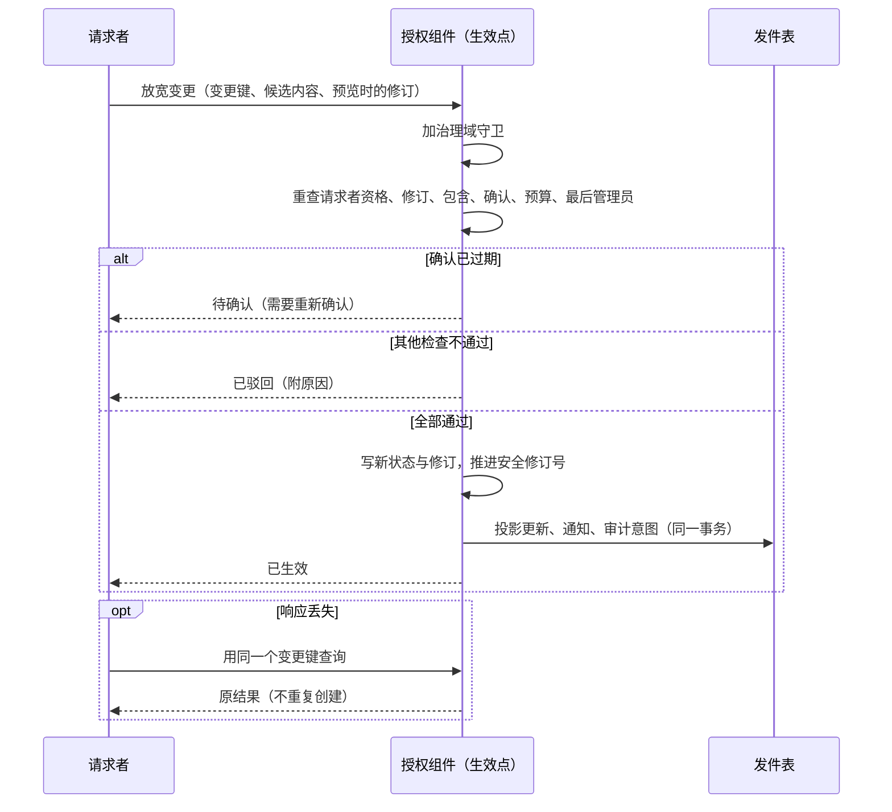
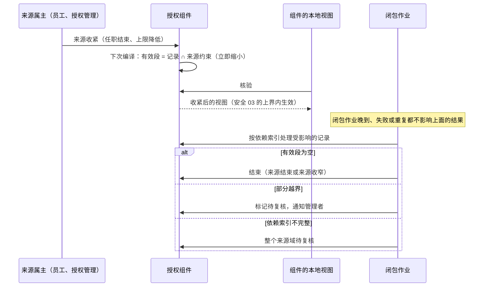

# 安全记录的状态与变更协议

安全 02–05 分别写了各类安全记录“应当怎样”：可信身份（安全 02）、接受与撤销（安全 03）、管理上限（安全 04）、共享与委托（安全 05）。本页给它们定出共同的状态与变更协议，回答四个问题：

1. 全部安全记录用什么状态，怎样流转。
2. 一个变更在哪一刻、经过哪些检查才算生效；结果不明时怎么办。
3. 来源变化之后（任职结束、上限收紧、委托人缩权），依赖它的记录怎样立即失效或缩小，后续的清理做什么。
4. 哪些操作需要独立确认；只有一名管理员的小公司怎么办；最后一名管理员、首次安装与恢复怎样处理。

依据的决定：D30（旧任职关联的授予自动撤销，新授予人工确认）、D35（集中与受限分级管理）、D36（普通授予不因管理员卸任失效）、D37（升级新增权限经客户确认）、D55（项目团队维护客户版本）、D57（默认有界本地授权）、D62（最后一名管理员离职照常生效，部署进入待恢复）。

## 两条基本原则

**一、一套通用生命周期，管全部安全记录。**各类记录（管理职责、管理持有、角色修订、授予、任职、账号关联、共享、委托、扮演、紧急访问、安装认领、批量计划）使用同一组状态与同一个生效点，按记录类型配置参数：需要谁确认、最长有效期、能否续期、通知谁。这与知识库授权决定 D9 的建议一致：所有临时授予形式共用“带期限、可撤销、记录了来源的授予”这一个底层结构，不每种各建一套。

**二、有效性由来源推出，不靠清理作业。**一条记录实际能提供的访问，等于它自己保存的段与它每个来源当前约束的交集。这个交集在编译授权包时，用[安全 07 的逐维求交](07-finite-expressions-containment-and-queries.md#求交委托和扮演的派生段)算出。所以来源一收紧，依赖它的记录立即缩小，不必等影响闭包作业跑完。闭包作业只负责记账、标记复核、通知与清理；它晚到、失败或重复，都不会放出多余的权限。

## 方案比较

| 路线 | 判断 |
| --- | --- |
| **采用**：通用生命周期 + 来源交集求有效 + 闭包作业只记账 | 一处实现、一组向量；收紧立即生效，不依赖作业；新的记录类型只加参数 |
| 每类记录各写状态机，收紧时由作业逐条改状态 | 写法直观，但状态与失效规则各写一遍；作业延迟或漏边期间旧权限仍然有效，这正是“到期了还能用”的来源 |
| 收紧时同步改写所有依赖记录 | 生效即时，但一次收紧可能牵动成千上万条记录，长事务、锁争用；依赖索引有缺口时还会漏改 |

## 受本协议管理的记录

| 记录 | 属主 | 来源（有效性依赖谁） | 放宽时需要 | 谁能收紧 |
| --- | --- | --- | --- | --- |
| 管理职责单元 | 授权组件 | 父职责单元的可授出上限 | 父单元的管理资格 + 包含证明 + 独立确认 | 父单元的管理者；安全处置 |
| 管理持有资格 | 授权组件 | 职责单元的当前状态；绑定的任职实例；账号状态 | 该单元的管理资格 + 独立确认 | 该单元或上级的管理者；本人放弃；安全处置 |
| 客户角色修订 | 授权组件 | 已注册且未退役的权限键 | 角色管理资格；新增权限按 D37 确认 | 角色管理者 |
| 普通授予 | 授权组件 | 治理单元的当前上限；绑定的任职实例；角色修订；账号状态 | 管理资格 + 包含证明（安全 07） | 管辖该授权域的管理者；受授人放弃；来源收紧 |
| 任职实例 | 员工组件 | 员工的在职状态；组织单元有效 | 员工组件的人事流程 | 员工组件 |
| 账号与员工关联 | 员工组件（账号身份由身份组件提供） | 账号状态；员工在职 | 身份管理资格 + 独立确认（确认记录由授权组件的受保护操作保存，员工组件核对后生效） | 身份管理者；安全处置 |
| 机构共享 | 授权组件 | 资源治理的可共享上限；资源当前的归属；接收人的账号状态 | 共享管理资格 + 包含证明 | 资源治理者；接收人放弃；来源收紧 |
| 个人委托边 | 授权组件 | 委托人当前的直接权限；创建时的上限；委托人绑定的任职实例 | 委托人本人（及 profile 要求的确认）+ 包含于委托人当前的权限 | 委托人；受托人放弃；来源收紧 |
| 只读扮演会话 | 身份组件签发会话，授权组件记许可 | 被查看人当前的读取权限；操作者的扮演资格 | 扮演资格 + 原因与工单 + profile 要求的批准 | 操作者退出；被查看人账号停用；管理者撤销；到期 |
| 紧急访问会话 | 授权组件 | 预置的紧急角色；操作者的紧急资格 | 按次批准，或合同事先约定的先用后审 | 到期；管理者撤销 |
| 安装认领 | 授权组件 | 部署代次 | 精确的身份匹配或一次性确认码 | 认领即消耗 |
| 变更计划 | 授权组件 | 计划内各项的目标修订 | 各项分别满足它记录类型的要求 | 计划发起人取消；到期 |

任职实例与账号关联不归授权组件所有，但它们的状态变化同样遵守本页的方向规则：收紧在属主提交时生效，放宽要求完整的事实。授权组件保存的是它们的受控视图（安全 02）；属主提交收紧之后，各组件多久内不再放行，由[安全 03 的内部来源水位](03-authorization-acceptance-and-revocation.md#内部来源的收紧与来源水位)给出上界。

## 通用生命周期

| 状态 | 编码 | 含义 | 是否提供访问 |
| --- | --- | --- | --- |
| 申请 | `requested` | 候选内容已记录 | 否 |
| 待确认 | `awaiting_confirmation` | 等待 profile 要求的确认 | 否 |
| 待生效 | `scheduled` | 已确认，生效时间在未来 | 否；到时间后经生效点重新检查，才转为生效 |
| 生效 | `active` | 正常提供访问 | 是，等于自身的段 ∩ 来源约束 |
| 受保护暂停 | `held` | 因安全处置，或来源约束无法计算，暂不提供访问 | 否 |
| 结束 | `ended` | 终态，记录结束原因 | 否 |

结束原因（`end_reason`）：

| 原因 | 编码 | 什么时候 |
| --- | --- | --- |
| 到期 | `expired` | 到达有效期终点（求值时已不提供访问，状态由闭包作业记账） |
| 撤销 | `revoked` | 有权收紧者撤销 |
| 放弃 | `relinquished` | 受授人、受托人或接收人放弃自己的授予、委托或共享；管理者放弃自己的持有资格 |
| 来源结束 | `source_ended` | 来源本身结束：绑定的任职结束、账号停用、委托人失去来源、职责单元撤销 |
| 来源收窄 | `source_narrowed` | 来源仍有效，但收窄后与本记录不再有交集（例如授予全部落在新上限之外） |
| 被替代 | `superseded` | 新记录包含旧记录的全部访问（续期、扩权），新记录生效时在同一个生效点事务中结束旧记录 |
| 驳回 | `rejected` | 确认人拒绝，或生效点的检查不通过 |
| 取消 | `cancelled` | 生效之前，被有权管理者或所属的批量计划终止 |
| 撤回 | `withdrawn` | 生效之前，申请人自己收回申请 |

### 状态迁移

| 当前状态 | 事件 | 守卫条件 | 结果状态 | 动作 |
| --- | --- | --- | --- | --- |
| （无） | 系统生成建议（例如 D30 的授权建议），或申请人保存草稿 | — | 申请 | 记录候选内容；不提供访问 |
| 申请 | 申请人或合格的管理者提交 | 系统生成的建议只能由合格的管理者提交，提交者成为请求者；系统身份不能作为放宽变更的请求者（D30） | 按下面“提交放宽变更”的各行 | — |
| （无）、申请 | 提交放宽变更 | profile 要求确认 | 待确认 | 记录候选内容与目标修订 |
| （无）、申请 | 提交放宽变更 | 不要求确认，生效时间为现在 | 经生效点（见下行） | — |
| （无）、申请 | 提交放宽变更 | 不要求确认，生效时间在未来 | 待生效 | 登记到点触发生效点的定时工作项 |
| 待确认 | 确认齐全 | 生效时间为现在 | 经生效点 | — |
| 待确认 | 确认齐全 | 生效时间在未来 | 待生效 | 登记到点触发生效点的定时工作项（[协议 01](../01-background-work.md)） |
| 待确认 | 确认人拒绝 | — | 结束（驳回） | 写审计，通知申请人 |
| 申请、待确认、待生效 | 申请人收回 | — | 结束（撤回） | 写审计 |
| 申请、待确认、待生效 | 有权管理者或批量计划终止 | — | 结束（取消） | 写审计 |
| 经生效点 | 全部检查通过 | — | 生效 | 推进受影响域的安全修订；写发件表（投影、通知、审计） |
| 经生效点 | 确认已过期（见下） | — | 待确认 | 需要重新确认；不按旧确认生效 |
| 经生效点 | 变更会减少可用的授权管理员，而最后管理员不变量无法证明；或放宽变更的请求者资格无法证明（见[系统角色与最后管理员](#系统角色与最后管理员)） | — | 原状态 | 返回“处理中”（`ADMIN_AVAILABILITY_UNPROVABLE`，可重试）；不驳回 |
| 经生效点 | 其他检查不通过（请求者资格、包含证明、目标或来源的修订已变、预算、受保护暂停覆盖、最后管理员不变量被证明会破坏） | — | 结束（驳回） | 附原因；批量计划中的项按[批量计划](#批量计划)的项状态表处理 |
| 待生效 | 到达生效时间 | — | 经生效点 | 由定时工作项触发；工作项运行之前不提供访问 |
| 生效 | 收紧（撤销、放弃） | 有权收紧（来源无法证明时按最后一次已应用的事实判断，见下文）；会减少可用管理员的，不破坏最后管理员不变量（安全处置除外） | 结束（撤销或放弃） | 提交即生效，不需要证明与确认 |
| 生效 | 收紧 | 会使可用的授权管理员为零（非安全处置） | 不变 | 驳回（`LAST_ADMIN_PROTECTED`） |
| 生效 | 内容收窄 | 有权收紧 | 生效（新修订） | 记录身份不变，生成新修订号 |
| 生效 | 包含它的新记录（续期、扩权）生效 | 生效点核对新记录包含旧记录的全部访问 | 结束（被替代） | 与新记录在同一个生效点事务中；不包含的变更按[变更方向](#变更方向)拆成先收紧、后放宽 |
| 生效 | 安全处置 | — | 受保护暂停（`security_hold`） | 写审计；记下处置人与处置范围 |
| 生效 | 闭包作业发现有效段为空 | — | 结束（来源结束，或来源收窄） | 记账；有效访问早已为空 |
| 生效 | 闭包作业发现来源约束无法计算 | — | 受保护暂停（`uncomputable`） | — |
| 生效 | 有效期终点到达 | — | 结束（到期） | 求值时已不提供访问；状态由闭包作业记账 |
| 受保护暂停（`uncomputable`） | 闭包作业发现来源约束已可计算 | 内容不变；与同一自然人的 `security_hold` 范围不相交 | 经生效点 | 由闭包作业触发；检查包含、来源与不变量；不重查原请求者的资格（D36：授出者卸任不影响已生效的授予），也不重查确认 |
| 受保护暂停（`security_hold`） | 处置的解除者恢复 | 内容不变；解除者有处置权限 | 经生效点 | 同一处置下的记录一起解除；检查解除者的资格、包含、来源与不变量；覆盖检查排除这些正在恢复的记录；不重查原请求者的资格与确认 |
| 受保护暂停 | 恢复时检查不通过 | — | 受保护暂停（不变） | 告警，转人工；部分越界按“部分越界保持生效”取交集恢复，不因此结束 |
| 受保护暂停 | 撤销 | — | 结束（撤销） | — |
| 受保护暂停 | 有效期终点到达，或来源结束 | — | 结束（到期或来源结束） | 由闭包作业记账 |
| 结束 | 任何事件 | — | 结束（不变） | 永不复活；重新授予是一条新记录，引用旧记录作为前身 |

规则：

- **结束是终态。**结束的记录永不复活；重新授予是一条新记录，引用旧记录作为前身。续期、扩权也一样：新记录包含旧记录的全部访问，新记录生效时旧记录以“被替代”结束（安全 05 的同一规则推广到全部类型）。**改目标或任何含收紧的变更**按[变更方向](#变更方向)拆成两步：先收紧旧记录（立即生效），再为新内容申请新记录；新记录生效之前，旧目标上已经没有访问。
- **到期在求值时生效。**有效期按左闭右开比较，到达终点即不提供访问；把状态改为“结束（到期）”是记账，由闭包作业完成，晚做不影响安全。
- **受保护暂停只能经生效点恢复。**恢复为“生效”必须重新做一次检查，内容不变；内容要变，就是新记录。两种暂停的恢复者不同：来源约束无法计算的暂停（`uncomputable`）由闭包作业在能够证明时自动恢复；安全处置的暂停（`security_hold`）由处置的解除者恢复。两者都不重查原请求者的资格：原请求者事后卸任不影响已生效的授予（D36），一次与受授人无关的暂停不应打破这一点。
- **安全处置的暂停不能被绕开。**生效点对每个放宽检查：新的访问的接收人（受授人、共享的接收人、委托的受托人）对应的**自然人**（关联到同一员工的全部账号，安全 02），在**任何治理域**中有处于 `security_hold` 的记录，且新访问的段与被暂停的段相交时，驳回（`HELD_BY_SECURITY_DISPOSITION`）。适用于全部放宽：授予、机构共享、个人委托边、续期与扩权、待生效记录到点、`uncomputable` 暂停的自动恢复。处置解除之前，这个人在被暂停的范围内拿不到新的访问；恢复被暂停的记录时，覆盖检查排除同一处置下正在一起恢复的记录。
- **修订不改身份，只用于收窄。**记录内容的收窄（例如普通授予的范围缩小）生成新修订号，记录身份不变；扩大范围是放宽，按上一条建新记录。
- **确认的有效期**：没有声明未来生效时间的记录，确认后要在确认有效期（起始 72 小时）内经过生效点；过期回到“待确认”，需要重新确认。声明了未来生效时间的记录，确认一直有效到该生效时间，到时由生效点重新检查其余条件（资格、包含、修订、预算、不变量）；确认的内容或目标修订在此期间被改动，生效点驳回。批量计划的确认有效到计划到期（见[批量计划](#批量计划)）。
- **单条与批量的区别**：单条记录在生效点检查不通过即驳回（附原因，申请人可以按新情况重新申请）；批量计划中的项在目标或来源的修订已变时转“待复核”，其他检查不通过时驳回（批量计划的项状态表）。

## 变更方向

每个变更先归类：

| 方向 | 例子 | 规则 |
| --- | --- | --- |
| 收紧 | 撤销、缩小范围、结束任职、停用账号、暂停、降低上限 | 有权收紧者一提交即生效，不需要包含证明，也不需要确认；任何主体都可以放弃自己的授予、委托或共享 |
| 放宽 | 新增授予、扩大范围或字段、延长期限、新增管理资格、激活会话 | 在生效点重新检查请求者当前的资格、包含证明、所需的确认、来源事实与预算，全部通过才生效 |
| 中性 | 显示名、说明、标签 | 不改变任何访问；仍然记修订与审计 |

- **同时有收紧与放宽的变更拆成两步，先收紧后放宽。**例如把一份授予从法人甲改到法人乙：先缩去甲（立即生效），再按放宽为乙申请。调岗时旧任职在 T 时刻结束、新任职在 T 时刻开始：旧授予在 T 失效，新授予在 T 经生效点检查后才生效；中间不出现“新旧都有效”的窗口。
- 收紧不需要证明，因为它只会减少访问；但“谁有权收紧”仍要检查（安全 04：回收只作用于自己管辖的授权域，不能借管理一个人，撤掉不归自己管的跨域授予）。

## 生效点

每个放宽变更，以及每个改变状态的收紧变更，都在授权组件的一个本地事务里完成，这个事务就是生效点：

1. 按变更涉及的治理域加守卫（安全 03 的同一类守卫），防止并发的收紧与放宽交错。
2. 重新检查：请求者此刻的身份与管理资格；目标记录与来源的修订是否仍是预览时的值；包含证明（安全 07，现场重算，不复用旧见证）；以“被替代”结束旧记录的，新记录包含旧记录；没有与受保护暂停（`security_hold`）的范围相交；所需的确认是否齐全且未过期；预算；最后管理员不变量（见下文）。
3. 写入新状态与修订，推进受影响域的安全修订号，同事务写发件表：投影更新、通知意图、审计意图。
4. 返回结果：已生效、已排定（待生效，到生效时间再经生效点）、已驳回（附原因）、处理中（包括最后管理员不变量暂时无法证明）、待确认；调用方遇到超时或未知时，用同一个变更键查询，不重复提交。

变更键按请求者的命名空间区分。同一个变更键、不同的内容，按冲突驳回。

**与 D57 的关系**：本页定义安全记录“何时变了”；“变了之后各组件何时不再放行”由[安全 03](03-authorization-acceptance-and-revocation.md) 定义。默认路径是：生效点提交并推进安全修订号后，各组件的本地授权视图在短有效期内经权威核验，超期即拒绝或暂缓高风险操作；客户选用严格路径时，再加持久接受与提交屏障。两条路径共用本页的生效点。

结论：放宽只在生效点全部检查通过时生效，预览时的检查不算数；结果未知时按变更键查询，不会重复创建（CP02–CP05）。

## 有效段的计算

编译授权包时，每条生效中的记录按下表与来源求交，结果才是下发的段：

| 记录 | 有效段 |
| --- | --- |
| 普通授予 | 授予的段 ∩ 治理单元当前的上限段；所引用角色修订中已退役的权限键对应的段为空；绑定的任职实例不在生效中、或受授账号已停用时为空 |
| 客户角色修订 | 不单独提供访问；经普通授予使用时，只有已注册且未退役的权限键参与（权限键退役立即使对应的段为空，不等闭包作业） |
| 管理持有资格（作为授出上限） | 职责单元当前的上限 ∩ 父单元当前的上限（逐级）；持有资格本身、绑定的任职或账号失效时为空 |
| 机构共享 | 共享的段 ∩ 资源治理当前的可共享上限；资源已移出原治理范围时为空 |
| 个人委托边 | 委托人当前直接权限的每个段 ∩ 创建时的上限 ∩ 委托边的范围与期限（安全 05）；多层链逐边求交 |
| 只读扮演会话 | 被查看人当前的读取段 ∩ 会话上限；操作者自己的权限不参与 |
| 紧急访问会话 | 预置紧急角色的段（默认只读） |

求交在安全 07 的原子代数里总能算出（每种原子在求交下封闭）。只有一种情况算不出：来源或记录使用了提供方私有的表达。这时该记录进入“受保护暂停”，直到能够证明为止。

**部分越界的授予保持生效**：治理上限收紧后，部分越界的授予保持生效、标记待复核，它的有效段自然就是交集；整体暂停会把仍在上限之内的合法访问一起停掉（安全 04 采用同一规则；参考模型的“部分越界整体暂停”坏变体改变了有效访问，被检查判为错误）。只有出于安全处置的收紧，才整体暂停。

## 影响闭包

来源收紧后，闭包作业按依赖索引找出受影响的记录，逐条处理：

| 情况 | 处理 |
| --- | --- |
| 来源已结束（绑定的任职结束、账号停用、委托人失去来源） | 转为“结束（来源结束）”，写审计与通知 |
| 来源仍有效，但有效段已为空（全部落在新上限之外） | 转为“结束（来源收窄）”，写审计与通知 |
| 部分越界 | 保持生效，标记待复核，通知有权的管理者；复核结论是收窄（生成新修订）或接受现状（有效段本来就是交集） |
| 来源约束无法计算 | 转为“受保护暂停” |
| 依赖索引本身不完整或不可用 | 不判断为“无人受影响”；把整个来源域标为待复核，按最保守的方式计算有效段 |

作业持久记录进度，可以重复执行，结果幂等。正确性不依赖它：参考模型验证了在任何时刻运行闭包作业，所有人的有效访问都不变。

结论：访问的缩小发生在编译视图的那一刻，与闭包作业无关；作业只记账、通知与标记复核（CP01、CP09、CP10、CP12）。

## 确认与受保护操作

本节的“受保护操作”只指安全记录的变更。业务上需要第二人确认的动作（关账的发起与重开、流程实例的迁移、大额调整等）用**业务确认 profile**，由业务组件声明，不进入下列清单，也不需要部署所有者确认。业务确认 profile 声明最少确认人数；声明为不要求独立确认人时（例如单人公司的关账），发起人自己的一次显式确认即可，留审计。

确认要求写在 profile 里：要几个独立确认人、谁有资格、确认多久内有效。独立指不同的自然人：关联到同一员工的多个账号算一个人（安全 02）；申请人不能确认自己的申请。

| 需要确认吗 | 条件 | 由谁确认 |
| --- | --- | --- |
| 受保护操作（见下列） | 部署中有两名以上可用的管理员 | 一名独立确认人 |
| 受保护操作 | 部署中只有一名可用的管理员 | 部署所有者确认（第二认证因素） |
| 普通授予、普通角色修订 | — | 默认不要求第二人（D35：小公司的集中管理不强制第二名员工）；profile 可以加严 |
| 业务确认 | 按业务确认 profile | 按 profile；可以是发起人自己的显式确认 |

标准的受保护操作：

1. 新增或扩大管理职责、授出管理持有资格、再下放管理。
2. 授予或变更系统角色的持有（见下节）。
3. 建立或变更账号与员工的关联；把外部身份映射到**已有的**平台主体，或变更已有的映射（[安全 11](11-identity-member-switching.md)）；重新启用或解冻一个持有授权管理资格的账号。首次登录的自动开通（[安全 02](02-trusted-identity-and-attributes.md#稳定主体与身份链接)，客户配置）为新的外部身份创建一个新的、没有任何授予的平台主体，不改变任何已有主体的映射，不在此列。
4. 紧急访问的激活（合同事先约定的情形可以先用后审，但必须立即通知并在期限内复核）。
5. 超过阈值的批量计划（阈值在 profile 中）。
6. 恢复流程。

**只有一名管理员时**：受保护操作找不到独立确认人，不能取消这一要求（安全 04）。做法是“部署所有者确认”：它是**第二个认证因素**，不是第二个确认人——单人公司中通常是同一个人持有。安装时生成部署所有者的确认凭据，由客户另行保管，与日常登录凭据分开；受保护操作由它作为第二道确认，使用后记录并通知。它与下文用于恢复的**恢复凭据**是两份不同的凭据，分开保管：日常确认的频繁使用不削弱恢复凭据的保管前提。这样单人公司也能完成受保护操作，同时“管理员账号被盗”不足以独自扩大管理权限。单管理员部署中，建立账号与员工的关联（每次入职）也需要这一确认，客户说明中写明这一负担。

## 系统角色与最后管理员

系统角色由产品预置，客户不能修改它们的内容，只能管理谁持有：

| 系统角色 | 用途 | 默认持有 |
| --- | --- | --- |
| 授权管理员 | 全范围的管理上限，用于集中管理 | 安装认领者 |
| 审计查看员 | 查看审计与授权解释，不改任何授权 | 无 |
| 紧急只读 | 紧急访问会话使用的预置角色 | 无人常驻持有，只经紧急访问会话生效 |
| 超级用户 | D37 所述对已注册、未退役权限键的特殊补齐 | 生产环境默认无人持有 |

- **最后管理员不变量**：会减少可用授权管理员的普通变更（撤销、放弃或收窄授权管理员的持有资格，变更系统角色的持有，变更管理职责单元或它的绑定）生效后，部署中必须至少有一份“可用”的授权管理员持有资格，即持有资格生效、账号有效、绑定的任职生效。其他变更不检查这个不变量。生效点在治理域守卫内检查；两名管理员并发互相撤销时，守卫使它们串行，后提交者被驳回。
- **“无法证明”不等于“为零”**：账号与任职的状态来自内部来源（安全 03）；来源对齐中、水位超过 `D_src_high`（管理变更按高风险档判断）或主体被隔离时，相应持有资格的可用性无法证明。会减少可用管理员的变更按三种结果处理：变更后**可证明**可用的管理员至少一名，通过；可证明为零（其余持有资格的来源事实都已应用、水位新鲜，且都不可用），驳回（`LAST_ADMIN_PROTECTED`）；其余情形返回“处理中”（`ADMIN_AVAILABILITY_UNPROVABLE`），稍后重试，不驳回。
- **来源无法证明时的请求者资格**：请求者的管理资格同样依赖内部来源。**收紧**（撤销、放弃、安全处置）在来源无法证明时，按最后一次已应用的来源事实判断请求者是否有权收紧，并在审计中标明“依据未证明是最新的事实”：收紧只减少访问，这样做不放宽任何东西，撤权不因员工或身份组件故障而无法办理。**放宽**的请求者资格必须可证明，否则返回“处理中”。会减少可用管理员的收紧，另按上一条。
- **作业遇到“处理中”**：定时触发生效点的工作项（待生效到点）与闭包作业的自动恢复，把“处理中”当作业务上的等待：放回 `retry_wait`，不计入尝试次数（[协议 01](../01-background-work.md) 的等待结果），超过声明的等待上限（起始 24 小时）才告警转人工。
- **来源事实照常生效**（D62）：这个检查只约束授权组件内的普通变更。“可用”还取决于员工组件的任职与身份组件的账号状态，它们由别的属主提交：来源侧的离职、任职结束与账号停用是事实，照常生效；授权组件应用这些事件后，**可证明**可用管理员为零时，与安全处置一样进入“待恢复”。只是无法证明（来源对齐中、水位过期、主体被隔离）不进入待恢复，只告警。员工组件办理离职时，如果此人是最后一名可用的授权管理员，给出提示，但不阻止。
- **安全处置**（账号被盗、强制停用）不受这个不变量约束，照常生效。因此没有可用管理员时，部署进入“待恢复”状态：期间除恢复流程外的管理变更一律驳回，业务授权照常按各自的来源计算。
- **待恢复的退出**：进入待恢复时，记下每份授权管理员持有资格变为不可用的原因。身份侧的安全冻结、标为被盗或可疑的停用，按安全处置对待。由正常的来源事实进入的（最后一名管理员离职、账号被正常停用），在某份持有资格经来源事实重新被证明可用时自动退出，写审计并通知；其中重新启用或解冻一个持有授权管理资格的账号是受保护操作（见上文清单第 3 项），经身份产品控制台直接启用、没有经过这项确认的，授权组件对该持有资格按无法证明处理，不自动退出。由安全处置进入的，只能经恢复流程退出：被处置的账号重新启用不能自动恢复管理权。

## 安装认领、恢复与紧急访问

**安装认领**：安装时登记一条认领记录，内容是精确的外部身份（签发方 + 主体）或一次性确认码的摘要，带到期时间。首次登录匹配成功时，在同一事务里创建授权管理员持有资格，并把认领标为已消耗；唯一约束保证只能消耗一次。认领与部署代次绑定，用旧备份恢复不会重新打开已消耗的认领。

**恢复**：没有可用的管理员，或需要撤换被盗的管理员时使用。由部署所有者用离线保管的恢复凭据，在部署机上执行恢复命令：

1. 进入恢复窗口：除恢复操作外，管理变更全部驳回。
2. 为指定的精确身份创建新的授权管理员持有资格；推进恢复代次（安全 03），使旧会话与旧许可失效。
3. 通知全部现有管理员与登记的联系人，写审计；要求事后复核并记录结论。
4. 轮换恢复凭据。

恢复不经过可能已经失效的身份系统；不提供绕过认证的接口，也不自动授出超级用户。

**紧急访问**：用于正常流程来不及的情形，例如生产故障需要查看业务数据。预置紧急只读角色；按次批准（或合同事先约定的先用后审）；激活即通知客户管理员，不能关闭；会话期限有上限，延长要重新批准；默认只读、禁止导出；每个请求的审计带会话标识；事后在期限内复核。身份系统不可用时，紧急访问需要不依赖它的认证路径；所选身份成员不具备这项能力时，紧急访问在该部署中不启用。

**项目团队访问客户系统也走这里**（D55）：项目团队与 AI 维护客户版本；团队成员（或代其执行的 AI 工具）进入客户的业务系统，应当是一次获批的紧急访问或临时访问：客户批准、有期限、全程审计、结束后给客户访问记录。不设供应商的常驻账号。

## 员工、账号与任职

- **任职实例**由员工组件拥有：计划中 → 生效 → 结束。法人、部门、岗位等有安全含义的变化，结束旧实例、创建新实例（安全 04），不在原实例上改。员工组件发布带实例身份与修订的事件。
- **账号与员工关联**由员工组件拥有（账号身份由身份组件提供，替换身份成员时关联不随之迁移）：申请 → 待确认（受保护）→ 生效 → 结束。一个员工可以关联多个账号，一个账号最多关联一个员工。关联的建立与变更都是受保护操作，因为它决定了任职授予作用到哪个账号，也决定了职责分离把哪些账号视为同一个人。
- **新任职的授权建议**（D30）：员工组件发布新任职后，授权组件按岗位模板生成授权建议，建议以“申请”状态存在，由合格的管理者确认后才成为普通授予；建议本身不提供访问。旧任职关联的授予在任职结束时由来源交集失效（D30 的“自动撤销”）：任职的终点已登记时随视图下发、到点在本地失效；即时办理的结束在授权组件应用事件后失效，上界见安全 03 的内部来源水位。闭包作业随后把它们记为结束（来源结束）。

## 批量计划

批量计划本身是一条记录，计划内的每一项另有状态。

| 计划状态 | 编码 | 含义 |
| --- | --- | --- |
| 草稿 | `draft` | 正在编辑 |
| 已预览 | `previewed` | 已记下每一项的候选内容与目标修订 |
| 已确认 | `confirmed` | 确认针对预览时记下的内容 |
| 执行中 | `executing` | 各项逐一经过生效点 |
| 已完成 | `completed` | 全部项已生效 |
| 部分完成 | `partially_completed` | 全部项都有最终结果，其中有驳回的项 |
| 已取消 | `cancelled` | 发起人取消；未执行与待复核的项终止 |
| 已到期 | `expired` | 从预览起超过最长时间（起始 7 天）时仍有待执行或待复核的项；这些项终止 |

计划的结束状态按以下顺序判定，互不重叠：发起人取消 → 已取消；到达最长时间时仍有未结束的项 → 已到期；全部项都有最终结果时，全部生效 → 已完成，否则 → 部分完成。已取消与已到期的计划中，已生效的项照常有效。

| 项的当前状态 | 事件 | 结果状态 |
| --- | --- | --- |
| 待执行（`pending`） | 经生效点，全部检查通过 | 已生效（`applied`） |
| 待执行 | 目标或来源的修订已变 | 待复核（`needs_review`） |
| 待执行 | 其他检查不通过 | 已驳回（`rejected`） |
| 待复核 | 合格的人重新确认新内容 | 待执行 |
| 待复核 | 计划到期或取消 | 已驳回（原因：未复核） |
| 待执行 | 计划取消或到期 | 已驳回（原因：计划终止） |

- 预览时记下每一项的候选内容与目标修订；确认针对这些内容。执行时每一项分别经过生效点；目标或来源的修订已变的项转为“待复核”，需要重新确认，不按旧确认生效。
- 计划报告每一项的最终状态，不以“整批成功”掩盖未执行的项；取消只停止未执行的项，已生效的项要用新的收紧变更撤回。
- 新增的人员、新增的角色使用者不自动进入已确认的计划（安全 04）。

## 共享、委托与扮演的参数

这三类记录的行为规则在[安全 05](05-sharing-delegation-and-impersonation.md)；在本协议中，它们是通用生命周期的三组参数：

| 参数 | 机构共享 | 个人委托边 | 只读扮演会话 |
| --- | --- | --- | --- |
| 发起者 | 有共享管理资格的人 | 委托人本人 | 有扮演资格的支持人员 |
| 确认 | 按资源治理的 profile | 按委托类型的 profile；审批代理通常由委托人或上级确认 | 按 profile 批准，必须带原因与工单 |
| 最长期限 | 允许“无固定终点”，但仍随治理上限与接收资格变化 | 按委托类型，例如休假日历；起始值待定 | 15 分钟（起始值），不可刷新 |
| 续期 | 新记录 | 新记录 | 新会话，重新申请 |
| 授出者卸任 | 不影响（机构来源，D36 同理） | 委托人失去来源时，有效段随之为空 | 不适用 |
| 再委托 | 不允许 | 基础 profile 不允许；扩展 profile 有限层数（安全 05） | 不允许 |
| 激活时的通知 | 接收人 | 受托人；审批代理通知相关流程 | 被查看人，在激活事务内写通知意图 |

**通知落点**：会话类记录（扮演、紧急访问）在激活的同一事务里写通知意图，由通知组件投递并写入站内通知；投递失败按通知组件的重试与告警处理，不回滚已激活的会话。部署中没有可用的站内通知能力时，这两类会话不启用（安全 05 的 SD17）。

## 参数起始值

待评审、待实测的起始值，不是客户承诺：

| 参数 | 起始值 |
| --- | --- |
| 确认的有效期（没有声明未来生效时间的记录，确认后多久内必须生效） | 72 小时 |
| 批量计划从预览到执行的最长时间 | 7 天 |
| 受保护操作需要的独立确认人数 | 1 |
| 只读扮演会话 | 15 分钟，不可刷新 |
| 紧急访问会话 | 4 小时，延长须重新批准 |
| 紧急访问的事后复核期限 | 2 个工作日 |
| 安装认领的一次性确认码有效期 | 24 小时 |

## 参考模型

[变更协议模型](../../../work/checks/09-change-protocol.py)（种子 20261013）用有限的原子集合代替安全 07 的段代数，对抽象的授权存储随机执行 3,000 条、每条 40 步的操作序列：放宽的请求与生效、上限收紧、任职结束、撤销管理资格、新增管理员、强制停用、撤销与重新授予、委托、闭包作业、批量计划、管理员正常卸任。

| 检查 | 结果 |
| --- | --- |
| 有效访问 = 记录 ∩ 来源约束；收紧后、闭包前不存在超出新约束的访问；委托所得不超过委托人当前的直接权限（EFFECTIVE） | 成立 |
| 闭包作业在任何时刻运行，都不改变任何人的有效访问（CLOSURE） | 成立 |
| 普通变更后始终有可用的管理员；强制停用可以打破，此后进入待恢复（LASTADMIN） | 成立；1,429 条序列进入待恢复 |
| 结束的记录永不复活（TERMINAL） | 成立 |
| 请求与生效之间失去管理资格的请求者，其请求不能生效（EFFECT） | 成立 |
| 管理员正常卸任不结束他发出的普通授予（DEPARTURE） | 成立 |
| 批量计划每一项都有明确的结果（BATCH） | 成立 |

8 个坏变体全部被发现：部分越界整体暂停、有效计算忽略上限、忽略任职状态、生效点不重查请求者、跳过最后管理员检查、卸任时连带结束授予、重新激活已结束的记录、委托不与委托人当前权限求交。

模型只说明协议在抽象层面自洽，不是 SDK、数据库或任何提供方的运行结果，也不算作 CP 或 PA 场景执行通过。**模型没有覆盖的条款**：模型中的任职结束与账号停用在授权组件的同一存储里先查不变量再执行，没有建出“来源侧的正常离职与停用不经授权组件的守卫”（D62 的情形，CP25、CP26）；确认的有效期与待生效、批量计划的到期与复核也不在模型中；结束原因（来源结束、来源收窄、撤销）在模型中只作记录，没有检查区分是否正确；“无法证明”时的最后管理员判断、两种暂停的恢复者、受保护暂停的覆盖检查也靠实现测试。

## 独立预期

未执行的预期，之后映射到 PA 场景与三门 SDK 的共同向量；每条另配合法的正例。

| 编号 | 场景 | 固定预期 |
| --- | --- | --- |
| CP01 | 撤销、放弃、任职结束、账号停用 | 提交即不再提供访问，不等闭包作业；作业晚到不改变结果 |
| CP02 | 新增授予在预览后、生效前，请求者失去管理资格 | 生效点驳回 |
| CP03 | 预览后目标记录或来源的修订变化 | 生效点驳回；批量计划中的该项转待复核；都不按旧确认生效 |
| CP04 | 同一变更键重复提交；不同内容重用变更键 | 返回原结果；冲突驳回 |
| CP05 | 请求超时、结果未知 | 用变更键查询；不重复创建 |
| CP06 | 结束的授予被“恢复” | 只能新建一条引用前身的记录，旧记录保持结束 |
| CP07 | 授予从法人甲改到法人乙 | 先收紧甲，再按放宽申请乙；中间没有“两者都有效”的时刻 |
| CP08 | 调岗：旧任职 T 结束、新任职 T 开始 | 旧授予在 T 失效；新授予在 T 经生效点检查后才生效 |
| CP09 | 治理上限收紧，一份授予部分越界 | 保持生效、有效段为交集、标记待复核；不整体暂停 |
| CP10 | 授予全部落在新上限之外 | 有效段立即为空；闭包作业记为结束（来源收窄） |
| CP11 | 来源使用提供方私有的表达，交集无法计算 | 受保护暂停，直到能够证明 |
| CP12 | 依赖索引缺边 | 不判为无人受影响；整个来源域待复核 |
| CP13 | 两名管理员并发互相撤销 | 串行；后提交者因最后管理员不变量被驳回 |
| CP14 | 唯一的管理员被安全处置强制停用 | 停用照常生效；部署进入待恢复，除恢复外的管理变更被驳回 |
| CP15 | 恢复流程 | 离线的所有者凭据、精确身份、新恢复代次、通知全部管理员、事后复核、凭据轮换 |
| CP16 | 两个首次登录并发认领；用认领前的备份恢复 | 只消耗一次；旧备份不重新打开认领 |
| CP17 | 单管理员执行受保护操作 | 需部署所有者确认；不能由同一管理员的其他账号确认 |
| CP18 | 申请人用关联到同一员工的另一账号确认自己的申请 | 视为同一个人，驳回 |
| CP19 | 账号与员工的关联被改到另一个员工 | 受保护操作；旧员工的任职授予立即不再作用于该账号 |
| CP20 | 新任职生成授权建议 | 建议不提供访问；合格的管理者确认后才成为授予 |
| CP21 | 批量计划部分项的目标已变、部分被驳回 | 每项报告最终状态；变化的项待复核；不报整批成功 |
| CP22 | 管理员正常卸任 | 他的管理持有结束；他发出的普通授予保持生效（D36） |
| CP23 | 扮演或紧急访问激活时通知组件不可用 | 通知意图已在激活事务中写入，投递重试与告警；部署没有站内通知能力时不启用这两类会话 |
| CP24 | 项目团队成员进入客户系统排查问题 | 走紧急访问或临时访问：客户批准、有期限、全程审计、事后给客户访问记录 |
| CP25 | 最后一名可用的授权管理员在员工组件被正常办理离职 | 离职生效；办理时提示；授权组件应用事件后进入待恢复 |
| CP26 | 最后一名授权管理员的账号在身份组件被正常停用 | 同上，进入待恢复 |
| CP27 | 建立账号与员工关联 | 员工组件保存关联，确认记录由授权组件的受保护操作保存；没有确认不生效 |
| CP28 | 单人公司每月关账 | 用业务确认 profile，不需要部署所有者确认 |
| CP29 | 身份来源对齐期间，撤销一名授权管理员的持有资格 | 可用管理员无法证明，返回处理中、稍后重试；不驳回为最后管理员保护，不进入待恢复 |
| CP30 | 最后一名管理员离职后部署进入待恢复，随后离职被撤回 | 持有资格经来源事实重新被证明可用，自动退出待恢复，写审计并通知 |
| CP31 | 张三的授予 G 被安全处置暂停，另一名管理员提交 G 的续期 | 驳回（`HELD_BY_SECURITY_DISPOSITION`）；处置解除前张三在该范围拿不到新的访问 |
| CP32 | 1 月甲授予乙，3 月甲卸任，6 月来源约束无法计算而暂停，7 月可以计算 | 闭包作业自动恢复，不因甲已卸任而驳回 |
| CP33 | 系统按岗位模板生成授权建议 | 只能由合格的管理者提交；授权组件的服务身份不能作为请求者 |
| CP34 | 批量计划到期时一项待复核、其余已生效 | 计划为已到期；待复核的项驳回（未复核）；已生效的项照常有效 |
| CP35 | 新的外部身份首次登录，部署允许自动开通 | 创建没有任何授予的新平台主体，不需要受保护操作的确认；映射到已有平台主体则需要 |
| CP36 | 员工组件宕机两小时，期间撤销一份不绑定任职的直接授予 | 撤销按最后已应用的事实判断请求者有权，照常生效并在审计中标明；不返回处理中 |
| CP37 | 员工来源过期期间，管理员提交一份新的普通授予 | 放宽的请求者资格无法证明，返回处理中，稍后重试 |
| CP38 | 张三的授予在西班牙销售域被安全处置暂停，集团域的管理员给张三重叠的授予，或同事把同样的权限委托给张三，或给张三关联的另一个账号授予 | 都驳回（`HELD_BY_SECURITY_DISPOSITION`）：按自然人、跨治理域、全部放宽检查 |
| CP39 | 处置解除者恢复被暂停的授予 G | 覆盖检查排除 G 与同一处置下的记录，恢复成功；检查不通过时保持暂停并告警，不结束 |
| CP40 | 唯一的授权管理员账号在身份组件被安全冻结，部署进入待恢复，之后有人在身份产品控制台解冻 | 解冻没有经过受保护操作，持有资格按无法证明处理，不自动退出待恢复；只能经恢复流程 |
| CP41 | 待生效的授予到点时可用管理员无法证明 | 不是减少管理员的变更，照常生效；若请求者资格无法证明，工作项按等待放回 `retry_wait`，不计尝试次数 |

## 依据与独立判断

知识库授权决定 D9 与《委托与临时授权》中的紧急访问一节提供中立参考：共用一个“带期限、可撤销、记来源”的结构；判定时比较有效期，不靠清理作业；紧急访问预置、按次批准、激活即通知、默认只读、不依赖故障系统、事后复核。本页与之一致。

本项目有两处独立的选择与知识库不同：一是管理上限与本人业务权限分开（D35）；二是允许扩展 profile 下有限层数的再委托（安全 05），而知识库建议委托不能再转委托。后者是为集团客户保留的扩展能力，基础 profile 仍不允许再委托。

“有效性由来源推出”是本项目的设计，正确性依靠上面的参考模型、之后的三语言向量与真实数据库的验证，知识库与外部资料不替它证明。

## 已知风险与待定

- 正式编码：通用状态、结束原因、变更键、确认记录、依赖索引、闭包进度的逐字段结构（[安全 09a](09a-encoding-and-records.md)）。
- 部署所有者凭据的形式、保管与轮换，以及它与身份成员的关系；紧急访问在身份系统不可用时的认证路径。这两项属于身份侧的设计，要与所选身份成员的能力一起确定。
- 各记录类型的 profile 参数：确认、期限、通知目标的默认值与可调范围（[安全 09b](09b-capabilities-and-profiles.md)）。
- 以上预期尚未在 SDK 或数据库上运行；CP25–CP41 在权限验收矩阵中的实例化见矩阵的说明。
