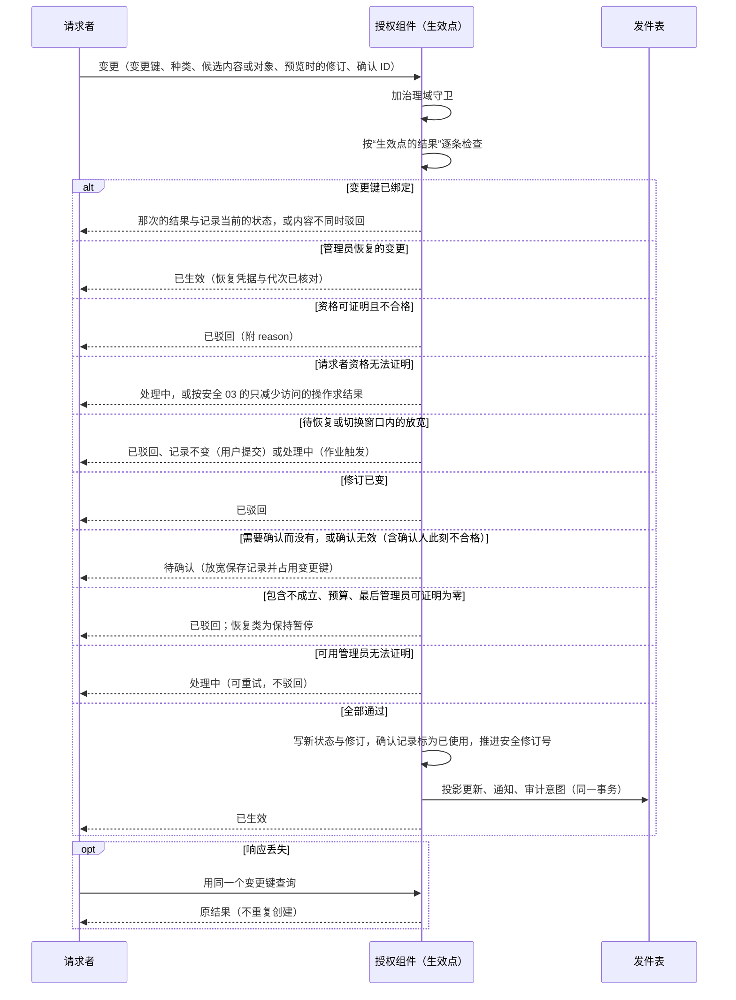
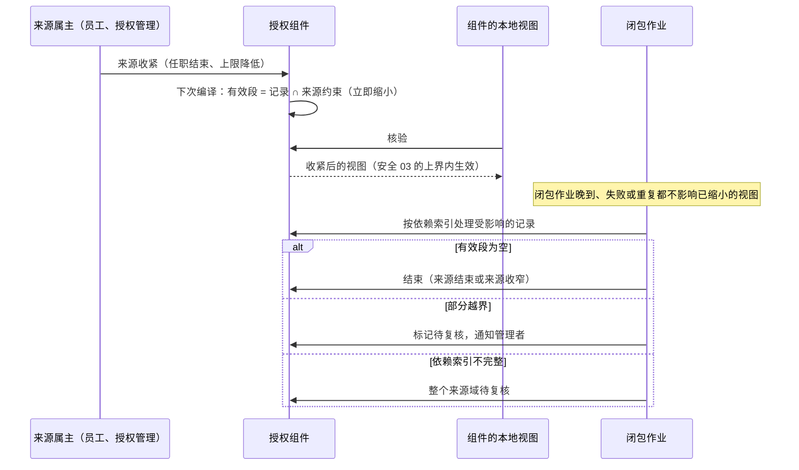

# 安全记录的状态与变更协议

安全 02–05 分别写了各类安全记录“应当怎样”：可信身份（安全 02）、接受与撤销（安全 03）、管理上限（安全 04）、共享与委托（安全 05）。本页给它们定出共同的状态与变更协议，回答四个问题：

1. 全部安全记录用什么状态，怎样流转。
2. 一个变更在哪一刻、经过哪些检查才算生效；结果不明时怎么办。
3. 来源变化之后（任职结束、上限收紧、委托人缩权），依赖它的记录怎样立即失效或缩小，后续的清理做什么。
4. 哪些操作需要独立确认；只有一名管理员的小公司怎么办；安全处置、最后一名管理员、首次安装与管理员恢复怎样处理。

依据的决定：D30（旧任职关联的授予自动撤销，新授予人工确认）、D35（集中与受限分级管理）、D36（普通授予不因管理员卸任失效）、D37（升级新增权限经客户确认）、D55（项目团队维护客户版本）、D57（默认有界本地授权）、D62（最后一名管理员离职照常生效，部署进入待恢复）。

本页的“管理员恢复”指部署所有者用恢复凭据重建授权管理员（[安装认领、管理员恢复与紧急访问](#安装认领管理员恢复与紧急访问)），与[协议 15](../15-backup-and-recovery.md) 把整套部署恢复到某一时刻的“整套恢复”是两件事。

## 两条基本原则

**一、一套通用生命周期，管授权组件的全部安全记录。**授权组件拥有的各类记录（管理职责、管理持有、角色修订、授予、共享、委托、扮演、紧急访问、安装认领、批量计划）使用同一组状态与同一个生效点，按记录类型配置参数：需要谁确认、最长有效期、能否续期、通知谁。这与知识库授权决定 D9 的建议一致：所有临时授予形式共用“带期限、可撤销、记录了来源的授予”这一个底层结构，不每种各建一套。员工组件拥有的任职实例与账号关联另有自己的生命周期（[员工、账号与任职](#员工账号与任职)），但遵守同样的变更方向。

**二、有效性由来源推出，不靠清理作业。**一条记录实际能提供的访问，等于它自己保存的段与它每个来源当前约束的交集。这个交集在编译授权包时，用[安全 07 的逐维求交](07-finite-expressions-containment-and-queries.md#求交委托和扮演的派生段)算出。所以来源一收紧，依赖它的记录立即缩小，不必等影响闭包作业跑完。闭包作业只负责记账、标记复核、通知与清理；它晚到、失败或重复，都不会放出多余的权限。

## 方案比较

| 路线 | 判断 |
| --- | --- |
| **采用**：通用生命周期 + 来源交集求有效 + 闭包作业只记账 | 一处实现、一组向量；收紧立即生效，不依赖作业；新的记录类型只加参数 |
| 每类记录各写状态机，收紧时由作业逐条改状态 | 写法直观，但状态与失效规则各写一遍；作业延迟或漏边期间旧权限仍然有效，这正是“到期了还能用”的来源 |
| 收紧时同步改写所有依赖记录 | 生效即时，但一次收紧可能牵动成千上万条记录，长事务、锁争用；依赖索引有缺口时还会漏改 |

## 受本协议管理的记录

| 记录 | 属主 | 生命周期 | 来源（有效性依赖谁） | 放宽时需要 | 谁能收紧 |
| --- | --- | --- | --- | --- | --- |
| 管理职责单元 | 授权组件 | 通用 | 父职责单元的可授出上限 | 父单元的管理资格 + 包含证明 + 独立确认 | 父单元的管理者；安全处置 |
| 管理持有资格 | 授权组件 | 通用 | 职责单元的当前状态；绑定的任职实例；账号状态 | 该单元的管理资格 + 独立确认 | 该单元或上级的管理者；本人放弃；安全处置 |
| 客户角色修订 | 授权组件 | 通用 | 已注册且未退役的权限键 | 角色管理资格；新增权限按 D37 确认 | 角色管理者 |
| 普通授予 | 授权组件 | 通用 | 治理单元的当前上限；绑定的任职实例；角色修订；账号状态 | 管理资格 + 包含证明（安全 07） | 管辖该授权域的管理者；受授人放弃；来源收紧 |
| 机构共享 | 授权组件 | 通用 | 资源治理的可共享上限；资源当前的归属；接收人的账号状态 | 共享管理资格 + 包含证明 | 资源治理者；接收人放弃；来源收紧 |
| 个人委托边 | 授权组件 | 通用 | 委托人当前的直接权限；创建时的上限；委托人绑定的任职实例 | 委托人本人（及 profile 要求的确认）+ 包含于委托人当前的权限 | 委托人；受托人放弃；来源收紧 |
| 只读扮演会话 | 身份组件签发会话，授权组件记许可 | 通用 | 被查看人当前的读取权限；操作者的扮演资格 | 扮演资格 + 原因与工单 + profile 要求的批准 | 操作者退出；被查看人账号停用；管理者撤销；到期 |
| 紧急访问会话 | 授权组件 | 通用 | 预置的紧急角色；操作者的紧急资格 | 按次批准，或合同事先约定的先用后审 | 到期；管理者撤销 |
| 安装认领 | 授权组件 | 通用 | 部署恢复代次（[协议 14](../14-data-foundations.md#库内计数与纪元)） | 精确的身份匹配或一次性确认码 | 认领即消耗 |
| 变更计划 | 授权组件 | 批量计划的状态（[批量计划](#批量计划)） | 计划内各项的目标修订 | 各项分别满足它记录类型的要求 | 计划发起人取消；到期 |
| 任职实例 | 员工组件 | 任职生命周期 | 员工的在职状态；组织单元有效 | 员工组件的人事流程 | 员工组件 |
| 账号与员工关联 | 员工组件（账号身份由身份组件提供） | 关联生命周期 | 账号状态；员工在职 | 身份管理资格 + 独立确认（确认记录由授权组件的受保护操作保存，员工组件核对后生效） | 身份管理者；安全处置 |

授权组件保存任职实例与账号关联的受控视图（安全 02）；属主提交收紧之后，各组件多久内不再放行，由[安全 03 的内部来源水位](03-authorization-acceptance-and-revocation.md#内部来源的收紧与来源水位)给出上界。

## 通用生命周期

| 状态 | 编码 | 含义 | 是否提供访问 |
| --- | --- | --- | --- |
| 申请 | `requested` | 候选内容已记录 | 否 |
| 待确认 | `awaiting_confirmation` | 等待 profile 要求的确认 | 否 |
| 待生效 | `scheduled` | 已确认，生效时间在未来 | 否；到时间后经生效点重新检查，才转为生效 |
| 生效 | `active` | 正常提供访问 | 是，等于自身的段 ∩ 来源约束；同一自然人处于安全处置时另受[安全处置](#安全处置)的求值限制 |
| 受保护暂停 | `held` | 因安全处置（`security_hold`）、来源约束无法计算（`uncomputable`），或处置解除时恢复未能完成（`restore_pending`），暂不提供访问 | 否 |
| 结束 | `ended` | 终态，记录结束原因 | 否 |

结束原因（`end_reason`）：

| 原因 | 编码 | 什么时候 |
| --- | --- | --- |
| 到期 | `expired` | 到达有效期终点（求值时已不提供访问，状态由闭包作业记账） |
| 撤销 | `revoked` | 有权收紧者撤销 |
| 放弃 | `relinquished` | 受授人、受托人或接收人放弃自己的授予、委托或共享；管理者放弃自己的持有资格 |
| 来源结束 | `source_ended` | 来源本身结束：绑定的任职结束、账号停用、委托人失去来源、职责单元撤销 |
| 来源收窄 | `source_narrowed` | 来源仍有效，但收窄后与本记录不再有交集（例如授予全部落在新上限之外） |
| 被替代 | `superseded` | 新记录包含旧记录的全部访问（续期、扩权），新记录生效时在同一个生效点事务中结束旧记录 |
| 驳回 | `rejected` | 确认人拒绝，或生效点驳回一条新记录 |
| 取消 | `cancelled` | 生效之前，被有权管理者或所属的批量计划终止 |
| 撤回 | `withdrawn` | 生效之前，申请人自己收回申请 |

### 状态迁移

每个变更先确定**种类**：`widen`（放宽：新记录、扩大、续期、激活会话）、`tighten`（收紧：撤销、放弃、内容收窄、安全处置，以及**终止尚未生效的记录**：确认人拒绝、申请人收回、有权管理者或批量计划取消）、`restore_security_hold`（解除安全处置后恢复）、`restore_uncomputable`（来源约束重新可计算后恢复）。其中改变管理职责、管理持有资格、系统角色的持有或账号与员工关联的 `widen`，称为**管理结构的放宽**。每条记录另有**状态修订**，每次状态迁移推进一次（与只在内容收窄时推进的内容修订分开）。“进入生效点”的结果由[生效点的结果](#生效点的结果)决定，再按该节的“结果对记录状态的作用”表改变记录状态；所以经生效点的每次状态变化都取治理域守卫、推进状态修订，并进入授权成员切换的增量与恢复的证据（收紧两段写）。闭包作业的记账迁移（到期、来源结束、无法计算）不经生效点，同样推进状态修订，但不进增量与证据：新成员与恢复后的授权组件自行重算。

| 当前状态 | 事件 | 守卫条件 | 结果状态 | 动作 |
| --- | --- | --- | --- | --- |
| （无） | 系统生成建议（例如 D30 的授权建议），或申请人保存草稿 | — | `requested` | 记录候选内容；不提供访问 |
| （无）、`requested` | 提交 `widen` | 系统生成的建议只能由合格的管理者提交，提交者成为请求者；系统身份不能作为 `widen` 的请求者（D30） | 进入生效点 | 按决策表：需要确认的保存为 `awaiting_confirmation`；全部通过、生效时间在未来的保存为 `scheduled` 并登记到点触发的定时工作项（[协议 01](../01-background-work.md)）；全部通过、生效时间为现在的生效 |
| `awaiting_confirmation` | 确认齐全 | — | 进入生效点 | 由授权组件以派生的键触发；生效时间在未来的结果为 `scheduled` |
| `requested`、`awaiting_confirmation`、`scheduled` | 确认人拒绝、申请人收回、有权管理者或批量计划取消 | — | 进入生效点（`tighten`：终止） | 生效时转为 `ended`（`rejected`、`withdrawn`、`cancelled`），写审计，通知申请人；推进状态修订，所以并发的到点工作项按第 3 行作废 |
| `scheduled` | 到达生效时间 | — | 进入生效点 | 由定时工作项以派生的键触发；工作项运行之前不提供访问 |
| `active` | `tighten`：撤销、放弃、内容收窄 | — | 进入生效点 | 收紧不需要包含证明；“谁有权收紧”与最后管理员不变量在生效点检查 |
| `active` | `tighten`：安全处置 | — | 进入生效点 | 生效时转为 `held`（`security_hold`），见[安全处置](#安全处置) |
| `active` | 包含它的新记录在同一个生效点生效（续期、扩大范围） | 生效点核对新记录包含旧记录的全部访问 | `ended`（`superseded`） | 与新记录同一事务 |
| `active` | 闭包作业发现有效段为空 | — | `ended`（`source_ended` 或 `source_narrowed`） | 记账；有效访问早已为空 |
| `active` | 闭包作业发现来源约束无法计算 | — | `held`（`uncomputable`） | — |
| `active`、`held` | 有效期终点到达，或来源结束 | — | `ended`（`expired` 或 `source_ended`） | 求值时已不提供访问；状态由闭包作业记账 |
| `held` | 闭包作业发现有效段为空 | — | `ended`（`source_narrowed`） | 记账 |
| `held`（`uncomputable`、`restore_pending`） | 闭包作业发现来源约束已可计算 | 内容不变 | 进入生效点（`restore_uncomputable`） | 不重查原请求者的资格（D36：授出者卸任不影响已生效的授予），也不重查确认 |
| `held`（`security_hold`） | 处置的解除者解除处置，或管理员恢复解除 | 内容不变 | 进入生效点（`restore_security_hold`） | 检查解除者；不重查原请求者的资格与确认 |
| `held` | 撤销 | — | `ended`（`revoked`） | — |
| `ended` | 任何事件 | — | `ended`（不变） | 永不复活；重新授予是一条新记录，引用旧记录作为前身 |

表格表达不了的三条规则：

- **到期在求值时生效。**有效期按左闭右开比较，到达终点即不提供访问；把状态改为 `ended`（`expired`）是记账，由闭包作业完成，晚做不影响安全。
- **修订不改身份，只用于收窄。**记录内容的收窄（例如普通授予的范围缩小）生成新的内容修订，记录身份不变。续期与扩大范围建新记录，生效时以 `superseded` 结束旧记录；改目标（新记录不包含旧记录）按[变更方向](#变更方向)拆成先收紧、后放宽。
- **确认的有效期**：没有声明未来生效时间的记录，确认后要在确认有效期（参数表）内经过生效点；过期回到 `awaiting_confirmation`，需要重新确认。声明了未来生效时间的记录，确认的有效期从生效时间起算（`expires_at` = 生效时间 + 确认有效期）。两种记录在生效点得到处理中而等待的时间都不计入：授权组件记下等待的起点，再次进入生效点时按等待时长顺延 `expires_at`；到时由生效点重新检查全部条件（含确认人此刻的资格）。批量计划的确认有效到计划到期。

## 变更方向

每个变更先归类：

| 方向 | 例子 | 规则 |
| --- | --- | --- |
| 收紧 | 撤销、缩小范围、结束任职、停用账号、暂停、降低上限 | 有权收紧者提交，经生效点检查“谁有权收紧”与最后管理员不变量；不需要包含证明，也不需要 profile 的确认（需要确认的收紧只按[生效点的结果](#生效点的结果)第 12、21 行）；任何主体都可以放弃自己的授予、委托或共享 |
| 放宽 | 新增授予、扩大范围或字段、延长期限、新增管理资格、激活会话 | 在生效点重新检查请求者当前的资格、包含证明、所需的确认、来源事实与预算，全部通过才生效 |
| 中性 | 显示名、说明、标签 | 不改变任何访问；仍然记修订与审计 |

- **同时有收紧与放宽的变更拆成两步，先收紧后放宽。**例如把一份授予从法人甲改到法人乙：先缩去甲（立即生效），再按放宽为乙申请；新记录生效之前，旧目标上已经没有访问。调岗时旧任职在 T 时刻结束、新任职在 T 时刻开始：旧授予在 T 失效，新授予在 T 经生效点检查后才生效；中间不出现“新旧都有效”的窗口。
- 收紧不需要证明，因为它只会减少访问；但“谁有权收紧”仍要检查（安全 04：回收只作用于自己管辖的授权域，不能借管理一个人，撤掉不归自己管的跨域授予）。请求者的资格依赖的来源无法证明时，按[安全 03 的只减少访问的操作](03-authorization-acceptance-and-revocation.md#只减少访问的操作)办理。

## 生效点

每个变更（四种种类）都在授权组件的一个本地事务里完成，这个事务就是生效点：

1. 按变更涉及的治理域加守卫（安全 03 的同一类守卫），防止并发的收紧与放宽交错。
2. 按[生效点的结果](#生效点的结果)的决策表重新检查：变更键、请求者此刻的身份与资格、部署与切换的状态、目标记录与来源的修订是否仍是预览时的值、所需的确认、包含证明（安全 07，现场重算，不复用旧见证）、以 `superseded` 结束旧记录时新记录包含旧记录、预算、最后管理员不变量。
3. 已生效时：写入新状态与修订，推进受影响域的安全修订号，把所用的确认记录标为已使用，同事务写发件表：投影更新、通知意图、审计意图。
4. 返回结果；调用方遇到超时或未知时，用同一个变更键查询，不重复提交。

**变更键**：每次进入生效点都带一个键，绑定规则只在下表（[安全 09a 的错误表](09a-encoding-and-records.md#求值结果与错误)的“占用变更键”一列链接这里）：

| 键 | 绑定的结果 | 不绑定的结果 |
| --- | --- | --- |
| 请求者的变更键（请求者的命名空间） | 已生效；终局的驳回；保存了记录的结果（`awaiting_confirmation`、`scheduled`） | 处理中；收紧与解除处置的待确认；可重试的驳回（第 10、11、13、15 行） |
| 授权组件派生的键：`<记录身份>:<状态修订>:<触发种类>`（授权组件的命名空间；触发种类为到点、确认齐全、自动恢复） | 已生效；终局的驳回 | 待确认、保持暂停、处理中 |

- 已绑定的键，同一内容再提交，返回那次的结果与记录当前的状态，不建第二条记录；内容不同按冲突驳回。
- 不绑定的结果，同键同内容重新提交照常检查；所以客户端按“可重试”用同一个键重试，窗口结束后就能成功。结果未知时按键查询：没有绑定的返回“未绑定”，客户端用同一个键重新提交。
- 派生键带状态修订：同一记录第二次无法计算后的自动恢复、第一次确认失效后的重新确认，状态修订已经推进，用的是新键，不会被第 1 行吞掉；状态修订已经过期的旧作业按第 3 行作废，不驳回、不改记录。
- 放宽的确认由确认人针对已保存的记录建立确认记录，不靠重新提交。

**与 D57 的关系**：本页定义安全记录“何时变了”；“变了之后各组件何时不再放行”由[安全 03](03-authorization-acceptance-and-revocation.md) 定义。默认路径是：生效点提交并推进安全修订号后，各组件的本地授权视图在短有效期内经权威核验，超期即拒绝或暂缓高风险操作；客户选用严格路径时，再加持久接受与提交屏障。两条路径共用本页的生效点。

### 生效点的结果

按行序，第一条命中；每行只有一个结果。

- “触发”：`user` 指用户提交（含附上确认后重新提交、确认人拒绝、申请人收回）；`job` 指授权组件以派生键触发的生效：待生效到点、确认齐全后的生效、闭包作业的自动恢复、批量计划的项；`recovery` 指部署所有者经恢复工具办理的[管理员恢复](#安装认领管理员恢复与紧急访问)，只由第 5、6 行处理，永不落到第 30 行。
- 种类与触发的组合（覆盖索引）：`widen` 有 `user`、`job`、`recovery`；`tighten` 有 `user`、`job`（批量计划的项、到期取消）、`recovery`（管理员恢复的收紧部分）；`restore_security_hold` 由解除者以 `user` 触发，或由管理员恢复以 `recovery` 触发；`restore_uncomputable` 只由闭包作业以 `job` 触发（处置解除时保持暂停的 `restore_pending` 也按它重试），不重查原请求者（D36），所以“请求者”各行不列它。
- 请求者与确认人的资格，在每次进入生效点时按此刻重查，不论触发方式：确认齐全或到点之前请求者已失去管理资格的，作业触发时同样驳回。例外只有三种：管理员恢复（第 5 行）；申请人收回与确认人拒绝（第 7 行）；对象不影响授权管理员可用性时，安全 03 两人规则下的确认人，资格按最后已应用的事实判断（[安全 03 的只减少访问的操作](03-authorization-acceptance-and-revocation.md#只减少访问的操作)）。

| 行 | 条件 | 种类 | 触发 | 结果 | reason（[安全 09a](09a-encoding-and-records.md#求值结果与错误)） |
| --- | --- | --- | --- | --- | --- |
| 1 | 键已绑定，内容相同 | 全部 | 全部 | 返回那次的结果与记录当前的状态 | — |
| 2 | 键已绑定，内容不同 | 全部 | 全部 | 已驳回 | `CHANGE_KEY_CONFLICT` |
| 3 | 记录当前的状态不是这次触发的起点状态（按[状态迁移](#状态迁移)），或派生键中的状态修订不是记录当前的状态修订 | 全部 | `job` | 作业作废，记录不变（不是驳回，不改记录） | — |
| 4 | 记录当前的状态不是这个事件的起点状态（例如对已生效的记录提交“取消”） | 全部 | `user` | 已驳回；按记录当前的状态重新提交（例如改为撤销） | `CHANGE_REVISION_STALE` |
| 5 | 恢复凭据已核对（由生效点从恢复命令的调用通道得出，不由请求自称），并且变更属于[管理员恢复](#安装认领管理员恢复与紧急访问)步骤表所列：收紧部分对指定持有资格的处置；或在部署处于管理员恢复中、新的授权恢复代次已取得时，放宽第 3 步所列的解除与放宽第 4 步为指定精确身份建立的授权管理员持有资格 | `tighten`、`widen`、`restore_security_hold` | `recovery` | 已生效（不检查请求者、确认、包含证明与预算；写审计并通知；越界的记录标记待复核） | — |
| 6 | 其余以 `recovery` 触发的变更（凭据未核对、不在管理员恢复中、内容不在步骤表所列） | 全部 | `recovery` | 已驳回 | `PERMISSION_DENIED` |
| 7 | 终止尚未生效的记录：请求者是该记录的申请人（收回），或 profile 列出的该记录的确认人（拒绝） | `tighten`（终止） | `user` | 已生效（不检查管理资格、确认与最后管理员不变量：终止不减少任何现有的可用性） | — |
| 8 | 请求者的资格可证明，且不合格（含不能收紧不归自己管辖的授权域；解除者对处置的治理域与范围没有处置权限） | `widen`、`tighten`、`restore_security_hold` | `user`、`job` | 已驳回 | `PERMISSION_DENIED` |
| 9 | 请求者的资格无法证明 | `widen`、`restore_security_hold` | `user`、`job` | 处理中 | `ADMIN_AVAILABILITY_UNPROVABLE` |
| 10 | 请求者的资格无法证明，请求者的主体被隔离 | `tighten` | `user`、`job` | 已驳回，可重试 | `AUTHORIZATION_UNPROVABLE` |
| 11 | 请求者的资格无法证明，按最后已应用的事实不合格 | `tighten` | `user`、`job` | 已驳回，可重试 | `AUTHORIZATION_UNPROVABLE` |
| 12 | 请求者的资格无法证明，对象影响授权管理员的可用性，又没有附上确认 | `tighten` | `user`、`job` | 处理中 | `ADMIN_AVAILABILITY_UNPROVABLE` |
| 13 | 部署处于待恢复或管理员恢复中，变更是管理结构的放宽（含恢复暂停中的管理持有资格） | `widen`、`restore_*` | `user` | 已驳回，可重试 | `RECOVERY_IN_PROGRESS` |
| 14 | 同第 13 行的条件 | `widen`、`restore_*` | `job` | 处理中 | `RECOVERY_IN_PROGRESS` |
| 15 | 授权成员切换窗口内（[安全 10](10-providers-and-member-switching.md) 第 2 步到 7.4 之前） | `widen`、`restore_*` | `user` | 已驳回，可重试 | `MEMBER_SWITCH_IN_PROGRESS` |
| 16 | 同第 15 行的条件 | `widen`、`restore_*` | `job` | 处理中 | `MEMBER_SWITCH_IN_PROGRESS` |
| 17 | 与本记录有效性相关的修订已变：记录自身的内容修订、它引用的角色修订、绑定的任职实例；用户提交时还包括所在治理单元的上限（作业触发时上限的修订不单独驳回，交第 18 行重算包含证明） | 全部 | `user`、`job` | 已驳回（批量计划中的项转待复核） | `CHANGE_REVISION_STALE` |
| 18 | 包含证明不成立，或要以 `superseded` 结束的旧记录不被新记录包含 | `widen` | `user`、`job` | 已驳回 | `CONTAINMENT_NOT_PROVEN` |
| 19 | 超出预算 | `widen` | `user`、`job` | 已驳回 | `CONTAINMENT_NOT_PROVEN`（原因：超预算） |
| 20 | 需要确认而没有确认：放宽按 profile | `widen` | `user`、`job` | 待确认，保存记录 | `CONFIRMATION_REQUIRED` |
| 21 | 需要确认而没有确认（终止尚未生效的记录不在此列）：安全 03 的两人规则（请求者资格按最后已应用的事实判断，且来源超过 `T_tight` 或 `stalled`）；受保护操作中的收紧（撤销或收窄其他授权管理员的持有资格、变更系统角色的持有、变更账号与员工的关联、处置或解除处置其他授权管理员，[确认与受保护操作](#确认与受保护操作)） | `tighten`、`restore_security_hold` | `user`、`job` | 待确认，不保存 | `CONFIRMATION_REQUIRED` |
| 22 | 某名确认人此刻的资格无法证明（`confirmer_basis` 为 `deployment_owner` 的确认只核对凭据与使用记录；对象不影响授权管理员可用性时，安全 03 两人规则下的确认人按最后已应用的事实判断；这两种不进入本行） | `widen`、`tighten`、`restore_security_hold` | `user`、`job` | 处理中 | `ADMIN_AVAILABILITY_UNPROVABLE` |
| 23 | 所附确认已过期、已使用、与对象内容或版本不符，或某名确认人此刻不合格、处于安全处置 | `widen` | `user`、`job` | 待确认，保存记录（不按旧确认生效） | `CONFIRMATION_REQUIRED` |
| 24 | 同第 23 行的条件 | `tighten`、`restore_security_hold` | `user`、`job` | 待确认，不保存 | `CONFIRMATION_REQUIRED` |
| 25 | 恢复后的有效段为空 | `restore_*` | `user`、`job` | 保持暂停 | — |
| 26 | 超出预算 | `restore_*` | `user`、`job` | 保持暂停 | `CONTAINMENT_NOT_PROVEN`（原因：超预算） |
| 27 | 依赖索引显示（或索引不完整，按会影响处理）变更会影响某份授权管理员持有资格的可用性，不是安全处置、也不是终止尚未生效的记录，且变更后可用管理员[可证明为零](#系统角色与最后管理员) | `tighten` | 全部 | 已驳回 | `LAST_ADMIN_PROTECTED` |
| 28 | 同第 27 行的条件，变更后可用管理员既不能证明至少一名，也不能证明为零 | `tighten` | 全部 | 处理中 | `ADMIN_AVAILABILITY_UNPROVABLE` |
| 29 | 全部通过，生效时间在未来 | `widen` | `user`、`job` | 待生效，保存记录 | — |
| 30 | 其余 | 全部 | 全部 | 已生效（`restore_*` 中部分越界的，已生效并标记待复核） | — |

结果对记录状态的作用，按（结果，对象）第一条命中：

| 结果 | 对象 | 记录状态 | 之后 |
| --- | --- | --- | --- |
| 已生效 | 放宽（新提交或已保存的记录） | `active`；以 `superseded` 结束被包含的旧记录 | — |
| 已生效 | 收紧：撤销、放弃、收窄、安全处置 | `ended`（`revoked`、`relinquished`）；收窄为 `active` 的新内容修订；安全处置为 `held`（`security_hold`） | — |
| 已生效 | 收紧：终止尚未生效的记录 | `ended`（`rejected`、`withdrawn`、`cancelled`） | 通知申请人 |
| 已生效 | 恢复 | `active` | — |
| 待生效 | 放宽 | `scheduled` | 登记到点的定时工作项 |
| 待确认 | 放宽的新提交，或已保存、确认无效的记录 | `awaiting_confirmation` | 确认人针对记录建立确认记录 |
| 待确认 | 收紧、解除处置 | 记录不变 | 确认人先针对对象与目标修订建立确认记录，请求者以同一变更键附上确认 ID 重新提交 |
| 作业作废 | 全部 | 记录不变 | 工作项结束，不重试（第 3 行） |
| 处理中 | 全部 | 记录不变 | `user` 由调用者重试（第 12 行附上确认后重新提交）；`job` 放回 `retry_wait`，不计尝试次数 |
| 已驳回，可重试 | 全部 | 不建记录；已有的记录不变 | 同一变更键稍后重新提交 |
| 已驳回（终局） | 批量计划中的项 | 按[批量计划](#批量计划)的项状态表 | — |
| 已驳回（终局） | 放宽的新提交 | `ended`（`rejected`） | — |
| 已驳回（终局） | 已保存的放宽记录（`awaiting_confirmation`、`scheduled`，不论哪一行驳回） | `ended`（`rejected`），记 reason | 通知请求者 |
| 已驳回（终局） | 收紧 | 记录不变 | — |
| 已驳回（终局） | 恢复 | `held`（不变） | 告警转人工 |
| 保持暂停 | 恢复 | `held`（不变） | 告警；有效段为空的由闭包作业以 `source_narrowed` 结束 |

**收紧的确认先行**：需要第二人确认的收紧（第 21 行），由确认人先针对对象与目标修订建立确认记录，请求者带着确认 ID 提交；授权组件不保存等待确认的收紧请求。

**确认人的资格在生效时重查**：声明了未来生效时间的记录，到时生效点重新检查全部条件，包括每名确认人此刻的资格可证明、合格且未处于安全处置；所以被撤换的管理员事先给出的确认，在撤换之后不再有效。

结论：放宽只在生效点全部检查通过时生效，预览时的检查不算数；无法证明时返回处理中而不是驳回或放行；保存了记录的结果占用变更键，结果未知时按变更键查询，不会重复创建（CP02–CP05、CP29、CP37、CP54、CP61）。

## 有效段的计算

编译授权包时，每条生效中的记录按下表与来源求交，结果才是下发的段：

| 记录 | 有效段 |
| --- | --- |
| 普通授予 | 授予的段 ∩ 治理单元当前的上限段；所引用角色修订中已退役的权限键对应的段为空；绑定的任职实例不在生效中、或受授账号已停用时为空 |
| 客户角色修订 | 不单独提供访问；经普通授予使用时，只有已注册且未退役的权限键参与（权限键退役立即使对应的段为空，不等闭包作业） |
| 管理持有资格（作为授出上限） | 职责单元当前的上限 ∩ 父单元当前的上限（逐级）；持有资格本身、绑定的任职或账号失效时为空 |
| 机构共享 | 共享的段 ∩ 资源治理当前的可共享上限；资源已移出原治理范围时为空 |
| 个人委托边 | 委托人当前直接权限的每个有效段（已扣除委托人的安全处置限制）∩ 创建时的上限 ∩ 委托边的范围与期限（安全 05）；多层链逐边求交 |
| 只读扮演会话 | 被查看人当前的读取段（已扣除被查看人的安全处置限制）∩ 会话上限；操作者自己的权限不参与 |
| 紧急访问会话 | 预置紧急角色的段（默认只读） |
| 任一记录，最后一层 | 受益的自然人处于安全处置时，与被暂停范围相交的段整段不生效（[安全处置](#安全处置)） |

求交在安全 07 的原子代数里总能算出（每种原子在求交下封闭）。只有一种情况算不出：来源或记录使用了提供方私有的表达。这时该记录进入 `held`（`uncomputable`），直到能够证明为止。

**部分越界的授予保持生效**：治理上限收紧后，部分越界的授予保持生效、标记待复核，它的有效段自然就是交集；整体暂停会把仍在上限之内的合法访问一起停掉（安全 04 采用同一规则；参考模型的“部分越界整体暂停”坏变体改变了有效访问，被检查判为错误）。只有出于安全处置的收紧，才整段停用。

## 影响闭包

来源收紧后，闭包作业按依赖索引找出受影响的记录，逐条处理：

| 情况 | 处理 |
| --- | --- |
| 来源已结束（绑定的任职结束、账号停用、委托人失去来源） | 转为 `ended`（`source_ended`），写审计与通知 |
| 来源仍有效，但有效段已为空（全部落在新上限之外） | 转为 `ended`（`source_narrowed`），写审计与通知 |
| 部分越界 | 保持生效，标记待复核，通知有权的管理者；复核结论是收窄（生成新修订）或接受现状（有效段本来就是交集） |
| 来源约束无法计算 | 转为 `held`（`uncomputable`） |
| 依赖索引本身不完整或不可用 | 不判断为“无人受影响”；把整个来源域标为待复核，按最保守的方式计算有效段 |

作业持久记录进度，可以重复执行，结果幂等。正确性不依赖它：参考模型验证了在任何时刻运行闭包作业，所有人的有效访问都不变。

结论：访问的缩小发生在编译视图的那一刻，与闭包作业无关；作业只记账、通知与标记复核（CP01、CP09、CP10、CP12）。

## 安全处置

安全处置用于账号被盗、强制停用这类情形：有处置权限的人暂停一个自然人在某个范围内的访问。身份侧的安全冻结（`security_frozen`）、标为被盗或可疑的停用，同样按安全处置对待。

### 记录与范围

- **记录什么**：一条安全处置记录：被处置的自然人（安全 02 的账号与员工关联）、处置时他的全部账号、被暂停的范围（一组段）、处置人与治理域；处置范围内这个自然人的生效记录转为 `held`（`security_hold`）。
- **账号集合**：处置时记录的账号，以及其中任一账号此后关联到的员工的全部账号；处置时没有关联员工的账号，此后关联到员工 E 时，E 的全部账号纳入。
- **求值时怎样挡**：这个自然人在求值时的每一个段，不论来自授予、任职的模板授予、关系、机构共享、个人委托还是扮演与紧急访问会话，只要与被暂停的范围相交，整段不生效（求交在原子代数中总能算出；整段停用比“减去”更保守，因为有限表达不支持排除）。所以不需要枚举放宽的种类，调岗、加入项目团队、共享给他所在的组织、为他新建并关联的账号都绕不开。
- **以他为上游的段**：以他为委托人的委托、以他为被查看人的扮演，按他扣除处置限制后的有效段求交（[有效段的计算](#有效段的计算)）。
- **对别的变更**：生效点不因处置驳回别的放宽；待生效到点与自动恢复也不因处置结束：它们照常生效，只是在处置期间被求值挡住，处置解除后自然恢复。跨治理域的影响通知双方的治理者。处置期间解除这个自然人的账号关联是受保护操作。
- **与最后管理员**：安全处置不受最后管理员不变量约束，照常生效；可用管理员因此可证明为零时，部署进入待恢复，由安全处置进入的只能经管理员恢复退出（[待恢复](#待恢复)）。
- **对外表达**：求值时被挡住的段对外按无权表达；解释中的 reason 为 `HELD_BY_SECURITY_DISPOSITION`（安全 09a）。

### 发起

对处置的治理域与范围有处置权限的人发起（范围包含于他的处置上限，安全 07 的包含证明）；处置其他授权管理员是受保护操作（[确认与受保护操作](#确认与受保护操作)）。管理员恢复的收紧部分以部署所有者为处置人建立处置。

### 身份侧处置的派生

- 初次对齐（新增投影、新的授权成员从零建立投影、恢复后的重新取回）时，“没有这一行”变为冻结不算转变；授权成员切换的导出带身份侧处置与派生它时的账号状态修订，新成员原样导入。整套恢复不从证据重放身份侧处置：重放后的账号状态按转变派生（[协议 15 的 6.3](../15-backup-and-recovery.md#63-重放)）。
- 按**账号状态的转变**派生，不按信号的到达：授权组件应用账号状态时（事件，或对齐、切换取回的快照行），某账号在投影中从“非冻结、没有被盗或可疑标记”变为 `security_frozen`，或变为带 `security_mark`（`compromised`、`suspicious`，[安全 09a](09a-encoding-and-records.md#安全记录)）的停用，才新建一条处置。
- 每个账号至多一条生效中的身份侧处置：已有生效中的，不新建；投影中原本就是冻结的（快照重复、切换后重新取回、恢复后向产品重新冻结），不新建。处置记录的 `signal_ref` 记（账号，发生转变时的账号状态修订）。
- 无条件建立：治理域为部署全局，范围为这个自然人的全部段。
- 身份侧解冻不自动解除处置。
- 处置已被解除、账号仍冻结时，身份侧再给它加上被盗或可疑标记，不算转变、不新建处置：账号冻结期间本来就没有访问。

### 解除

- **谁能解除**：对处置的治理域与范围有处置权限的人（跨域的处置只能由同级或上级域解除；身份侧建立的与管理员恢复建立的，只能由部署级的处置权限或管理员恢复解除），且不是被处置的自然人本人，也不是被暂停的授予的受授人（按自然人判断）；解除以授权管理员为对象的处置是受保护操作。管理员恢复按[管理员恢复](#安装认领管理员恢复与紧急访问)的放宽第 3 步解除。
- **一次求完**：解除是一个变更：同一处置下、此刻仍为 `held`（`security_hold`）的全部记录在**一个**生效点事务中求结果（`restore_security_hold`；处置期间已被撤销或结束的记录不在其中，不会复活）；记录分布在几个治理域时，按治理域身份升序加守卫，所以两次解除、或解除与跨域收紧并发时不会互相死锁。所附确认绑定这次解除（处置身份与处置修订），解除完成时才标为已使用。
- **结果**：任何一条得到处理中、待确认或已驳回，整个解除不生效：处置保持生效，全部记录不变，按那一条的结果返回。全部记录都得到已生效或保持暂停时，处置转为已解除，求值限制一起解除；保持暂停的记录改记为 `held`（`restore_pending`），由闭包作业按 `restore_uncomputable` 的方式重试。处置期间已生效、包含某条被暂停记录的新记录（例如续期），解除时以 `superseded` 结束被包含的旧记录。

安全处置记录的状态，按行序第一条命中：

| 当前状态 | 事件 | 守卫条件 | 结果状态 |
| --- | --- | --- | --- |
| （无） | 处置人提交（`submit`） | 发起者合格；处置其他授权管理员时确认有效 | 生效（`active`） |
| （无） | 授权组件应用的账号状态发生上述转变（`identity_signal`） | 该账号没有生效中的身份侧处置 | 生效 |
| 生效 | 账号状态再次应用、没有新的转变（`identity_signal`） | — | 生效（不变） |
| （无） | 管理员恢复撤换持有资格（`admin_recovery`） | 部署所有者的恢复凭据 | 生效 |
| 生效 | 解除（`release`），全部记录都得到已生效或保持暂停 | 解除者合格；以授权管理员为对象时确认有效 | 已解除（`released`） |
| 生效 | 管理员恢复解除（`admin_recovery_release`），全部记录都得到已生效或保持暂停 | 部署处于管理员恢复中，恢复凭据已核对 | 已解除 |
| 生效 | 解除，任一记录得到处理中、待确认或已驳回 | — | 生效（不变）；已驳回时告警 |
| 其余组合 | — | — | 不变，拒绝 |

## 确认与受保护操作

本节的“受保护操作”只指安全记录的变更。业务上需要第二人确认的动作（关账的发起与重开、流程实例的迁移、大额调整等）用**业务确认 profile**，由业务组件声明，不进入下列清单，也不需要部署所有者确认。业务确认 profile 声明最少确认人数；声明为不要求独立确认人时（例如单人公司的关账），发起人自己的一次显式确认即可，留审计。

确认要求写在 profile 里：要几个独立确认人、谁有资格、确认多久内有效。独立指不同的自然人：关联到同一员工的多个账号算一个人（安全 02）；申请人不能确认自己的申请，操作对象本人也不能确认针对自己的受保护操作。

| 需要确认吗 | 条件 | 由谁确认 |
| --- | --- | --- |
| 受保护操作（见下列） | 除申请人与操作对象之外，还有至少一名可用的管理员 | 其中一名独立确认人 |
| 受保护操作 | 除申请人与操作对象之外没有可用的管理员（只有一名管理员；或两名中一名是被盗的对象） | 部署所有者确认（第二认证因素） |
| 受保护操作 | 可用管理员可证明为零（待恢复） | 只能经管理员恢复办理 |
| 普通授予、普通角色修订 | — | 默认不要求第二人（D35：小公司的集中管理不强制第二名员工）；profile 可以加严 |
| 业务确认 | 按业务确认 profile | 按 profile；可以是发起人自己的显式确认 |

标准的受保护操作：

1. 新增或扩大管理职责、授出管理持有资格、再下放管理。
2. 授予或变更系统角色的持有（见[系统角色与最后管理员](#系统角色与最后管理员)）。
3. 建立或变更账号与员工的关联；把外部身份映射到**已有的**平台主体，或变更已有的映射（[安全 11](11-identity-member-switching.md)）；重新启用或解冻一个持有授权管理资格的账号。首次登录的自动开通（[安全 02](02-trusted-identity-and-attributes.md#稳定主体与身份链接)，客户配置）为新的外部身份创建一个新的、没有任何授予的平台主体，不改变任何已有主体的映射，不在此列。
4. 紧急访问的激活（合同事先约定的情形可以先用后审，但必须立即通知并在期限内复核）。
5. 超过阈值的批量计划（阈值在 profile 中）。
6. 管理员恢复。
7. 以其他授权管理员的持有资格或账号为对象的安全处置、撤销或收窄，以及解除这样的处置：否则一名被盗的管理员可以单人处置其他全部管理员，自己成为唯一可用的管理员，或单人解除别人对被盗管理员的处置。处置覆盖其他全部授权管理员时另发严重告警。

**确认记录**：每次确认生成一条确认记录，绑定操作的对象与内容：放宽绑定候选内容的摘要；收紧绑定对象与目标修订；重新启用或解冻账号时绑定账号、目标状态与确认时的账号状态版本。只有得到“已生效”的那次生效点把它标为已使用（解除处置的确认在整个解除完成时标为已使用），此后不能再用；对象、内容或版本不符，或已被使用过，都按没有确认处理。

**只有一名管理员时**：受保护操作找不到独立确认人，不能取消这一要求（安全 04）。做法是“部署所有者确认”：它是**第二个认证因素**，不是第二个确认人——单人公司中通常是同一个人持有。安装时生成部署所有者的确认凭据，由客户另行保管，与日常登录凭据分开；受保护操作由它作为第二道确认，使用后记录并通知。它与管理员恢复用的**恢复凭据**是两份不同的凭据，分开保管：日常确认的频繁使用不削弱恢复凭据的保管前提。这样单人公司也能完成受保护操作，同时“管理员账号被盗”不足以独自扩大管理权限。单管理员部署中，建立账号与员工的关联（每次入职）也需要这一确认，客户说明中写明这一负担。

## 系统角色与最后管理员

系统角色由产品预置，客户不能修改它们的内容，只能管理谁持有：

| 系统角色 | 用途 | 默认持有 |
| --- | --- | --- |
| 授权管理员 | 全范围的管理上限，用于集中管理 | 安装认领者 |
| 审计查看员 | 查看审计与授权解释，不改任何授权 | 无 |
| 紧急只读 | 紧急访问会话使用的预置角色 | 无人常驻持有，只经紧急访问会话生效 |
| 超级用户 | D37 所述对已注册、未退役权限键的特殊补齐 | 生产环境默认无人持有 |

可用管理员的判定：

| 用语 | 定义 |
| --- | --- |
| 可用 | 一份授权管理员持有资格生效、不处于安全处置、账号有效、绑定的任职生效，且不处于“待补确认” |
| 可证明至少一名 | 至少一份持有资格可用，并且它依赖的来源事实都已应用、水位不早于 `当前时刻 − D_src_high`（管理变更按高风险档判断）、主体未被隔离 |
| 可证明为零 | 部署中每份未结束的授权管理员持有资格（在生效点的检查中，指变更之后其余的每份）依赖的来源事实都已应用、水位不早于 `当前时刻 − D_src_high`、主体未被隔离，且都不可用 |
| 无法证明 | 既不能证明至少一名，也不能证明为零（来源对齐中、水位过期、主体被隔离） |

- **最后管理员不变量**：依赖索引显示会影响某份授权管理员持有资格可用性的普通变更（撤销、放弃或收窄持有资格，变更系统角色的持有，变更管理职责单元或它的绑定，变更持有资格所用账号与员工的关联等），生效后部署中必须至少有一份可用的授权管理员持有资格；依赖索引不完整或不可用时，按会影响处理。其他变更不检查这个不变量。生效点在治理域守卫内检查；两名管理员并发互相撤销时，守卫使它们串行，后提交者被驳回。三种结果的处理见[生效点的结果](#生效点的结果)。
- **作业遇到“处理中”**：定时触发生效点的工作项（待生效到点）、确认齐全后的生效与闭包作业的自动恢复，把“处理中”当作业务上的等待：放回 `retry_wait`，不计入尝试次数（[协议 01](../01-background-work.md) 的等待结果），超过等待上限（参数表）才告警转人工。
- **来源事实照常生效**（D62）：不变量只约束授权组件内的普通变更。“可用”还取决于员工组件的任职与身份组件的账号状态，它们由别的属主提交：来源侧的离职、任职结束与账号停用是事实，照常生效。员工组件办理离职时，如果此人是最后一名可用的授权管理员，给出提示，但不阻止。
- **重新启用管理员账号**：重新启用或解冻一个持有授权管理资格的账号是受保护操作：身份适配组件办理前向授权组件取得确认，并把确认 ID 写进账号状态事件；授权组件按[确认记录](#确认与受保护操作)的规则核对。经身份产品控制台直接启用、事件不带确认 ID 或核对不通过的，该持有资格标为“待补确认”，按不可用处理并告警；有权限的人经受保护操作补办后转为可用；待恢复期间没有可用的确认人，经管理员恢复处理。

### 待恢复

部署级的状态，由授权组件保存。按行序，第一条命中：

| 当前状态 | 事件 | 守卫条件 | 结果状态 | 动作 |
| --- | --- | --- | --- | --- |
| 运行（`operational`） | 任何使某份持有资格不可用的变化之后（来源事实、安全处置、有效期终点、来源约束无法计算、待补确认），或来源对齐完成、水位恢复新鲜时，重新求值，可用管理员无法证明 | — | 运行（不变） | 只告警 |
| 运行 | 同上，可用管理员可证明为零 | — | 待恢复（`recovery_pending`） | 记下每份持有资格不可用的原因：安全处置（含身份侧的 `security_frozen` 与标为被盗、可疑的停用），或来源事实；严重告警，通知登记的联系人 |
| 运行、待恢复 | 部署所有者开始管理员恢复的放宽部分 | 已取得新的授权恢复代次 | 管理员恢复中（`admin_recovery`） | 见[管理员恢复](#安装认领管理员恢复与紧急访问) |
| 管理员恢复中 | 新的持有资格已建立并通知（放宽第 5 步完成），或之后来源对齐完成、水位恢复新鲜、所涉账号状态变化 | 新建的持有资格可证明可用 | 运行 | 轮换恢复凭据作为待办告警，直到完成；回到运行时按第一、二行重新求值一次 |
| 管理员恢复中 | 同上一行的事件 | 新建的持有资格不可证明可用（账号仍停用、任职未生效、来源对齐中） | 管理员恢复中（不变） | 记录原因并告警，受管理员恢复的上限约束 |
| 管理员恢复中 | 部署所有者中止，或超过上限（参数表） | — | 进入前的状态（运行或待恢复） | 已推进的代次不回退 |
| 管理员恢复中 | 部署所有者重新开始 | 已取得新的代次 | 管理员恢复中 | — |

待恢复只能经管理员恢复退出：来源事实（离职、停用）使持有资格结束，结束的记录不会复活，而重新建立持有资格是受保护操作，可用管理员为零时没有人能确认。待恢复与管理员恢复中，管理结构的放宽（管理员恢复本身除外）被驳回（`RECOVERY_IN_PROGRESS`）；收紧、普通授予、到点生效与自动恢复照常按[生效点的结果](#生效点的结果)办理，业务授权照常按各自的来源计算。

## 安装认领、管理员恢复与紧急访问

**安装认领**：安装时登记一条认领记录，内容是精确的外部身份（签发方 + 主体）或一次性确认码的摘要，带到期时间。首次登录匹配成功时，在同一事务里创建授权管理员持有资格，并把认领标为已消耗；唯一约束保证只能消耗一次。认领与部署恢复代次绑定（协议 14），用旧备份恢复会推进部署恢复代次，不会重新打开已消耗的认领。

**管理员恢复**：没有可用的管理员，或需要撤换被盗的管理员时使用。由部署所有者用离线保管的恢复凭据，在部署机上执行恢复命令；恢复命令经生效点的 `recovery` 触发（决策表第 5、6 行）。按步骤：

| 步骤 | 内容 | 守卫与失败时 |
| --- | --- | --- |
| 收紧 1 | 部署所有者指定要撤换的授权管理员持有资格（撤换被盗管理员时必须指定），授权组件在一个事务中（多个治理域按[解除](#解除)的同一顺序加守卫）把它们转为 `held`（`security_hold`），记为一次以部署所有者为处置人的安全处置 | 不需要新的代次；证据存储不可达也照常办理，证据按[协议 15 的证据的写入](../15-backup-and-recovery.md#证据的写入)两段写 |
| 收紧 2 | 同一事务：作废被撤换者尚未使用的确认记录；被撤换者作为请求者、尚未生效的放宽转为 `ended`（`cancelled`）；只作为确认人参与的退回 `awaiting_confirmation`，需要重新确认；被撤换者确认的批量计划中未执行的项转为待复核 | 这次处置只能由部署级的处置权限或管理员恢复解除 |
| 收紧 3 | 授权成员切换窗口内照常办理，并记入切换增量；被盗账号的会话由身份适配组件停用该账号或撤销它的会话（不受授权的恢复代次影响） | — |
| 放宽 1 | 从证据存储取得新的授权恢复代次（[安全 03 的代次、纪元与修订](03-authorization-acceptance-and-revocation.md#代次纪元与修订)），写入授权库 | 取不到时不开始，收紧部分照常 |
| 放宽 2 | 部署进入管理员恢复中 | 管理结构的放宽除恢复操作外全部驳回，收紧照常 |
| 放宽 3 | 解除指定的精确身份所受的处置：身份侧建立的，以及处置人是被撤换者的（`admin_recovery_release`）；身份侧已解冻、标为“待补确认”的持有资格同时补办确认 | 指定身份在身份侧仍冻结或停用时，先由身份适配组件以恢复凭据办理解冻或启用，解冻事件带管理员恢复以部署所有者为确认人生成的确认记录；授权组件应用了解冻后的账号状态（来源水位越过解冻事件）才执行本步 |
| 放宽 4 | 指定的精确身份经第 3 步仍没有可用的授权管理员持有资格时，才为它创建新的；授权组件以新代次回答核验，组件丢弃旧视图，严格路径的旧许可随之失效 | — |
| 放宽 5 | 通知全部现有管理员与登记的联系人，写审计；要求事后复核并记录结论 | 新建的持有资格可证明可用才回到运行（[待恢复](#待恢复)）；否则停在管理员恢复中，来源对齐完成、水位恢复新鲜或所涉账号状态变化时重新求守卫 |
| 放宽 6 | 轮换恢复凭据 | 不阻塞回到运行，未完成时告警 |

管理员恢复不经过可能已经失效的身份系统；不提供绕过认证的接口，也不自动授出超级用户。

- **授权成员切换窗口内**（[安全 10](10-providers-and-member-switching.md)）需要管理员恢复时，先按安全 10 的回退结束窗口（7.4 之前），或等 7.4 完成之后在新成员上进行；7.4 取得代次之后、新成员接管之前不开始管理员恢复，避免两边各自推进代次。
- **身份成员切换中**（[安全 11](11-identity-member-switching.md)）：第 2 步到 6.2.1 之间需要管理员恢复时，先按回退 A 结束切换再做；6.2.2 之后，恢复出的管理员使用新成员的 issuer：在新成员登记映射、发放一次性登记码是切换窗口“放宽一律驳回”的例外，由新适配组件凭部署所有者的恢复凭据受理；登记码的有效期与核销同安全 11 第 1 步的登记码（a），6.6.1 的核对接受它。授权组件在 6.5 对齐之后才看得到这个账号，所以恢复出的管理员在 6.5 之后才可证明可用，部署在此之前停在管理员恢复中。切换中不能解冻账号，要恢复的人本身被冻结时，先结束切换。之后切换按回退 B 撤回的，部署所有者凭恢复凭据在旧成员为这名管理员补登记映射（同一例外），否则部署重新进入待恢复。也可以先按回退 B 结束切换再做，此时恢复出的管理员使用旧成员的 issuer。

**紧急访问**：用于正常流程来不及的情形，例如生产故障需要查看业务数据。预置紧急只读角色；按次批准（或合同事先约定的先用后审）；激活即通知客户管理员，不能关闭；会话期限有上限，延长要重新批准；默认只读、禁止导出；每个请求的审计带会话标识；事后在期限内复核。身份系统不可用时，紧急访问需要不依赖它的认证路径；所选身份成员不具备这项能力时，紧急访问在该部署中不启用。

**项目团队访问客户系统也走这里**（D55）：项目团队与 AI 维护客户版本；团队成员（或代其执行的 AI 工具）进入客户的业务系统，应当是一次获批的紧急访问或临时访问：客户批准、有期限、全程审计、结束后给客户访问记录。不设供应商的常驻账号。

## 员工、账号与任职

任职实例由员工组件拥有。法人、部门、岗位等有安全含义的变化，结束旧实例、创建新实例（安全 04），不在原实例上改。员工组件发布带实例身份与修订的事件。

| 当前状态 | 事件 | 结果状态 |
| --- | --- | --- |
| （无） | 登记（`register`） | 计划中（`planned`） |
| `planned` | 到达开始时间（`start_reached`） | 生效（`active`） |
| `planned`、`active` | 结束（`end`：离职、调岗、到达终点） | 结束（`ended`） |

账号与员工关联由员工组件拥有（账号身份由身份组件提供，替换身份成员时关联不随之迁移）。一个员工可以关联多个账号，一个账号最多关联一个员工。关联的建立与变更都是受保护操作，因为它决定了任职授予作用到哪个账号，也决定了职责分离把哪些账号视为同一个人。

| 当前状态 | 事件 | 结果状态 |
| --- | --- | --- |
| （无） | 申请（`request`） | 申请（`requested`） |
| `requested` | 提交（`submit`） | 待确认（`awaiting_confirmation`，受保护） |
| `awaiting_confirmation` | 员工组件核对授权组件保存的确认记录（`confirm`） | 生效（`active`） |
| `awaiting_confirmation` | 拒绝或撤回（`reject`、`withdraw`） | 结束（`ended`） |
| `active` | 解除（`unlink`；处置期间解除为受保护操作） | 结束（`ended`） |

**账号状态**由身份组件提供：`active`、`disabled`、`security_frozen`。身份产品因多次登录失败做的**临时锁定**（到期自动解锁）不是停用：身份适配组件不把它映射为 `disabled`，到期解锁也不算启用类变更；它只挡住登录，不影响授权管理员的“可用”，也不产生“待补确认”。否则外部攻击者反复触发全部管理员的锁定，就能让管理员一直无法证明。产品的**永久锁定**（多次失败后把账号设为停用）同理：身份成员的 profile 对持有授权管理资格的账号关闭永久锁定；关闭不了时，适配组件把登录失败引起的停用按临时锁定处理，不映射为 `disabled`。

**新任职的授权建议**（D30）：员工组件发布新任职后，授权组件按岗位模板生成授权建议，建议以 `requested` 状态存在，由合格的管理者确认后才成为普通授予；建议本身不提供访问。旧任职关联的授予在任职结束时由来源交集失效（D30 的“自动撤销”）：任职的终点已登记时随视图下发、到点在本地失效；即时办理的结束在授权组件应用事件后失效，上界见安全 03 的内部来源水位。闭包作业随后把它们记为 `ended`（`source_ended`）。

## 批量计划

批量计划本身是一条记录，计划内的每一项另有状态。

| 计划状态 | 编码 | 含义 |
| --- | --- | --- |
| 草稿 | `draft` | 正在编辑 |
| 已预览 | `previewed` | 已记下每一项的候选内容与目标修订 |
| 已确认 | `confirmed` | 确认针对预览时记下的内容 |
| 执行中 | `executing` | 各项逐一经过生效点 |
| 已完成 | `completed` | 全部项已生效 |
| 部分完成 | `partially_completed` | 全部项都有最终结果，其中有驳回的项 |
| 已取消 | `cancelled` | 发起人取消；未执行与待复核的项终止 |
| 已到期 | `expired` | 从预览起超过最长时间（参数表）时仍有待执行或待复核的项；这些项终止 |

计划的结束状态按以下顺序判定，互不重叠：发起人取消 → 已取消；到达最长时间时仍有未结束的项 → 已到期；全部项都有最终结果时，全部生效 → 已完成，否则 → 部分完成。已取消与已到期的计划中，已生效的项照常有效。

| 项的当前状态 | 事件 | 结果状态 |
| --- | --- | --- |
| 待执行（`pending`） | 经生效点，全部检查通过（结果为已生效或待生效） | 已生效（`applied`）；结果为待生效的，记录是 `scheduled`，计划取消时不终止它，要另行取消 |
| 待执行 | 目标或来源的修订已变 | 待复核（`needs_review`） |
| 待执行 | 所附确认无效（确认人被撤换、处于安全处置或此刻不合格） | 待复核 |
| 待执行 | 生效点返回处理中 | 待执行（不变），工作项等待 |
| 待执行 | 需要确认而没有确认（第 20、21 行） | 待复核 |
| 待执行 | 其他检查不通过 | 已驳回（`rejected`） |
| 待复核 | 合格的人重新确认新内容 | 待执行 |
| 待复核 | 计划到期或取消 | 已驳回（原因：未复核） |
| 待执行 | 计划取消或到期 | 已驳回（原因：计划终止） |

- 预览时记下每一项的候选内容与目标修订；确认针对这些内容。执行时每一项分别经过生效点；目标或来源的修订已变的项转为“待复核”，需要重新确认，不按旧确认生效。单条记录在同样的情形下直接驳回，申请人按新情况重新申请。
- 计划报告每一项的最终状态，不以“整批成功”掩盖未执行的项；取消只停止未执行的项，已生效的项要用新的收紧变更撤回。
- 新增的人员、新增的角色使用者不自动进入已确认的计划（安全 04）。

## 共享、委托与扮演的参数

这三类记录的行为规则在[安全 05](05-sharing-delegation-and-impersonation.md)；在本协议中，它们是通用生命周期的三组参数：

| 参数 | 机构共享 | 个人委托边 | 只读扮演会话 |
| --- | --- | --- | --- |
| 发起者 | 有共享管理资格的人 | 委托人本人 | 有扮演资格的支持人员 |
| 确认 | 按资源治理的 profile | 按委托类型的 profile；审批代理通常由委托人或上级确认 | 按 profile 批准，必须带原因与工单 |
| 最长期限 | 允许“无固定终点”，但仍随治理上限与接收资格变化 | 按委托类型，例如休假日历；起始值待定 | 15 分钟（起始值），不可刷新 |
| 续期 | 新记录 | 新记录 | 新会话，重新申请 |
| 授出者卸任 | 不影响（机构来源，D36 同理） | 委托人失去来源时，有效段随之为空 | 不适用 |
| 再委托 | 不允许 | 基础 profile 不允许；扩展 profile 有限层数（安全 05） | 不允许 |
| 激活时的通知 | 接收人 | 受托人；审批代理通知相关流程 | 被查看人，在激活事务内写通知意图 |

**通知落点**：会话类记录（扮演、紧急访问）在激活的同一事务里写通知意图，由通知组件投递并写入站内通知；投递失败按通知组件的重试与告警处理，不回滚已激活的会话。部署中没有可用的站内通知能力时，这两类会话不启用（安全 05 的 SD17）。

## 参数起始值

待评审、待实测的起始值，不是客户承诺：

| 参数 | 起始值 |
| --- | --- |
| 确认的有效期（没有声明未来生效时间的记录，确认后多久内必须生效） | 72 小时 |
| 批量计划从预览到执行的最长时间 | 7 天 |
| 受保护操作需要的独立确认人数 | 1 |
| 生效点“处理中”的等待上限（作业转人工之前） | 24 小时 |
| 管理员恢复中的上限（超过即回到进入前的状态并告警） | 24 小时 |
| 只读扮演会话 | 15 分钟，不可刷新 |
| 紧急访问会话 | 4 小时，延长须重新批准 |
| 紧急访问的事后复核期限 | 2 个工作日 |
| 安装认领的一次性确认码有效期 | 24 小时 |

## 参考模型

[变更协议模型](../../../work/checks/09-change-protocol.py)（种子 20261013）用有限的原子集合代替安全 07 的段代数，对抽象的授权存储随机执行 3,000 条、每条 40 步的操作序列：放宽的请求与生效、上限收紧、任职结束、撤销管理资格、新增管理员、强制停用、撤销与重新授予、委托、闭包作业、批量计划、管理员正常卸任。

| 检查 | 结果 |
| --- | --- |
| 有效访问 = 记录 ∩ 来源约束；收紧后、闭包前不存在超出新约束的访问；委托所得不超过委托人当前的直接权限（EFFECTIVE） | 成立 |
| 闭包作业在任何时刻运行，都不改变任何人的有效访问（CLOSURE） | 成立 |
| 普通变更后始终有可用的管理员；强制停用可以打破，此后进入待恢复（LASTADMIN） | 成立；1,429 条序列进入待恢复 |
| 结束的记录永不复活（TERMINAL） | 成立 |
| 请求与生效之间失去管理资格的请求者，其请求不能生效（EFFECT） | 成立 |
| 管理员正常卸任不结束他发出的普通授予（DEPARTURE） | 成立 |
| 批量计划每一项都有明确的结果（BATCH） | 成立 |

8 个坏变体全部被发现：部分越界整体暂停、有效计算忽略上限、忽略任职状态、生效点不重查请求者、跳过最后管理员检查、卸任时连带结束授予、重新激活已结束的记录、委托不与委托人当前权限求交。

模型只说明协议在抽象层面自洽，不是 SDK、数据库或任何提供方的运行结果，也不算作 CP 或 PA 场景执行通过。**模型没有覆盖的条款**：模型中的任职结束与账号停用在授权组件的同一存储里先查不变量再执行，没有建出“来源侧的正常离职与停用不经授权组件的守卫”（D62 的情形，CP25、CP26）；确认的有效期与待生效、批量计划的到期与复核也不在模型中；结束原因（来源结束、来源收窄、撤销）在模型中只作记录，没有检查区分是否正确；“无法证明”时的最后管理员判断、两种暂停的恢复者、求值时的处置限制、待恢复的退出与确认记录的核对，靠实现测试。另外，终止尚未生效的记录作为收紧经生效点、派生键的状态修订、管理员恢复的生效点路径与处置解除、身份侧处置按账号状态的转变派生、按治理域顺序加守卫、作业作废与管理员恢复的驳回（CP67–CP95）也没有建模，靠实现测试。

## 独立预期

未执行的预期，之后映射到 PA 场景与三门 SDK 的共同向量；每条另配合法的正例。

| 编号 | 场景 | 固定预期 |
| --- | --- | --- |
| CP01 | 撤销、放弃、任职结束、账号停用 | 提交即不再提供访问，不等闭包作业；作业晚到不改变结果 |
| CP02 | 新增授予在预览后、生效前，请求者失去管理资格 | 生效点驳回 |
| CP03 | 预览后目标记录或来源的修订变化 | 生效点驳回；批量计划中的该项转待复核；都不按旧确认生效 |
| CP04 | 同一变更键重复提交；不同内容重用变更键 | 返回原结果；冲突驳回 |
| CP05 | 请求超时、结果未知 | 用变更键查询；不重复创建 |
| CP06 | 结束的授予被“恢复” | 只能新建一条引用前身的记录，旧记录保持结束 |
| CP07 | 授予从法人甲改到法人乙 | 先收紧甲，再按放宽申请乙；中间没有“两者都有效”的时刻 |
| CP08 | 调岗：旧任职 T 结束、新任职 T 开始 | 旧授予在 T 失效；新授予在 T 经生效点检查后才生效 |
| CP09 | 治理上限收紧，一份授予部分越界 | 保持生效、有效段为交集、标记待复核；不整体暂停 |
| CP10 | 授予全部落在新上限之外 | 有效段立即为空；闭包作业记为结束（来源收窄） |
| CP11 | 来源使用提供方私有的表达，交集无法计算 | 受保护暂停，直到能够证明 |
| CP12 | 依赖索引缺边 | 不判为无人受影响；整个来源域待复核 |
| CP13 | 两名管理员并发互相撤销 | 撤销其他授权管理员的持有资格是受保护操作，各自要附上独立确认人的确认；附齐后守卫使两次撤销串行，后提交者因最后管理员不变量被驳回 |
| CP14 | 唯一的管理员被安全处置强制停用 | 停用照常生效；部署进入待恢复，管理结构的放宽（管理员恢复除外）被驳回，收紧照常 |
| CP15 | 管理员恢复 | 离线的所有者凭据、精确身份、新恢复代次、通知全部管理员、事后复核、凭据轮换 |
| CP16 | 两个首次登录并发认领；用认领前的备份恢复 | 只消耗一次；旧备份不重新打开认领 |
| CP17 | 单管理员执行受保护操作 | 需部署所有者确认；不能由同一管理员的其他账号确认 |
| CP18 | 申请人用关联到同一员工的另一账号确认自己的申请 | 视为同一个人，驳回 |
| CP19 | 账号与员工的关联被改到另一个员工 | 受保护操作；旧员工的任职授予立即不再作用于该账号 |
| CP20 | 新任职生成授权建议 | 建议不提供访问；合格的管理者确认后才成为授予 |
| CP21 | 批量计划部分项的目标已变、部分被驳回 | 每项报告最终状态；变化的项待复核；不报整批成功 |
| CP22 | 管理员正常卸任 | 他的管理持有结束；他发出的普通授予保持生效（D36） |
| CP23 | 扮演或紧急访问激活时通知组件不可用 | 通知意图已在激活事务中写入，投递重试与告警；部署没有站内通知能力时不启用这两类会话 |
| CP24 | 项目团队成员进入客户系统排查问题 | 走紧急访问或临时访问：客户批准、有期限、全程审计、事后给客户访问记录 |
| CP25 | 最后一名可用的授权管理员在员工组件被正常办理离职 | 离职生效；办理时提示；授权组件应用事件后进入待恢复 |
| CP26 | 最后一名授权管理员的账号在身份组件被正常停用 | 同上，进入待恢复 |
| CP27 | 建立账号与员工关联 | 员工组件保存关联，确认记录由授权组件的受保护操作保存；没有确认不生效 |
| CP28 | 单人公司每月关账 | 用业务确认 profile，不需要部署所有者确认 |
| CP29 | 身份来源对齐期间，撤销一名授权管理员的持有资格 | 可用管理员无法证明，返回处理中、稍后重试；不驳回为最后管理员保护，不进入待恢复 |
| CP30 | 最后一名管理员离职后部署进入待恢复，随后离职被撤回 | 持有资格已因来源结束，不会复活；部署仍在待恢复，由部署所有者经管理员恢复处理 |
| CP31 | 张三的授予 G 被安全处置暂停，另一名管理员提交 G 的续期 | 续期照常生效，但处置期间与被暂停范围相交的段在求值时整段不生效；处置解除后才提供访问 |
| CP32 | 1 月甲授予乙，3 月甲卸任，6 月来源约束无法计算而暂停，7 月可以计算 | 闭包作业自动恢复，不因甲已卸任而驳回 |
| CP33 | 系统按岗位模板生成授权建议 | 只能由合格的管理者提交；授权组件的服务身份不能作为请求者 |
| CP34 | 批量计划到期时一项待复核、其余已生效 | 计划为已到期；待复核的项驳回（未复核）；已生效的项照常有效 |
| CP35 | 新的外部身份首次登录，部署允许自动开通 | 创建没有任何授予的新平台主体，不需要受保护操作的确认；映射到已有平台主体则需要 |
| CP36 | 员工组件宕机，期间撤销一份不绑定任职的直接授予 | 来源水位的年龄在 `T_tight` 内时，按最后已应用的事实判断请求者有权，单人照常生效；超过后经第二名管理员确认生效；两种情形都在审计中标明，不返回处理中（安全 03 的只减少访问的操作） |
| CP37 | 员工来源过期期间，管理员提交一份新的普通授予 | 放宽的请求者资格无法证明，返回处理中，稍后重试 |
| CP38 | 张三被安全处置，之后被调到新岗位（模板授予覆盖同一范围）、加入项目团队、被共享、被委托，或用关联的另一个账号 | 这些段与被暂停范围相交，在求值时整段不生效；处置期间解除账号关联需要受保护操作 |
| CP39 | 处置解除者恢复被暂停的授予 G | 经生效点恢复；处置对该自然人的求值限制一起解除；检查不通过时保持暂停并告警，不结束 |
| CP40 | 唯一的授权管理员账号在身份组件被安全冻结，部署进入待恢复，之后有人在身份产品控制台解冻 | 解冻没有经过受保护操作，持有资格按无法证明处理，不自动退出待恢复；只能经管理员恢复 |
| CP41 | 待生效的授予到点时可用管理员无法证明 | 不是减少管理员的变更，照常生效；若请求者资格无法证明，工作项按等待放回 `retry_wait`，不计尝试次数 |
| CP42 | 不在待恢复时，一名管理员的账号经身份产品控制台被重新启用 | 事件不带确认 ID，持有资格标为待补确认、按无法证明处理并告警；经受保护操作补办后转为可证明 |
| CP43 | 一名管理员在一个小治理域处置了张三，集团域随后给张三一份不相交的授予 | 不相交的段照常生效；相交的段在求值时被挡住，不被生效点驳回，也不被结束 |
| CP44 | 张三是 D1 的管理员（有处置权限），D1 的另一名管理员处置暂停了张三在 D1 的业务授予；张三用自己的账号解除处置 | 解除者是被处置的自然人本人，驳回；需要另一名有处置权限的人解除 |
| CP45 | 张三被处置后，人事为他新建账号 a3 并关联到同一员工，管理员给 a3 的授予覆盖被暂停的范围 | 求值按“记录的账号 ∪ 当前关联到同一员工的账号”，a3 的相交段整段不生效 |
| CP46 | 张三在处置前把同一范围委托给李四 | 委托边按张三扣除处置限制后的有效段求交，李四经委托所得的相交段不生效；张三本人的段同样被挡住 |
| CP47 | 身份适配组件发来管理员账号的重新启用事件，确认 ID 属于另一个账号，或已经被使用过 | 按没有确认处理：持有资格标为待补确认，按无法证明处理并告警 |
| CP48 | 外部攻击者对全部授权管理员的账号反复输错密码，身份产品临时锁定后到期自动解锁 | 临时锁定不映射为停用，解锁不是启用类变更；管理员的可用性不变，不产生待补确认，不进入待恢复 |
| CP49 | 部署处于待恢复，受限管理者撤销被盗账号张三在 D1 的付款授予 | 收紧照常生效；只有管理结构的放宽被驳回 |
| CP50 | 部署处于待恢复期间，一份普通授予与一份管理持有资格各自到点生效 | 普通授予照常生效；管理持有资格的到点生效返回处理中，工作项等待，不结束记录 |
| CP51 | 授权管理员 A 的账号被盗，部署所有者做管理员恢复撤换 A | 收紧部分把 A 的持有资格转为安全处置暂停；放宽部分取得新代次后为 C 建立持有资格；A 此前对其他管理员的处置由 C 经生效点解除；A 处置过的管理员可以在放宽第 3 步由管理员恢复直接解除 |
| CP52 | 管理员 A 对另外两名授权管理员 B、C 发起安全处置 | 受保护操作，没有独立确认人或部署所有者的确认时返回待确认；处置覆盖其他全部管理员时另发严重告警 |
| CP53 | 集团域的管理员处置了张三，小治理域 D2 的管理者要解除这次处置 | D2 的管理者对集团域没有处置权限，驳回 |
| CP54 | 收紧因超过 `T_tight` 需要第二人确认，请求者取得确认后以同一变更键附上确认 ID 重新提交 | 第一次的待确认没有占用变更键，重新提交照常检查并生效；确认记录在生效时标为已使用 |
| CP55 | 待生效的授予到点，定时工作项进入生效点 | 使用派生的变更键，不被申请时的变更键“返回原结果”卡住 |
| CP56 | 管理员 X 被安全处置、Y 正常离职，部署进入待恢复；随后 Y 的离职被撤回 | 部署仍在待恢复，只能经管理员恢复退出；X 的处置由部署级的处置权限或管理员恢复解除 |
| CP57 | 唯一的授权管理员 P 在身份侧被安全冻结，部署进入待恢复；之后带合法确认 ID 解冻 | 身份侧解冻不解除处置，不自动恢复管理权；部署所有者为 P 做管理员恢复：放宽第 3 步解除身份侧处置并补办确认，P 回到可用，部署回到运行 |
| CP58 | 身份产品配置了多次失败后永久锁定，攻击者对全部管理员反复输错密码 | 持有授权管理资格的账号关闭了永久锁定，或登录失败引起的停用按临时锁定处理；管理员不被停用 |
| CP59 | 授权成员切换窗口内，用户提交一份新授予，另一份待生效授予到点 | 用户提交的驳回（`MEMBER_SWITCH_IN_PROGRESS`）；到点的返回处理中，等 7.4 之后生效 |
| CP60 | 审计组件（证据存储）不可达时发现授权管理员的账号被盗，部署所有者做管理员恢复 | 收紧部分照常暂停被盗管理员（证据走外部告警渠道）；放宽部分等证据存储可达、取得新代次后才开始 |
| CP61 | 需要确认或未来生效的放宽，响应丢失后同一变更键重试 | 第一次已保存记录并绑定变更键；重试返回那条记录与它当前的状态，只有一条记录 |
| CP62 | 被盗管理员 A 事先确认了 Z 的管理员授予（三天后生效），次日管理员恢复撤换 A | 撤换的事务作废 A 未使用的确认，Z 的授予退回待确认；即使漏掉，生效点重查确认人此刻的资格，A 处于处置中，不生效 |
| CP63 | A、B、D 三名管理员，B 经 C 确认处置了被盗的 D，A 单人解除这次处置 | 解除以授权管理员为对象的处置是受保护操作，没有有效确认返回待确认 |
| CP64 | 管理员恢复的放宽部分第 3 步失败，或部署所有者中止 | 部署回到进入前的状态，已推进的代次不回退；可以重新开始 |
| CP65 | 身份侧把管理员 P 的账号 a1 标为被盗，P 关联到同一员工的 a2 仍持有管理资格 | 身份侧信号无条件建立部署全局的处置，a2 的管理资格在求值时被挡住；身份侧解冻不解除处置 |
| CP66 | 处置覆盖张三的 30 条记录，解除时 2 条超出预算 | 28 条恢复；2 条改记为 `held`（`restore_pending`），由闭包作业重试；全部有结果后处置才转为已解除 |
| CP67 | 管理者 Z 提交一份需要确认的授予，确认齐全之前 Z 被撤销管理持有资格，确认人随后确认 | 确认齐全后的生效以 `job` 进入生效点，重查 Z 此刻的资格，第 8 行驳回；记录转为 `ended`（`rejected`）并通知 |
| CP68 | 声明下周一生效的授予到点时，请求者已卸任 | 第 8 行驳回；请求者的资格无法证明时第 9 行处理中，工作项放回 `retry_wait` |
| CP69 | `scheduled` 的授予到点时，员工来源对齐中，确认人的资格无法证明 | 第 22 行处理中，放回 `retry_wait`；来源对齐后照常生效，不退回待确认 |
| CP70 | 授权成员切换窗口内以键 K 提交新授予，得到 `MEMBER_SWITCH_IN_PROGRESS`；7.4 之后客户端用 K 重试 | 可重试的驳回不占用变更键；重试照常检查并生效 |
| CP71 | 解除覆盖管理员 D 的 5 条记录的处置，附 E 的确认 | 5 条在一个生效点事务中求结果，确认在解除完成时标为已使用；任一条处理中时整个解除不生效 |
| CP72 | 身份切换中，管理员 P 的账号 a1 在新成员被冻结，授权组件在 6.5 对齐时从快照得到 a1 = `security_frozen` | 按账号状态派生处置，P 关联的 a2 的管理资格同样被挡 |
| CP73 | 整套恢复后身份适配组件按证据重新冻结 a1 | 身份侧处置不从证据重放；授权组件看到 a1 从 T 时的状态转为冻结，派生一条；已有生效中的身份侧处置时不新建 |
| CP74 | 管理员恢复为 C 创建持有资格，C 的账号在身份侧仍是停用 | 不回到运行，停在管理员恢复中并告警 |
| CP75 | 管理员离职时来源落后，可用管理员无法证明；来源追平后可证明为零 | 来源对齐完成时重新求值，进入待恢复并通知联系人 |
| CP76 | 被撤换的管理员确认过一个仍在执行的批量计划 | 撤换时未执行的项转待复核；执行时确认无效的项同样转待复核 |
| CP77 | 授权成员切换的第 4 步进行中，安全员在旧成员上取消一份 `scheduled` 的付款授予 | 取消是终止类收紧，经生效点并记入切换增量；新成员中这份授予已结束，到点不生效 |
| CP78 | T 之后取消一份待生效的授予，随后整套恢复到 T | 取消作为收紧两段写入证据，第 6 步重放后这份授予仍是已结束 |
| CP79 | 取消与到点工作项并发 | 两者都取治理域守卫；取消先提交时推进状态修订，工作项的派生键所指的状态修订已过期，第 3 行作废；工作项先提交时记录已生效，取消按第 4 行驳回，请求者按撤销重新提交 |
| CP80 | 三名管理员，身份来源停住超过 `T_tight`，M1 停用普通账号 Y，M2 确认 | M2 的资格按最后已应用的事实判断，合格即生效；不返回处理中 |
| CP81 | 同一授予两次因来源无法计算而暂停，两次自动恢复 | 第二次的派生键带新的状态修订，照常生效，不被第 1 行返回旧结果 |
| CP82 | 声明一个月后生效的授予到点时，所在治理单元的上限推进了修订 | 作业触发时上限的修订不单独驳回；仍被包含则生效；上限收紧使包含证明不成立时第 18 行驳回，记录转为 `ended`（`rejected`）并通知请求者 |
| CP83 | 切换窗口内用户提交一份未来生效的授予 | 提交进入生效点，第 15 行驳回、可重试；不在旧成员中建出会在切换后丢失的待生效记录 |
| CP84 | 被盗管理员 A 处置了 B、C、D，部署所有者撤换 A 并恢复 B | 放宽第 3 步解除处置人是 A 的处置，B 回到可用，部署回到运行；C、D 由 B 经生效点解除 |
| CP85 | 管理员恢复中止、部署回到待恢复后，恢复工具重试放宽第 4 步 | 部署不处于管理员恢复中，第 6 行驳回，不建持有资格 |
| CP86 | 以 `recovery` 触发提交一份普通授予或超级用户持有 | 不在步骤表所列，第 6 行驳回 |
| CP87 | 暂停中的授予被撤销后，之前等待中的自动恢复作业重试 | 记录已结束，第 3 行作废作业，记录不复活 |
| CP88 | 处置期间撤销被暂停的一条记录，之后解除处置 | 解除只对此刻仍为 `held`（`security_hold`）的记录求结果，已撤销的不复活 |
| CP89 | 管理员恢复退回了 Z 的授予（`awaiting_confirmation`），之后原来的到点工作项触发 | 状态已不是 `scheduled`，第 3 行作废作业，Z 的授予仍待确认 |
| CP90 | 确认人拒绝一份授权管理员持有的授予 | 第 7 行：只核对他是该记录的确认人，不要求第二人确认 |
| CP91 | 失去管理资格的申请人收回自己尚未生效的申请 | 第 7 行生效，不按资格驳回 |
| CP92 | 来源停住超过 `T_tight`，两名按旧事实合格的管理员互相确认，要停用第三名管理员 | 对象影响管理员可用性，确认人的资格要可证明；第 22 行处理中 |
| CP93 | 两名可用管理员 A、B，A 被盗，B 要处置 A | 除申请人与对象之外没有可用管理员，由部署所有者确认 |
| CP94 | 授权成员切换，新成员从零建立账号状态投影，a1 早已冻结、身份侧处置已解除 | 初次对齐不算转变，不新建处置；切换的等价核验不受影响 |
| CP95 | 管理员恢复解冻 P 的账号，解冻事件晚于放宽第 3 步的执行时机 | 第 3 步等授权组件应用了解冻后的状态才执行；解冻事件带部署所有者的确认记录，持有资格不被标为待补确认；P 原有的持有资格恢复后不再新建 |

## 依据与独立判断

知识库授权决定 D9 与《委托与临时授权》中的紧急访问一节提供中立参考：共用一个“带期限、可撤销、记来源”的结构；判定时比较有效期，不靠清理作业；紧急访问预置、按次批准、激活即通知、默认只读、不依赖故障系统、事后复核。本页与之一致。

本项目有两处独立的选择与知识库不同：一是管理上限与本人业务权限分开（D35）；二是允许扩展 profile 下有限层数的再委托（安全 05），而知识库建议委托不能再转委托。后者是为集团客户保留的扩展能力，基础 profile 仍不允许再委托。

“有效性由来源推出”是本项目的设计，正确性依靠本页的参考模型、之后的三语言向量与真实数据库的验证，知识库与外部资料不替它证明。

## 已知风险与待定

- 正式编码：通用状态、结束原因、变更键、确认记录、依赖索引、闭包进度的逐字段结构（[安全 09a](09a-encoding-and-records.md)）。
- 部署所有者凭据与恢复凭据的形式、保管与轮换，以及它与身份成员的关系；紧急访问在身份系统不可用时的认证路径。这两项属于身份侧的设计，要与所选身份成员的能力一起确定。
- 各记录类型的 profile 参数：确认、期限、通知目标的默认值与可调范围（[安全 09b](09b-capabilities-and-profiles.md)）。
- 以上预期尚未在 SDK 或数据库上运行；CP25–CP95 在权限验收矩阵中的实例化见矩阵的说明。
