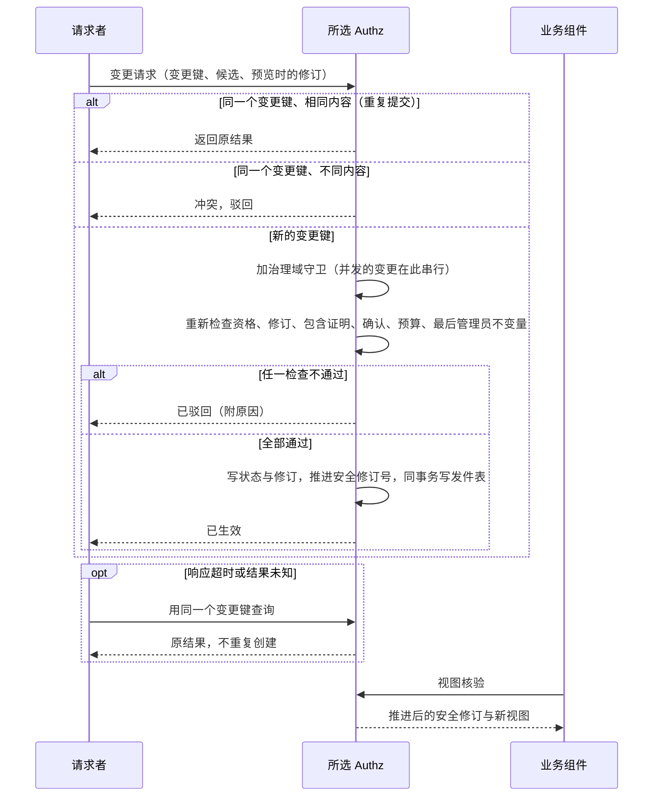
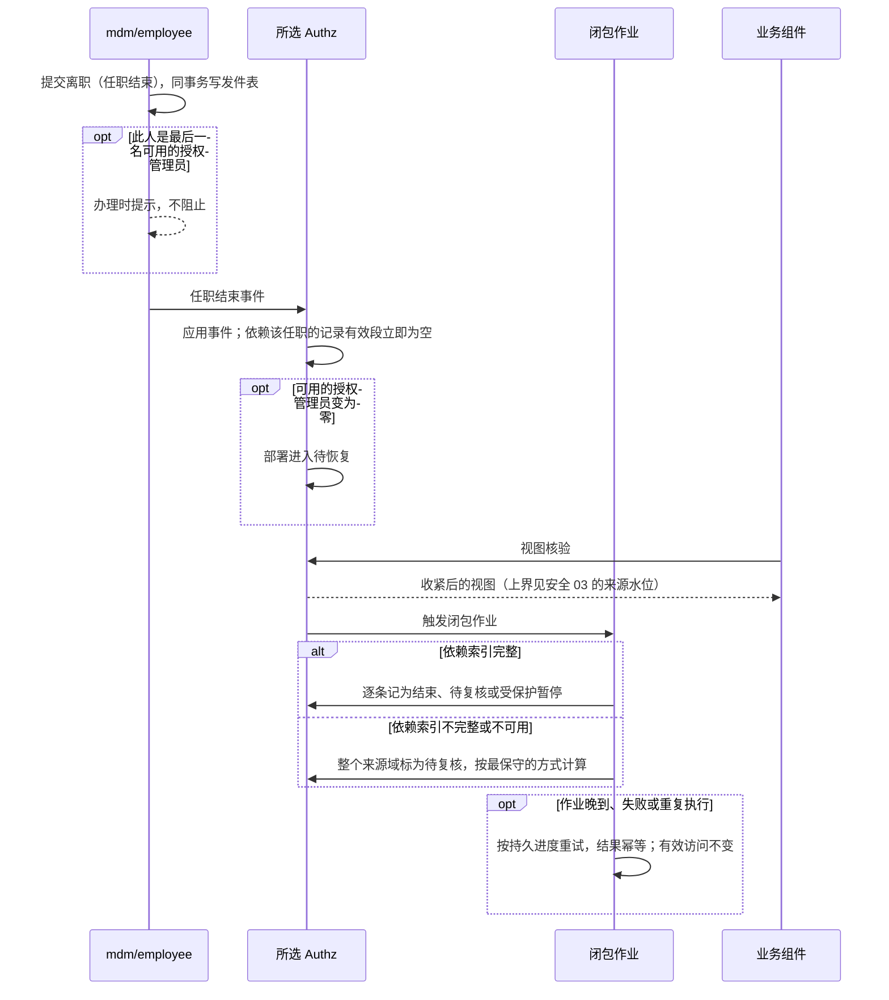

# 安全记录的状态与变更协议

本页定义全部安全记录（授权管理、身份关联、任职、共享、委托、扮演、紧急访问、安装认领与批量计划）共同的状态与变更协议，回答四个问题：

1. 全部安全记录用什么状态，怎样流转。
2. 一个变更在哪一刻、经过哪些检查才算生效；结果不明时怎么办。
3. 来源变化之后（任职结束、上限收紧、委托人缩权），依赖它的记录怎样立即失效或缩小，后续的清理做什么。
4. 哪些操作需要独立确认；只有一名管理员的小公司怎么办；最后一名管理员、首次安装与恢复怎样处理。

各类记录“应当怎样”的行为规则在[安全 02](02-trusted-identity-and-attributes.md)（可信身份）、[安全 03](03-authorization-acceptance-and-revocation.md)（接受与撤销）、[安全 04](04-authorization-administration-and-appointments.md)（管理上限与任职）、[安全 05](05-sharing-delegation-and-impersonation.md)（共享与委托）。本页使用 D30、D35–D37、D57 与 D62 的结论；状态、结束原因与变更请求的逐字段编码见[安全 09 的安全记录](09a-encoding-and-records.md#安全记录)与[变更协议](09a-encoding-and-records.md#变更协议)，下文括号中的英文是其中的枚举值。

## 两条基本原则

**一、一套通用生命周期，管全部安全记录。**各类记录（管理职责、管理持有、角色修订、授予、任职、账号关联、共享、委托、扮演、紧急访问、安装认领、批量计划）使用同一组状态与同一个生效点，按记录类型配置参数：需要谁确认、最长有效期、能否续期、通知谁。这与知识库授权决定 D9 的建议一致：所有临时授予形式“共用同一个底层结构：带期限、可撤销、记录了来源的授予”，不要每种各建一套。

**二、有效性由来源推出，不靠清理作业。**一条记录实际能提供的访问，等于它自己保存的段与它的每个来源当前约束的交集。这个交集在编译授权包时，用[安全 07 的逐维求交](07-finite-expressions-containment-and-queries.md#求交委托和扮演的派生段)算出。因此来源一收紧，依赖它的记录立即缩小，不必等影响闭包作业跑完。闭包作业只负责记账、标记复核、通知与清理；它晚到、失败或重复，都不会放出多余的权限。

## 方案比较

| 路线 | 判断 |
| --- | --- |
| **采用**：通用生命周期，加来源交集求有效，闭包作业只记账 | 一处实现、一组向量；收紧即时生效，不依赖作业；新的记录类型只加参数 |
| 每类记录各写状态机，收紧时由作业逐条改状态 | 写法直观，但状态与失效规则各写一遍；作业延迟或漏边期间，旧权限仍然有效，这正是“到期了还能用”的来源 |
| 收紧时同步改写所有依赖记录 | 生效即时，但一次收紧可能牵动成千上万条记录，造成长事务与锁争用；依赖索引有缺口时还会漏改 |

## 受本协议管理的记录

| 记录 | 属主 | 来源（有效性依赖谁） | 放宽时需要 | 谁能收紧 |
| --- | --- | --- | --- | --- |
| 管理职责单元 | Authz | 父职责单元的可授出上限 | 父单元的管理资格、包含证明与独立确认 | 父单元的管理者；安全处置 |
| 管理持有资格 | Authz | 职责单元的当前状态；绑定的任职实例；账号状态 | 该单元的管理资格与独立确认 | 该单元或上级的管理者；本人放弃；安全处置 |
| 客户角色修订 | Authz | 已注册且未退役的权限键 | 角色管理资格；新增权限按 D37 确认 | 角色管理者 |
| 普通授予 | Authz | 治理单元的当前上限；绑定的任职实例；角色修订；账号状态 | 管理资格与包含证明（安全 07） | 管辖该授权域的管理者；受授人放弃；来源收紧 |
| 任职实例 | 员工组件 | 员工的在职状态；组织单元有效 | 员工组件的人事流程 | 员工组件 |
| 账号与员工关联 | 员工组件（账号身份由 IAM 提供） | 账号状态；员工在职 | 身份管理资格与独立确认（确认记录由 Authz 的受保护操作保存，员工组件核对后生效） | 身份管理者；安全处置 |
| 机构共享 | Authz | 资源治理的可共享上限；资源当前的归属；接收人的账号状态 | 共享管理资格与包含证明 | 资源治理者；接收人放弃；来源收紧 |
| 个人委托边 | Authz | 委托人当前的直接权限；创建时的上限；委托人绑定的任职实例 | 委托人本人（以及 profile 要求的确认），且包含于委托人当前的权限 | 委托人；受托人放弃；来源收紧 |
| 只读扮演会话 | IAM 签发会话，Authz 记录许可 | 被查看人当前的读取权限；操作者的扮演资格 | 扮演资格、原因与工单、profile 要求的批准 | 操作者退出；被查看人的账号停用；管理者撤销；到期 |
| 紧急访问会话 | Authz | 预置的紧急角色；操作者的紧急资格 | 按次批准，或合同约定的先用后审 | 到期；管理者撤销 |
| 安装认领 | Authz | 部署代次 | 精确的身份匹配，或一次性确认码 | 认领即消耗 |
| 变更计划 | Authz | 计划内各项的目标修订 | 各项分别满足它的记录类型的要求 | 计划发起人取消；到期 |

任职实例与账号关联不归 Authz 所有，但它们的状态变化同样遵守本页的方向规则：收紧在属主提交时生效，放宽要求完整的事实。Authz 保存的是它们的受控视图（安全 02）；属主提交收紧之后，各组件多久内不再放行，由[安全 03 的内部来源水位](03-authorization-acceptance-and-revocation.md#内部来源的收紧与来源水位)给出上界。

## 通用生命周期

| 状态 | 含义 | 是否提供访问 |
| --- | --- | --- |
| 申请（`requested`） | 候选内容已记录 | 否 |
| 待确认（`awaiting_confirmation`） | 等待 profile 要求的确认 | 否 |
| 待生效（`scheduled`） | 已确认，生效时间在未来 | 否；到时间后经生效点重新检查，才转为生效 |
| 生效（`active`） | 正常提供访问 | 是，等于自身段 ∩ 来源约束 |
| 受保护暂停（`held`） | 因安全处置，或来源约束无法计算，暂不提供访问 | 否 |
| 结束（`ended`） | 终态，记录结束原因：到期、撤销、放弃、来源结束、被替代、驳回、取消、撤回 | 否 |

规则：

- **结束是终态。**结束的记录永不复活；重新授予是一条新记录，引用旧记录作为前身。续期、扩权、改目标也一样。
- **到期在求值时生效。**有效期按左闭右开比较，到达终点即不提供访问；把状态改为“结束（到期）”是记账，由闭包作业完成，晚做不影响安全。
- **受保护暂停只能经生效点恢复。**恢复为“生效”必须重新做一次完整检查，内容不变；内容要变，就是新记录。
- **修订不改身份。**记录的内容修订（例如普通授予的范围缩小）生成新的修订号，记录身份不变；扩大范围按放宽处理。

状态迁移表（“生效点”的检查见[生效点](#生效点)；每次经过生效点的变化都同事务写入发件表：投影更新、通知意图与审计意图）：

| 当前状态 | 事件 | 守卫条件 | 结果状态 | 动作 |
| --- | --- | --- | --- | --- |
| — | 提出放宽的候选（新增、续期、扩权、改目标，或任职生成的授权建议） | — | 申请 | 记录候选内容，以及预览时的目标与来源修订 |
| 申请 | 提交生效 | profile 要求确认 | 待确认 | — |
| 申请、待确认 | 提交生效或确认齐全 | 所需确认齐全，生效时间在未来 | 待生效 | 记录确认 |
| 申请、待确认 | 提交生效或确认齐全 | 生效时间已到，生效点检查全部通过 | 生效 | 写入状态与修订，推进受影响域的安全修订号 |
| 待生效 | 生效时间到达 | 生效点重新检查全部通过 | 生效 | 同上 |
| 申请、待确认、待生效 | 到达生效点 | 任一检查不通过（请求者失去资格、包含不成立、确认缺失或过期、预算、最后管理员不变量） | 结束（驳回） | 返回驳回原因 |
| 申请、待确认、待生效 | 到达生效点 | 预览之后目标或来源的修订已变化 | 驳回，或转待复核 | 不按旧的确认生效 |
| 生效 | 有效期终点到达 | — | 求值时立即不提供访问；闭包作业随后记为结束（到期） | — |
| 生效 | 有权者撤销 | 撤销者管辖该授权域 | 结束（撤销） | 推进安全修订号 |
| 生效 | 主体放弃自己的授予、委托或共享 | — | 结束（放弃） | 推进安全修订号 |
| 生效 | 内容缩小 | 修改者有权收紧 | 生效（新修订号，身份不变） | 推进安全修订号 |
| 生效 | 来源收紧，有效段变为空 | — | 有效段立即为空；闭包作业随后记为结束（来源结束） | 写审计与通知 |
| 生效 | 来源收紧，部分越界 | — | 生效，标记待复核；有效段为交集 | 通知有权的管理者 |
| 生效 | 来源约束无法计算（提供方私有的表达） | — | 受保护暂停 | — |
| 生效 | 安全处置 | — | 受保护暂停 | — |
| 受保护暂停 | 恢复 | 经生效点完整检查通过，内容不变 | 生效 | 推进安全修订号 |
| 受保护暂停 | 恢复并修改内容 | — | 拒绝 | 修改内容要建新记录 |
| 结束 | 任何恢复或修改 | — | 拒绝 | 重新授予建新记录，引用旧记录为前身 |

## 变更方向

每个变更先归类：

| 方向 | 例子 | 规则 |
| --- | --- | --- |
| 收紧 | 撤销、缩小范围、结束任职、停用账号、暂停、降低上限 | 有权收紧者一提交即生效，不需要包含证明，也不需要确认；任何主体都可以放弃自己的授予、委托或共享 |
| 放宽 | 新增授予、扩大范围或字段、延长期限、新增管理资格、激活会话 | 在生效点重新检查请求者当前的资格、包含证明、所需的确认、来源事实与预算，全部通过才生效 |
| 中性 | 显示名、说明、标签 | 不改变任何访问；仍记修订与审计 |

- **同时有收紧与放宽的变更，拆成两步，先收紧后放宽。**例如把一份授予从法人甲改到法人乙：先缩去甲（立即生效），再按放宽为乙申请。调岗时旧任职在 T 时刻结束、新任职在 T 时刻开始：旧授予在 T 失效，新授予在 T 经生效点检查后才生效；中间不出现“新旧都有效”的窗口。
- 收紧不需要证明，因为它只会减少访问；但“谁有权收紧”仍要检查：回收只作用于自己管辖的授权域，不能借管理一个人，撤掉他不归自己管的跨域授予（安全 04）。

## 生效点

每个放宽变更，以及每个改变状态的收紧变更，都在 Authz 的一个本地事务里完成，这个事务就是生效点：

1. 按变更涉及的治理域加守卫（[安全 03 的裁决权威与依赖域](03-authorization-acceptance-and-revocation.md#裁决权威与依赖域)中的同一类守卫），防止并发的收紧与放宽交错。
2. 重新检查：请求者此刻的身份与管理资格；目标记录与来源的修订是否仍是预览时的值；包含证明（安全 07，现场重算，不复用旧的见证）；所需的确认是否齐全且未过期；预算；[最后管理员不变量](#系统角色与最后管理员)。
3. 写入新状态与修订，推进受影响域的安全修订号，同事务写发件表：投影更新、通知意图、审计意图。
4. 返回结果：已生效、已驳回（附原因）、处理中。调用方收到超时或未知时，用同一个变更键查询，不重复提交。

变更键按请求者的命名空间区分。同一个变更键、不同的内容，按冲突驳回。

图说明：生效只发生在 Authz 的一个守卫事务里；重复、冲突与超时都按变更键收敛到同一个结果；两名管理员并发互相撤销时，守卫使它们串行，后提交者被最后管理员不变量驳回。

**与 D57 的关系。**本页定义安全记录“何时变了”；“变了之后各组件何时不再放行”由安全 03 定义。按 D57，默认路径是：生效点提交并推进安全修订号之后，各组件的本地授权视图在短有效期内经过权威核验，超期即拒绝或暂缓高风险操作；客户选用严格路径时，再加持久接受与提交屏障。两条路径共用本页的生效点。

## 有效段的计算

编译授权包时，每条生效中的记录按下表与来源求交，结果才是下发的段：

| 记录 | 有效段 |
| --- | --- |
| 普通授予 | 授予的段 ∩ 治理单元当前的上限段；绑定的任职实例不在生效中，或受授账号已停用时，为空 |
| 管理持有资格（作为授出上限） | 职责单元当前的上限 ∩ 父单元当前的上限（逐级）；持有资格本身、绑定的任职或账号失效时，为空 |
| 机构共享 | 共享的段 ∩ 资源治理当前的可共享上限；资源已移出原治理范围时，为空 |
| 个人委托边 | 委托人当前直接权限的每个段 ∩ 创建时的上限 ∩ 委托边的范围与期限（安全 05）；多层链逐边求交 |
| 只读扮演会话 | 被查看人当前的读取段 ∩ 会话上限；操作者自己的权限不参与 |
| 紧急访问会话 | 预置紧急角色的段（默认只读） |

求交在安全 07 的原子代数里总能算出（每种原子在求交下封闭）。只有一种情况算不出：来源或记录使用了提供方私有的表达。这时该记录进入受保护暂停，直到能证明为止。

**上限收紧时，部分越界的授予保持生效。**治理上限收紧后，部分越界的授予保持生效、标记待复核，它的有效段自然就是交集；整体暂停会把仍在上限之内的合法访问一起停掉（参考模型中“部分越界整体暂停”的坏变体因此改变了有效访问，被判为错误）。只有出于安全处置的收紧，才整体暂停。安全 04 的上限收紧按这一规则执行。

## 影响闭包

来源收紧后，闭包作业按依赖索引找出受影响的记录，逐条处理：

| 情况 | 处理 |
| --- | --- |
| 有效段已为空（例如绑定的任职已结束、全部落在新上限之外） | 转为结束（来源结束），写审计与通知 |
| 部分越界 | 保持生效，标记待复核，通知有权的管理者；复核结论是缩小（生成新修订），或接受现状（有效段本来就是交集） |
| 来源约束无法计算 | 转为受保护暂停 |
| 依赖索引本身不完整或不可用 | 不判断为“无人受影响”；把整个来源域标为待复核，按最保守的方式计算有效段 |

作业持久记录进度，可以重复执行，结果幂等。正确性不依赖它：参考模型验证了在任何时刻运行闭包作业，所有人的有效访问都不变。

以员工组件提交离职为例，来源收紧与闭包作业的关系：

图说明：访问的收紧发生在 Authz 应用来源事件、重新计算有效段的那一刻，不等闭包作业；作业只做记账、标记、通知与清理，它的任何失败都不放出多余的权限。

## 确认与受保护操作

本节的“受保护操作”只指安全记录的变更。业务上需要第二人确认的动作（关账的发起与重开、流程实例迁移、大额调整等）用**业务确认** profile，由业务组件声明，不进入下列清单，也不需要部署所有者确认。

确认要求写在 profile 里：要几个独立确认人、谁有资格、确认多久内有效。“独立”指不同的自然人：关联到同一员工的多个账号算一个人（安全 02）；申请人不能确认自己的申请。

标准的受保护操作（需要一名独立确认人；部署中只有一名管理员时，由部署所有者确认这一第二认证因素代替）：

1. 新增或扩大管理职责、授出管理持有资格、再下放管理。
2. 授予或变更[系统角色](#系统角色与最后管理员)的持有。
3. 建立或变更账号与员工的关联。
4. 紧急访问的激活（合同事先约定的情形可以先用后审，但必须立即通知，并在期限内复核）。
5. 超过阈值的批量计划（阈值在 profile 中）。
6. 恢复流程。

普通授予、普通角色修订默认不要求第二人（D35：小公司的集中管理不强制第二名员工）。

| 变更 | 部署中有独立确认人 | 需要的确认 |
| --- | --- | --- |
| 收紧（撤销、缩小、放弃、停用） | — | 不需要确认；只检查收紧者是否有权 |
| 上面清单中的受保护操作 | 有 | 一名独立确认人（不同的自然人，不是申请人本人） |
| 上面清单中的受保护操作 | 没有（只有一名管理员） | 部署所有者确认，使用后记录并通知 |
| 普通授予、普通角色修订 | — | 默认不需要第二人 |
| 业务上需要第二人的动作 | — | 业务组件声明的业务确认 profile；不使用部署所有者确认 |

命中策略：第一条命中。

**只有一名管理员时。**受保护操作找不到独立确认人，不能因此取消这一要求（安全 04）。做法是“部署所有者确认”：它是**第二个认证因素**，不是第二个确认人，单人公司中通常由同一个人持有。安装时生成部署所有者的确认凭据，由客户另行保管，与日常登录凭据分开；受保护操作由它作为第二道确认，使用后记录并通知。它与下文用于恢复的**恢复凭据**是两份不同的凭据，分开保管：日常确认的频繁使用不削弱恢复凭据的保管前提。这让单人公司也能完成受保护操作，同时让“管理员账号被盗”不足以独自扩大管理权限。单管理员部署中，建立账号与员工的关联（每次入职）也需要这一确认，客户说明中写明这一负担。

## 系统角色与最后管理员

系统角色由产品预置，客户不能修改它们的内容，只能管理谁持有：

| 系统角色 | 用途 | 默认持有 |
| --- | --- | --- |
| 授权管理员 | 全范围的管理上限，用于集中管理 | 安装认领者 |
| 审计查看员 | 查看审计与授权解释，不改任何授权 | 无 |
| 紧急只读 | 紧急访问会话使用的预置角色 | 无人常驻持有，只经紧急访问会话生效 |
| 超级用户 | D37 所述对已注册、未退役权限键的特殊补齐 | 生产环境默认无人持有 |

**最后管理员不变量**：任何普通变更生效后，部署中必须至少有一份“可用”的授权管理员持有资格，即持有资格生效、账号有效、绑定的任职生效。生效点在治理域守卫内检查这个不变量；两名管理员并发互相撤销时，守卫使它们串行，后提交者被驳回。

- **只约束 Authz 内的普通变更。**“可用”还取决于员工组件的任职与 IAM 的账号状态，它们由别的属主提交：来源侧的离职、任职结束与账号停用是事实，照常生效（D62）。Authz 应用这些事件后发现可用管理员为零时，与安全处置一样进入“待恢复”。员工组件办理离职时，若此人是最后一名可用的授权管理员，给出提示，但不阻止。
- **安全处置不受这个不变量约束**（账号被盗、强制停用）：它照常生效。若因此没有可用的管理员，部署进入“待恢复”状态，期间除恢复流程之外的管理变更一律驳回，业务授权照常按各自的来源计算。

## 安装认领、恢复与紧急访问

**安装认领**：安装时登记一条认领记录，内容是精确的外部身份（签发方加主体），或一次性确认码的摘要，带到期时间。首次登录匹配成功时，在同一事务里创建授权管理员持有资格，并把认领标为已消耗；唯一约束保证只能消耗一次。认领与部署代次绑定，用旧备份恢复不会重新打开已消耗的认领。

**恢复**：没有可用管理员，或需要撤换被盗的管理员时使用。由部署所有者用离线保管的恢复凭据，在部署机上执行恢复命令：

1. 进入恢复窗口：除恢复操作外，管理变更全部驳回。
2. 为指定的精确身份创建新的授权管理员持有资格；推进恢复代次（[安全 03 的代次与修订的区分](03-authorization-acceptance-and-revocation.md#代次与修订的区分)），使旧会话与旧许可失效。
3. 通知全部现有的管理员与登记的联系人，写审计；要求事后复核并记录结论。
4. 轮换恢复凭据。

恢复不经过可能已经失效的身份系统；不提供绕过认证的接口，也不自动授出超级用户。

**紧急访问**：用于正常流程来不及的情形，例如生产故障需要查看业务数据。按知识库的通行做法：预置紧急只读角色；按次批准（或合同约定的先用后审）；激活即通知客户的管理员，不能关闭这一通知；会话期限有上限，延长要重新批准；默认只读、禁止导出；每个请求的审计带会话标识；事后在期限内复核。身份系统不可用时，紧急访问需要不依赖它的认证路径；所选的 IAM 成员不具备这项能力时，紧急访问在该部署中不启用。

**项目团队访问客户系统也走这里。**按 D55，项目团队与 AI 维护客户版本；团队成员（或代其执行的 AI 工具）进入客户的业务系统，应当是一次获批的紧急访问或临时访问：客户批准、有期限、全程审计、结束后给客户访问记录。不设供应商的常驻账号。

## 员工、账号与任职

- **任职实例**由员工组件拥有，状态为计划中（`planned`）、生效（`active`）、结束（`ended`），依次流转。法人、部门、岗位等有安全含义的变化，结束旧实例、创建新实例（安全 04），不在原实例上修改。员工组件发布带实例身份与修订的事件。
- **账号与员工关联**由员工组件拥有（账号身份由 IAM 提供，替换 IAM 成员时关联不随之迁移），状态依次为申请、待确认（受保护操作）、生效、结束。一个员工可以关联多个账号，一个账号最多关联一个员工。关联的建立与变更都是受保护操作，因为它决定了任职授予作用到哪个账号，也决定了职责分离把哪些账号视为同一个人。
- **新任职的授权建议**（D30）：员工组件发布新任职后，Authz 按岗位模板生成授权建议，建议以“申请”状态存在，由合格的管理者确认后才成为普通授予；建议本身不提供访问。旧任职关联的授予在任职结束时由来源交集失效（D30 的“自动撤销”）：任职的终点已登记时随视图下发，到点在本地失效；即时办理的结束，在 Authz 应用事件后失效，上界见安全 03 的内部来源水位。闭包作业随后把它们记为结束。

## 批量计划

批量计划本身是一条记录，计划内的每一项另有状态。

- 预览时记下每一项的候选内容与目标修订；确认针对这些内容。
- 执行时每一项分别经过生效点。目标修订已变化的项转为待复核，需要重新确认，不按旧的确认生效。
- 计划报告每一项的最终状态，不以“整批成功”掩盖未执行的项；取消只停止未执行的项，已生效的项要用新的收紧变更撤回。
- 新增的人员、新增的角色使用者，不自动进入已确认的计划（安全 04）。

计划的状态（`plan_state`）：

| 当前状态 | 事件 | 守卫条件 | 结果状态 | 动作 |
| --- | --- | --- | --- | --- |
| 草稿（`draft`） | 预览 | — | 已预览（`previewed`） | 记下每一项的候选内容与目标修订 |
| 已预览 | 确认 | 确认针对预览的内容；超过阈值的计划按受保护操作确认 | 已确认（`confirmed`） | 记录确认 |
| 已确认 | 开始执行 | 距预览不超过最长时间（起始 7 天） | 执行中（`executing`） | 每一项分别经过生效点 |
| 执行中 | 每一项都有了最终状态 | — | 已完成（`completed`）或部分完成（`partially_completed`） | 报告每一项的最终状态 |
| 完成之前的状态 | 发起人取消 | — | 已取消（`cancelled`） | 只停止未执行的项；已生效的项不回滚，要用新的收紧变更撤回 |

计划内每一项的状态（`item_state`）：

| 当前状态 | 事件 | 守卫条件 | 结果状态 |
| --- | --- | --- | --- |
| 待执行（`pending`） | 执行到该项 | 生效点检查全部通过 | 已生效（`applied`） |
| 待执行 | 执行到该项 | 目标修订已变化 | 待复核（`needs_review`），需要重新确认 |
| 待执行 | 执行到该项 | 其他检查不通过 | 已驳回（`rejected`） |

## 共享、委托与扮演的参数

这三类记录的行为规则在安全 05；在本协议中，它们是通用生命周期的三组参数：

| 参数 | 机构共享 | 个人委托边 | 只读扮演会话 |
| --- | --- | --- | --- |
| 发起者 | 有共享管理资格的人 | 委托人本人 | 有扮演资格的支持人员 |
| 确认 | 按资源治理的 profile | 按委托类型的 profile；审批代理通常由委托人或上级确认 | 按 profile 批准，必须带原因与工单 |
| 最长期限 | 允许“无固定终点”，但仍随治理上限与接收资格变化 | 按委托类型，例如休假日历；起始值待定 | 15 分钟（起始值），不可刷新 |
| 续期 | 新记录 | 新记录 | 新会话，重新申请 |
| 授出者卸任 | 不影响（机构来源，与 D36 同理） | 委托人失去来源时，有效段随之为空 | 不适用 |
| 再委托 | 不允许 | 基础 profile 不允许；扩展 profile 允许有限的层数（安全 05） | 不允许 |
| 激活时的通知 | 接收人 | 受托人；审批代理通知相关的流程 | 被查看人，在激活事务内写通知意图 |

**通知落点。**会话类记录（扮演、紧急访问）在激活的同一事务里写通知意图，由通知组件投递并写入站内通知；投递失败按通知组件的重试与告警处理，不回滚已激活的会话。部署中没有可用的站内通知能力时，这两类会话不启用（安全 05 的 SD17）。

## 参数起始值

以下是待评审、待实测的起始值，不是对客户的承诺：

| 参数 | 起始值 |
| --- | --- |
| 确认的有效期（确认后多久内必须生效） | 72 小时 |
| 批量计划从预览到执行的最长时间 | 7 天 |
| 受保护操作需要的独立确认人数 | 1 |
| 只读扮演会话 | 15 分钟，不可刷新 |
| 紧急访问会话 | 4 小时，延长须重新批准 |
| 紧急访问的事后复核期限 | 2 个工作日 |
| 安装认领的一次性确认码有效期 | 24 小时 |

## 独立预期

以下预期尚未执行，以后映射到 PA 场景与三种 SDK 的共同向量。每条另配合法的正例。

| 编号 | 场景 | 固定预期 |
| --- | --- | --- |
| CP01 | 撤销、放弃、任职结束、账号停用 | 提交即不再提供访问，不等闭包作业；作业晚到不改变结果 |
| CP02 | 新增授予在预览之后、生效之前，请求者失去管理资格 | 生效点驳回 |
| CP03 | 预览之后目标记录或来源的修订变化 | 生效点驳回或转待复核，不按旧的确认生效 |
| CP04 | 同一个变更键重复提交；不同的内容重用变更键 | 返回原结果；冲突驳回 |
| CP05 | 请求超时、结果未知 | 用变更键查询；不重复创建 |
| CP06 | 结束的授予被“恢复” | 只能新建一条引用前身的记录，旧记录保持结束 |
| CP07 | 授予从法人甲改到法人乙 | 先收紧甲，再按放宽申请乙；中间没有“两者都有效”的时刻 |
| CP08 | 调岗：旧任职在 T 结束、新任职在 T 开始 | 旧授予在 T 失效；新授予在 T 经生效点检查后才生效 |
| CP09 | 治理上限收紧，一份授予部分越界 | 保持生效，有效段为交集，标记待复核；不整体暂停 |
| CP10 | 授予全部落在新上限之外 | 有效段立即为空；闭包作业记为结束（来源结束） |
| CP11 | 来源使用提供方私有的表达，交集无法计算 | 受保护暂停，直到能证明 |
| CP12 | 依赖索引缺边 | 不判为无人受影响；整个来源域待复核 |
| CP13 | 两名管理员并发互相撤销 | 串行；后提交者因最后管理员不变量被驳回 |
| CP14 | 唯一的管理员被安全处置强制停用 | 停用照常生效；部署进入待恢复，除恢复之外的管理变更被驳回 |
| CP15 | 恢复流程 | 离线的所有者凭据、精确的身份、新的恢复代次、通知全部管理员、事后复核、凭据轮换 |
| CP16 | 两个首次登录并发认领；用认领之前的备份恢复 | 只消耗一次；旧备份不重新打开认领 |
| CP17 | 单管理员执行受保护操作 | 需要部署所有者确认；不能由同一管理员的其他账号确认 |
| CP18 | 申请人用关联到同一员工的另一个账号确认自己的申请 | 视为同一人，驳回 |
| CP19 | 账号与员工的关联被改到另一个员工 | 受保护操作；旧员工的任职授予立即不再作用于该账号 |
| CP20 | 新任职生成授权建议 | 建议不提供访问；合格的管理者确认后才成为授予 |
| CP21 | 批量计划中部分项的目标已变、部分被驳回 | 每项报告最终状态；变化的项待复核；不报整批成功 |
| CP22 | 管理员正常卸任 | 他的管理持有结束；他发出的普通授予保持生效（D36） |
| CP23 | 扮演或紧急访问激活时通知组件不可用 | 通知意图已在激活事务中写入，投递重试并告警；部署没有站内通知能力时，不启用这两类会话 |
| CP24 | 项目团队成员进入客户系统排查问题 | 走紧急访问或临时访问：客户批准、有期限、全程审计、事后给客户访问记录 |
| CP25 | 最后一名可用的授权管理员在员工组件被正常办理离职 | 离职生效；办理时提示；Authz 应用事件后进入待恢复 |
| CP26 | 最后一名授权管理员的账号在 IAM 被正常停用 | 同上，进入待恢复 |
| CP27 | 建立账号与员工的关联 | 员工组件保存关联，确认记录由 Authz 的受保护操作保存；没有确认不生效 |
| CP28 | 单人公司每月关账 | 用业务确认 profile，不需要部署所有者确认 |

## 参考模型

[变更协议模型](../../../work/checks/09-change-protocol.py)（种子 20261013）用有限的原子集合代替安全 07 的段代数，对抽象的授权存储随机执行 3,000 条、每条 40 步的操作序列：放宽请求与生效、上限收紧、任职结束、撤销管理资格、新增管理员、强制停用、撤销与重新授予、委托、闭包作业、批量计划、管理员正常卸任。结果：

| 检查 | 结果 |
| --- | --- |
| 有效访问 = 记录 ∩ 来源约束；收紧之后、闭包之前，不存在超出新约束的访问；委托所得不超过委托人当前的直接权限 | 成立 |
| 闭包作业在任何时刻运行，都不改变任何人的有效访问 | 成立（采用“部分越界保持生效”的规则） |
| 普通变更之后始终有可用的管理员；强制停用可以打破它，此后进入待恢复 | 成立；1,429 条序列在强制停用后进入待恢复，其余不变量在这些序列中同样成立 |
| 结束的记录永不复活 | 成立 |
| 请求与生效之间失去管理资格的请求者，其请求不能生效 | 成立 |
| 管理员正常卸任不结束他发出的普通授予 | 成立 |
| 批量计划的每一项都有明确的结果 | 成立 |

8 个坏变体全部使模型失败：部分越界整体暂停、有效计算忽略上限、忽略任职状态、生效点不重查请求者、跳过最后管理员检查、卸任时连带结束授予、重新激活已结束的记录、委托不与委托人当前的权限求交。检查写成同义反复或只检查单条记录时，会漏掉其中两个变体；模型的检查避开了这两种写法，实现测试也要避开。

模型只说明协议在抽象层面自洽，不是 SDK、数据库或任何提供方的运行结果，也不算作 CP 或 PA 场景已执行通过。

**模型没有覆盖的条款**：模型中的任职结束与账号停用，在 Authz 的同一存储里先查不变量再执行，没有建出“来源侧的正常离职与停用不经 Authz 守卫”（D62 的情形）；CP25、CP26 靠实现测试验证。

## 依据与独立判断

知识库授权决定 D9 与《委托与临时授权》中的紧急访问一节提供中立参考：共用一个“带期限、可撤销、记来源”的结构；判定时比较有效期，不靠清理作业；紧急访问预置、按次批准、激活即通知、默认只读、不依赖故障的系统、事后复核。本页与之一致。

项目的独立选择有两处与知识库不同：一是管理上限与本人的业务权限分开（D35）；二是扩展 profile 下允许有限层数的再委托（安全 05），而知识库建议委托不能再转委托。后者是项目为集团客户保留的扩展能力，基础 profile 仍不允许再委托。

“有效性由来源推出”是本项目的设计，正确性依靠上面的参考模型、以后的三语言向量与真实数据库的验证，知识库与外部资料不替它证明。

## 已知风险与待定

- **部署所有者凭据**的形式、保管与轮换，以及它与 IAM 成员的关系；紧急访问在身份系统不可用时的认证路径。这两项属于身份协议，要与所选 IAM 成员的能力一起确定。
- **profile 参数**：各记录类型的确认、期限、通知目标的默认值与可调范围。
- CP25、CP26（来源侧的正常离职与停用使可用管理员为零）不在参考模型内，靠实现测试验证。
