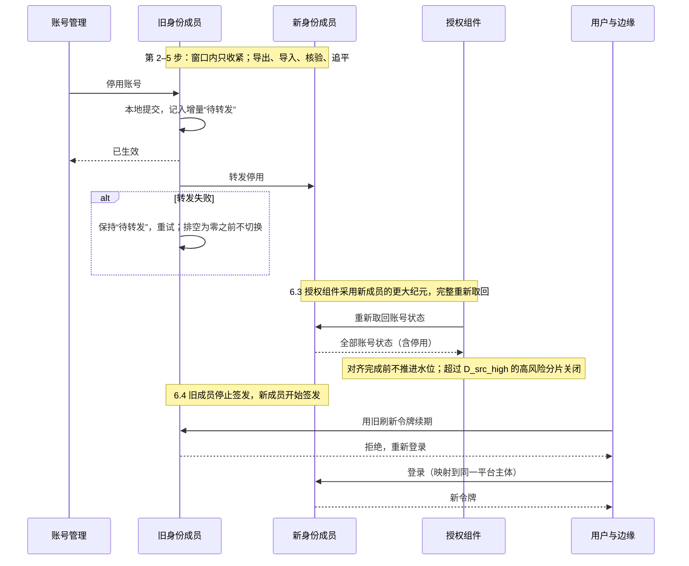

# 身份成员的切换

本页定义客户从一个身份成员换到另一个时怎样做：例如从 Casdoor 适配组件换到 Keycloak 适配组件，或者同一适配组件背后的外部身份源发生更换。它与授权成员的切换（[安全 10](10-providers-and-member-switching.md#成员切换协议)）结构相同，另外处理身份特有的四件事：外部账号到稳定平台主体的映射、账号停用不能丢、签名密钥与会话、授权组件对身份来源水位的重新对齐。选择哪个身份方案见[身份的选型说明](../../00-overview/guides/identity.md)。

## 要保持的结果

- **平台主体不变**：业务、授权、审计引用的都是部署内稳定的平台主体（[安全 02](02-trusted-identity-and-attributes.md#稳定主体与身份链接)）。换身份成员只改变“外部账号 → 平台主体”的映射，不改变任何平台主体的身份；授权记录、账号与员工的关联（员工组件拥有）、审计都不迁移、不改写。
- **没有人因切换获得更多访问**：映射只能是预先登记、唯一、精确的；不按邮箱或登录名自动认人，不把两个平台主体合并，也不把一个外部账号映射到另一个人的平台主体。
- **停用不丢失**：旧成员中已停用、已安全冻结的账号，在新成员中仍是停用或冻结；切换期间发生的停用，切换后仍然有效。重新启用只能经新成员明确办理。
- **撤权上界不变**：账号停用传到各组件的上界，切换期间仍按[安全 03 的内部来源水位](03-authorization-acceptance-and-revocation.md#内部来源的收紧与来源水位)成立；做不到时，受影响的高风险分片关闭，而不是放行。
- **可以回退**：切换的每一步都能撤回；新成员开始签发之后的回退，停用也不丢失。

授权组件的数据、恢复代次与授权成员都不因身份切换而改变。

## 步骤

默认在预告的维护窗口内进行（D25）。

1. **预检。**
   - 能力：按[身份的共同验收](../../00-overview/guides/identity.md#共同验收)核对新成员：访问与刷新令牌、issuer、audience 与类型、撤销与注销、密钥轮换（含预先发布的备用密钥，[协议 19](../../../protocols/19-config-secrets-registries-release.md)）、MFA 与敏感声明、平台主体映射、用户停用、目录事件；以及授权组件补取时需要的“拉取截至此刻的变更”（安全 03）。新成员不能提供这种拉取时，账号状态按外部来源的 `D_source` 声明，切换后产品说明相应改写。
   - 映射：为每个平台主体准备新成员中的外部身份（`(issuer, subject)`）。来源可以是预先登记的映射表、目录联邦中的稳定标识，或经确认的绑定流程（安全 02）。统计没有映射的平台主体与多对一的映射；多对一一律拒绝，没有映射的平台主体切换后不能登录，直到经确认的绑定完成。
   - 存在缺口时停止：要么不换，要么先补齐映射，再重新预检。
2. **进入切换窗口。**旧成员中的**放宽**类账号变更（新开账号、重新启用、新的外部链接、MFA 降级）被驳回；**收紧**（停用、安全冻结、撤销会话）照常在旧成员上生效，并记入切换增量。登录照常在旧成员上进行。
3. **导出。**从旧成员导出截至某一时点的全部账号状态（`active`、`disabled`、`security_frozen`）、每条停用的产品坐标（安全 03）、平台主体映射与外部链接。密码等凭据通常不能迁移；能否迁移由两种产品的能力决定，不能迁移的，切换后用户按新成员的流程重新设置。
4. **导入与核验。**新成员按映射导入账号与状态。逐个平台主体核对：状态相同；没有一个平台主体在新成员中的状态比旧成员宽（停用的不能变成启用）；映射一对一。任何差异都中止切换并列出。
5. **追平增量。**把导出时点之后在旧成员上生效的收紧重放到新成员，再核对一次受影响的平台主体。
6. **切换**（按顺序）：
   1. **旧成员停止放宽，收紧先旧后新。**此后的收紧由旧成员受理：先在本地提交并记入增量（“待转发”），再转发新成员；本地提交成功后调用者即得到“已生效”，转发失败时由旧成员重试，排空之前必须完成。
   2. **排空。**把全部“待转发”与未重放的增量重放到新成员，直到为零。
   3. **授权组件改用新成员作为身份来源。**新成员以更大的纪元发布账号状态；授权组件采用新纪元，对身份来源做一次完整的重新取回（[协议 02 的纪元变化](../02-projections.md#纪元变化)），对齐完成之前不推进这个来源的水位；期间水位超过 `D_src_high` 的高风险分片关闭。维护窗口的时长要计入这段对齐。
   4. **签名密钥与会话。**新成员的签名公钥事先加入身份族的公钥集合（预先发布，协议 19）；切换时旧成员停止签发新令牌，新成员开始签发。组件在旧访问令牌的有效期内仍接受旧成员签发的令牌（停用照常经授权组件的视图生效，不依赖令牌过期）；旧成员的刷新令牌不被新成员接受。浏览器会话由身份适配组件在服务端持有，旧适配组件的会话随之失效，用户重新登录；边缘丢弃缓存的旧令牌（[协议 20 的登录与会话](../../../protocols/20-frontend.md#登录与会话)）。
   5. **换地址。**部署变量中的身份族地址（`$endpoint:` 引用）与前端回调地址指向新成员；滚动生效期间，旧适配组件对新的登录请求重定向到新成员，不再自己签发。
7. **观察与回退。**
   - 第 6.4 步之前：回退就是撤销切换窗口，旧成员恢复受理放宽，新成员的导入丢弃；授权组件若已采用新纪元，再以旧成员的更大纪元重新对齐。
   - 第 6.4 步之后：按本协议反向执行一次：从新成员导出账号状态与增量，旧成员导入、核对，停用不丢失；旧成员的重新启用规则仍按产品坐标（安全 03）判断，期间在新成员停用的账号不会因回退而复活。
8. **退役旧成员。**旧成员签发的最后一个访问令牌过期、全部组件已换地址、观察期（起始 1 天）内没有请求到达旧成员之后，从公钥集合中移除旧成员的公钥（协议 19 的退役步骤），再退役旧成员。

结论：平台主体不变，停用先落在旧成员、再到新成员，授权组件在采用新来源时完整对齐，所以切换既不会让停用的账号复活，也不会让任何人获得更多访问（IM01–IM12）。

## 独立预期

| 编号 | 场景 | 固定预期 |
| --- | --- | --- |
| IM01 | 新成员缺少停用、撤销或密钥轮换等必需能力 | 预检停止并列出缺口；不切换 |
| IM02 | 两个旧账号映射到新成员的同一个外部身份 | 拒绝多对一；不合并平台主体 |
| IM03 | 某平台主体没有映射 | 切换后不能登录，直到经确认的绑定完成；不按邮箱或登录名自动认人 |
| IM04 | 旧成员中已停用的账号 | 新成员中仍是停用；核验发现变宽即中止切换 |
| IM05 | 切换窗口内停用一个账号，转发新成员失败 | 调用者得到“已生效”；增量保持“待转发”并重试；排空为零之前不切换；切换后仍是停用 |
| IM06 | 切换窗口内新开账号或重新启用 | 驳回 |
| IM07 | 授权组件改用新成员作为身份来源 | 采用更大的纪元，完整重新取回，对齐前不推进水位；超过 `D_src_high` 的高风险分片关闭 |
| IM08 | 用户用旧成员的刷新令牌续期 | 拒绝，重新登录；旧访问令牌在其有效期内仍被接受，停用照常经授权视图生效 |
| IM09 | 切换后账号与员工的关联、授权记录与审计 | 不变；都引用同一平台主体 |
| IM10 | 新成员签发之后回退 | 反向执行本协议；期间在新成员停用的账号回退后仍是停用 |
| IM11 | 旧成员的最后一个访问令牌尚未过期 | 旧成员的公钥保留在公钥集合中，直到过期后才移除 |
| IM12 | 初始管理员的安装认领 | 不因切换重新打开；管理员按映射登录到原平台主体 |

## 已知风险与待定

- 各身份产品之间凭据（密码、MFA 登记）能否迁移，按具体产品核对；不能迁移的，客户说明写明用户需要重新设置。
- 目录联邦（LDAP、AD）作为外部身份源时，映射使用目录中的哪个稳定标识，随具体产品确定。
- 切换窗口与授权组件重新对齐身份来源的实际时长，在代表部署实验中测量。
- 本页没有参考模型；停用不丢失与映射一对一的检查，靠实现测试与切换演练。
