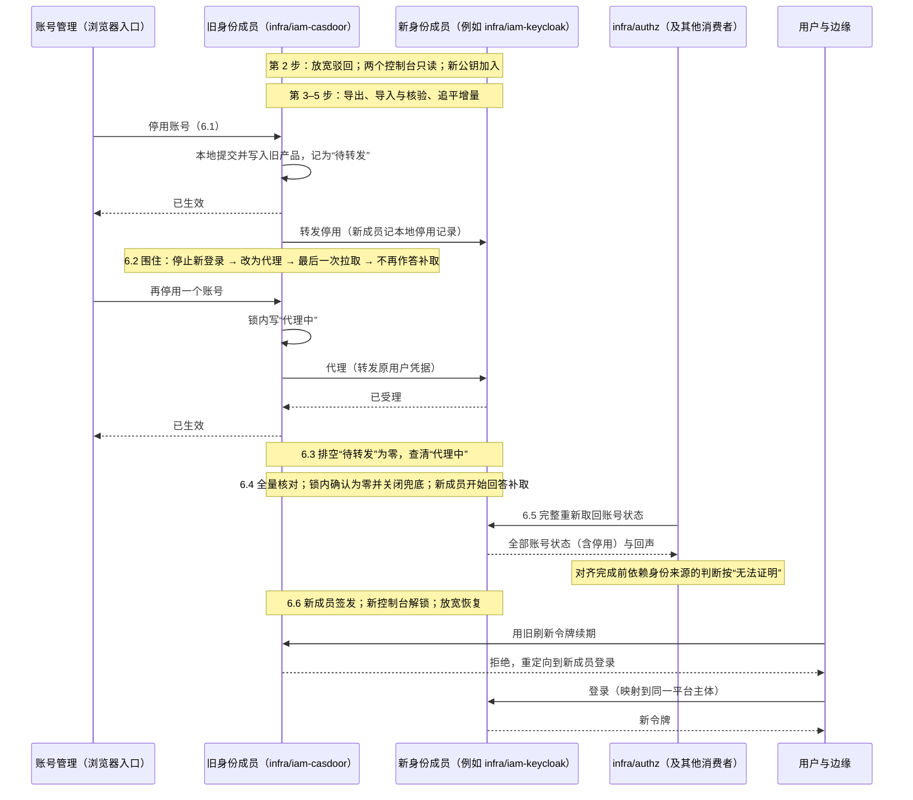
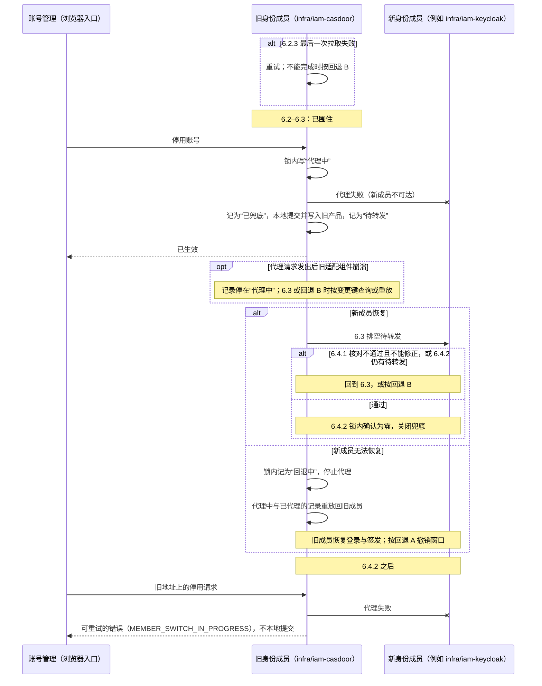

# 身份成员的切换

本页定义客户从一个身份成员换到另一个时怎样做：例如从 Casdoor 适配组件（`infra/iam-casdoor`）换到 Keycloak 适配组件，或者同一适配组件背后的外部身份源发生更换。它与授权成员的切换（[安全 10](10-providers-and-member-switching.md#成员切换协议)）结构相同，另外处理身份特有的几件事：外部账号到稳定平台主体的映射、账号停用不能丢、签名密钥与会话、MFA、各消费者对身份来源的重新对齐。选择哪个身份方案见[身份的选型说明](../../00-overview/guides/identity.md)。

整个切换的核心是**先围住、后排空**：先围住旧成员——停止新的登录与回答补取，账号变更改为代理给新成员，只在新成员不可达时由旧成员本地兜底；再把旧成员上生效过的全部收紧送到新成员（排空），并在增量的锁内确认排空为零、同时关闭兜底，之后新成员才接管。

## 要保持的结果

- **平台主体不变**：业务、授权、审计引用的都是部署内稳定的平台主体（[安全 02](02-trusted-identity-and-attributes.md#稳定主体与身份链接)）。换身份成员只改变“外部账号 → 平台主体”的映射，不改变任何平台主体的身份；授权记录、账号与员工的关联（员工组件拥有）、审计都不迁移、不改写。
- **没有人因切换获得更多访问**：映射只能是预先登记、唯一、精确的；不按邮箱或登录名自动认人，不把两个平台主体合并，也不能把一个外部账号映射到另一个人的平台主体。映射的建立与变更是受保护操作（[安全 08](08-state-and-change-protocol.md#确认与受保护操作)）。
- **停用不丢失**：旧成员中已停用、已安全冻结的账号，在新成员中仍是停用或冻结；切换期间发生的停用，切换后仍然有效。重新启用只能经新成员明确办理。
- **撤权上界不变**：账号停用传到各组件的上界，切换前后都按[安全 03 的内部来源水位](03-authorization-acceptance-and-revocation.md#内部来源的收紧与来源水位)成立；切换过程中依赖身份来源的判断按“无法证明”处理，而不是放行。新成员不能保持这个上界时（例如不能提供拉取，只能按外部来源的 `D_source` 声明），预检停止，除非客户书面接受新的上界，产品说明相应改写。
- **认证强度不降低**：MFA 登记通常不能迁移；需要 MFA 的操作，在用户于新成员登记 MFA 之前不能执行（操作 profile 照常要求 MFA，不因切换豁免）。首次登记也要有与原强度相当的证明，否则只掌握泄露密码的人可以抢先替受害人登记。
- **可以回退**：任何阶段都能撤回，停用不丢失（见[回退](#回退)）。

授权组件的数据、授权的恢复代次与授权成员都不因身份切换而改变。

## 参与者与前提

| 参与者 | 在切换中做什么 |
| --- | --- |
| 旧身份成员（旧适配组件与旧产品） | 窗口内继续受理收紧并记入增量；6.2 起被围住，只为已有会话刷新、代理账号变更与兜底；6.6 起把登录重定向到新成员 |
| 新身份成员（新适配组件与新产品） | 导入、追平、接收转发与代理；6.4 起作为身份来源回答补取；6.6 起签发并受理全部账号变更 |
| 身份来源的消费者 | 由订阅登记列出：授权组件、员工组件中账号与员工的关联、显示用的投影，以及以身份产品的目录事件为来源的适配组件（企业目录同步）。授权组件在 6.5 更换身份来源，其余消费者在 6.6 之后 |
| 账号管理的入口 | 停用、冻结、撤销会话等经适配组件的接口办理，由平台授权判断；不经产品控制台。切换期间请求仍发到旧地址，由旧适配组件受理或代理 |
| 部署所有者 | 维护窗口内在场；必要时给出部署所有者确认（安全 03 的只减少访问的操作） |
| 切换操作者 | 有权限的人在维护窗口内按步骤推进，记录每一步的守卫结果 |

前提与固定的做法：

- **两套令牌**：切换窗口内，新适配组件接受两个成员签发的用户令牌（两套签名公钥都已预先发布），所以 6.2 之后旧适配组件代理过来的请求能被办理，不依赖新产品接受旧 issuer 的令牌。
- **控制台锁定**：锁定指把产品的人工管理控制台与其他管理账号设为只读（产品设置，或在网络上禁止管理入口），并对已打开的控制台会话立即生效；适配组件自己的服务账号保留写权限（导入、重放、转发与重新停用都要用它）。各阶段哪个控制台锁定，只在[阶段总表](#阶段总表)中定义。
- **窗口内的启用一律违规**：从第 2 步到 6.6，适配组件从任一产品拉取到不是自己办理的启用类变更，都判为违规：重新停用并告警；需要启用的，6.6 之后经新成员办理。产品因多次登录失败做的临时锁定与到期解锁不是停用与启用（[安全 08 的员工、账号与任职](08-state-and-change-protocol.md#员工账号与任职)），不判违规。
- **增量的完整性**：从第 2 步起，旧适配组件经任何途径受理、看到或做出的收紧——经接口受理的、`P_pull` 与最后一次拉取取到的、违规后的重新停用、6.2 的兜底——都在同一事务记入增量（[增量与代理记录](#增量与代理记录)）。
- **账号管理的请求者资格**：6.2 之后身份来源的水位停住，请求者的资格依赖身份来源时无法证明；停用、冻结、撤销会话是只减少访问的操作，按[安全 03 的只减少访问的操作](03-authorization-acceptance-and-revocation.md#只减少访问的操作)办理。为使管理员在 6.2 到 6.6 之间仍持有有效的令牌，旧适配组件在这段时间继续为已有会话刷新访问令牌（不受理新的登录），刷新前核对增量与代理记录，命中停用、冻结或撤销会话的，拒绝刷新并撤销该会话。
- **三个地址变量**：身份族地址（`$endpoint:` 引用，登录与签发）、签名公钥地址、各消费者用于补取与批量读取的身份来源地址，是分开的部署变量，按不同的步骤更换。

## 阶段总表

请求怎样处理：

| 阶段 | 收紧（停用、冻结、撤销会话） | 放宽（开通、重新启用、新链接、MFA 降级） | 登录与刷新 | 补取与批量读取（各消费者） |
| --- | --- | --- | --- | --- |
| 第 1 步 | 旧成员 | 旧成员 | 旧成员 | 旧成员 |
| 第 2–5 步 | 旧成员，记入增量 | 驳回（`MEMBER_SWITCH_IN_PROGRESS`）；首次登录的自动开通关闭 | 旧成员 | 旧成员 |
| 6.1–6.2.1 | 旧成员，记入增量（“待转发”）后转发新成员 | 驳回 | 旧成员 | 旧成员 |
| 6.2.2–6.4.1 | 旧适配组件代理到新成员；新成员不可达或超时时旧适配组件本地兜底，记为“待转发”；新成员拒绝的原样返回 | 驳回（管理员恢复的例外见表下） | 新的登录暂停；已有会话由旧适配组件刷新（刷新前核对停用） | 旧成员不作答，水位停住；依赖身份来源的判断，高风险操作在 `D_src_high` 后、普通读取在 `D_src_read` 后关闭 |
| 6.4.2–6.5 | 旧适配组件代理到新成员；代理失败返回可重试的错误（`MEMBER_SWITCH_IN_PROGRESS`），不再兜底 | 驳回（管理员恢复的例外见表下） | 同上 | 新成员作答；授权组件在 6.5 对齐，完成之前按无法证明 |
| 6.6 至该消费者完成更换 | 新成员；旧地址上的请求由旧适配组件代理，代理失败返回可重试的错误 | 新成员（首次登录的自动开通到第 7 步观察期结束才恢复） | 新成员；旧地址上的登录被重定向 | 新成员；未更换的消费者按无法证明 |
| 该消费者完成更换之后 | 新成员 | 新成员 | 新成员 | 新成员 |
| 回退 B 中（第 1–6 步） | 第 3 步之前返回可重试的错误；之后旧成员本地提交 | 驳回，第 7 步回退 A 时恢复 | 第 6 步之前不受理新的登录；授权组件不可达时拒绝刷新全部会话 | 第 5 步起旧成员作答 |

管理员恢复的例外：6.2.2 之后需要管理员恢复时，在新成员登记映射与发放一次性登记码由新适配组件凭部署所有者的恢复凭据受理，不按“放宽一律驳回”处理（[安全 08 的管理员恢复](08-state-and-change-protocol.md#安装认领管理员恢复与紧急访问)）；第 2 步到 6.2.1 之间需要管理员恢复时，先按回退 A 结束切换。

控制台、客户端、公钥与回退：

| 阶段 | 旧控制台 | 新控制台 | 新产品中本平台的客户端 | 身份族的公钥集合 | 回退 |
| --- | --- | --- | --- | --- | --- |
| 第 1 步 | 可写 | — | 停用（预检核对） | 旧 | 停止即可 |
| 第 2–5 步、6.1、6.2.1 | 只读 | 只读 | 停用 | 旧 + 新（第 2 步加入） | 回退 A |
| 6.2.2–6.5 | 只读 | 只读 | 停用 | 旧 + 新 | 回退 B |
| 6.6 至退役 | 只读 | 可写 | 启用 | 旧 + 新 | 回退 C |
| 退役后 | — | 可写 | 启用 | 新 | 回退 C（反向切换） |

从 6.2 到授权组件完成 6.5，依赖身份来源的判断按上表关闭：普通读取在 `D_src_read` 后也关闭，所以这段时间实际上是停机，维护窗口要计入它；账号管理仍能经只减少访问的操作办理。

## 步骤

默认在预告的维护窗口内进行（D25）。每一步写明做什么、守卫与失败时怎么办；守卫不满足不进入下一步。

1. **预检。**只核对，不改变任何状态；存在缺口时停止：要么不换，要么先补齐，再重新预检。
   - **能力**：按[身份的共同验收](../../00-overview/guides/identity.md#共同验收)核对新成员：访问与刷新令牌、issuer、audience 与类型、撤销与注销、密钥轮换（含预先发布的备用密钥，[协议 19](../19-config-secrets-registries-release.md)）、MFA 与敏感声明、平台主体映射、用户停用、目录事件；能拉取凭据变更事件（改密码、MFA 因素增删、会话撤销；不能提供的，产品说明写明“恢复后凭据收紧可能丢失”，[协议 15 的证据存储](../15-backup-and-recovery.md#恢复组与备份清单)）；授权组件补取时需要的“拉取截至此刻的变更”（[安全 03 的身份成员由外部产品承载时](03-authorization-acceptance-and-revocation.md#身份成员由外部产品承载时)）；声明实现实例（[协议 02 的来源更换实现](../02-projections.md#来源更换实现)）；新适配组件能从自己的库离线导出账号状态、本地停用记录与平台主体级记录（回退 C 在新成员不可用时要用它）。
   - **旧产品**：刷新令牌时不会自动停用或冻结账号（有这类功能的先关闭），使 6.2 的最后一次拉取之后旧产品不再产生账号状态变更。
   - **依赖身份的授权能力**：部署中依赖身份成员的授权能力是否仍然满足，例如紧急访问需要的独立认证路径（[安全 09b](09b-capabilities-and-profiles.md#能力目录) 的 `authz.break_glass`）；不满足时，或停止切换，或客户确认在新成员下不启用该能力。
   - **映射**：每个平台主体都有新成员中的外部身份（`(issuer, subject)`），来源是预先登记的映射表、目录联邦中的稳定标识，或经确认的绑定流程（安全 02）。多对一一律拒绝。每个可用的授权管理员都必须有映射：没有映射的管理员切换后不能登录，受保护操作的确认会无人能做。其他没有映射的平台主体列入清单，切换后不能登录，直到经确认的绑定完成。
   - **控制台与客户端**：两个产品的控制台都能按[参与者与前提](#参与者与前提)的定义锁定，且对已打开的会话立即生效；新产品中本平台的客户端处于停用。
   - **消费者**：订阅登记列出的每个身份来源消费者都支持协议 02 的来源更换实现。
   - **不与其他切换重叠**：授权成员切换（[安全 10](10-providers-and-member-switching.md)）不在进行中；身份切换进行中也不开始授权成员切换。
   - **MFA 与密码**：MFA 不能迁移时，选定新成员中首次登记的证明方式，强度不低于原来的认证：（a）切换窗口内，用户在旧成员上（已过 MFA）领取旧适配组件签发、绑定该用户的新成员一次性登记码；（b）管理员经受保护操作（安全 08）为用户发放一次性登记码，经带外渠道交付；（c）客户规定的带外确认。登记码的有效期不晚于第 7 步观察期结束，由新适配组件核销，只能使用一次；账号被安全处置、冻结或停用时，它尚未核销的登记码一并作废（否则持有被盗会话的人领到的码可以在新成员登记自己的 MFA）。只选（a）（b）的部署，6.6 之前每个可用的授权管理员都要已领取（a）的登记码，否则 6.6 之后没有一名管理员能完成登记，也就没有人能发放（b）。原来没有 MFA 的账号按新成员的普通流程登记。密码不能迁移时，新成员的密码重设流程不能比旧成员弱（例如不能只凭邮箱，而旧成员要求邮箱加 MFA）。
   - **窗口时长**：演练测得的“6.2 到授权组件完成 6.5”的时长。超过 `T_tight`（安全 03）的部分，账号管理需要第二人确认（两名以上可用管理员时第二名管理员，只有一名时部署所有者）；客户确认这一安排，或缩短窗口。
2. **进入切换窗口。**按顺序：
   1. 旧成员驳回放宽类账号变更（`MEMBER_SWITCH_IN_PROGRESS`），关闭首次登录的自动开通（没有映射的外部账号不能登录，也不会新建平台主体）。收紧照常经旧适配组件在旧成员生效，并记入增量。
   2. 两个控制台锁为只读。旧适配组件随即向旧产品拉取截至此刻的变更，把拉到的收紧（包括锁定前一刻在控制台提交的停用）记入增量，并记下这次拉取的位置。拉取失败：重试；不能完成时解除锁定，按回退 A。
   3. 新成员的签名公钥加入身份族的公钥集合（预先发布，协议 19），使 6.6 开始签发时各组件已经能验证；在新产品中配置第 1 步选定的 MFA 首次登记方式。
   4. 登录照常在旧成员上进行；选了方式（a）的用户在这段时间领取登记码。
3. **导出。**从旧成员导出截至某一时点的全部账号状态（`active`、`disabled`、`security_frozen`，以及停用带的 `security_mark`）、每条停用的产品坐标（安全 03）、平台主体映射与外部链接，以及已删除的平台主体与已解除的链接（作为墓碑，使新成员不会让它们复活）。临时锁定不导出。密码与 MFA 登记能否迁移由两种产品的能力决定；不能迁移的，切换后按第 1 步选定的方式重新设置。
4. **导入与核验。**
   - 新成员按映射导入账号与状态。
   - 新适配组件为**每个**平台主体（包括没有映射的）记一条平台主体级的状态记录：以后为没有映射的主体办理绑定时，绑定流程读取这条记录，停用的主体绑定后仍是停用，重新启用另行办理。
   - 新适配组件为每条导入的停用与冻结记一条本地停用记录，坐标取写入新产品后的变更标识（安全 03 的产品坐标），所以新产品以后回退丢失这次停用时，拉取到的“启用”会被判为回退。
   - 核对：逐个平台主体状态相同；没有一个平台主体在新成员中的状态比旧成员宽（停用的不能变成启用）；墓碑没有复活；映射一对一；MFA 首次登记方式按第 1 步配置。任何差异都中止并列出，修正后重新导入核对，或按回退 A。
5. **追平增量。**把导出时点之后增量中的条目重放到新成员（同样记本地停用记录），再核对一次受影响的平台主体。
6. **切换。**前一小步完成，才进入下一小步。
   1. **收紧先旧后新。**旧适配组件受理收紧：在本地提交、写入旧产品并记入增量（“待转发”），提交成功即答“已生效”；再转发新成员（新适配组件记本地停用记录；没有映射的主体写入它的平台主体级记录，不算转发失败）。转发失败由旧适配组件重试；永久失败的条目转人工处置，处置完成之前不进入 6.4。
   2. **围住旧成员。**按顺序：
      1. 只选（a）（b）登记方式的部署，先核对每个可用的授权管理员都已领取（a）的登记码（之后旧成员不再受理新登录，就领不到了）；没有的，等待领取或按回退 A。然后旧成员停止新的登录与首次签发，已有会话的刷新改由旧适配组件按[参与者与前提](#参与者与前提)核对后办理。产品此后不再因登录产生账号变更（例如多次失败后的锁定）。
      2. 在增量的锁内把切换状态记为“已围住”，旧适配组件从此停止自己受理账号变更：收紧改为代理到新成员（按安全 02 转发原用户的凭据，新适配组件按[参与者与前提](#参与者与前提)接受）。每次代理先在增量的锁内写一条“代理中”的代理记录，再发请求（[增量与代理记录](#增量与代理记录)）。撤销会话代理成功后，旧适配组件同时撤销自己持有的该会话，并通知边缘丢弃缓存的令牌（[协议 20 的登录与会话](../20-frontend.md#登录与会话)）。放宽一律驳回。新成员不可达或超时时，旧适配组件按 6.1 的方式本地提交、写入旧产品，记为“待转发”，调用者得到“已生效”；新成员明确拒绝的（例如校验失败）原样返回，不本地兜底。
      3. 最后一次拉取：旧适配组件从第 2 步那次拉取的位置起，向旧产品拉取截至此刻的变更，把收紧记入增量。失败时重试；不能完成时按回退 B。
      4. 旧适配组件不再写回声、不再回答补取。各消费者的身份来源水位从此停住。
   3. **排空。**把增量中全部“待转发”的条目重放到新成员，直到为零；“代理中”的代理记录按变更键向新成员查询结果，确认的转为“已代理”，新成员没有受理的转为本地兜底（“待转发”）。
   4. **新成员接管身份来源。**按顺序：
      1. 对全部平台主体再核对一次“新成员不比旧成员宽”（含窗口内被判为违规、重新停用的）。不通过：列出差异，修正后重新核对；不能修正时按回退 B。
      2. 在增量的锁内确认没有“待转发”的条目、也没有“代理中”的代理记录，同时向证据存储同步写入移交记录（角色、旧实例、移交位置、新实例、这次切换尝试的身份，协议 15 的证据存储），并把切换状态记为“已接管”。写入结果不明时先按尝试身份读回核对；不满足或写不进证据时，先写一条“放弃这次移交”（同一尝试身份；证据存储不可达时经签名的外部告警渠道），再回到 6.3。
      3. 新适配组件开始作为身份来源写回声、回答补取（以新的实现实例）。
   5. **授权组件更换身份来源。**授权组件按[协议 02 的来源更换实现](../02-projections.md#来源更换实现)：事先登记新成员的实现实例，把身份来源地址指向新成员，完整重新取回，对齐完成之前依赖身份来源的判断按“无法证明”处理，完成后由新成员的回声恢复水位。授权组件完成之前不进入 6.6：这样新成员开放登录时，管理员的资格已可证明，被盗的账号可以照常停用。
   6. **新成员开始签发，恢复放宽。**按顺序：
      1. 只选（a）（b）登记方式的部署，再核对一次每个可用的授权管理员都持有可用的首次登记证明：（a）的登记码，或管理员恢复时由部署所有者发放的一次性码（[安全 08 的管理员恢复](08-state-and-change-protocol.md#安装认领管理员恢复与紧急访问)，有效期与核销同（a））。之后新增、两种都没有的管理员不计入这项核对，6.6 之后由已登记的管理员按（b）为他发码；只有可用的授权管理员全部缺少首次登记证明时才按回退 B 处理。
      2. 新产品中本平台的客户端启用，新成员开始签发令牌；旧适配组件把登录请求重定向到新成员（不必等 6.8 换地址），停止为旧会话刷新。
      3. 新产品的控制台解除锁定；放宽类账号变更在新成员上恢复受理。
      4. 其余身份来源消费者按协议 02 的来源更换实现更换来源（同 6.5 的做法）；漏登记的消费者按协议 02 转为 `blocked` 并告警，补登记后按 `blocked` 的出口采用。

      6.2.1 到 6.6.2 之间不能新登录；已有会话照常刷新。
   7. **签名密钥、服务凭据与会话。**
      - 新成员的签名公钥已在第 2 步加入公钥集合；切换窗口内，两个成员发布的公钥集合都同时包含新旧公钥，组件无论从哪个地址取得公钥都能验证两边的令牌。
      - 组件在旧访问令牌的有效期内仍接受旧成员签发的令牌（停用照常经授权组件的视图生效，不依赖令牌过期）；旧成员的刷新令牌不被新成员接受。
      - 浏览器会话由身份适配组件在服务端持有，旧适配组件的会话随之失效，用户重新登录；边缘丢弃缓存的旧令牌（协议 20 的登录与会话）。
      - 服务凭据：组件之间的服务身份默认来自部署信任域签发的证书（安全 02 的基础路线），不受身份切换影响；部署采用身份成员签发的服务令牌时，按同样的方式切换：新成员的服务令牌公钥先加入、再切换签发、旧的到期后移除。
   8. **换地址。**部署变量中的身份族地址与前端回调地址指向新成员；滚动生效期间，旧适配组件继续把登录请求重定向到新成员，不再自己签发。
7. **观察。**观察期（起始 1 天）内核对登录、停用与各消费者的水位；需要撤回时按回退 C。观察期结束后，首次登录的自动开通按客户原来的设置在新成员上恢复（映射规则仍按安全 02）。
8. **退役旧成员。**旧成员签发的最后一个访问令牌过期、全部组件已换地址、没有“代理中”的代理记录（接管之后超时的，按变更键向新成员查清）、退役观察期（起始 1 天，与第 7 步的观察期同时开始）内没有请求到达旧成员之后，从公钥集合中移除旧成员的公钥（协议 19 的退役步骤），再退役旧成员。退役后仍保留旧成员可重新部署的产物与配置，直到早于退役时刻的备份全部过期（协议 15 的恢复与成员切换）；密钥材料不保留，恢复时重新生成并按协议 15 的签名密钥步骤发布；目录联邦等外部依赖届时已不在客户控制下的，恢复改为以新成员为基线、按证据重放，并在恢复记录中写明。

**为什么排空为零就够了**：增量从第 2 步起收齐了旧适配组件经任何途径受理、看到或做出的收紧；控制台从第 2 步起只读，产品自己因登录产生的变更在 6.2.1 之后停止，刷新不产生账号状态变更（预检核对），最后一次拉取从第 2 步的位置起、在这些之后进行，所以产品侧没有遗漏。围住之后，旧成员上新产生的收紧只有代理失败时的本地兜底，它与其他条目同在增量中，记为“待转发”；代理记录先写后发，结果不明的也在。6.4.2 在增量的锁内确认待转发与代理中都为零并同时关闭兜底，兜底与代理记录的写入也要取同一把锁，所以确认之后不会再出现新的待转发。于是旧成员上生效过的每一次收紧，都在新成员接管之前到达了新成员。

## 增量与代理记录

切换状态（部署级，由旧适配组件保存）：

| 当前状态 | 事件 | 守卫条件 | 结果状态 |
| --- | --- | --- | --- |
| 正常（`normal`） | 进入切换窗口（第 2 步） | 预检通过 | 窗口（`window`） |
| 窗口 | 开始收紧先旧后新（6.1） | 第 3–5 步完成 | 转发中（`forwarding`） |
| 转发中 | 开始围住（6.2.2，在增量的锁内） | 6.2.1 已完成 | 已围住（`fenced`） |
| 已围住 | 确认（6.4.2） | 在增量的锁内：最后一次拉取（6.2.3）已成功，没有待转发，没有代理中；移交记录已写入证据存储 | 已接管（`handed_over`） |
| 已围住 | 移交记录写不进 | 已写“放弃这次移交” | 已围住（不变），回到 6.3；之后要撤回只能按回退 B，经代理的停用重放回旧成员 |
| 已接管 | 新成员开始签发（6.6.2） | 授权组件已完成 6.5；6.6.1 的核对通过 | 新成员签发（`new_issuing`） |
| 新成员签发 | 退役旧成员（第 8 步） | 第 8 步的条件 | 已退役（`retired`） |
| 窗口、转发中 | 回退 A | — | 正常 |
| 已围住、已接管 | 开始回退 B | — | 回退中（`rolling_back`） |
| 回退中 | 代理记录全部重放回旧成员 | 授权组件已不采用新成员、并已对齐到旧实例（整套恢复中的回退只要求已不采用新成员）；没有代理中与已代理未重放的记录；反向移交已写入（证据存储或签名的告警渠道） | 正常 |
| 新成员签发 | 开始回退 C | — | 反向切换中（`reverse_switching`），按本协议以新成员为“旧”、旧成员为“新”重新走第 1–8 步 |
| 反向切换中 | 反向切换的 6.6.2 完成 | 同正向的守卫 | 正常（旧成员签发） |
| 其余组合 | — | — | 不变，拒绝 |

增量条目（旧适配组件）：

| 当前状态 | 事件 | 守卫条件 | 结果状态 |
| --- | --- | --- | --- |
| （无） | 旧适配组件受理、拉取到或做出一次收紧；或代理失败的兜底 | 切换状态是窗口、转发中、已围住或回退中；兜底只在已围住时 | 待转发（`pending`） |
| 待转发 | 新成员确认（第 5 步的追平、6.1 的转发、6.3 的排空） | — | 已送达（`delivered`） |
| 待转发 | 永久失败 | — | 待转发（转人工处置，处置完成之前不进入 6.4） |
| 任一 | 回退 A、B 完成 | — | 不变（这些收紧已在旧成员生效，不需要回放） |

代理记录（旧适配组件，与增量同一把锁），按行序第一条命中：

| 当前状态 | 事件 | 守卫条件 | 结果状态 |
| --- | --- | --- | --- |
| （无） | 6.2 之后收到一次收紧请求 | 切换状态是已围住、已接管或新成员签发 | 代理中（`proxying`），然后发出代理请求 |
| 代理中 | 新成员确认已受理 | — | 已代理（`proxied`） |
| 代理中 | 旧适配组件崩溃后恢复，结果不明 | — | 代理中（6.3 或回退 B 时按变更键向新成员查询） |
| 代理中 | 新成员不可达或超时 | 切换状态是已围住 | 已兜底（`fell_back`）；同一事务写一条“待转发”的增量条目（超时的可能已被新成员受理，排空时重放到新成员是幂等的） |
| 代理中 | 新成员明确拒绝 | — | 失败（`failed`）；拒绝原样返回调用者 |
| 代理中 | 新成员不可达 | 切换状态是已接管或新成员签发 | 失败（`failed`）；调用者得到可重试的错误 |
| 代理中 | 超时 | 切换状态是已接管或新成员签发 | 代理中；调用者得到可重试的错误；退役之前按变更键向新成员查清 |
| 代理中、已代理 | 回退 B 重放回旧成员 | 切换状态是回退中 | 已回放（`replayed_back`） |
| 任一 | 切换状态是回退中时又收到收紧请求 | 授权组件已转为对齐中、不再采用新成员（回退 B 第 2.1 步已完成） | 不再代理：旧适配组件本地提交，写入旧产品 |
| 任一 | 同上 | 第 2.1 步尚未完成（含授权组件不可达） | 不受理，返回可重试的错误 |

## 回退

按切换所处的阶段，一行对应一种做法。

| 阶段 | 做法 | 停用怎样不丢 |
| --- | --- | --- |
| A：第 2 步之后、6.2.2 之前 | 撤销切换窗口：旧成员恢复受理放宽与新的登录（6.2.1 之后），自动开通恢复原设置，旧控制台解除锁定；新成员的导入丢弃；新产品中本平台的客户端保持停用；新成员的公钥从公钥集合中撤下 | 窗口内的收紧都先在旧成员提交，没有离开旧成员 |
| B：6.2.2 之后、6.6.2 之前（例如新成员宕机、排空或核对无法完成、授权组件对齐失败） | 按下面的[回退 B 的步骤](#回退-b-的步骤) | 代理失败时的兜底本来就在旧成员；代理成功的按先写的代理记录重放回旧成员；授权组件不再采用新成员之后，旧适配组件才受理本地收紧，所以回退期间的停用对授权组件始终可见、上界不变 |
| C：6.6.2 之后 | 以新成员为“旧”、旧成员为“新”，按本协议反向执行一次：导出账号状态与增量、导入、核对、各消费者把身份来源更换回去（协议 02 的来源更换实现）。新成员不可用时，以新适配组件的离线导出为准；读不到时按身份组件不可用与[协议 15](../15-backup-and-recovery.md) 的恢复处理 | 接管时同样同步写入反向的移交记录；反向的核对同样要求“不比原来宽”；旧成员的重新启用仍按产品坐标判断（安全 03），期间在新成员停用的账号不会因回退而复活 |

### 回退 B 的步骤

1. 在增量的锁内把切换状态记为“回退中”：旧适配组件从此停止代理；在第 3 步之前不受理本地收紧，收到的收紧返回可重试的错误（`MEMBER_SWITCH_IN_PROGRESS`）。
2. 让授权组件不再采用新成员，不依赖新成员配合：
   1. 操作者把新实例从授权组件撤下：已在 6.5 采用的，按[协议 02 的对齐状态表](../02-projections.md#消费者一侧订阅应用与水位)撤下已采用的实例，并把旧实例登记为下一实现实例；尚未采用的，撤下已登记的下一实例。授权组件转为对齐中之后，依赖身份来源的判断按“无法证明”处理，直到第 5 步采用旧实例并对齐完成。
   2. 同时请新成员停止写回声、停止回答补取，但不等它确认（网络分区时送不到）。
   3. 授权组件不可达时，第 2.1 步做不了：旧适配组件拒绝刷新全部会话（被盗会话不能续期），收紧仍按第 1 步返回可重试的错误，不本地受理；已签发的访问令牌在有效期内到期，授权视图超过有效期后高风险操作关闭。授权组件恢复后再完成第 2.1 步。
3. 授权组件已转为对齐中之后，旧适配组件开始受理本地收紧：本地提交，写入旧产品。
4. 把全部“代理中”与“已代理”的代理记录重放回旧成员（停用是幂等的，重放一次多余的无害；“代理中”的先按变更键向新成员查询，新成员不可读时一律重放）。
5. 重放为零后，旧成员恢复回答补取与写回声；写反向的移交记录（证据存储；写不进时经签名的外部告警渠道，[协议 15 的证据的写入](../15-backup-and-recovery.md#证据的写入)，不因此停在两个成员都不作答）；授权组件采用旧实例并对齐完成。
6. 旧成员恢复登录与签发。整套恢复中的回退只做到第 5 步，登录与签发按协议 15 的恢复模式表在只读开放时恢复。管理员恢复在切换中用新成员的 issuer 建出的管理员，旧适配组件凭部署所有者的恢复凭据在旧成员为他开通账号并登记映射（与阶段表下的例外同理），否则部署重新进入待恢复（[安全 08 的管理员恢复](08-state-and-change-protocol.md#安装认领管理员恢复与紧急访问)）。
7. 按回退 A 撤销切换窗口：恢复放宽与自动开通、解除旧控制台的锁定、丢弃新成员的导入、撤下新公钥。

返回“处理中”的账号管理请求（安全 03：对象持有授权管理资格、资格无法证明）不被保存，由调用者在来源恢复后重试；回退不需要另外处理它们。

## 时序图

主路径：

结论：围住之前的停用都先在旧成员提交，围住之后的停用落在新成员（代理记录先写）或作为待转发留在旧成员；新成员接管之前待转发与代理中都为零；授权组件在新成员开放登录之前完成对齐。所以停用的账号不会复活，停用也不会失去上界（IM01–IM12、IM17、IM22、IM26、IM33）。

失败分支（回退 B 在图中只画到“锁内记为回退中、重放回旧成员”；完整的七步以[回退 B 的步骤](#回退-b-的步骤)为准）：

结论：兜底只在新成员接管之前使用，它产生的待转发被排空守卫覆盖；代理记录先写后发，崩溃也不丢；回退 B 先在锁内停止代理再重放，回退期间到达的停用留在旧成员；新成员接管之后，停用只有在新成员提交才算生效（IM05、IM24、IM29、IM30、IM34、IM35）。

## 独立预期

| 编号 | 步骤 | 场景 | 固定预期 |
| --- | --- | --- | --- |
| IM01 | 1 | 新成员缺少停用、撤销或密钥轮换等必需能力 | 预检停止并列出缺口；不切换 |
| IM02 | 1 | 两个旧账号映射到新成员的同一个外部身份 | 拒绝多对一；不合并平台主体 |
| IM03 | 1、4 | 某平台主体没有映射 | 切换后不能登录，直到经确认的绑定完成；不按邮箱或登录名自动认人，不自动开通新的平台主体；已停用的主体绑定后仍是停用（IM26） |
| IM04 | 4 | 旧成员中已停用的账号 | 新成员中仍是停用；核验发现变宽即中止；新产品以后回退丢失这次停用时，按本地停用记录判为回退并重新停用 |
| IM05 | 6.1 | 切换窗口内停用一个账号，转发新成员失败 | 调用者得到“已生效”；增量保持“待转发”并重试；排空为零之前不进入 6.4；切换后仍是停用 |
| IM06 | 2–6.5 | 切换窗口内新开账号或重新启用 | 驳回（`MEMBER_SWITCH_IN_PROGRESS`） |
| IM07 | 6.5 | 授权组件更换身份来源 | 事先登记新实现实例，完整重新取回，对齐前依赖身份来源的判断按无法证明处理；没有登记的实现实例变化不采用 |
| IM08 | 6.7 | 用户用旧成员的刷新令牌续期 | 拒绝，重新登录；旧访问令牌在有效期内仍被接受，停用照常经授权视图生效 |
| IM09 | 全程 | 切换后账号与员工的关联、授权记录与审计 | 不变；都引用同一平台主体 |
| IM10 | 回退 C | 新成员签发之后回退 | 反向执行本协议；期间在新成员停用的账号回退后仍是停用 |
| IM11 | 8 | 旧成员的最后一个访问令牌尚未过期 | 旧成员的公钥保留在两个成员的公钥集合中，直到过期后才移除 |
| IM12 | 全程 | 初始管理员的安装认领 | 不因切换重新打开；管理员按映射登录到原平台主体 |
| IM13 | 2 之后 | 有人在旧产品控制台停用或启用账号 | 控制台已只读，无法落地；账号管理经适配组件办理；不能锁为只读的部署在预检时停止 |
| IM14 | 1 | 某个可用的授权管理员没有映射 | 预检停止；不进入切换 |
| IM15 | 1 | 新成员不能提供拉取，只能按 `D_source` 声明上界 | 预检停止，除非客户书面接受新的上界并改写产品说明 |
| IM16 | 6.6 之后 | 用户执行需要 MFA 的操作，尚未在新成员登记 MFA | 拒绝，引导登记；不因切换豁免 MFA |
| IM17 | 2 | 控制台锁定前一刻有人在控制台停用账号，定时拉取尚未取到 | 第 2 步锁定后的拉取把它记入增量，排空后到达新成员；这次拉取失败时不进入切换窗口 |
| IM18 | 6.6 之后 | 攻击者持有某管理员泄露的密码，切换后抢先在新成员登录并登记 MFA | 首次登记需要第 1 步选定的证明（旧成员上领取的登记码、管理员发放的一次性码或带外确认）；没有证明不能登记，需要 MFA 的操作拒绝 |
| IM19 | 6.6 | 员工组件也订阅了身份来源 | 预检核对它支持来源更换；6.6 之后事先登记新实例并对齐；漏登记时它停住并告警，不把新实例的版本当作旧值忽略 |
| IM20 | 6.2–6.5 | 发现一个普通账号被盗，管理员持有已有会话 | 旧适配组件为已有会话刷新令牌，管理员经旧适配组件代理到新成员停用；新适配组件接受旧成员签发的令牌办理 |
| IM21 | 6.2–6.5 | 有人重新启用账号 | 驳回；放宽在 6.6 才恢复 |
| IM22 | 3–4 | 旧成员中已删除的平台主体与已解除的链接 | 作为墓碑导出导入，在新成员中不复活 |
| IM23 | 6.2–6.6 | 用户登录 | 新登录暂停；已有会话照常刷新（刷新前核对停用）；6.6 起旧地址上的登录被重定向到新成员 |
| IM24 | 6.2–6.5 | 新成员宕机 | 按回退 B：锁内记为回退中、停止代理，代理记录重放回旧成员，旧成员恢复登录与签发；不卡死 |
| IM25 | 4–6.5 | 有人在新产品的控制台重新启用一个导入的停用账号 | 新控制台从第 2 步到 6.6 只读，无法落地；拉取到的不是适配组件办理的启用类变更判为违规，重新停用并告警；6.4 的全量核对通过才接管 |
| IM26 | 6.6 之后 | 离职员工 Y 已停用、没有映射，半年后为 Y 办理绑定 | 绑定读取 Y 的平台主体级记录，Y 绑定后仍是停用；重新启用另行办理 |
| IM27 | 6.2–6.5 | 围住后 90 秒发现一个普通账号被盗，管理员的资格因身份来源停住而无法证明 | 停用是只减少访问的操作，来源水位的年龄在 `T_tight` 内，按最后已应用的事实单人办理，审计标明；超过 `T_tight` 时需要第二人确认（安全 03） |
| IM28 | 2–6.5 | 有人经新产品自己的登录入口登录一个已导入的账号 | 新产品中本平台的客户端在 6.6 之前停用，不能为本平台签发令牌；回退 A、B 时新公钥从集合中撤下 |
| IM29 | 6.2–6.3 | 新成员宕机，回退决定之前有人提交停用 | 旧适配组件本地兜底并记为待转发，调用者得到已生效；新成员恢复则排空，回退 B 时它本来就在旧成员 |
| IM30 | 6.4.2 之后 | 旧地址上的停用请求代理到新成员失败 | 返回可重试的错误 `MEMBER_SWITCH_IN_PROGRESS`；不本地提交，不答“已生效” |
| IM31 | 2–6.6 | 旧产品因多次登录失败临时锁定一个账号，到期自动解锁；攻击者故意对全部管理员制造锁定 | 临时锁定不是停用，解锁不是启用类变更，不判违规；临时锁定不导出、不迁移；管理员账号不被停用，不进入待恢复 |
| IM32 | 6.2–6.5 | 授权管理员 M 的账号被盗，要停用 M | 对象持有授权管理资格，请求者资格依赖停住的身份来源而无法证明：经部署所有者确认可以立即办理；否则返回处理中，请求不保存，授权组件完成 6.5 后由调用者重试。这段时间 M 的会话仍能办理对象不是管理员的只减少访问的操作（受 `T_tight` 限制，审计标明），不能执行放宽与高风险操作；6.6 之前没有新登录 |
| IM33 | 6.5–6.6 | 授权组件对齐尚未完成，操作者要开放新成员的登录 | 不进入 6.6；新成员开放登录时管理员的资格已可证明 |
| IM34 | 6.4.1 | 新成员在线，核对不通过且不能修正，操作者决定回退 B；同一时刻有人经旧适配组件停用账号 X | 锁内记为回退中之后，旧适配组件不再代理，X 的停用本地提交在旧成员；记为回退中之前已代理的，按代理记录重放回旧成员；X 不丢失 |
| IM35 | 6.2–6.3 | 代理请求已被新成员受理，旧适配组件在收到结果前崩溃，随后新成员宕机 | 代理记录先写为“代理中”；回退 B 时新成员不可读，一律重放回旧成员；停用不丢失 |
| IM36 | 6.6.1 | 只选（a）（b）登记方式，一名可用的授权管理员没有领取（a）的登记码 | 不进入 6.6.2；等待领取或按回退 B |
| IM37 | 回退 C | 6.6 之后新产品的库损坏，新成员不可用 | 以新适配组件的离线导出为准做反向切换；读不到时按身份组件不可用与协议 15 处理 |
| IM38 | 6.2.2–6.2.3 | 6.2.2 之后一次停用经代理在新成员生效，随后 6.2.3 的最后一次拉取持续失败 | 切换状态在 6.2.2 已是“已围住”，按回退 B：代理记录重放回旧成员，该停用仍在；不按回退 A 丢弃 |
| IM39 | 6.2.3 | 最后一次拉取持续失败 | 不进入 6.3；重试，不能完成时按回退 B |
| IM40 | 6.2.2–6.4.1 | 新成员明确拒绝一次代理的停用（例如请求校验失败） | 原样返回调用者，不本地兜底 |
| IM41 | 6.2–6.5 | 唯一的授权管理员被确认被盗，部署所有者做管理员恢复 | 按安全 08：恢复出的管理员使用新成员的 issuer，并同时登记映射与一次性登记码；或先按回退 B 结束切换 |
| IM42 | 6.5 之后 | 授权组件已采用新成员，6.6.1 核对不通过，回退 B；回退中经旧地址停用 X | 回退 B 第 2 步撤下新实例，授权组件转为对齐中、依赖身份来源的判断无法证明；授权组件确认之后旧适配组件才本地提交 X 的停用；第 5 步对齐到旧实例后 X 的停用生效 |
| IM43 | 6.4.2 | 移交记录写不进证据存储 | 不记为已接管，回到 6.3；证据可达后重新确认 |
| IM44 | 6.6.1 | 6.3 时唯一的管理员被盗，部署所有者经管理员恢复为 C 发放一次性码 | C 持有管理员恢复的一次性码，6.6.1 通过；不需要回退 B；授权组件在 6.5 对齐之后 C 才可证明可用，部署在此之前停在管理员恢复中 |
| IM45 | 6.4.2 之后 | 旧地址上的停用代理到新成员超时 | 调用者得到可重试的错误；记录保持代理中，退役之前按变更键查清 |
| IM46 | 6.5 之后 | 回退 B，旧适配组件与新成员网络分区，授权组件仍连得上新成员 | 操作者先把新实例从授权组件撤下；授权组件确认之前旧适配组件不受理本地收紧；之后的停用对授权组件可见 |
| IM47 | 6.2 之后 | 被盗会话为某账号领取了（a）登记码，随后该账号被冻结 | 未核销的登记码随冻结作废，6.6 之后不能用它登记 MFA |
| IM48 | 6.6.1 | 6.3 新增的一名管理员没有任何首次登记证明，其他管理员都有 | 他不计入核对，6.6 之后由已登记的管理员按（b）发码；不回退 |
| IM49 | 6.6.2 之后 | 发现新成员的问题，决定回退 C | 切换状态转为反向切换中，按本协议反向重走；完成前不回到正常 |
| IM50 | 6.4.2 | 写移交记录超时，实际已写入 | 按尝试身份读回核对；不能确认时写“放弃这次移交”再回到 6.3；整套恢复按最后一条未被放弃的移交排序 |
| IM51 | 6.5 之后 | 回退 B 时授权组件不可达 | 旧适配组件拒绝刷新全部会话，收紧返回可重试的错误、不本地受理；授权组件恢复后先撤下新实例，再继续第 3 步 |
| IM52 | 6.3 | 管理员恢复用新 issuer 建出管理员 C，之后切换按回退 B 撤回 | 部署所有者在旧成员为 C 补登记映射；否则部署重新进入待恢复 |
| IM53 | 第 2 步之后、6.2.1 之前 | 需要管理员恢复 | 先按回退 A 结束切换，再做管理员恢复 |
| IM54 | 6.4.2 | 写了“放弃这次移交”之后决定撤回 | 切换状态仍是已围住，只能按回退 B，经代理的停用重放回旧成员；不按回退 A 丢弃 |

## 已知风险与待定

- 各身份产品之间凭据（密码、MFA 登记）能否迁移，按具体产品核对；不能迁移的，客户说明写明用户需要重新设置。
- 目录联邦（LDAP、AD）作为外部身份源时，映射使用目录中的哪个稳定标识，随具体产品确定。
- 各身份产品的管理控制台能否锁为只读、怎样锁、对已打开的会话是否立即生效；刷新令牌时是否会自动停用账号、能否关闭；临时锁定怎样与停用区分；这些随具体产品核对。
- 切换窗口与各消费者重新对齐身份来源的实际时长，在代表部署实验中测量；6.2 到授权组件完成 6.5 之间实际停机。
- 以身份产品的目录事件为来源的组织、员工适配（企业目录同步）随部署设计确定；它们作为身份来源的消费者，在 6.6 之后更换来源。
- 本页没有参考模型；停用不丢失、映射一对一、排空守卫、代理记录与回退 B、来源更换，靠实现测试与切换演练。
