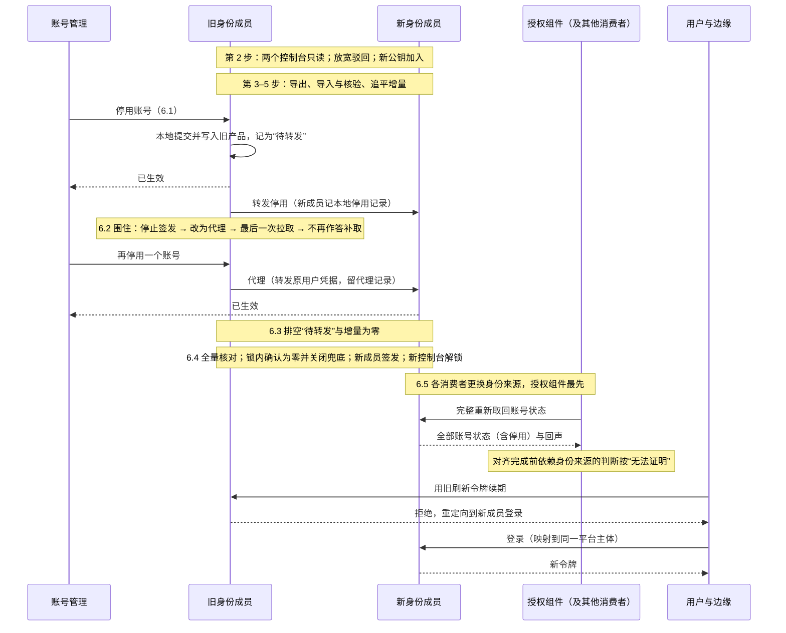
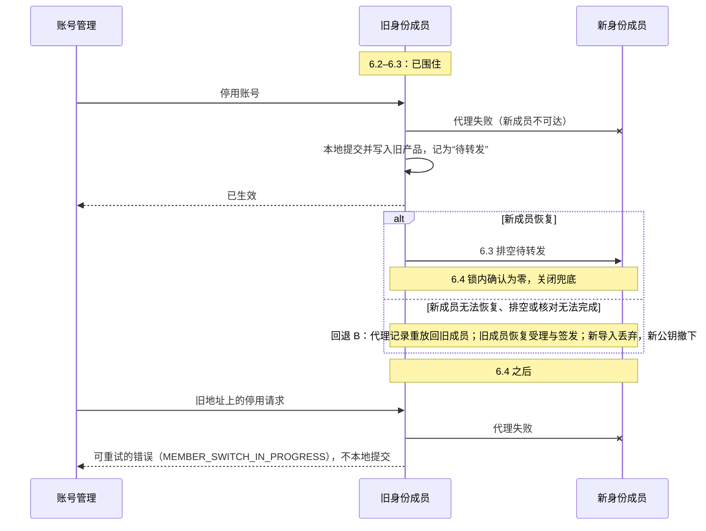

# 身份成员的切换

本页定义客户从一个身份成员换到另一个时怎样做：例如从 Casdoor 适配组件换到 Keycloak 适配组件，或者同一适配组件背后的外部身份源发生更换。它与授权成员的切换（[安全 10](10-providers-and-member-switching.md#成员切换协议)）结构相同，另外处理身份特有的几件事：外部账号到稳定平台主体的映射、账号停用不能丢、签名密钥与会话、MFA、各消费者对身份来源的重新对齐。选择哪个身份方案见[身份的选型说明](../../00-overview/guides/identity.md)。

整个切换的核心是**先围住、后排空**：先让旧成员不再自己受理任何账号变更（围住），再把它已经生效的全部收紧送到新成员（排空），排空为零之后新成员才开始签发。

## 要保持的结果

- **平台主体不变**：业务、授权、审计引用的都是部署内稳定的平台主体（[安全 02](02-trusted-identity-and-attributes.md#稳定主体与身份链接)）。换身份成员只改变“外部账号 → 平台主体”的映射，不改变任何平台主体的身份；授权记录、账号与员工的关联（员工组件拥有）、审计都不迁移、不改写。
- **没有人因切换获得更多访问**：映射只能是预先登记、唯一、精确的；不按邮箱或登录名自动认人，不把两个平台主体合并，也不能把一个外部账号映射到另一个人的平台主体。映射的建立与变更是受保护操作（[安全 08](08-state-and-change-protocol.md#确认与受保护操作)）。
- **停用不丢失**：旧成员中已停用、已安全冻结的账号，在新成员中仍是停用或冻结；切换期间发生的停用，切换后仍然有效。重新启用只能经新成员明确办理。
- **撤权上界不变**：账号停用传到各组件的上界，切换前后都按[安全 03 的内部来源水位](03-authorization-acceptance-and-revocation.md#内部来源的收紧与来源水位)成立；切换过程中依赖身份来源的判断按“无法证明”处理，而不是放行。新成员不能保持这个上界时（例如不能提供拉取，只能按外部来源的 `D_source` 声明），预检停止，除非客户书面接受新的上界，产品说明相应改写。
- **认证强度不降低**：MFA 登记通常不能迁移；需要 MFA 的操作，在用户于新成员登记 MFA 之前不能执行（操作 profile 照常要求 MFA，不因切换豁免）。首次登记也要有与原强度相当的证明，否则只掌握泄露密码的人可以抢先替受害人登记。
- **可以回退**：任何阶段都能撤回，停用不丢失（见[回退](#回退)）。

授权组件的数据、授权的恢复代次与授权成员都不因身份切换而改变。

## 参与者与前提

| 参与者 | 在切换中做什么 |
| --- | --- |
| 旧身份成员（旧适配组件与旧产品） | 窗口内继续受理收紧并记入增量；6.2 起被围住，只代理与兜底；6.4 起把登录重定向到新成员 |
| 新身份成员（新适配组件与新产品） | 导入、追平、接收转发；6.4 起签发并受理全部账号变更 |
| 身份来源的消费者 | 由订阅登记列出：授权组件、员工组件中账号与员工的关联、显示用的投影，以及以身份产品的目录事件为来源的适配组件（企业目录同步）。6.5 各自更换身份来源，授权组件最先 |
| 账号管理的入口 | 停用、冻结、撤销会话等经适配组件的接口办理，由平台授权判断；不经产品控制台 |
| 切换操作者 | 有权限的人在维护窗口内按步骤推进，记录每一步的守卫结果 |

前提与固定的做法：

- **两套令牌**：切换窗口内，新适配组件接受两个成员签发的用户令牌（两套签名公钥都已预先发布），所以 6.2 之后旧适配组件代理过来的请求能被办理，不依赖新产品接受旧 issuer 的令牌。
- **控制台锁定**：锁定指把产品的人工管理控制台与其他管理账号设为只读（产品设置，或在网络上禁止管理入口），并对已打开的控制台会话立即生效；适配组件自己的服务账号保留写权限（导入、重放、转发与重新停用都要用它）。各阶段哪个控制台锁定，只在[阶段总表](#阶段总表)中定义。
- **窗口内的启用一律违规**：从第 2 步到 6.4，适配组件从任一产品拉取到启用类变更（包括产品自己的自动解锁），都判为违规：重新停用并告警；需要启用的，6.4 之后经新成员办理。
- **账号管理的请求者资格**：6.2 之后身份来源的水位停住，请求者的资格依赖身份来源时无法证明；停用、冻结、撤销会话是只减少访问的操作，按[安全 03 的只减少访问的操作](03-authorization-acceptance-and-revocation.md#只减少访问的操作)办理。
- **三个地址变量**：身份族地址（`$endpoint:` 引用，登录与签发）、签名公钥地址、各消费者用于补取与批量读取的身份来源地址，是分开的部署变量，按不同的步骤更换。

## 阶段总表

请求怎样处理：

| 阶段 | 收紧（停用、冻结、撤销会话） | 放宽（开通、重新启用、新链接、MFA 降级） | 登录与刷新 | 补取与批量读取（各消费者） |
| --- | --- | --- | --- | --- |
| 第 1 步 | 旧成员 | 旧成员 | 旧成员 | 旧成员 |
| 第 2–5 步 | 旧成员，记入增量 | 驳回；首次登录的自动开通关闭 | 旧成员 | 旧成员 |
| 6.1 | 旧成员，记入增量（“待转发”）后转发新成员 | 驳回 | 旧成员 | 旧成员 |
| 6.2–6.3 | 旧适配组件代理到新成员；代理失败时旧适配组件本地提交，记为“待转发” | 驳回 | 暂停；已签发的访问令牌在有效期内照常使用 | 旧成员不作答，水位停住；依赖身份来源的判断，高风险操作在 `D_src_high` 后、普通读取在 `D_src_read` 后关闭 |
| 6.4 至该消费者完成 6.5 | 新成员；旧地址上的请求由旧适配组件代理，代理失败返回可重试的错误 | 新成员 | 新成员；旧地址上的登录被重定向 | 新成员已可作答；该消费者对齐完成之前按无法证明 |
| 该消费者完成 6.5 之后 | 新成员 | 新成员 | 新成员 | 新成员 |

控制台、客户端、公钥与回退：

| 阶段 | 旧控制台 | 新控制台 | 新产品中本平台的客户端 | 身份族的公钥集合 | 回退 |
| --- | --- | --- | --- | --- | --- |
| 第 1 步 | 可写 | — | 停用 | 旧 | 停止即可 |
| 第 2–5 步、6.1 | 只读 | 只读 | 停用 | 旧 + 新（第 2 步加入） | 回退 A |
| 6.2–6.3 | 只读 | 只读 | 停用 | 旧 + 新 | 回退 B |
| 6.4 至退役 | 只读 | 可写 | 启用 | 旧 + 新 | 回退 C |
| 退役后 | — | 可写 | 启用 | 新 | 按本协议反向切换 |

从 6.2 到授权组件完成 6.5，依赖身份来源的判断按上表关闭：普通读取在 `D_src_read` 后也关闭，所以这段时间实际上是停机，维护窗口要计入它；账号管理仍能经只减少访问的操作办理。

## 步骤

默认在预告的维护窗口内进行（D25）。每一步写明做什么、守卫与失败时怎么办；守卫不满足不进入下一步。

1. **预检。**只核对，不改变任何状态；存在缺口时停止：要么不换，要么先补齐，再重新预检。
   - **能力**：按[身份的共同验收](../../00-overview/guides/identity.md#共同验收)核对新成员：访问与刷新令牌、issuer、audience 与类型、撤销与注销、密钥轮换（含预先发布的备用密钥，[协议 19](../19-config-secrets-registries-release.md)）、MFA 与敏感声明、平台主体映射、用户停用、目录事件；授权组件补取时需要的“拉取截至此刻的变更”（[安全 03 的身份成员由外部产品承载时](03-authorization-acceptance-and-revocation.md#身份成员由外部产品承载时)）；声明实现实例（[协议 02 的来源更换实现](../02-projections.md#来源更换实现)）。
   - **依赖身份的授权能力**：部署中依赖身份成员的授权能力是否仍然满足，例如紧急访问需要的独立认证路径（[安全 09b](09b-capabilities-and-profiles.md#能力目录) 的 `authz.break_glass`）；不满足时，或停止切换，或客户确认在新成员下不启用该能力。
   - **映射**：每个平台主体都有新成员中的外部身份（`(issuer, subject)`），来源是预先登记的映射表、目录联邦中的稳定标识，或经确认的绑定流程（安全 02）。多对一一律拒绝。每个可用的授权管理员都必须有映射：没有映射的管理员切换后不能登录，受保护操作的确认会无人能做。其他没有映射的平台主体列入清单，切换后不能登录，直到经确认的绑定完成。
   - **控制台**：两个产品的控制台都能按[参与者与前提](#参与者与前提)的定义锁定，且对已打开的会话立即生效。
   - **消费者**：订阅登记列出的每个身份来源消费者都支持协议 02 的来源更换实现。
   - **MFA 与密码**：MFA 不能迁移时，选定新成员中首次登记的证明方式，强度不低于原来的认证：（a）切换窗口内，用户在旧成员上（已过 MFA）领取旧适配组件签发、绑定该用户的新成员一次性登记码；（b）管理员经受保护操作（安全 08）为用户发放一次性登记码，经带外渠道交付；（c）客户规定的带外确认。原来没有 MFA 的账号按新成员的普通流程登记。密码不能迁移时，新成员的密码重设流程不能比旧成员弱（例如不能只凭邮箱，而旧成员要求邮箱加 MFA）。
   - **窗口时长**：演练测得的“6.2 到授权组件完成 6.5”的时长。超过 `T_tight`（安全 03）的部分，账号管理需要两名管理员（安全 03 的只减少访问的操作）；客户确认这一安排，或缩短窗口。
2. **进入切换窗口。**按顺序：
   1. 两个控制台锁为只读。旧适配组件随即向旧产品拉取截至此刻的变更，把拉到的收紧（包括锁定前一刻在控制台提交的停用）记入增量。拉取失败：重试；不能完成时解除锁定，不进入窗口。
   2. 旧成员驳回放宽类账号变更，关闭首次登录的自动开通（没有映射的外部账号不能登录，也不会新建平台主体）。收紧照常经旧适配组件在旧成员生效，并记入增量。
   3. 新成员的签名公钥加入身份族的公钥集合（预先发布，协议 19），使 6.4 开始签发时各组件已经能验证；新产品中本平台的客户端保持停用（新产品自己的登录与密码重设入口不能为本平台签发令牌）；在新产品中配置第 1 步选定的 MFA 首次登记方式。
   4. 登录照常在旧成员上进行；选了方式（a）的用户在这段时间领取登记码。
3. **导出。**从旧成员导出截至某一时点的全部账号状态（`active`、`disabled`、`security_frozen`）、每条停用的产品坐标（安全 03）、平台主体映射与外部链接，以及已删除的平台主体与已解除的链接（作为墓碑，使新成员不会让它们复活）。密码与 MFA 登记能否迁移由两种产品的能力决定；不能迁移的，切换后按第 1 步选定的方式重新设置。
4. **导入与核验。**
   - 新成员按映射导入账号与状态。
   - 新适配组件为**每个**平台主体（包括没有映射的）记一条平台主体级的状态记录：以后为没有映射的主体办理绑定时，绑定流程读取这条记录，停用的主体绑定后仍是停用，重新启用另行办理。
   - 新适配组件为每条导入的停用与冻结记一条本地停用记录，坐标取写入新产品后的变更标识（安全 03 的产品坐标），所以新产品以后回退丢失这次停用时，拉取到的“启用”会被判为回退。
   - 核对：逐个平台主体状态相同；没有一个平台主体在新成员中的状态比旧成员宽（停用的不能变成启用）；墓碑没有复活；映射一对一；MFA 首次登记方式按第 1 步配置。任何差异都中止并列出，修正后重新导入核对，或按回退 A。
5. **追平增量。**把导出时点之后在旧成员上生效的收紧重放到新成员（同样记本地停用记录），再核对一次受影响的平台主体。
6. **切换。**前一小步完成，才进入下一小步。
   1. **收紧先旧后新。**旧适配组件受理收紧：在本地提交、写入旧产品并记入增量（“待转发”），提交成功即答“已生效”；再转发新成员（新适配组件记本地停用记录；没有映射的主体写入它的平台主体级记录，不算转发失败）。转发失败由旧适配组件重试；永久失败的条目转人工处置，处置完成之前不进入 6.4。
   2. **围住旧成员。**按顺序：
      1. 旧成员停止签发与刷新令牌，登录暂停；已签发的访问令牌在有效期内照常使用。此后产品不再因登录产生账号变更（例如多次失败后的锁定）。
      2. 旧适配组件停止自己受理账号变更：收紧改为代理到新成员（按安全 02 转发原用户的凭据，新适配组件按[参与者与前提](#参与者与前提)接受），并留一份代理记录供回退 B 重放；放宽一律驳回。代理失败（新成员不可达）时，旧适配组件按 6.1 的方式本地提交、写入旧产品并记为“待转发”，调用者得到“已生效”。
      3. 最后一次拉取：旧适配组件向旧产品拉取截至此刻的变更，把收紧记入增量。失败时重试；不能完成时按回退 B。
      4. 旧适配组件不再写回声、不再回答补取。各消费者的身份来源水位从此停住。
   3. **排空。**把增量中全部“待转发”与未重放的条目重放到新成员，直到为零。
   4. **新成员开始签发，恢复放宽。**按顺序：
      1. 对全部平台主体再核对一次“新成员不比旧成员宽”（含窗口内被判为违规、重新停用的）。不通过：列出差异，修正后重新核对；不能修正时按回退 B。
      2. 在增量的锁内确认“待转发”为零，并记下“已进入 6.4”；不为零则回到 6.3。从这一刻起旧适配组件的兜底关闭：代理失败返回可重试的错误（`MEMBER_SWITCH_IN_PROGRESS`），不再本地提交。
      3. 新产品中本平台的客户端启用，新成员开始签发令牌；旧适配组件把登录请求重定向到新成员（不必等 6.7 换地址）。
      4. 新产品的控制台解除锁定；放宽类账号变更在新成员上恢复受理。

      6.2 到这里之间不能登录；这段时间通常很短，因为 6.1 一直在持续转发。
   5. **各消费者更换身份来源。**第 1 步核对过的每个消费者，按[协议 02 的来源更换实现](../02-projections.md#来源更换实现)更换：事先登记新成员的实现实例，把身份来源地址指向新成员，完整重新取回，对齐完成之前依赖身份来源的判断按“无法证明”处理，完成后由新成员的回声恢复水位。授权组件最先进行。漏登记的消费者按协议 02 停住并告警。
   6. **签名密钥、服务凭据与会话。**
      - 新成员的签名公钥已在第 2 步加入公钥集合；切换窗口内，两个成员发布的公钥集合都同时包含新旧公钥，组件无论从哪个地址取得公钥都能验证两边的令牌。
      - 组件在旧访问令牌的有效期内仍接受旧成员签发的令牌（停用照常经授权组件的视图生效，不依赖令牌过期）；旧成员的刷新令牌不被新成员接受。
      - 浏览器会话由身份适配组件在服务端持有，旧适配组件的会话随之失效，用户重新登录；边缘丢弃缓存的旧令牌（[协议 20 的登录与会话](../20-frontend.md#登录与会话)）。
      - 服务凭据：组件之间的服务身份默认来自部署信任域签发的证书（安全 02 的基础路线），不受身份切换影响；部署采用身份成员签发的服务令牌时，按同样的方式切换：新成员的服务令牌公钥先加入、再切换签发、旧的到期后移除。
   7. **换地址。**部署变量中的身份族地址与前端回调地址指向新成员；滚动生效期间，旧适配组件继续把登录请求重定向到新成员，不再自己签发。
7. **观察。**观察期（起始 1 天）内核对登录、停用与各消费者的水位；需要撤回时按[回退](#回退) C。观察期结束后，首次登录的自动开通按客户原来的设置在新成员上恢复（映射规则仍按安全 02）。
8. **退役旧成员。**旧成员签发的最后一个访问令牌过期、全部组件已换地址、观察期内没有请求到达旧成员之后，从公钥集合中移除旧成员的公钥（协议 19 的退役步骤），再退役旧成员。

**为什么排空为零就够了**：围住之后，旧成员上新产生的收紧只有一种来源：6.2 第 2 小步代理失败时的本地提交，它与 6.1 的条目同在增量中，记为“待转发”。6.4 第 2 小步在增量的锁内确认待转发为零并同时关闭兜底，兜底的本地提交也要取同一把锁，所以确认之后不会再出现新的待转发。于是旧成员上生效过的每一次收紧，都在新成员开始签发之前到达了新成员。控制台从第 2 步起只读，产品自己因登录产生的变更在 6.2 第 1 小步之后停止，最后一次拉取在两者之后，所以产品侧也没有遗漏。

## 回退

命中策略：按切换所处的阶段，一行对应一种做法。

| 阶段 | 做法 | 停用怎样不丢 |
| --- | --- | --- |
| A：第 2 步之后、6.2 之前 | 撤销切换窗口：旧成员恢复受理放宽，自动开通恢复原设置，旧控制台解除锁定；新成员的导入丢弃；新产品中本平台的客户端保持停用；新成员的公钥从公钥集合中撤下 | 窗口内的收紧都先在旧成员提交，没有离开旧成员 |
| B：6.2 之后、6.4 之前（例如新成员宕机、排空或核对无法完成） | 解除围住：把新成员在 6.2 之后受理的收紧（按旧适配组件的代理记录；新成员可读时也从它导出核对）重放回旧成员；然后旧成员恢复签发与回答补取，再按回退 A 撤销切换窗口（恢复放宽与自动开通、解除旧控制台的锁定、丢弃新成员的导入、撤下新公钥）；各消费者的身份来源没有更换，水位随旧成员的回声恢复 | 代理失败时的本地提交本来就在旧成员；代理成功的按代理记录重放回旧成员 |
| C：6.4 之后 | 以新成员为“旧”、旧成员为“新”，按本协议反向执行一次：导出账号状态与增量、导入、核对、各消费者把身份来源更换回去（协议 02 的来源更换实现） | 反向的核对同样要求“不比原来宽”；旧成员的重新启用仍按产品坐标判断（安全 03），期间在新成员停用的账号不会因回退而复活 |

## 时序图

主路径：

结论：围住之前的停用都先在旧成员提交，围住之后的停用只落在新成员或作为待转发留在旧成员；新成员开始签发之前待转发为零；消费者在新成员签发之后才更换来源并完整对齐。所以停用的账号不会复活，停用也不会失去上界（IM01–IM12、IM17、IM22、IM26）。

失败分支：

结论：兜底只在新成员尚未签发时使用，它产生的待转发被排空守卫覆盖；新成员签发之后，停用只有在新成员提交才算生效；任何时候回退，停用都留在当时有权威的那一方（IM05、IM24、IM29、IM30）。

## 独立预期

| 编号 | 步骤 | 场景 | 固定预期 |
| --- | --- | --- | --- |
| IM01 | 1 | 新成员缺少停用、撤销或密钥轮换等必需能力 | 预检停止并列出缺口；不切换 |
| IM02 | 1 | 两个旧账号映射到新成员的同一个外部身份 | 拒绝多对一；不合并平台主体 |
| IM03 | 1、4 | 某平台主体没有映射 | 切换后不能登录，直到经确认的绑定完成；不按邮箱或登录名自动认人，不自动开通新的平台主体；已停用的主体绑定后仍是停用（IM26） |
| IM04 | 4 | 旧成员中已停用的账号 | 新成员中仍是停用；核验发现变宽即中止；新产品以后回退丢失这次停用时，按本地停用记录判为回退并重新停用 |
| IM05 | 6.1 | 切换窗口内停用一个账号，转发新成员失败 | 调用者得到“已生效”；增量保持“待转发”并重试；排空为零之前不进入 6.4；切换后仍是停用 |
| IM06 | 2–6.3 | 切换窗口内新开账号或重新启用 | 驳回 |
| IM07 | 6.5 | 授权组件更换身份来源 | 事先登记新实现实例，完整重新取回，对齐前依赖身份来源的判断按无法证明处理；没有登记的实现实例变化不采用 |
| IM08 | 6.6 | 用户用旧成员的刷新令牌续期 | 拒绝，重新登录；旧访问令牌在有效期内仍被接受，停用照常经授权视图生效 |
| IM09 | 全程 | 切换后账号与员工的关联、授权记录与审计 | 不变；都引用同一平台主体 |
| IM10 | 回退 C | 新成员签发之后回退 | 反向执行本协议；期间在新成员停用的账号回退后仍是停用 |
| IM11 | 8 | 旧成员的最后一个访问令牌尚未过期 | 旧成员的公钥保留在两个成员的公钥集合中，直到过期后才移除 |
| IM12 | 全程 | 初始管理员的安装认领 | 不因切换重新打开；管理员按映射登录到原平台主体 |
| IM13 | 2 之后 | 有人在旧产品控制台停用或启用账号 | 控制台已只读，无法落地；账号管理经适配组件办理；不能锁为只读的部署在预检时停止 |
| IM14 | 1 | 某个可用的授权管理员没有映射 | 预检停止；不进入切换 |
| IM15 | 1 | 新成员不能提供拉取，只能按 `D_source` 声明上界 | 预检停止，除非客户书面接受新的上界并改写产品说明 |
| IM16 | 6.4 之后 | 用户执行需要 MFA 的操作，尚未在新成员登记 MFA | 拒绝，引导登记；不因切换豁免 MFA |
| IM17 | 2 | 控制台锁定前一刻有人在控制台停用账号，定时拉取尚未取到 | 第 2 步锁定后的拉取把它记入增量，排空后到达新成员；这次拉取失败时不进入切换窗口 |
| IM18 | 6.4 之后 | 攻击者持有某管理员泄露的密码，切换后抢先在新成员登录并登记 MFA | 首次登记需要第 1 步选定的证明（旧成员上领取的登记码、管理员发放的一次性码或带外确认）；没有证明不能登记，需要 MFA 的操作拒绝 |
| IM19 | 6.5 | 员工组件也订阅了身份来源 | 预检核对它支持来源更换；6.5 事先登记新实例并对齐；漏登记时它停住并告警，不把新实例的版本当作旧值忽略 |
| IM20 | 6.2–6.3 | 发现一个普通账号被盗 | 经旧适配组件代理到新成员停用；新适配组件接受旧成员签发的令牌办理 |
| IM21 | 6.2–6.3 | 有人重新启用账号 | 驳回；放宽在 6.4 才恢复 |
| IM22 | 3–4 | 旧成员中已删除的平台主体与已解除的链接 | 作为墓碑导出导入，在新成员中不复活 |
| IM23 | 6.2–6.3 | 用户登录 | 暂停登录；已签发的访问令牌在有效期内照常使用；6.4 起旧地址上的登录被重定向到新成员 |
| IM24 | 6.2–6.3 | 新成员宕机 | 按回退 B 解除围住，把代理记录中的收紧重放回旧成员，旧成员恢复受理与签发；不卡死 |
| IM25 | 4–6.3 | 有人在新产品的控制台重新启用一个导入的停用账号 | 新控制台从第 2 步到 6.4 只读，无法落地；拉取到的任何启用类变更判为违规，重新停用并告警；6.4 前的全量核对通过才签发 |
| IM26 | 6.4 之后 | 离职员工 Y 已停用、没有映射，半年后为 Y 办理绑定 | 绑定读取 Y 的平台主体级记录，Y 绑定后仍是停用；重新启用另行办理 |
| IM27 | 6.2–6.5 | 围住后 90 秒发现一个普通账号被盗，管理员的资格因身份来源停住而无法证明 | 停用是只减少访问的操作，来源水位的年龄在 `T_tight` 内，按最后已应用的事实单人办理，审计标明；超过 `T_tight` 时需要第二名管理员确认（安全 03） |
| IM28 | 2–6.3 | 有人经新产品自己的登录入口登录一个已导入的账号 | 新产品中本平台的客户端在 6.4 之前停用，不能为本平台签发令牌；回退 A、B 时新公钥从集合中撤下 |
| IM29 | 6.2–6.3 | 新成员宕机，回退决定之前有人提交停用 | 旧适配组件本地提交并记为待转发，调用者得到已生效；新成员恢复则排空，回退 B 时它本来就在旧成员 |
| IM30 | 6.4 之后 | 旧地址上的停用请求代理到新成员失败 | 返回可重试的错误 `MEMBER_SWITCH_IN_PROGRESS`；不本地提交，不答“已生效” |
| IM31 | 2–6.4 | 旧产品因锁定时限到期自动解锁一个账号，被适配组件拉取到 | 判为违规，重新停用并告警；需要启用的在 6.4 之后经新成员办理 |
| IM32 | 6.2–6.5 | 授权管理员 M 的账号被盗，要停用 M | 对象持有授权管理资格，请求者资格依赖停住的身份来源而无法证明，返回处理中（安全 03）；这段时间登录在 6.4 之前暂停，依赖身份来源的高风险操作在 `D_src_high` 后已关闭，M 的账号不能执行管理操作；授权组件完成 6.5 后照常办理 |

## 已知风险与待定

- 各身份产品之间凭据（密码、MFA 登记）能否迁移，按具体产品核对；不能迁移的，客户说明写明用户需要重新设置。
- 目录联邦（LDAP、AD）作为外部身份源时，映射使用目录中的哪个稳定标识，随具体产品确定。
- 各身份产品的管理控制台能否锁为只读、怎样锁、对已打开的会话是否立即生效，随具体产品核对。
- 切换窗口与各消费者重新对齐身份来源的实际时长，在代表部署实验中测量；6.2 到授权组件完成 6.5 之间实际停机。
- 以身份产品的目录事件为来源的组织、员工适配（企业目录同步）随部署设计确定；它们作为身份来源的消费者，按 6.5 更换来源。
- 本页没有参考模型；停用不丢失、映射一对一、排空守卫与来源更换，靠实现测试与切换演练。
