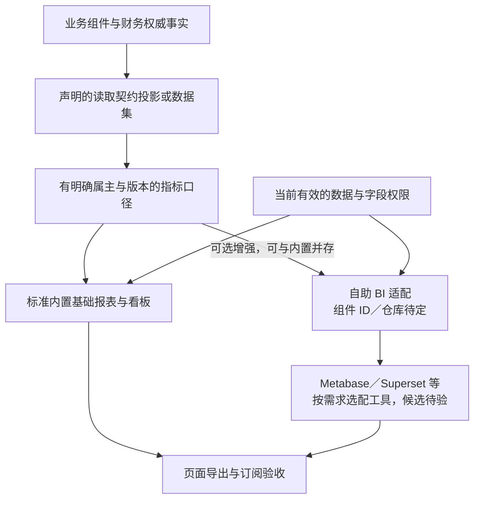

# 报表、看板与自助分析的选择

> 状态：标准内置基础报表、自助 BI 按需选配的方向已定；原分析货架未实现。数据供给、指标、权限适配和运行预算仍需详细设计与验证。

## 选择对象与组件仓库

| 选择对象 | 组件／仓库或产品 | 谁替换谁 | 状态与边界 |
| --- | --- | --- | --- |
| 内置基础报表 | 所选业务组件与前端入口的报表实现 | 同一报表／入口的受控定制或 Fork 接替；不要求每张报表独立仓库 | 标准交付方向已定，具体报表目录与属主尚待设计 |
| 分析货架原条目 | `ana/bi`，规划仓库 `ana-bi` | 最终分析适配或投影实现承接其有效能力；具体拆分与候选成员身份未定 | 未实现，不将 `ana/bi` 当作已接通多个 BI 的万能组件 |
| 自助 BI 工具 | Metabase、Superset 等评估候选；项目适配组件的 ID／仓库未分配 | 所选 BI 与对应适配路线可在指标、权限与配置迁移验收后接替 | 没有指定产品或已交付成员，不编造 `ana/bi-metabase` 等身份 |
| 客户自有 BI | 客户现有工具，加明确项目数据与授权适配 | 可成为自助路线的另一实现；内置基础报表可继续保留 | 按真实接口、许可、出口与资源验收，不是自动兼容 |

这里有两种选择：内置／自助是交付能力组合，Metabase／Superset 等是自助工具路线的替换候选。它们都不接替业务事实或正式财务账簿。原分析条目与仓库定位见[分析货架](../components/catalog.md#分析)。

内置基础报表与选配自助 BI 可以同时使用，不画成二选一。客户可按需求选择工具；多个工具并存时分别验证数据供给、权限、出口和资源，不从候选列表推导当前已支持任意多工具组合。

## 能力分工

数据集、指标、水位、授权、订阅、自助 BI 路线与搜索的协议见[协议 13](../protocols/13-search-reports-and-datasets.md)。

业务组件拥有原始事实、业务规则与必要的操作查询；财务拥有正式账簿及会计结果。报表和分析使用声明的读取契约、投影或数据集，不通过跨组件任意 SQL 获得所有权，也不直接扣库存、核销或记账。正式账务与报告调整的边界见[标准账簿范围](finance-and-settlement.md#每法人单账簿的标准范围)。

指标需明确来源、粒度、时间／业务日期、发生归属或当前组织口径、币种／单位、退款与更正处理、版本和负责人。多个展示工具可以引用共同定义；不预设所有指标只能由一个独立服务计算，也不允许同名指标悄悄采用不同定义。

图表示逻辑责任，尚未裁定新增组件身份、服务数量或部署边界。必要操作查询与重分析区分负载预算；小客户不因几个固定报表自动承担完整数仓、管道和 BI 服务。重分析的数据供给与隔离需另外验证，外壳合并不能取消资源限制。

## 标准交付与选配路线

标准版内置基础固定报表和看板，不安装额外 BI 平台也能使用所选业务能力声明的基础报表；客户需要拖拽制作报表或多维探索时，再选配可替换的 BI 适配与工具。这里的内置是产品交付方式，不要求所有查询与页面挤进一个组件，也不取消重分析的数据供给与资源隔离。

| 选择 | 优势 | 代价 | 适用需求与规模条件 |
| --- | --- | --- | --- |
| 内置固定报表／看板为标准，自助 BI 独立选配 | 复用项目入口与权限，少一套工具维护；无 BI 也可完成已声明的基础报表 | 新报表与复杂探索较依赖开发；需维护报表查询与页面 | 业务明确、固定报表为主的小客户；较大客户也可使用，资源与重分析隔离仍需测量 |
| 可替换的成熟 BI 作为标准报表平台，业务入口嵌入或跳转 | 复用图表与探索能力，客户可自行制作较多报表 | 基础交付增加工具与适配；权限、版本、导出／订阅、许可和资源需一起验收 | 自助分析需求较多、能承担工具维护的客户；能否适合小型部署待测，不能以用户数直接判定 |

已选择第一条作为标准最低交付路径；第二条保留为客户组合方案，不要求所有客户承担。内置不表示每张报表一个组件；选配 BI 不表示客户只能使用一种工具。基础财务／业务报告的责任、指标或报告是否可自定义，以及报表目录尚待逐项设计。

## 替换和安全适配

替换 BI 工具要清点指标定义、数据集、图表、筛选参数、账号／身份映射、数据与字段权限、缓存、导出、订阅和分享链接。共同指标应可核对，工具专属图表与查询配置可能需要重建；不承诺只换地址即可迁移全部看板。

页面、合计、排行、筛选项、下钻、缓存、导出与订阅都要验证授权。单点登录或隐藏菜单不证明数据访问已隔离；用户能够自由编辑查询时，数据源与查询能力必须有明确边界。汇总可能反推受限信息，按具体指标定义保护办法，不从知识库样例照搬统一分组阈值。

读取、导出与交付使用当前有效授权；具体机制承接[权限设计](../02-security-and-permissions.md)，不另建立能放宽原保护的独立授权规则。定时订阅按接收者当前资格与允许内容生成／交付；不能用创建订阅时的历史范围永久发送。数据截至时间、口径版本及失败／陈旧状态需可见，具体新鲜度等级另审。

数据截至与完整覆盖水位分别表示；最新事件时间不能证明没有未处理缺口。事实来源、快照／增量交接和历史重建统一遵循[事件分类与恢复](../05-transactions-and-messaging.md#事件分类重放与去重寿命)，冷／热集合按[权威目录](../04-data-and-lifecycle.md#生命周期状态与跨层查询)去重。BI 选型不能绕开这些保证，也不把所有查询强制变成实时流式处理。

## 选型证据和验收

| 要证明 | 最小验证目标 |
| --- | --- |
| 标准组合 | 不装额外 BI 时，所选业务能力仍完成声明的基础报表；选配自助 BI 另验适配，缺少选配能力时行为明确，不以空白数据冒充完成 |
| 口径与财务差异 | 固定样例含退款、更正、跨日、单位／币种和历史组织变化；多个展示渠道结果按同一口径核对，报告调整与正式账簿差异可解释 |
| 权限与数据出口 | 多角色交替查询和缓存、改参数、受限字段／派生指标、合计／下钻、撤权后的导出下载及订阅发送 |
| 数据供给与恢复 | 延迟、重复／乱序、缺失与重建、更正和冷热覆盖；不能把业务事件流当作必然含完整历史的数据源 |
| 资源与部署 | 在线交易并行运行重查询／导出，测尾延迟、扫描／并发限制与积压；选配前后整套资源及维护步骤分别记录 |
| 工具替换 | 图表与配置迁移清单、指标／权限对照、旧订阅处理、失败恢复、精确版本与许可条件 |

尚未选择 BI 产品、实现适配器或运行报表实验；许可和性能不能从工具名称或演示功能推导。普通操作报表、跨组件分析和实时看板的时效／存储范围分别设计，不在本题设定所有客户必须使用实时分析库。

功能参考：[Metabase 全应用嵌入](https://www.metabase.com/docs/latest/embedding/full-app-embedding)提供嵌入式探索及权限／单点登录接入，该文档当前将此形态列为 Pro／Enterprise 能力；[Superset 安全配置](https://superset.apache.org/admin-docs/security/)说明自身权限机制，并明确不能把工具当作数据库防火墙。这里只证明适配和许可条件需要核对，不推荐购买特定版本，也不照搬工具默认角色、允许任意 SQL 或采用其权限规则替代本项目语义。
