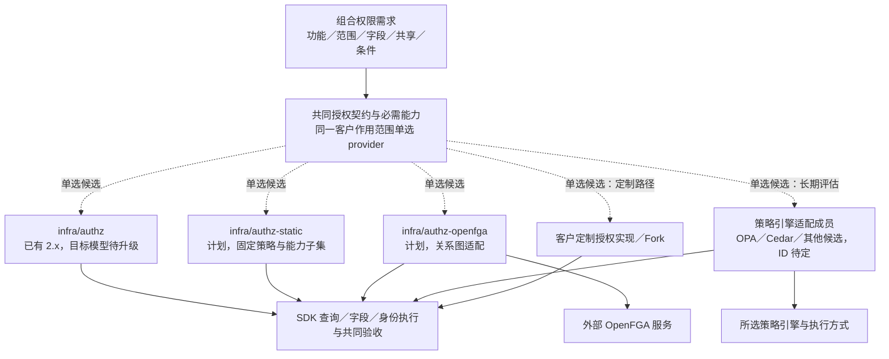

# 授权模型、组件方案与切换

> 状态：权限选择与替换的统一入口。`infra/authz` 2.x 已有；静态与 OpenFGA 成员计划中；其他引擎为长期评估方向，不等于已批准开发。完整授予的新目标尚须演进族契约与 SDK，没有已通过的新模型替换组合。

## 客户选择的是哪一层

本页从[身份授权分图](../components/selection-map.md#身份授权与组织分图)展开。IAM 证明是谁，Authz 决定能做什么、访问哪些记录与字段。客户先确认权限需求，再选择能覆盖需求的授权组件；不同权限模型可以在同一实现里组合，不必每种模型、每个角色或每个客户都另建一个组件。

需要分清三层：权限类型表达需求，模型表达规则，组件／引擎实现这些规则。固定配置与数据库管理是数据维护方式，本地、嵌入、旁车与远程服务是执行位置；它们都不是新的业务权限模型。

## 权限类型与模型怎样组合

| 客户的问题 | 类型／模型 | 项目中的表达与执行 | 对选型的影响 |
| --- | --- | --- | --- |
| 哪些岗位能查看、确认、审批 | 功能权限，RBAC | 角色与权限键、有效授予；服务端入口和业务动作检查 | 各成员须提供所选业务的基本功能判定，不直接在业务代码判断供应商角色名 |
| 哪些法人、部门、仓库的数据能看或改 | 数据范围，属性／组织范围 | 完整授予上的范围与当前资源属性；查询前过滤，列表与单对象一致 | 只有 true／false Check 不够，还须能实现完整查询与分页 |
| 什么金额、任职、时间条件下可执行 | 条件，ABAC；复杂规则可用版本化策略 | 可信主体／资源／操作／环境属性，按整份授予配对 | 先区分授权条件与业务不变量；具体属性与条件协议待设计，不声明旧成员已支持任意表达式 |
| 成本、工资、联系方式能看多少，哪些能修改 | 字段权限 | 与当前记录／动作匹配的授予、统一输出／输入校验及过滤排序保护 | 所选实现与 SDK 必须承接逐记录字段，不能从全局字段键直接放开 |
| 单独把一张订单或文件分享给某人 | 对象共享，ACL／直接关系 | 对象、主体、动作、期限与撤销；业务关系和人工共享有各自权威 | 动态共享须有相应能力，不是固定角色配置的必然功能 |
| 团队、父文件夹、嵌套成员关系带来访问权 | 关系继承，ReBAC | 关系与派生规则，列表／Check／投影保持同语义 | 多跳关系是关系图实现的重要候选理由；单层共享不强制部署图服务 |
| 临时代批、只读扮演、到期与撤销 | 委托和授予生命周期 | 授予来源、期限、权限上限与责任链 | 各支持方案分别验收；不是换一种模型就自动具备 |
| 无论角色如何都不能自审或绕过期间锁 | 必需业务控制 | 业务组件拥有约束，授权与业务检查共同决定动作 | 换授权实现不能改变这些不变量；继续承接不提供管理员可配置 Deny 的方向 |

RBAC、ABAC、ACL、ReBAC 与字段保护不是按名字四选一。常见 ERP 会同时需要角色、范围、有限条件和字段；协作型业务再加入共享与关系。数据密级／MAC 类需求按可信标签与强制规则专项设计；预签名等持有即可使用的访问能力见[附件权限](files-and-attachments.md)，不据此新增一套放宽业务授权的系统。

同一主体兼任时，先判断每一份完整授予的操作、范围、条件与字段，再汇总合法结果。甲范围的审批或明文字段不能与乙范围的读取授予拼接；旧契约中维度分别取并集的规则与此目标不一致，需先改规格并决定兼容版本。

## 哪些组件可以相互替换



虚线是方案选择关系，不是运行期调用或已经安装的成员。对一个客户作用范围，配置一个明确的授权 provider 入口；一个成员可以组合多种模型或内部引擎。暂不将多个独立 provider 的结果按 OR 拼接，也不将不同法人的薪资路由规则自动推广到授权。

| 方案 | 组件／仓库 | 主要覆盖方向与价值 | 代价与适用场景 | 当前状态 |
| --- | --- | --- | --- | --- |
| 标准本地策略与投影 | `infra/authz`，[infra-authz](https://github.com/brickKit/infra-authz) | 项目维护角色、范围、共享等语义；SDK 在本地执行适合下推查询的判断 | 更新、撤销、字段与投影一致性需要维护；通用 ERP 列表与组织范围的标准候选 | 项目锁定 2.0.1；新完整授予模型、条件与替换能力仍待升级验证 |
| 静态配置成员 | `infra/authz-static`，规划仓库 `infra-authz-static` | 为固定权限和可配置范围提供精简维护路线；不将静态等同于无数据／字段保护 | 动态管理、共享、关系等以真实能力声明为准；需要这些能力的客户不能静默降级 | 计划；具体能力子集、部署与语义未验收 |
| 关系图成员 | `infra/authz-openfga`，规划仓库 `infra-authz-openfga` | 通过 OpenFGA 处理适合的团队、父子与多跳关系；标准功能／范围／字段由适配与 SDK 共同承接 | 外部图服务、存储与同步、列表枚举／截断、条件属性和修订一致性增加成本；适合关系协作复杂的组合 | 计划，不将 OpenFGA 产品能力视为项目已实现 |
| 属性／策略引擎成员 | 正式 ID 与仓库未分配；OPA、Cedar、Cerbos 等作为不同候选评估 | 适合规则复杂、需要可测试的版本化策略或共享决策的客户 | 属性来源、列表过滤、字段、策略版本、错误与新鲜度需适配；产品接口不等价，不能统称无成本互换 | 长期评估，未指定产品／组件或承诺本轮开发 |
| 嵌入库实现路径 | 可在上述自有成员／SDK 的明确适配层评估 Casbin 等库；无独立组件 ID | 对适合的模型减少额外服务进程 | 语言支持、配置与求值差异、查询和跨语言验收仍需处理 | 工程候选；不自动成为新的可部署砖或直接跨组件导入库实现 |
| 客户定制成员／Fork | 对已选成员保留 ID 正常升版的 Fork，或明确的新实现；仓库按客户来源登记 | 承接客户独有模型与管理流程 | 团队维护适配、版本与状态迁移，客户决定升级；不能省略共同安全验收 | 定制路径，未指定通用替代仓库 |

共同族契约仓库为 [contract-infra-authz](https://github.com/brickKit/contract-infra-authz)。官方 SDK 在 be-sdk-go／be-sdk-python／be-sdk-ts 实现消费与执行；它们不是三种权限产品。当前 rc.2 的角色、范围和字段语义须与新完整授予目标对齐，不能宣布所有候选已经满足共同契约。

OpenFGA 是现有计划的关系图候选；SpiceDB 等可在出现明确一致性或部署需求时另行评估，正式 ID／仓库与实施范围尚未分配。没有必要仅为权限模型名称收集一批仓库；有独立客户取舍、共同契约与可控迁移价值时，才形成新的成员。

## 客户怎样选

| 客户需求 | 优先比较的路线 | 选择前必须确认 |
| --- | --- | --- |
| 通用 ERP，角色与法人／组织／仓库范围为主 | 标准 `infra/authz` | 完整授予、字段、列表、撤权和受限管理的目标验收 |
| 固定角色，授予变更少，精简维护 | `infra/authz` 与计划 `infra/authz-static` | 客户是否需要动态授权、共享／委托；静态方案缺少任何必需能力就不能选 |
| 大量对象共享、团队与父子继承 | 标准方案与计划 `infra/authz-openfga` | 关系权威、同步／删除、列表与详情一致、可用性和整套资源 |
| 条件复杂且经常演进 | 标准有限条件与策略引擎候选 | 可信属性、新鲜度、查询／字段翻译、策略测试与升级维护；不会因选引擎就向客户开放任意编程 |
| 特殊管理或业务模型 | 受控适配／客户 Fork／新成员 | 能否保留共同安全保证，团队维护成本及旧状态迁移 |

复杂度按授予数、关系深度、列表规模、更新频率、查询负载、字段和高风险操作衡量，不仅按人数判断。各方案没有本项目统一环境下的容量对照，暂不声称某个产品最省资源或吞吐最高。

## 在哪里选择组件

设计选型在本页完成，实际客户组合记入装配项目：`brickkit.yaml` 锁定所选成员和精确版本，`config/vars.yaml` 绑定统一族地址，业务组件按共同契约使用地址，前端按客户已启用能力展示功能。新增、移除和升级使用 BrickKit 命令保持运行锁、部署与配置一致。

目标版地址形状示意如下；静态／OpenFGA 成员尚未安装，示意不是当前可直接执行的配置：

```yaml
AUTHZ_URL: $endpoint:infra/authz-openfga
AUTHZ_GRPC_URL: $endpoint:infra/authz-openfga:grpc
```

选择另一个成员时两个地址指向那个成员。不能只改地址就宣布迁移成功；先满足共同契约与所需能力、主体／授予／关系状态和修订转换、SDK／查询兼容，再做真实验收。所需／提供能力的项目元数据由 `assembly.yaml`、契约与 be-ops 承接，具体检查还须随新模型完善，不假设 BrickKit CLI 能理解 RBAC／ABAC／ReBAC 的业务含义。

## 授权管理能力

标准设计已定同时支持集中管理与受限分级管理；客户可以只用集中管理。启用分级管理时，方案需覆盖管理对象、可授权限及范围／条件上限，不能因换 provider 丢失约束。业务使用权与授出管理权分别声明，共同边界见[授权管理与授出上限](../02-security-and-permissions.md#授权管理与授出上限)。

迁移与验收不仅比较业务允许／拒绝，还要比较谁能授予、修改角色与回收、管理资格和来源、间接提权防护及交接。管理员正常卸任不使合法普通业务授予自动失效，接任者或上级接管，被授予人自身的任职、有效期和撤销规则仍适用；不能在转换为另一 provider 时误变成授出者卸任就全部失效。

共同验收区分普通业务授予与用户代办／委托，并保留来源和审计链。正常交接与安全事件、范围／上限收紧的处理不同，具体协议与尚未实现状态见[普通授予与管理员交接](../02-security-and-permissions.md#普通授予与管理员交接)。

## 部署与维护怎样比较

| 路线 | 运行与持久对象 | 必须计入的代价 |
| --- | --- | --- |
| 标准本地判断 | 项目授权成员、策略／授予存储与各组件的 SDK／投影 | Bundle 传播、缓存／投影水位、查询资源与撤销故障；本地判断不代表授权永远不用服务 |
| 静态成员 | 计划成员及版本化策略／配置；真实持久依赖待定义 | 修改、审核与发布流程，所选能力的维护限制和热更新／恢复验收 |
| 关系图成员 | 项目适配组件、外部 OpenFGA 与所需持久存储；项目的主体／授予与修订数据按契约维护 | 多层存储同步、图查询与列表、备份恢复、版本／模型迁移与故障保护 |
| 策略引擎候选 | 项目适配，加所选引擎的嵌入、旁车或独立服务形态 | 各自语言与进程成本、策略和属性分发、查询／字段适配及完整测试 |
| 适配成员进入外壳 | 仅将已支持合并的自有成员放进同语言、同 SDK 外壳 | 保留真实 RPC、成员资源预算和共享故障；外部图／策略服务不自动随之合并 |

每套客户组合由团队维护，客户决定升级；管理界面提供允许的有限角色、范围与条件设置，策略语言和模型演进由团队按版本与验收维护。基本权限与必要审计不会因精简部署被取消。

## 替换步骤和验证目标

导出主体、角色、授予、资源和关系，确定可表示范围；构建目标模型；转换数据并验证修订；切换统一入口；重建投影；验证正反权限、列表／详情／字段／导出、撤销与故障。切换窗口和回退条件由运行手册明确。

标准业务角色模板与客户实际角色的来源／版本关系同样需要迁移。升级新增权限不自动加入普通实际角色，经授权管理人员确认后生效；系统角色与专用超级角色单独处理。具体共同保证和未定升级协议见[普通业务角色与升级确认](../02-security-and-permissions.md#普通业务角色与升级确认)。

待审重点：本地与 provider 的决策分工、ListObjects 和数据库过滤、权限修订令牌、缓存刷新、explain 的泄漏边界、委托与扮演、服务身份和事件处理。

具体推荐和冻结阻塞统一在[权限执行规范](../02-security-and-permissions.md#全局复审后的执行推荐)：有限类型表达、可证明管理上限、完整查询、业务接受节点／撤销竞争及内部认证。产品宣称更高一致性或本地低延迟不是这些结果的替代证明，不在每个 provider 比较中另维护安全算法。

## 产品能力依据与项目边界

- [OpenFGA 授权概念](https://openfga.dev/docs/authorization-concepts)说明角色、属性、关系及条件可组合；这不证明项目适配已覆盖逐记录字段或完整查询。
- [OPA 数据过滤与部分求值](https://www.openpolicyagent.org/docs/filtering/partial-evaluation)说明策略可形成数据过滤条件；实际表达式子集、SQL／字段翻译和性能仍须验收，不再笼统写成策略引擎都只能回答布尔值。
- [Cedar 概念](https://docs.cedarpolicy.com/overview/terminology.html)以主体、动作、资源与上下文表达授权；查询与数据／字段执行不能凭模型名省略。
- [Casbin 概述](https://casbin.apache.org/docs/overview/)提供多模型执行库；引入库不是自动获得本项目授予管理、撤销和跨语言等价。

资料用于区分候选职责；正式选型必须固定产品／契约版本验证。其他引擎当前只列评估名称，不作其具体功能、许可或部署已支持的承诺。
