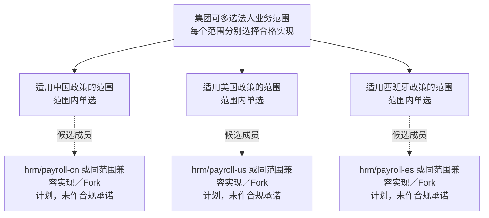
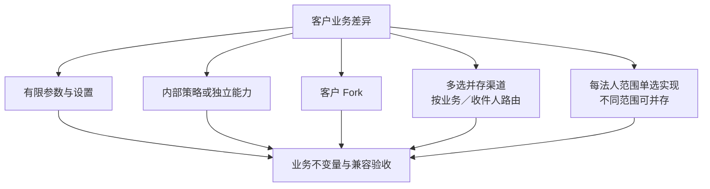

# 业务定制、算法选择与渠道组合

> 状态：替换路径与待审场景；未来业务货架尚未全部实现。

## 选择对象与组件仓库

业务定制与外部通道分别介绍。下面先点名协作组件和变化去向，再列出可按同一能力选择的通道成员。所有已有仓库链接核对自当前子模块，未接入条目仅列规划名；没有第二个成员时明确写定制／Fork 路径。

| 业务选择点 | 原组件与仓库 | 可以替换或承接什么 | 状态与详细入口 |
| --- | --- | --- | --- |
| 伙伴身份与角色 | `mdm/customer`／[mdm-customer](https://github.com/brickKit/mdm-customer)，原 `mdm/supplier`／规划 `mdm-supplier` | 新统一伙伴组件承接两者基础身份与角色；不是客户与供应商任选其一 | 新身份／仓库未定；[边界](../01-component-boundaries.md#业务伙伴与角色) |
| 产品主数据 | `mdm/product`／[mdm-product](https://github.com/brickKit/mdm-product) | 同产品职责的兼容实现／客户 Fork 接替 | 有 2.x；没有已交付的另一标准产品成员 |
| 销售订单 | `erp/sales`／[erp-sales](https://github.com/brickKit/erp-sales) | 深度行业订单实现或客户 Fork 接替；实物／服务基础仍在标准组件内选配 | 有 2.x，新能力与缺件保护待实现；[销售边界](../01-component-boundaries.md#销售类型与按需依赖) |
| 库存与复杂仓储 | `erp/inventory`／[erp-inventory](https://github.com/brickKit/erp-inventory)，复杂仓储新 ID／仓库待定 | 库存兼容实现／Fork接替库存；仓储可另换同任务契约实现 | 两种职责相互协作，不互为替代；[库存与仓储](../01-component-boundaries.md#库存核心与仓库作业) |
| CRM 关系与商机 | `crm/opportunity`／[crm-opportunity](https://github.com/brickKit/crm-opportunity)，`crm/customer` 等为规划条目 | 各自能力的兼容实现或 Fork 接替；CRM 关系不接替伙伴基础身份 | 商机已有，其余见[CRM 货架](../components/catalog.md#客户关系) |
| 组织与任职 | `mdm/org`／规划 `mdm-org`，独立员工任职能力新 ID／仓库待定 | 同组织／任职契约的对应实现或 Fork 接替 | 与 IAM、薪资相互协作，不互为替代 |
| 其他 ERP／HR／项目业务 | 原组件 ID 与规划仓库见[完整货架](../components/catalog.md) | 明确对应能力的兼容实现、内部策略或客户 Fork；没有已指定的通用替代仓库 | 未实现条目按原状态；不因能 Fork 就宣称有现成替代件 |

定制仓库按被定制组件的来源、客户差异与新版本登记，不编造统一的 Fork 名称。选择另一业务身份时，调用方、事件与数据迁移可能需要受控修改；保留同 ID 的 Fork 也须正常升版。

## IM 适配成员

这些成员承接 IM 通道职责，可按客户／收件人路由选择或并存。它们与 `infra/notification` 协作，不替代通知意图、偏好与路由权威。

| 组件 ID | 仓库定位 | 使用场景 | 状态 |
| --- | --- | --- | --- |
| `integration/im-dingtalk` | [integration-im-dingtalk](https://github.com/brickKit/integration-im-dingtalk) | 客户使用钉钉，按声明消息／结果能力接入 | 当前有 2.0.0；新协议能力需验 |
| `integration/im-wechat-work` | 规划 `integration-im-wechat-work` | 客户使用企业微信 | 计划，接口／消息差异待适配 |
| `integration/im-feishu` | 规划 `integration-im-feishu` | 客户使用飞书 | 计划，具体支持能力待验 |
| `integration/im-slack` | 规划 `integration-im-slack` | 客户使用 Slack | 计划，具体支持能力待验 |
| `integration/im-teams` | 规划 `integration-im-teams` | 客户使用 Teams | 计划，具体支持能力待验 |

选择依据是客户实际协作生态、所需消息／交互类型与维护条件；不把五个渠道的扩展能力写成完全相同。切换清点收件身份、凭据、模板、待发送／结果状态、回调与重复保护，完整通道契约和目标 SDK 仍待验收。

## 支付与电子签适配成员

| 选择组 | 组件 ID | 仓库规划名 | 可以接替的职责与状态 |
| --- | --- | --- | --- |
| 支付 | `integration/payment-stripe` | `integration-payment-stripe` | Stripe 通道适配，计划 |
| 支付 | `integration/payment-paypal` | `integration-payment-paypal` | PayPal 通道适配，计划 |
| 支付 | `integration/payment-alipay` | `integration-payment-alipay` | 支付宝通道适配，计划 |
| 支付 | `integration/payment-wechat-pay` | `integration-payment-wechat-pay` | 微信支付通道适配，计划 |
| 电子签 | `integration/esign-docusign` | `integration-esign-docusign` | DocuSign 签署适配，计划 |
| 电子签 | `integration/esign-pandadoc` | `integration-esign-pandadoc` | PandaDoc 签署适配，计划 |
| 电子签 | `integration/esign-esign` | `integration-esign-esign` | e签宝签署适配，计划 |

同组成员可按声明能力选择或并存，不表示不同外部服务对每个交易／地区／签署条件都等价。通道产品、许可、费用、地区资格和真实外部结果在具体组合中核对，本页不作支付或签署合规承诺。支付不能代替[资金收付业务与财务核销](finance-and-settlement.md#收付款通道与财务账簿)，电子签也不能自行决定原业务单据已放行。

邮件 `integration/email`／规划 `integration-email`、短信 `integration/sms`／规划 `integration-sms` 是不同投递方式，可与 IM 组合，不自动归为同语义互换。EDI `integration/edi`／规划 `integration-edi` 承接业务交换，不替代支付或通知。它们均未实现，须分别明确契约与结果验收。

## 薪资按法人选择的成员

图说明跨范围可以并存，同一范围内才比较替代实现；不是国家方案任选一个就适用于全部法人。适用政策与合规条件须由具体客户方案核对，当前国家成员均未实现。

| 原货架组件 | 仓库规划名 | 角色与选择范围 | 状态 |
| --- | --- | --- | --- |
| `hrm/payroll-core` | `hrm-payroll-core` | 共用薪资模型候选，是否独立为最终组件仍待审 | 未实现，不与任一国家实现互为完整替代 |
| `hrm/payroll-cn` | `hrm-payroll-cn` | 声明适用范围内的中国薪资实现候选 | 未实现，不声明地区合规 |
| `hrm/payroll-us` | `hrm-payroll-us` | 声明适用范围内的美国薪资实现候选 | 未实现，不声明地区合规 |
| `hrm/payroll-es` | `hrm-payroll-es` | 声明适用范围内的西班牙薪资实现候选 | 未实现，不声明地区合规 |

国家实现根据法人实际适用政策选择，不把中国实现直接用作西班牙法人的替代。替换是同一负责范围内更换满足其规则的实现或客户 Fork；不同范围可并存，同一范围只有一个权威。共用核心、国家适配、员工／任职与财务是协作关系，最终组件边界、路由与迁移仍待设计。

## 客户差异的落点

同一种差异要先比较落点，不按图机械拆成多个新组件。

| 差异 | 候选路径 | 优势 | 代价与验收 |
| --- | --- | --- | --- |
| 参数与限额 | 所属业务组件的有限设置，客户授权人员通过界面调整 | 日常调整无需因单个业务参数变化而维护部署 | 校验允许范围与组合、管理权限、版本／生效及审计；不能变成无限规则语言 |
| 实物／服务销售 | 标准销售统一订单基础，按启用业务能力要求库存 | 服务客户可不装库存，共同订单基础集中维护 | 类型与依赖声明、缺件保护、混合明细、交付／账务状态及迁移；无库存运行未验证 |
| 简单／复杂仓库作业 | 库存基础操作配可选复杂仓储组件 | 小客户只装必要能力，复杂仓库流程可单独替换 | 任务与库存提交的协调、幂等、部分执行、恢复及在途迁移；未实现 |
| 成本、计价、拣货等算法 | 明确可替换策略／能力，按不变量选择组件或内部策略 | 已定主动承接常见差异，集中变化与分别验证 | 状态归属、事务不变量、性能和历史结果；具体边界待审 |
| 某客户特有模型 | 独立版本 Fork | 客户可自主偏离 | 差异、来源、兼容、升级和迁移责任 |
| 多种完整业务实现 | 同契约族或受控适配 | 为不同客户画像选实现 | 语义、状态、调用方和权限／数据迁移 |
| 不同法人使用不同实现 | 明确作用范围后并存 | 法人分别选配、替换或 Fork | 范围缺失／重叠、调用路由、权限与跨法人汇总 |
| IM／邮件／支付／电子签 | 多通道并存 | 覆盖不同生态 | 路由、凭据、回调、幂等、费用与第三方故障 |

有限设置的维护方式已定，具体可调项和生效协议仍需逐业务设计；部署参数继续由 BrickKit 管理。设置与扩展／Fork 的分界及验收见[有限业务设置](../06-engineering-conventions.md#有限业务设置)。

销售已定的能力选配与缺件保证见[销售类型与按需依赖](../01-component-boundaries.md#销售类型与按需依赖)。深度行业模型仍可独立替换或 Fork；本轮未开发服务交付或调整当前依赖清单。

复杂仓储已定可独立于库存核心选配、定制与替换，责任图与共同约束见[库存核心与仓库作业](../01-component-boundaries.md#库存核心与仓库作业)。替换任务实现要迁移在途状态并核对库存结果，不能以独立组件为由删除旧任务或重复执行数量变动。

## 已定的算法替换方向

常见且合理的客户算法差异优先设计明确替换点。有独立选配和维护价值、且能守住业务不变量的能力，可以成为独立组件；需要在同一一致性边界执行的策略留在原组件，通过明确接口或受控适配选择。模型深度改变仍可完整 Fork，不为组件数量机械拆分。

替换点先写状态归属、输入输出、错误、身份权限、并发与事务要求、切换时点和历史结果处理，再决定实现形态。一个业务事实保持明确写入权威，外壳不自动把跨组件写变成共同事务。具体计价、成本和拣货模型尚未定，不把此方向写成已经有可替换实现。

内部策略是原组件内部实现，不作为可独立部署的砖承诺；真正的独立算法组件继续通过外部契约调用。不能用跨组件源码导入或直接函数调用伪造独立性。

不同策略允许不同业务结果；共同验收证明契约、安全与共享不变量，策略自己的业务规则单独验证。不能用“所有成员必须算出同一结果”证明算法替换，也不能只换接口名称就宣称业务语义已经适配。

## 财务能力的选择

已定存货成本与资金收付分别作为独立可选组件，库存数量、成本子账、资金执行与财务账簿保持明确权威。责任图、取舍、市场依据和恢复要求集中在[财务与结算专篇](finance-and-settlement.md)。

## 不能沿用的简化判定

“有依赖边就永远不可替换”只描述现有绑定的代价，不是所有未来设计的结论。可选择保留 ID 的 Fork、统一族契约、稳定适配层或受控改调用方。先比较改动与数据成本，再决定是否值得独立。

保留组件 ID 的 Fork 正常升版，不复用已发布版本。新身份实现说明谁要改 manifest、配置、契约引用和源码。当前标准版与客户偏离版本由项目团队统一维护，AI 执行修复、上游合并、接口演进和数据适配，客户决定是否升级；维护清单、验证及实施材料见[客户交付版本的维护范围](../06-engineering-conventions.md#客户交付版本的维护范围)。

## 按法人选择业务实现

已定方向：适合按法人划分的业务能力允许同时选择多个实现。集团可为不同法人的薪资选择不同国家方案；小客户仍可只选一个。每个实现具有明确负责范围，同一业务范围只有一个权威处理者。

这是未来设计能力，当前尚未实现或验收。薪资共用核心与国家适配是否独立、作用范围怎样表达、路由和装配检查放在哪里仍需设计；不能简单改为广播渠道。IAM、授权、库存和财务需按各自不变量判断，不能自动采用相同划分。

组合与切换验收覆盖范围缺失／重叠、正确路由、跨法人越权、汇总、旧数据与在途业务迁移；替换一个法人的实现不能隐式转移其他法人的责任。法律与税务规则在实现前按目标地区和日期核验，当前不声明已合规。

## 外部渠道的边界

对外命令、回调、对账、凭据与渠道替换的共同协议见[协议 10](../protocols/10-external-integration.md)。

当前钉钉实现不证明全部渠道接口等价。其他渠道按共同的通知或支付能力验收，同时列出无法统一的可选能力；前端要能识别差异。

## 客户展示

每个业务选项讲清适用行业、业务政策、处理能力、定制成本与历史数据影响。算法“更快”不代表业务“更正确”；成本和过账政策要通过示例、属性、边界和真实业务专家审查。
