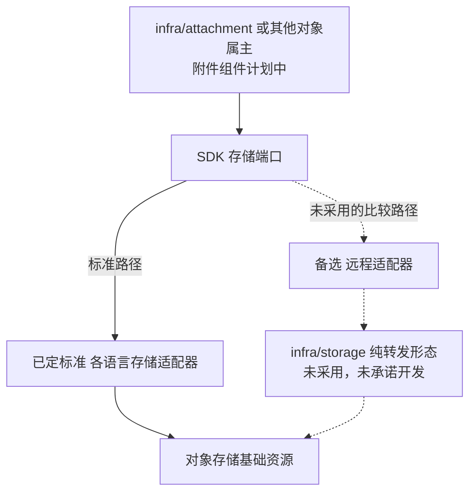

# 附件、物理对象与存储访问的选择

> 状态：标准采用 SDK 存储适配器、不为纯转发增加统一存储组件的方向已定；附件职责继续承接，具体存储分配、引用／删除／保全和运行验证未完成。

## 选择对象与组件仓库

| 对象 | 具体组件／仓库或资源 | 替换关系 | 状态 |
| --- | --- | --- | --- |
| 附件元数据与授权协作 | `infra/attachment`，规划仓库 `infra-attachment` | 同契约附件成员／客户 Fork 接替附件职责，保持父记录授权和引用状态 | 未实现，没有另一个已经交付的附件成员 |
| 纯物理转发 | `infra/storage`，原规划仓库 `infra-storage` | 标准职责由 SDK 存储适配器承接；统一门面仅保留比较路径 | 纯转发退出标准开发货架；身份／注册预留仍保留 |
| 存储访问适配 | be-sdk-go／be-sdk-python／be-sdk-ts 的共同存储端口 | 更换明确适配器可连接合格存储；三语言语义须一致 | 目标实现与验收待补，不新增一个代理服务作为必选 |
| 字节存储 | RustFS 或经验证的其他 S3 服务 | 在内容、凭据、所用能力和恢复核对后接替物理后端 | 资源替换，不替代附件业务组件 |
| 扫描／预览等处理 | 附件协议下的处理实现；具体产品与独立组件边界未定 | 在内容身份、结果语义及故障验收成立后更换处理实现 | 尚未选定产品或仓库，不将每个处理步骤预设为独立组件 |

父记录仍由其业务组件拥有。例如 `erp/sales` 的附件权限来源于销售记录，`infra/attachment` 不因存储或处理更换而取得独立放行权。完整目录见[基础能力](../components/catalog.md#基础与通用能力)。

## 已有职责与替换点

| 责任方 | 拥有的内容 | 替换时要保留 |
| --- | --- | --- |
| 业务组件 | 父记录、业务访问与关联资格 | 附件不能绕过记录的当前数据／字段与操作权限 |
| 附件组件 | 附件元数据、处理状态、授权协作及引用管理 | 向父记录所属组件检查授权，上传、隔离、可用状态和历史可核对 |
| SDK 存储端口／适配器 | 物理对象访问、签名及错误映射等技术能力 | 跨语言契约、对象身份、大小／内容校验、凭据隔离和恢复 |
| 对象存储基础资源 | 字节、对象版本及声明的存储能力 | 所用协议子集、访问策略、持久性、备份及保全能力实际验收 |

物理访问方式不能取代业务授权；存储服务器能保存对象不证明附件可安全下载。生产默认扫描、开发默认关闭的既有方向保留，处理失败不能伪装扫描通过。本轮不裁定新的扫描产品、统一保留年限或每种文件的合规要求。

## 标准物理访问与替代路径

标准由附件或其他对象属主组件通过 SDK 存储端口和适配器访问对象存储，不为纯转发额外规划 `infra/storage`。对象存储服务器仍是基础资源；附件元数据、扫描处理与授权协作保留各自责任。三种语言的适配和凭据隔离必须共同验证，不能因没有中央门面而让组件共享全库存储权限。

图中的实线为已定标准方向，虚线入口为未采用的比较路径，不表示已实现或验证全部适配。获得合格临时访问能力后，客户端字节可直传存储；采用独立门面也不天然要求代理全部字节，附件用户授权仍按上述职责保持。

| 选择 | 优势 | 代价 | 适用条件 |
| --- | --- | --- | --- |
| A：标准物理访问通过 SDK 适配器，不为纯转发另设 `infra/storage` | 少一层调用、依赖和维护对象，保留对象属主的技术隔离；附件业务仍可独立替换 | 多语言适配要共同验收，凭据与资源初始化要按属主管理；跨协议选择可能需要适配代码 | 各组件使用明确存储能力、希望轻量装配；存储产品及兼容子集仍需验证 |
| B：标准物理访问统一经独立存储门面，SDK 提供远程适配 | 集中存储协议与凭据管理，后端变更可集中适配，减少语言重复接入 | 增加网络、故障与部署依赖，门面需防止越权与资源争用，升级／恢复牵涉更多调用方 | 客户希望集中控制对象访问，能承担门面维护和可用性预算；是否更省资源或维护成本须测量 |

标准选择 A，B 保留为取舍比较，未承诺开发。扫描、预览、配额、保全等有明确业务／治理价值的能力仍按责任设计；以后有独立存储治理价值时可以重审组件边界，不能仅凭新增功能名称就复制附件元数据或业务授权。

`infra/storage` 是原始规划与预留，未实现；纯转发形态不再进入标准开发货架，保留条目说明去向，不删除或回收注册端口、schema 与身份。本轮不改变现有 BrickKit 运行锁或删除组件目录，具体适配、资源初始化及任何实施迁移另写计划。

## 待补齐的对象与权限协议

本节列出的问题已形成协议候选，见[协议 12：附件与对象存储](../protocols/12-attachments-and-object-storage.md)。

明确每类对象的逻辑属主、物理桶／前缀和凭据范围，包括附件、渲染结果、导出、事件大载荷和冷数据。业务关联到另一组件，不自动转移物理属主或开放它的桶；附件具体落桶、处理工作者权限和初始化规则仍待设计。

附件 ID、对象 key／版本、内容摘要和父记录关联各有用途。业务引用稳定身份，不能长期保存临时 URL 作为唯一引用。上传完成后的大小／类型／摘要、扫描结果与最终可下载对象必须对应同一内容，不能因重复上传或覆盖而使已通过扫描的状态指向另一个文件。

引用解除、业务记录删除、附件不可用、物理删除和法定保全分别表达；清理应复核有效引用、处理作业和保全要求。数据库元数据与对象存储不能假装共同提交，定义孤儿对象、缺失对象、部分迁移与恢复的对账。复用范围、软删／宽限、版本及备份擦除责任仍待具体裁定，不能直接套用“删除记录就立即删对象”。

下载路径承接授权风险分级：普通短期链接的暴露窗口与严格敏感读取需要分别证明。预签名 URL 是持有即可用的访问能力，应用权限变化并不天然逐个撤销已签出的链接；严格场景若采用受控下载，要验每次访问检查、缓存、重试／续传与故障保护。具体时限和机制待定，不承诺已经实现即时撤销。

## 替换、部署与验收

验收至少覆盖：跨属主读写拒绝、父记录授权和撤权、上传者不自动永久可见、未扫描／失败不可下载、重复上传及内容覆盖、链接暴露／有效期、引用／删除／保全竞争、处理幂等、大小与分片、对象／元数据对账、迁移校验与恢复。物理路径 A／B 若受支持，分别验同一端口的行为、安全和错误，不能只凭能上传一张图片认定兼容。

资源测量包括大文件与并发处理时的连接、内存、带宽、存储请求和积压；门面或附件进入外壳时，验证其他成员不会因文件处理争用失去必要服务预算。直传、受控下载及集中门面的性能分别记录，不从“少一层”推导容量保证。

更换存储后端或引入／移除门面时，清点对象内容／版本、元数据与引用、凭据／策略、链接、处理任务、保全及恢复清单。切换期间只有明确的写入与读取路径，失败恢复不能丢引用或绕授权；完整步骤、命令和支持条件待补，尚未运行新文件实验。

协议风险参考：[Amazon S3 预签名 URL](https://docs.aws.amazon.com/AmazonS3/latest/userguide/using-presigned-url.html)说明链接可在到期前多次使用、同 key 上传可能替换对象，以及有效性与签名凭据相关；据此不能将预签名当作一次性权限或扫描后的不可变保证。这里是设计风险依据，不把 AWS 的具体能力、默认时限或权限策略直接推广为 RustFS 及所有 S3 实现均已支持。
