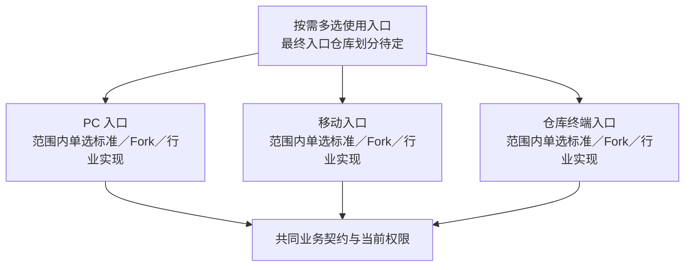

# 前端与客户体验的替换

> 状态：标准前端已有旧版实现；高级及行业前端属于未来货架。

## 选择对象与组件仓库

| 选择对象 | 现有／规划组件与仓库 | 谁可以接替谁 | 选择范围与状态 |
| --- | --- | --- | --- |
| 标准使用入口 | `frontend/standard`，[frontend-standard](https://github.com/brickKit/frontend-standard) | 同一入口的客户 Fork 或满足共同业务契约的另一入口实现 | 有旧版源码，未进当前运行锁；PC／移动／终端拆分仍待实施 |
| 高级／行业体验 | `frontend/advanced`，规划仓库 `frontend-advanced` | 在相同入口、功能与权限满足时接替对应标准入口；不同入口也可并存 | 原货架候选，未实现；不能推导最终仍是两个整套互斥仓库 |
| 客户页面与入口 Fork | 从被定制入口派生的独立仓库，来源与版本按客户登记 | 接替同一入口或构建时选定模块，保留业务契约和权限 | 已定定制路线，没有统一的“客户前端”固定 ID |

具体入口和页面模块的最终仓库划分未定，不提前命名 PC／移动新组件。更换前端不替代 `erp/sales` 等后端事实权威；多个前端对同一后端访问也必须各自受控。完整候选定位见[组件货架](../components/catalog.md#前端)。

图展示两层选择：入口可以多选，每个入口分别选一个实现。不同入口可采用不同版本／Fork；原 frontend/standard 与 frontend/advanced 的最终拆分仍待设计，图不分配新组件身份。前端能力与字段权限由真实业务契约约束。

## 按使用入口选择

已定前端以使用入口为选择与替换单位。PC 办公、移动外勤和仓库终端可以分别选择、组合和定制，例如标准 PC 搭配客户 Fork 的移动端。标准产品可以提供常用组合，小客户只选需要的入口。

该方向尚未完成源码拆分和装配验证。现有 standard 的去处、组件身份、代码共享与仓库划分、静态资源托管和会话方式另行设计；不要求运行时微前端或每个页面独立成组件。

| 路径 | 优势 | 代价与限制 | 场景 |
| --- | --- | --- | --- |
| 标准前端 | 共用页面和交互，减少重复维护 | 行业与复杂交互未必适配 | 通用业务客户 |
| 标准前端 Fork | 可以快速偏离交互与视图 | 项目团队承担契约兼容、权限显示和升级适配／验证，客户决定是否升级 | 企业独有流程与品牌 |
| 独立行业／高级前端 | 可按特定用户重新设计体验 | 页面和测试独立，业务契约与功能缺件要适配 | 行业界面、复杂可视化等未来需求 |
| 多端组合 | PC、移动、专用终端分别适配 | 会话、错误、权限、多语言和离线语义需一致 | 办公、外勤、仓库等不同操作场景 |

## 同一入口的构建与发布

同一入口默认在构建时组合选中的业务页面模块，生成确定版本，共同验证和发布。模块可以明确分界、独立维护和替换；增加或替换页面源码后需要重建该入口，PC、移动和仓库等不同入口仍分别发布。

已选页面的菜单可见性与权限按运行时实际能力判断，有限业务设置仍由所属业务组件维护；调整这些内容不因此要求重新构建。具体模块与包、仓库、共享代码、页面／资源注册和装配生成尚待设计，不要求每个页面独立成为 BrickKit 组件，也不将此方式套到后端组件跨源码调用。

此路径将组合问题尽量放在构建和交付验证阶段，代价是局部页面源码更新也要重建所在入口。需要模块独立发布或嵌入外部系统时，另设计可选集成路线，比较版本兼容、加载失败、共享依赖、样式／路由／会话和回退；未承诺已支持运行时加载。

## 共同边界

核心业务规则在后端权威实现；前端负责交互、草稿、可见性和展示。业务试算接口、字段权限、错误语义、组件启用与实际用户权限分别约定。菜单隐藏不能替代后端拒绝。

不同入口共用后端契约与安全保证，但应分别声明实际需要的能力和兼容版本，避免将“共用契约”误写成所有入口必须启用相同功能。前端产品套装是常用组合，不限制客户单独替换一个入口。

## 断网草稿与可选离线能力

标准默认在线处理正式业务，客户端断网时保护本地草稿，联网后由用户确认提交。离线采集和自动同步另作可选终端能力设计，不是全部客户默认必须启用的机制。此处断网指客户端无法连接系统后端，与客户内网部署不上公网分别说明。

本地保存不等于后端已接收或完成，不能显示成已确认订单、已扣库存或已审批。重新提交按当前有效授权、业务状态和并发版本检查；旧草稿不能沿用过期权限。

草稿保护是已定目标，当前各入口的实现仍需验证。可保存字段、本地保护、用户／法人隔离、保留期限与容量、清理和设备丢失处理待设计；不能把任意敏感资料默认缓存到终端。可选离线能力需另列业务范围、队列、冲突和恢复验收。

## 替换验收

用相同业务契约核对登录、菜单、列表、提交、权限拒绝、字段掩码、批量／导出、缺件行为、多语言和浏览器／设备。性能按真实数据、页面规模和网络测量，前端产品名称不能代替容量说明。

增加单入口替换、不同入口混合版本、后端升级兼容以及登录／退出的组合验收。代码共享不等于可以省略某个入口的真实受保护请求验证。

构建组合验证选中页面与后端能力／兼容版本对应、未选页面不误注册、缺件行为、运行时权限变化、客户页面替换、旧客户端及发布回退；产物生成成功不代表真实页面已通过业务与安全验收。

断网验收覆盖草稿保存与状态提示、恢复连接后的用户确认、权限已撤销、服务端记录已修改、重复提交和多用户共用终端；不以本地页面仍可操作证明正式业务已通过。
