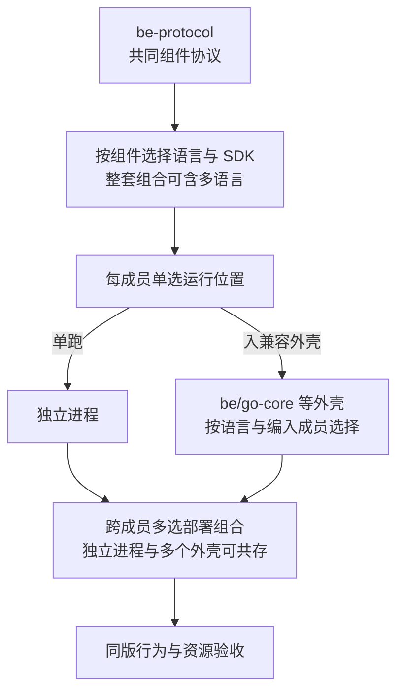

# SDK、外壳与运行方式的选择

> 状态：运行方案比较；三种 SDK 的新版仍开发中，四个外壳尚无真实成员组装。

## 选择对象与组件仓库

| 对象 | 具体仓库 | 选择或替换关系 | 状态与边界 |
| --- | --- | --- | --- |
| Go SDK | [be-sdk-go](https://github.com/brickKit/be-sdk-go) | Go 组件的官方协议实现；同语言其他 SDK 需通过同一协议验收 | 新版开发中；不是无需改源码即可换成 Python SDK |
| Python SDK | [be-sdk-python](https://github.com/brickKit/be-sdk-python) | Python 组件的官方协议实现 | 新版开发中；换语言属于实现迁移，不是部署开关 |
| TypeScript SDK | [be-sdk-ts](https://github.com/brickKit/be-sdk-ts) | TypeScript 组件的官方协议实现 | 新版开发中；当前无已交付 TS 外壳路线 |
| Go 外壳 | `be/go-core`／[be-go-core](https://github.com/brickKit/be-go-core)、`be/go-infra`／[be-go-infra](https://github.com/brickKit/be-go-infra)、`be/go-backoffice`／[be-go-backoffice](https://github.com/brickKit/be-go-backoffice) | 对同一业务成员组合比较单跑与兼容外壳；三个外壳按编入成员承担不同组合，不能无条件互换 | 骨架仓库已有，目标真实成员组装与资源验收待做 |
| Python 外壳 | `be/py-render`，[be-py-render](https://github.com/brickKit/be-py-render) | 对匹配的 Python 成员比较单跑、合并或拆回 | 骨架已有，不替代 Go 外壳或外部 IdP 产品进程 |
| 运行引擎 | Docker／Podman／Kubernetes，基础运行环境 | 部署目标选择；业务组件版本和契约保持可核对 | 支持范围按真机／集群证据，不能把三者互相运行成功视为已证明 |

组件成员列表、语言与编译版本确定外壳是否合格。改变运行拓扑不是替换业务权威；外壳仍保留成员自己的 HTTP／gRPC 与权限执行。完整资源对照见[部署实验](../07-validation.md#代表性部署对照实验)。

同一外壳需要匹配语言、SDK 与精确成员版本；组合能力按实际实现与验收说明。

数据拓扑与进程拓扑分别选择。外壳按数据库目标分池（协议 14）；一个成员迁到另一数据库／实例时，可先单跑，或采用以后经过验证的按目标多池外壳，不能只修改成员地址并继续共用原池。数据库、实例和宿主分离的用途及代价见[在线数据库分离](../04-data-and-lifecycle.md#在线数据库怎样分离)。

| 选择 | 优势 | 代价 | 适用判据 |
| --- | --- | --- | --- |
| 单组件独立进程 | 独立扩容、发布与故障隔离较明确 | 进程、连接、镜像和运维数量增加 | 高频变更、热点、异构语言或需要隔离的组件 |
| 同语言外壳 | 合并部分启动与运行开销 | 共享故障，精确成员编译，停止与资源隔离复杂 | 预算受限、负载可合并，等价与预算已验证 |
| 混合部署 | 对热组件和常规组件分别安排 | 寻址、版本、监控、迁移和组合矩阵增加 | 用实际资源与故障目标确定组合 |
| 新语言／新 SDK | 可适配技术生态与客户维护能力 | 协议实现、运行时、外壳和测试成本 | 必须通过共同协议；进外壳需对应启动器 |

## 可替换的稳定面

外部协议、错误、身份、事件、数据和运维语义由协议版本约束。内部 API 可以因语言而异；客户替换实现时，明确新语言或 SDK 的源码改动范围，而不是承诺内部代码零改动。

外壳仍只承担部署合并职责。任何改变跨组件通信和共享数据的提议，都要重新评估独立运行、权限、事务与迁移后果，不能当作普通性能优化。

## 成本和证据

组件独立开发和验证，再通过外壳装配是已定路线；外壳优先是候选取向，正式组合按实测确定。合并会绑定部分物理发布、扩容与故障边界，保留单跑／混合与拆回路径，不因逻辑组件仍独立就承诺物理隔离不受影响。

同一业务负载、组件版本和基础资源分别测各形态，比较空闲／峰值内存、CPU、连接、请求延迟、后台完成、异常退出和维护步骤。汇总给客户时同时列收益和共享故障代价。

小型客户可以只选需要的组件；Podman 是重点候选，须与引擎、拓扑和选配分别验证。基础资源与运维成本计入整套交付，不只计业务进程；对照矩阵与证据边界见[代表性部署对照实验](../07-validation.md#代表性部署对照实验)。

切换要重建精确成员镜像，使用 BrickKit 更新部署，验证地址、配置、真实端口和拆回。仅生成 `servedBy` 或健康不证明可互换。

标准正式升级允许预告维护窗口，受影响业务在迁移和验证期间暂停；客户数据保留，失败恢复与在途接续必须证明。需要升级期间连续服务时，另选经过专项验收的方案，不能从有多副本推导已经支持。要求见[正式客户升级与维护窗口](../03-deployment-and-resources.md#正式客户升级与维护窗口)。
