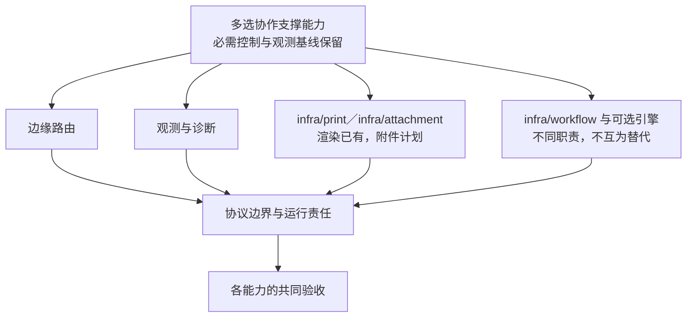
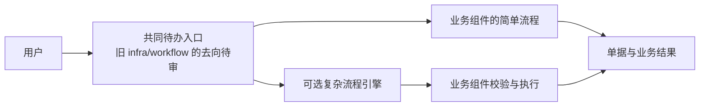

# 边缘、观测、打印与文件支撑能力

> 状态：替换层次和能力比较；具体产品与版本在专题深化时核验。

## 选择对象与组件仓库

| 能力 | 明确的组件／仓库或资源 | 替换与协作关系 | 当前状态 |
| --- | --- | --- | --- |
| 边缘入口 | Traefik 基础资源；Kubernetes 对应路由控制器按目标选择 | 同一声明入口可适配另一合格控制器；不替代业务授权 | 当前边缘资源已有，目标版本／引擎适配需验 |
| 移动展示聚合 | `infra/bff-mobile`，[infra-bff-mobile](https://github.com/brickKit/infra-bff-mobile) | 相同移动展示契约的实现／Fork 接替，不接替原业务权威 | 2.x 已有；目标用户身份／字段、扇出预算与缺件行为需验 |
| 日志／指标／追踪 | Collector、Loki、Prometheus、Tempo、Grafana 等运行资源与配置 | 同类采集／存储／展示后端按协议替换；基本／完整方案是部署组合 | 完整样板已有，基本方案与资源成本待验；不是五个相互替换的组件 |
| 打印渲染 | `infra/print`，[infra-print](https://github.com/brickKit/infra-print) | 相同渲染契约的实现或客户 Fork 可接替；内部渲染引擎也可按明确接口调整 | 2.x 已有，没有已交付的第二个通用渲染成员 |
| 统一待办 | `infra/workflow`，[infra-workflow](https://github.com/brickKit/infra-workflow) | 新待办实现／Fork 接替待办聚合；可选流程引擎与其协作 | 轻量待办已有；新职责下身份、重构与迁移待定 |
| 复杂流程 | 可选流程引擎及项目适配，产品、组件 ID 与仓库未定 | 同流程契约的引擎适配可接替流程推进；不能替代待办入口或业务放行 | 方向已定，尚无候选仓库交付承诺 |
| 业务审计 | `infra/audit`，规划仓库 `infra-audit` | 满足可靠采集、查询、保留与权限的审计实现／Fork 接替 | 未实现；运行日志或观测后端不替代审计责任 |
| 附件业务 | `infra/attachment`，规划仓库 `infra-attachment` | 同附件契约实现／Fork 接替；对象存储为技术依赖 | 未实现；详见[附件选型](files-and-attachments.md) |
| 通知路由 | `infra/notification`，[infra-notification](https://github.com/brickKit/infra-notification) | 同意图／偏好／路由职责的实现或 Fork 接替；IM 成员分别选配 | 2.x 已有，通道成员不代替通知协调 |
| 死信处理 | `infra/dlq-monitor`，规划仓库 `infra-dlq-monitor` | 同声明运输与恢复能力下更换观察／处理实现 | 未实现；不替代原业务幂等、对账与授权 |

需要更换具体支撑能力时先确认相同职责。审批引擎、待办、通知、审计和打印不是一组互斥成员；独立仓库与基础资源也分别维护。完整仓库来源在[组件货架](../components/catalog.md)。

图是能力地图；各项采用基础资源、项目配置、SDK 或组件的形态由其职责决定。

| 能力 | 可选择的层次 | 优势与代价 | 场景／规模判据 |
| --- | --- | --- | --- |
| 边缘路由 | 本地反向代理、目标集群路由控制器 | 管理入口与 TLS；配置和安全责任增加 | 客户网络与引擎，路由／证书运维能力 |
| 可观测性 | 本地输出、采集器、不同 OTLP 后端 | 统一诊断与历史分析；采集和保存占资源 | 故障诊断需求、保留期、数据量与隐私 |
| 业务审计 | 动作采集、可靠转运、集中查询／保留与恢复 | 追溯操作与结果；动作范围、保存和查询有独立安全与资源成本 | 已定按风险覆盖，普通低风险读取不全部进长期业务审计 |
| 打印渲染 | 不同渲染实现、PDF／标签输出能力 | 适配单据模板与设备；字体和沙箱、资源与输出稳定性有成本 | 模板、打印机、并发和延迟 |
| 文件／附件 | 业务附件服务与存储适配器 | 统一权限和元数据；多余转发会增加故障点 | 文件大小、预览、权限与保留需求 |
| 审批 | 待办聚合、固定流程、可配置引擎 | 不同业务复杂度的选择；状态迁移和职责分工更复杂 | 是否客户画流程、长期流程、会签与在途升级 |

## 语义与责任

边缘路由不自动拥有业务授权；观测后端替换要保留成员身份、脱敏和追踪关系；渲染引擎替换要规定布局、模板、字体和错误；文件服务要保留访问控制与内容完整性；不同审批能力必须先比较职责，不能强行归成同一族。

纯基础资源、项目带外配置、自有组件与 SDK 适配器分别说明，不能用“都是组件”隐藏责任。

## 附件与存储职责的承接

附件组件管理元数据与处理状态、向父记录所属业务组件检查授权，SDK 端口提供物理对象操作的既有方向继续承接。标准已定采用 SDK 存储适配器，不为纯转发额外增加统一存储组件。完整职责、物理访问路径比较、引用／删除／保全与替换验收集中在[附件与存储选型](files-and-attachments.md)；本轮未新建组件或运行文件实验。

## 待办与流程的选择

具体协议见[协议 09：审批与流程](../protocols/09-approval-and-workflow.md)。

已定统一待办箱与流程能力分开设计。简单流程可由业务组件管理，复杂编排按需接入引擎，任务汇总到共同入口。现有 infra/workflow 是轻量待办箱，不证明已经具备复杂引擎适配；它的具体保留、重构与命名仍待设计。

图表示逻辑动作路径，任务查询与结果同步协议另定；不表示可选引擎已实现，也不把单据执行结果归给待办入口。

| 责任 | 必须保持的边界 |
| --- | --- |
| 共同待办入口 | 汇总任务与处理入口；动作到达权威处理方，结果不确定时如实显示 |
| 流程管理方 | 简单业务流程或可选引擎管理流程推进；任务和流程状态明确权威来源 |
| 业务组件 | 拥有单据、业务修订与放行约束，不因流程显示完成就跳过校验 |

不能让待办箱和流程方各自决定同一任务的最终结果。任务身份、来源、动作路由、权限、失效、同步、历史和恢复协议要在替换前定义；统一入口不能掩盖任务仍在处理中或旧审批已失效。此逻辑分工不强制每种能力独立部署为一个进程。

标准版支持有人工审批和明确的无需人工审批流程，后者继续执行业务校验和审计；必需控制不能被配置静默跳过。审批中关键修改通过新修订触发重审；审批通过但未执行的普通单据默认保留原单号、修订重审并暂停受影响执行，严格业务保留变更单路径。旧记录保留，已执行事实另走业务更正。共同保证见[审批依据与修订](../02-security-and-permissions.md#审批依据与修订)，具体边界、实例衔接与迁移协议另行设计。

在途实例绑定原流程及相关配置版本，新规则默认用于新实例；替换或升级流程实现时要保留旧执行语义，或明确迁移／重新发起。权限与执行时必需控制继续适用。共同边界见[流程版本与在途实例](../02-security-and-permissions.md#流程版本与在途实例)，不把静态版本号当作兼容验收证据。

审批人员变化的处理已定：未处理任务按已绑定的组织职责规则和当前资格寻找合格接任者，转交保留旧任务与历史并通知；无合法替代路径时暂停转人工，严格流程可要求人工确认。替换流程实现需保持这一语义及当前权限／职责分离检查，不自动授予接任者权限，具体协议见[审批任务与人员变化](../02-security-and-permissions.md#审批任务与人员变化)。

普通人工审批超时默认提醒与升级处理责任，继续待处理；业务申请到期另声明策略，不将超时写成人工同意／拒绝，不延长单据或预占期限。不同流程能力的状态、提醒与恢复验收需保持这一边界，见[审批处理截止与业务到期](../02-security-and-permissions.md#审批处理截止与业务到期)。

## 业务审计与运行观测

业务审计与排障日志分别设计。长期业务审计已定按风险和明确动作清单覆盖，敏感读取／导出及必要变更、代操作和安全拒绝可靠记录，普通低风险读取保留访问日志；客户扩展范围另定。

业务变更的原子审计与可靠转运承接现行方向；读取、失败和拒绝的采集机制需另外定义。替换采集器或观测后端不证明业务审计可恢复、可查询或权限正确。共同保证见[审计动作与读取范围](../02-security-and-permissions.md#审计动作与读取范围)，具体组件分工、保留和故障保护仍待设计。

第一落点、读取与拒绝的记录点、转运回执、本地副本的删除资格（回执加备份水位）、积压与容量保护、审计组件的装配要求，见[协议 03：审计的可靠保存](../protocols/03-audit-durability.md)。

### 观测部署方案

已定提供基本与完整等明确观测方案，客户按诊断需求和资源选择；完整观测栈继续作为验证样板。各档保持协议要求的成员身份、请求／链路关联、脱敏与错误语义，业务审计的必需动作、可靠保存和查询控制继续适用，也不因允许联网就默认回传客户遥测。

| 方案 | 保留的能力 | 优势与代价 |
| --- | --- | --- |
| 基本 | 持久且可定位的结构化日志、关键指标、必要告警、链路关联与扩展接口；集中检索／完整追踪存储按需增加 | 可以减少部分服务与维护对象；历史检索和完整追踪分析能力较少，仍需明确故障定位与告警责任 |
| 完整 | 在共同输出之上配置集中日志检索、指标／告警、追踪和看板后端 | 提供更完整的历史分析与关联诊断；采集、保存、查询和维护增加资源成本 |

现行 Tempo／Loki／Prometheus／Grafana 组合承接为完整样板，不将其配置现状写成所有客户的必装条件。本轮未删除资源或改变采集。具体产品、最低指标／告警清单、保存期限、容量保护与各档切换步骤待设计；资源成本与故障诊断能力按真实部署分别验证，不能凭少安装几个服务宣称已满足小客户预算。

## 共同验收

真实引擎路由与证书、停机与故障、观测输出／告警、敏感信息不泄露、打印结果与资源限制、文件的用户权限与失效链接、审批的重复动作和在途恢复。未承诺的能力标为待定，支持范围由实际证据界定。
